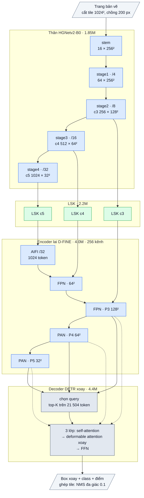

# Thẻ kiến trúc OpenOBB: bản chốt raster (2026-10-08)

Chỉ nói về kiến trúc model: chỉ số, các lớp, phần dùng lại và nguồn, rủi ro bản quyền.

- Mục tiêu: OBB trên **ảnh** bản vẽ CAD (object nhỏ, ống mảnh, khối), không dùng vector khi suy luận.
- Bản chốt: **OpenOBB + LSK** (run `c6-fpc-raster-lsk-s`). Đây là mặc định của `openobb train`.
- Lịch sử thí nghiệm: [research/LEDGER.md](../research/LEDGER.md).

## 1. Sơ đồ

Sơ đồ khối và bảng từng lớp: mục 6 (phụ lục, cuối file).

## 2. Chỉ số (val, 24 epoch, tile 1024, cùng điều kiện; mốc duy nhất: YOLO26x)

| Benchmark | Model | Tham số | mAP50 | mAP50:95 | Latency (bs1, fp16, RTX PRO 6000) |
|---|---|---|---|---|---|
| FloorPlanCAD (ảnh CAD, 30 class) | YOLO26x (mốc) | 57.6M, 202 GFLOPs | **80.16** | **74.96** | 11.6 ms |
| FloorPlanCAD | **OpenOBB1-S + LSK (bản chốt)** | **12.5M** | **78.16** | **68.81** | 11.4 ms |
| FloorPlanCAD | OpenOBB1-S, không LSK (c4) | 10.3M | 76.83 | 66.57 | 10.0 ms |
| DOTA-v1.0 (tham khảo lõi OBB) | YOLO26x | 57.6M | 78.42 | 53.10 | 12.8 ms |
| DOTA-v1.0 | OpenOBB1-X (không LSK) | 63.4M | 76.29 | 52.84 | 20.0 ms |

- Số OpenOBB đo với 900 query khi suy luận. Latency YOLO đo end-to-end, latency OpenOBB đo forward model; hai số gần tương đương.
- **Bản S nhỏ hơn YOLO26x 4.6 lần, cùng tốc độ.**
  - Recall bằng YOLO26x: 92.0 so với 91.9.
  - Thắng ở object lớn cần hình dạng toàn cục: wardrobe +7.2, sofa +6.6 AP50.
  - Thua chủ yếu ở độ khít box của object mảnh, dài: window −12.9, sliding-door −16.0 AP50:95 (phân tích F18 trong sổ cái).
- **LSK so với không LSK:** +1.33 / +2.24, mAP50:95 tăng ở 26/27 class. Tăng mạnh nhất ở class mảnh/nhỏ: bay-window +7.6, airconditioner +5.1, blind-window +4.8, sliding-door +3.3.
- **Chưa đo:** cỡ M/X trên FloorPlanCAD. Trên DOTA, bản X đã gần ngang độ khít box của YOLO26x.

## 3. Các lớp

Sơ đồ khối và bảng từng lớp: mục 6 (phụ lục, cuối file).

## 4. Phần dùng lại: bao nhiêu và lấy từ đâu

| Thước đo | Dùng lại gần nguyên | Viết lại trên khung có sẵn | Tự viết |
|---|---|---|---|
| Tham số, bản S | 47% (backbone 15% + encoder 32%) | 35% (decoder OBB) | 18% (LSK) |
| Tham số, bản X | 76% (backbone 47% + encoder 29%) | 12% (decoder OBB) | 12% (LSK) |

| Thành phần | Nguồn | License | Cách dùng |
|---|---|---|---|
| HGNetv2 backbone | D-FINE (port từ PaddleDetection, Baidu) | Apache-2.0 | chép, đã sửa; giữ notice |
| Hybrid encoder (AIFI + CCFM) | DEIM / D-FINE / RT-DETR | Apache-2.0 | chép, thêm hook |
| Deformable attention core, tiện ích, FrozenBN | DEIM / D-FINE / RT-DETR / DETR | Apache-2.0 | chép |
| Cấu trúc decoder, hàm FDR, LQE, denoising, matcher, khung loss MAL/FGL/DDF | D-FINE, DEIM | Apache-2.0 | viết lại cho box xoay |
| Phần box xoay (phân phối cạnh + góc, sampling xoay, cost Chamfer/KLD/IoU, IoU xoay, denoising có hướng, AQD, nhóm một-nhiều, loss góc), adapter LSK | tự viết; ý tưởng từ paper: RiO-DETR, O2-DETR, RHINO, H-DETR, YOLO26, LSKNet | — | chỉ lấy ý tưởng, không chép code |

- License gốc của phần chép nằm trong `LICENSES/`.
- Weights khởi tạo: D-FINE COCO (Apache-2.0).

## 5. Rủi ro bản quyền của kiến trúc (đánh giá kỹ thuật, không phải tư vấn pháp lý)

| Phần | Rủi ro | Lý do |
|---|---|---|
| Backbone, encoder, lõi attention chép từ D-FINE/DEIM | **Thấp** | Apache-2.0 cho phép bán, sửa, đóng mã; chỉ cần giữ LICENSE + NOTICE và ghi file đã sửa (đã làm). |
| Decoder OBB viết lại trên khung D-FINE | **Thấp** | Khung gốc Apache-2.0; phần box xoay là code riêng. |
| Phần tự viết theo ý tưởng paper (kể cả paper có code NC/AGPL như RHINO, YOLO26, LSKNet) | **Thấp** | Bản quyền bảo vệ code, không bảo vệ ý tưởng; không chép code. Rủi ro còn lại là bằng sáng chế (hiếm với các kỹ thuật học thuật này). |
| Weights benchmark train trên FloorPlanCAD / DOTA (CC BY-NC / học thuật) | **Trung bình nếu bán chính weights này** | Chỉ dùng để đo. Bản thương mại: fine-tune hoặc train lại trên dataset tự gắn nhãn, khởi tạo từ D-FINE COCO (Apache). |

## 6. Phụ lục: kiến trúc theo lớp (bản chốt S + LSK)

Kích thước ghi cho một tile 1 × 3 × 1024 × 1024, 7 class. Ký hiệu: `conv k×k sS a→b` = Conv + BN + kích hoạt, `dw` = depthwise,
`/N` = stride N so với ảnh. Cỡ khác: bảng cuối mục.

### Luồng dữ liệu

Xanh dương: mượn (pretrained, Apache-2.0). Xanh lá: tự viết. Xám đậm: khung D-FINE, phần OBB viết lại.

### Thân: HGNetv2-B0 (mượn, Apache-2.0, trọng số D-FINE), 1.85M

| Khối | Lớp | Ra | Tham số |
|---|---|---|---|
| stem | conv 3×3 s2 3→16; nhánh [conv 2×2 16→8 → conv 2×2 8→16] ∥ max-pool 2; nối 32 → conv 3×3 s2 → 16 → conv 1×1 → 16 | 16 × 256² (/4) | 0.006M |
| stage1 | 1 khối HG: 3 × conv 3×3 16, nối → 1×1 → 64 | 64 × 256² | 0.01M |
| stage2 | dw 3×3 s2; 1 khối HG: 3 × conv 3×3 32, nối → 1×1 → 256 | **c3** 256 × 128² (/8) | 0.09M |
| stage3 | dw 3×3 s2; 2 khối HG nhẹ: 3 × (1×1 → dw 5×5) 64, nối → 1×1 → 512 | **c4** 512 × 64² (/16) | 0.64M |
| stage4 | dw 3×3 s2; 1 khối HG nhẹ: 3 × (1×1 → dw 5×5) 128, nối → 1×1 → 1024 | **c5** 1024 × 32² (/32) | 1.10M |

Kích hoạt ReLU, có LAB (affine học được sau kích hoạt) như bản B0 gốc.

### Adapter LSK (tự viết, ý tưởng LSKNet), 2.21M

Trên c3 / c4 / c5 (256 / 512 / 1024 kênh; 0.12M / 0.43M / 1.65M): a = dw 5×5(x); b = dw 7×7 giãn 3(a) (trường nhìn khoảng 23 ô); a, b → conv 1×1
về c/2; cổng = conv 7×7 trên [trung bình, max theo kênh] của [a, b] → 2 kênh sigmoid; m = conv 1×1 c/2→c (khởi tạo 0) của (a·g₁ + b·g₂);
ra **x + x·m**. Khởi tạo = đồng nhất.

### Encoder lai D-FINE (mượn, Apache-2.0, trọng số COCO), 4.02M, 256 kênh

| Khối | Lớp | Ra | Tham số |
|---|---|---|---|
| input_proj | ba conv 1×1 + BN: 256 / 512 / 1024 → 256 | | 0.46M |
| AIFI | 1 lớp transformer trên 1024 token của /32: attention 8 đầu, FFN 256→1024→256 (GELU), vị trí sin-cos 2-D | 256 × 32² | 0.79M |
| FPN (2 bước) | lateral 1×1; upsample ×2; nối 512 → RepNCSPELAN4 (độ sâu 1) → 256 | 256 × 64², **P3** 256 × 128² | 1.38M |
| PAN (2 bước) | SCDown [1×1 → dw 3×3 s2]; nối 512 → RepNCSPELAN4 → 256 | **P4** 256 × 64², **P5** 256 × 32² | 1.39M |

### Decoder DETR xoay (khung D-FINE, phần OBB viết lại), 4.38M

| Khối | Lớp | Ra | Tham số |
|---|---|---|---|
| chọn query | Linear + LayerNorm trên 21 504 token của encoder → head class + head box (4 delta + cos / sin 2θ) → top-K (300 khi train, 900 khi suy luận); vị trí query không chứa góc; MLP vị trí 6→512→256 | K × 256 | 0.34M |
| 3 lớp decoder | self-attention giữa query (8 đầu, d 256) → **deformable cross-attention xoay theo góc box** (8 đầu, 3 tầng, 3 / 6 / 3 điểm) → FFN 256→1024→256 | K × 256 | 3.38M |
| head mỗi lớp | class: Linear 256→7; box: MLP 256→256→256→165 = phân phối 5 × 33 bin (4 cạnh trong khung xoay + góc dư ±π/4); LQE | K × (7 + 165) | 0.66M |

Chỉ khi train: 900 query một-nhiều (mỗi object 6 query), denoising có hướng (AQD), ghép Hungarian (focal × IoU^0.5 + Chamfer góc + KLD).

### Tổng hợp

| Phần | S | Tỉ lệ (S) | M | L | X | Nguồn |
|---|---|---|---|---|---|---|
| Thân HGNetv2 | B0, 1.85M | 14.8% | B2, 6.03M | B4, 13.51M | B5, 33.23M | mượn (Apache-2.0) |
| LSK | 2.21M | 17.7% | 4.86M | 8.54M | 8.54M | tự viết |
| Encoder lai | 4.02M (256) | 32.3% | 7.80M (256) | 9.34M (256) | 20.70M (384) | mượn (Apache-2.0) |
| Decoder | 4.38M (3 lớp) | 35.2% | 5.72M (4) | 8.34M (6) | 8.59M (6) | khung D-FINE, phần OBB viết lại |
| **Tổng** | **12.46M** | | **24.4M** | **39.7M** | **71.1M** | |

Suy luận: mỗi tile → 900 query → điểm sigmoid theo class + box (cx, cy, w, h, θ), không NMS trong tile → ghép tile về trang bằng NMS đa giác
IoU 0.1 theo class.
