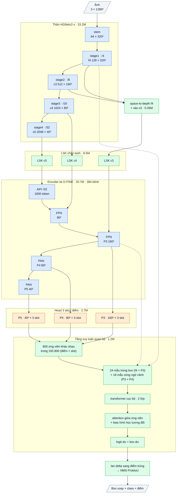

# OpenOBB10: v8 + head nhiều slot, gán nhãn theo tầm với, cân bằng class hiếm (2026-10-12)

`model=openobb10s | m | l | x`. CLI và API giữ nguyên, chỉ đổi `model=`.

OpenOBB10 = **OpenOBB8** (lõi pretrained OpenOBB7 + tầng suy luận quan hệ) cộng ba thay đổi ở head dense và bộ gán nhãn.
Ba thay đổi này nhắm đúng ba lỗi đã đo trên nhãn:
- class nhỏ (wall_300) bị tranh điểm với junction;
- class box lớn (note) bị học box cắt cụt;
- class hiếm (slide_door, double_door) không được cân bằng.

Phần pretrained (HGNetv2, encoder lai) **không đổi**, để giữ độ chính xác của các class đang tốt (wall, door, junction).
Chạy ảnh chữ nhật khi suy luận (giống `rect` của YOLO) áp dụng cho mọi model, không riêng v10.

## 1. Bài học từ v3 → v8

- Khoảng cách với YOLO26x **dồn vào class tí hon / hiếm** (F44):
  - wall_300: 0.58–0.60 so với 0.824;
  - slide_door: 0.21–0.27 so với 0.345.
  - Các class khác ngang hoặc hơn YOLO. Độ khít box chung đã ngang (mAP50-95 / mAP50 = 0.66 so với 0.67).
- Lỗi chính của wall_300 là **bị đoán thành junction** (28–40% ở v3 / v6 / v8, F35, F39, F43, F44). slide_door bị đoán thành wall (45–71%).
- Hai lần thử trước đều **không sửa được** ô wall_300 → junction, vì cùng chung giả thuyết "thiếu ngữ cảnh / thiếu chi tiết":
  - v7 thêm ngữ cảnh vào tháp class;
  - v8 thêm tầng quan hệ đọc chi tiết stride 4 và vòng ngữ cảnh.
- Pretrain quyết định trên data nhỏ (F40); lõi tự thiết kế train từ đầu thua xa (v6, v9).
  → Không động vào lõi pretrained. Thay đổi phải nằm ở head / gán nhãn, và bắt đầu bằng phép đồng nhất.

## 2. Số đo mới trên nhãn (Wall_Color train, 250 ảnh, quy về 1280 px; script trong `research/analysis/`)

**Tranh điểm.** Mỗi điểm lưới của head dense (v3 → v8) chỉ dự đoán **một** box, và bộ gán nhãn giao mỗi điểm cho **một** object.
Đếm theo đúng luật ứng viên của v3 (min_side 8, dải ngang 1 stride):

| Class | Điểm stride 8 / object | Tỉ lệ điểm bị class khác tranh | Object không có điểm riêng (1 slot) |
|---|---|---|---|
| wall_300 (9.9 × 6 px) | 1.5 | **75%** (chủ yếu với junction) | **72%** |
| junction (9.5 px) | 1.7 | 66% (với wall) | 60% |
| wall | 9.8 | 20% | 15% |
| slide_door / double_door / door | 9–15 | 13–26% | 0–7% |

- Tâm wall_300 cách tâm junction gần nhất **3.9 px** (trung vị), và hai box **chồng lên nhau thật**.
- 72% wall_300 phải thắng một điểm đang tranh với junction thì mới được học. Thua thì điểm đó học nhãn junction tại đúng chỗ của wall_300.
  Đây chính là lỗi wall_300 → junction.
- **Lưới mịn hơn không giải quyết được:** ở stride 4 vẫn còn 60% wall_300 không có điểm riêng, vì hai box chồng nhau.
  (Điều này cũng giải thích vì sao thêm chi tiết stride 4 ở v7 / v8 không sửa được lỗi.)
- **Cho mỗi điểm dự đoán S object** thì một object chỉ cần một điểm có không quá S object phủ:

  | S (slot / điểm) | wall_300 không có chỗ | junction | wall |
  |---|---|---|---|
  | 1 (v3 → v8) | 72% | 60% | 15% |
  | 2 | 17% | 15% | 5% |
  | **3** | **1%** | **1%** | **1%** |

**Mục tiêu cắt cụt.** DFL của v3 với tới tối đa 31 bin: dọc trục 31 × stride (P3: 248 px), độ dày 31 × stride/2.
Điểm ứng viên mà object vượt tầm vẫn được học, với mục tiêu bị kẹp (clamp), tức là học vẽ box cụt:

| Class | Điểm P3 có mục tiêu cụt | Object không có điểm P3 nào vẽ đủ | P4 |
|---|---|---|---|
| **note** (dài 200 px, p90 404 px) | **78%** | **39%** | 30% điểm cụt |
| wall | 7% | 0% | 1% |
| slide_door | 2% | 0% | 0% |

Box cụt có điểm cao vẫn sống qua NMS thành **box trùng** (đúng hiện tượng một bức tường ra nhiều box ở v3). Nó cũng kéo mAP50-95 của note xuống.

**Class hiếm không được cân bằng.** RFS ở mức ảnh (t = 0.1) cho hệ số lặp **1.0 cho mọi class**:
slide_door xuất hiện ở 22% ảnh, double_door 26%, wall_300 35%, tất cả đều > 10%.
Trong khi đó mất cân bằng theo object là **54 : 1** (junction 6986, slide_door 130, double_door 184, wall_300 399).

## 3. Lập luận: từng mảnh

| Mảnh | Bài học / số đo | Cơ chế | Kỳ vọng | Điều sẽ chứng minh sai |
|---|---|---|---|---|
| **Head nhiều slot** (S = 3) | 72% wall_300 không có điểm riêng; stride 4 không sửa được (60%); v7 / v8 không giảm ô wall_300 → junction | Mỗi điểm có S cặp (class, box). Các object được chọn cho một điểm (tối đa S, theo IoU) ghép vào slot bằng **hoán vị chi phí nhỏ nhất** (EMD, CrowdDet). Chi phí = −(điểm^α · IoU^β) của dự đoán của chính slot đó | wall_300 hết bị junction "cướp" điểm: recall wall_300 tăng (v3: R 0.33, YOLO 0.87), ô wall_300 → junction giảm rõ; junction tăng nhẹ | Ô wall_300 → junction không giảm, hoặc AP wall_300 không tăng so với v8 cùng ngân sách |
| **Gán nhãn theo tầm với** | 78% điểm P3 của note học box cụt; box cụt sống qua NMS thành box trùng | Một điểm chỉ là ứng viên của object nếu vẽ được trọn object: hai khoảng dọc trục ≤ 31 stride và độ dày ≤ 31 nửa stride. Object không có điểm nào thoả thì giữ luật cũ | mAP50-95 của note tăng; số box trùng (dòng `Duplicate boxes` khi val) giảm, nhất là với vật dài | mAP50-95 của note không tăng và số box trùng không giảm |
| **Cân bằng class hiếm** | RFS ở mức ảnh không tác dụng (hệ số 1.0 cho mọi class); mất cân bằng object 54 : 1 | Mỗi điểm dương của class c nặng w_c = clamp(√(n_max / n_c), 1, 4) trong mọi loss dense. n_c = số điểm dương đếm trượt (momentum 0.99). Class nhiều nhất giữ w = 1; điểm âm không đổi | Recall slide_door / double_door / wall_300 tăng | AP class hiếm không tăng, hoặc precision các class khác giảm |

**Vì sao không làm kém các class đang tốt.**
- Slot 0 chính là head của v8: cùng tên tham số, nên checkpoint v8 / v3 nạp thẳng vào.
- Slot phụ khởi tạo trọng số class = 0, bias ứng với xác suất 1e-4 (dưới ngưỡng NMS 0.001). Lớp box của slot phụ chép từ slot 0.
  → Ở bước 0, đầu vào NMS của v10 **y hệt** v8 (test `test_identity_at_init_equals_openobb8`).
- Với điểm chỉ có một object, ghép slot chọn slot đang dự đoán tốt nhất (slot 0 lúc đầu), nên việc học của wall / door / junction ở điểm không tranh chấp giữ nguyên.
- Cân bằng giữ trọng số 1 cho class nhiều nhất và không đổi điểm âm.
- Gán nhãn theo tầm với chỉ bỏ những cặp (điểm, object) mà điểm đó vốn không thể vẽ đúng.

**Giới hạn của lập luận.**
- Số "object không có điểm riêng" đếm trên nhãn; nó là điều kiện cần, chưa phải bằng chứng mAP tăng.
- Cân bằng class có thể đổi recall lấy precision ở class hiếm.
- Data val của class hiếm rất ít (slide_door 31, double_door 25), nên nhiễu lớn.
- Phải so cùng công thức train với v8.

## 4. Kiến trúc chi tiết (cỡ x, ảnh 1280)

Sơ đồ khối và bảng từng lớp: mục 10 (phụ lục, cuối file).


| Phần | Làm gì | Ý tưởng từ đâu | Code | Tham số (x) | GFLOPs (x, 1280) |
|---|---|---|---|---|---|
| Lõi + tầng quan hệ của v8 | không đổi | OpenOBB8 | có sẵn | 66.58M | khoảng 969 |
| **Slot phụ của head** | 2 slot × 3 tầng × (1×1 class 192 → 7, 1×1 box 128 → 98) | CrowdDet (multiple instance prediction, CVPR 2020) | tự viết (`SlotHead`, `openobb10.py`) | **84k (+0.13%)** | **+1.9 (+0.2%)**; ảnh chữ nhật 928 × 1280: +1.4 |
| **Ghép slot bằng EMD** | mỗi điểm giữ ≤ S object tốt nhất, thử mọi hoán vị (3! = 6), chọn chi phí nhỏ nhất | CrowdDet (EMD loss) | tự viết (`assign_slots`, `openobb10_loss.py`) | 0 | chỉ khi train |
| **Gán nhãn theo tầm với** | lọc cặp (điểm, object) vượt tầm DFL | tự thiết kế từ số đo mục 2 | tự viết | 0 | chỉ khi train |
| **Cân bằng class** | w_c = clamp(√(n_max / n_c), 1, 4) cho điểm dương | RFS / LVIS (căn bậc hai tần suất), áp ở mức object | tự viết | 0 | chỉ khi train |
| Chuẩn hoá mục tiêu theo nhóm slot | điểm mục tiêu TAL chuẩn hoá riêng cho slot 0 và nhóm slot phụ, nên slot mới tự khởi động như head v3 | TOOD (TAL), tự điều chỉnh | tự viết | 0 | 0 |

- NMS vẫn là `fast_nms` theo class, lấy tối đa 4000 ứng viên tốt nhất trước NMS. Số anchor tăng gấp 3 nhưng chi phí NMS không đổi.
  Không dùng set-NMS của CrowdDet: hai slot của cùng một điểm mà ra cùng một object vẫn bị NMS gộp lại.
- Chi phí train: bộ gán nhãn tính ProbIoU cho S slot trên các cặp nằm trong box (ít), thêm vài phần trăm.

## 5. Tỉ lệ tận dụng cái có sẵn

| Loại | Phần | Tỉ lệ |
|---|---|---|
| Weights pretrained | HGNetv2-B5 + encoder lai (D-FINE COCO, Apache-2.0) | 81% tham số (như v8) |
| Code OpenOBB dùng lại | Toàn bộ OpenOBB8 (lõi, head, tầng quan hệ, loss tầng quan hệ), `decode`, `fast_nms`, `frame_targets` | dùng nguyên |
| Code chép từ nơi khác | không có | 0% |
| Ý tưởng từ công bố | CrowdDet (nhiều instance / điểm, EMD), TOOD (TAL), RFS / LVIS (căn bậc hai tần suất), YOLO (letterbox chữ nhật) | tự viết lại |
| Thiết kế mới của OpenOBB10 | head nhiều slot đồng nhất lúc khởi tạo trên lõi pretrained; ghép slot theo chi phí của chính từng slot; chuẩn hoá mục tiêu theo nhóm slot; lọc ứng viên theo tầm với của DFL dị hướng | 84k tham số + bộ gán nhãn |

## 6. Train (trên Colab)

```bash
# khuyến nghị: đi tiếp từ OpenOBB8 đã train (slot 0 + lõi + tầng quan hệ nạp đủ, slot phụ bắt đầu từ slot 0)
openobb train model=openobb10x weights=<best.pt của OpenOBB8> data=/content/data.yaml imgsz=1280 epochs=50

# hoặc từ COCO như v8
openobb train model=openobb10x data=/content/data.yaml imgsz=1280 epochs=100
```

- Công thức mặc định giống v8: lr 5e-4, backbone ×0.1, `rel_k=600`.
- So sánh sạch nhất (tuỳ ngân sách): chạy thêm một lần `v10_off=slots,reach,balance` từ cùng checkpoint, cùng epoch.
  Lần đó chính là v8 train tiếp.
- Xem theo class (thước YOLO) và confusion matrix: ô **wall_300 → junction**, ô **slide_door → wall**, dòng `Duplicate boxes`.

### Chỉ số kỳ vọng (ghi TRƯỚC khi train, 2026-10-12)

Điều kiện: đi tiếp 50 epoch từ best của v8 (ep36: **0.699 / 0.460**), thước YOLO, val 53 ảnh.
Mốc YOLO26x: 0.746 / 0.499.

| Class (số mẫu val) | v8 best | v10 kỳ vọng mAP50 / mAP50-95 | Lý do | Mảnh chịu trách nhiệm |
|---|---|---|---|---|
| wall (1044) | .875 / .580 | .87–.89 / .58–.60 | 15% tường không có điểm riêng → 1%; 7% điểm P3 hết học box cụt | slots, reach |
| note (60) | .796 / .490 | .79–.82 / **.50–.54** | 78% điểm P3 hết học box cụt → box khít hơn, ít box trùng | reach |
| door (391) | .974 / .816 | .97 / .81–.82 (giữ) | không bị tranh điểm (0%), không cụt | — |
| slide_door (31) | .209 / .090 | .20–.35 / .09–.15 | cân bằng ×4; giới hạn bởi data (130 mẫu train), YOLO cũng chỉ .345 | balance |
| double_door (25) | .545 / .444 | .52–.62 / .42–.50 | cân bằng; val rất ít mẫu nên nhiễu ±0.05 | balance |
| **wall_300 (141)** | **.582 / .231** (R .411) | **.65–.78 / .28–.38** (R .55–.70) | 72% không có điểm riêng → 1%; nhắm ô wall_300 → junction | slots (+ balance) |
| junction (1773) | .916 / .566 | .91–.93 / .56–.58 | 60% không có điểm riêng → 1% | slots |
| **all** | **.699 / .460** | **.70–.77 / .46–.51**, giữa khoảng ≈ **.73 / .48** | trung bình 7 class | |

Cách đọc kết quả:
- Mức nhiễu giữa các lần train khoảng ±0.02 mAP50 (v3 / v8 cùng ngân sách lệch 0.02).
  Train tiếp v8 thêm 50 epoch không đổi gì cũng có thể tăng khoảng +0.005–0.01. Lần đối chứng `v10_off=slots,reach,balance` cho số này chính xác.
- **Slot được xác nhận** nếu wall_300 ≥ .65 mAP50 **và** ô wall_300 → junction giảm rõ (v8 khoảng 28%).
  **Bác bỏ** nếu wall_300 < .62 hoặc ô đó không giảm.
- **Theo tầm với được xác nhận** nếu mAP50-95 của note ≥ .50 và `Duplicate boxes` giảm.
- **Không làm hại class đang tốt:** wall / door / junction không được giảm quá 0.02 mAP50.
  Nếu giảm, tắt từng mảnh (`v10_off=balance` trước, vì nó đổi loss của mọi class hiếm) để tìm thủ phạm.
- Cận trên .77 chỉ đạt khi wall_300 về gần mức YOLO (.824). Cận dưới .70 nghĩa là chỉ ngang v8 → giả thuyết tranh điểm không phải nguyên nhân chính.

## 7. Đo tác dụng từng mảnh (`v10_off=`)

| `v10_off=` | Tắt gì | Câu hỏi |
|---|---|---|
| `slots` | Head một slot (= v8) | Tranh điểm có phải nguyên nhân của wall_300 → junction? |
| `reach` | Luật ứng viên cũ (học box cụt) | Box cụt có gây box trùng / kéo note xuống? |
| `balance` | Không cân bằng class | Class hiếm có cần cân bằng mức object? |

`v8_off=` và `v7_off=` vẫn dùng được như cũ.

## 8. Tốc độ

- Head nhiều slot: +0.2% FLOPs, NMS không đổi (tối đa 4000 ứng viên).
- **Ảnh chữ nhật khi suy luận** (mọi model): ảnh chỉ được đệm lên bội số 32 thay vì thành hình vuông `imgsz × imgsz`.
  - Trang A (1683 × 2381) chạy 928 × 1280 thay vì 1280 × 1280: ít hơn 28% điểm ảnh.
  - Đo trên v3-x thật (CPU, 1 luồng): 7.8 s so với 10.4 s; 214 / 215 box, 98% trùng khớp.
  - Không cần train lại: position embedding của encoder là sincos (tính ra, không học).
- Chưa làm (theo user, rủi ro độ chính xác): cắt nhánh P5 chết, thay các khối depthwise trong phần pretrained.
- Cần đo GPU trước khi train dài: dòng `Speed:` khi val.

## 9. Rủi ro đã biết

- **Chưa có số độ chính xác.** Mới có test CPU:
  - đồng nhất lúc khởi tạo so với v8;
  - một slot + tắt hết = bộ gán nhãn / loss của v3 y hệt;
  - hai object chồng nhau được học trên hai slot của cùng một điểm;
  - luật tầm với;
  - trọng số cân bằng;
  - fuse BN;
  - nạp checkpoint.
- Slot phụ có thể học trùng object của slot 0. NMS theo class gộp lại, nhưng nếu `Duplicate boxes` tăng thì phải xem lại.
- Cân bằng class có thể tăng box sai ở class hiếm (precision giảm). Nếu vậy, giảm trần 4 hoặc tắt `balance`.
- Tầng quan hệ chọn K = 600 ứng viên trên 3 × A anchor. Ảnh rất đông vật có thể cần `rel_k` lớn hơn.

## 10. Phụ lục: kiến trúc theo lớp (cỡ x)

Kích thước ghi cho ảnh vào 1 × 3 × 1280 × 1280, Wall_Color (7 class). Ký hiệu: `conv k×k sS a→b` = Conv + BN + kích hoạt,
`dw` = depthwise, `/N` = stride N so với ảnh.

### Luồng dữ liệu

Xanh dương: mượn (pretrained, Apache-2.0). Xanh lá: tự viết. Cam: mới ở v10 (3 slot mỗi điểm). Gán nhãn theo tầm với và cân bằng mức object chỉ ở loss, không thêm lớp. Mỗi stage của thân đi qua bộ chặn độ lớn (guard, không tham số).



### Thân: HGNetv2-x (mượn, Apache-2.0, trọng số D-FINE COCO), 33.23M

| Khối | Lớp | Ra | Tham số |
|---|---|---|---|
| stem | conv 3×3 s2 3→32; nhánh [conv 2×2 32→16 → conv 2×2 16→32] ∥ max-pool 2; nối 64 → conv 3×3 s2 64→32 → conv 1×1 32→64 | 64 × 320² (/4) | 0.03M |
| stage1 | 1 khối HG: 6 × conv 3×3 64→64, nối 448 kênh → 1×1 →64 → 1×1 →128 | **f4** 128 × 320² | 0.26M |
| stage2 | dw 3×3 s2; 2 khối HG: 6 × conv 3×3 128, nối → 1×1 → 512 | **c3** 512 × 160² (/8) | 3.03M |
| stage3 | dw 3×3 s2; 5 khối HG nhẹ: 6 × (1×1 → dw 5×5) 256, nối → 1×1 512 → 1×1 1024 | **c4** 1024 × 80² (/16) | 11.93M |
| stage4 | dw 3×3 s2; 2 khối HG nhẹ: 6 × (1×1 → dw 5×5) 512, nối → 1×1 → 2048 | **c5** 2048 × 40² (/32) | 17.99M |

BN của thân bị đóng băng (FrozenBatchNorm), kích hoạt ReLU.

### Chặn độ lớn + chi tiết stride 4 (tự viết), 0.26M

| Khối | Lớp | Ra | Tham số |
|---|---|---|---|
| guard | sau mỗi stage của thân: x · min(1, 4 / rms(x)) theo từng ảnh (tính fp32); đồng nhất khi rms ≤ 4 | như đầu vào | 0 |
| spd | f4 space-to-depth (128 × 320² → 512 × 160²) → conv 1×1 512→512 + BN (gamma khởi tạo 0) → **cộng** vào c3 trước LSK | 512 × 160² | 0.26M |

### Adapter LSK (tự viết, ý tưởng LSKNet), 8.54M

Trên c3 / c4 / c5, mỗi tầng một khối (c = 512 / 1024 / 2048 kênh; 0.43M / 1.65M / 6.45M):
a = dw 5×5(x); b = dw 7×7 giãn 3(a) (trường nhìn khoảng 23 ô); a, b → conv 1×1 về c/2; cổng = conv 7×7 trên [trung bình, max theo kênh]
của [a, b] → 2 kênh sigmoid; m = conv 1×1 c/2→c (khởi tạo 0) của (a·g₁ + b·g₂); ra **x + x·tanh(m)** (hệ số khuếch đại luôn trong (0, 2)). Khởi tạo = đồng nhất.

### Encoder lai D-FINE (mượn, Apache-2.0, trọng số COCO), 20.70M, 384 kênh

| Khối | Lớp | Ra | Tham số |
|---|---|---|---|
| input_proj | ba conv 1×1 + BN: c3 512→384, c4 1024→384, c5 2048→384 | | 1.38M |
| AIFI | 1 lớp transformer trên 1600 token của /32: attention 8 đầu, FFN 384→2048→384 (GELU), vị trí sin-cos 2-D | 384 × 40² | 2.17M |
| FPN (2 bước) | lateral 1×1 384→384; upsample ×2; nối 768 → RepNCSPELAN4 → 384 | 384 × 80², **P3** 384 × 160² | 8.57M |
| PAN (2 bước) | SCDown [1×1 384→384 → dw 3×3 s2]; nối 768 → RepNCSPELAN4 → 384 | **P4** 384 × 80², **P5** 384 × 40² | 8.58M |

RepNCSPELAN4(768→384): conv 1×1 768→768, tách 2 nửa 384; nửa sau qua [CSP 384→192 (3 khối RepVGG 3×3 ∥ 1×1) → conv 3×3 192] rồi
[CSP 192→192 (3 khối) → conv 3×3 192]; nối 384 + 384 + 192 + 192 → conv 1×1 → 384. Kích hoạt SiLU.

### Head 3 slot mỗi điểm (tự viết), 2.72M

Head có ngữ cảnh của v7 là slot 0; thêm 2 slot, mỗi slot một lớp 1×1 class (192→7, bias tiên nghiệm 1e-4: tắt cho tới khi học) và một
lớp 1×1 box (128→98, chép từ slot 0) trên đầu ra cuối của hai tháp. Mỗi điểm lưới đưa ra tối đa 3 box (cho các object chung một ô).

| Nhánh | Lớp (một tầng) | Ra mỗi điểm | Tham số (3 tầng) |
|---|---|---|---|
| class | dw 3×3 384 → 1×1 384→192 → StripMix(192, k = 11) → dw 3×3 192 → 1×1 192→192 → 1×1 →7 (bias tiên nghiệm 0.01) | 7 logit | 0.82M |
| box | conv 3×3 384→128 → conv 3×3 128→128 → 1×1 128→98 (chạy fp32) | 98 kênh | 1.81M |

98 kênh box (một nhóm): góc θ, lệch ngang tâm (× stride), phân phối 32 bin khoảng cách tới đầu sau và 32 bin tới đầu trước dọc trục
(bin = 1 stride), 32 bin độ dày (bin = 1/2 stride). Mỗi tầng một tháp riêng; điểm lưới = tâm ô.

| Thêm cho slot 1, 2 | Lớp (một tầng) | Tham số (3 tầng) |
|---|---|---|
| class | 2 × conv 1×1 192→7 | 0.008M |
| box | 2 × conv 1×1 128→98 (fp32) | 0.076M |

### Tầng suy luận quan hệ (tự viết), 1.22M

K = 600 ứng viên mỗi ảnh, d = 192.

| Khối | Lớp | Ra | Tham số |
|---|---|---|---|
| chọn ứng viên | 600 điểm tốt nhất, bỏ trùng (ProbIoU > 0.7) khi chọn; khi train thêm bản rung của box nhãn | 600 box | 0 |
| mẫu bên trong | lưới 8 dọc × 3 ngang trong khung xoay (hai hàng ngang ngay ngoài hai cạnh dài), đọc song tuyến f4 (128 kênh) và P3 (384) → Linear 128→192 + Linear 384→192 | 600 × 24 × 192 | 0.10M |
| vòng ngữ cảnh | 18 điểm quanh box, cách khoảng một chiều dài (clamp(L, 32, 192) px), đọc P3 + P4 → hai Linear 384→192 | 600 × 18 × 192 | 0.15M |
| vị trí + hình học | MLP vị trí mẫu (2→192→192); token hình học MLP (log L, log T, sin / cos 2θ, xác suất nền → 192 → 192) | | 0.08M |
| transformer cục bộ | 2 lớp, pre-norm, 6 đầu, FFN 192→384→192, trên 43 token mỗi ứng viên → 1 token | 600 × 192 | 0.59M |
| lớp quan hệ | 1 lớp attention giữa 600 ứng viên + bias hình học tương đối mỗi đầu: MLP (7 số của j trong khung i → 32 → 6), fp32 | 600 × 192 | 0.30M |
| đầu ra | LayerNorm → Linear 192→7 (logit dư) và 192→5 (dịch hai đầu, log độ dày, lệch ngang, góc ±0.2 rad), khởi tạo 0 | 600 × (7 + 5) | 0.003M |

Khi suy luận, delta logit của mỗi ứng viên được lan sang các điểm trùng nó (ProbIoU > 0.7) trong 4000 điểm tốt nhất, rồi mới NMS.

### Tổng hợp

| Phần | Tham số | Tỉ lệ | Nguồn |
|---|---|---|---|
| Thân HGNetv2-x | 33.23M | 49.8% | mượn (Apache-2.0) |
| guard + spd | 0.26M | 0.4% | tự viết |
| LSK | 8.54M | 12.8% | tự viết |
| Encoder lai | 20.70M | 31.0% | mượn (Apache-2.0) |
| Head 3 slot | 2.72M | 4.1% | tự viết |
| Tầng suy luận quan hệ | 1.22M | 1.8% | tự viết |
| **Tổng** | **66.67M** | | 19.1% tự viết |

Suy luận: 33 600 điểm × 3 slot = 100 800 dự đoán → 600 ứng viên được tinh chỉnh → lan delta → Fast-NMS ProbIoU theo class → tối đa 1000 box.
