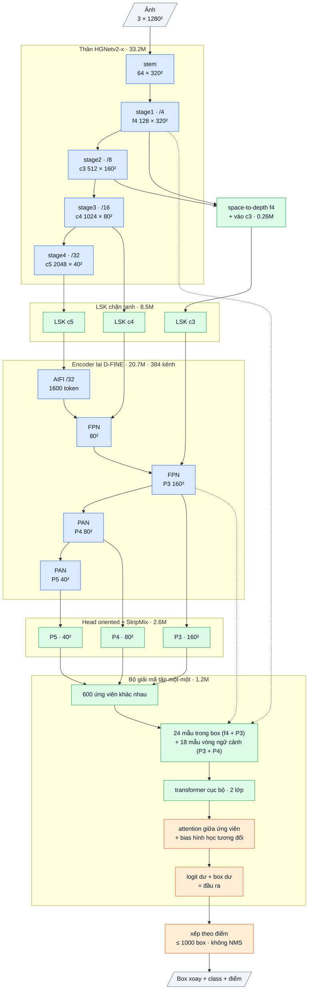

# OpenOBB11: đề xuất dense + bộ giải mã tập một-một (khử trùng tự học, không NMS) (2026-10-13)

`model=openobb11s | m | l | x`. CLI và API giữ nguyên, chỉ đổi `model=`.

OpenOBB11 giữ **lõi pretrained và head dense của OpenOBB8**. Thay đổi nằm ở **vai trò và cách train của tầng suy luận quan hệ**:
- Từ một tầng "chấm lại điểm" (học một-nhiều), nó trở thành **bộ giải mã tập kết quả** (học một-một).
- Mỗi object chỉ còn đúng một ứng viên dương. Mọi bản sao và mảnh vụn là âm.
- Đầu ra cuối cùng chính là đầu ra của tầng này, **không qua NMS**.

## 1. Bài học từ v3 → v10 và số đo

**Box trùng là lỗi chính nhìn thấy được** (ảnh user: một bức tường dài ra nhiều box chồng nhau).
- v10: 16.7% số detection là box trùng (F47).
- Phân tích trên 53 ảnh val với `openobb10x.pt` (`research/analysis/dup_analysis.py`; box thô trước NMS, nhiều cách lọc, thước YOLO):

| Cách lọc | mAP50 | mAP50-95 | Box trùng (conf 0.25) |
|---|---|---|---|
| NMS ProbIoU 0.7 (mặc định) | 0.675 | 0.438 | 1191 / 7355 |
| NMS 0.6 | 0.689 | 0.442 | 354 |
| NMS 0.5 | 0.693 | 0.444 | 115 |
| NMS 0.3 | 0.694 | 0.446 | 66 |
| NMS 0.7 + bỏ box nằm ≥ 80% trong box điểm cao hơn | 0.672 | 0.437 | 1063 |

- Các cặp box cùng class còn chồng nhau sau NMS: **2587 chồng lệch**, **738 box ngắn nằm trong box dài**, 510 gần trùng khít.
  - Với vật mảnh, IoU gần như chỉ còn là tỉ lệ độ dài. Một bản sao 200 px của bức tường 300 px có IoU 0.67, nên qua được NMS 0.7.
  - Lệch ngang 2–3 px với tường dày 6 px cũng làm IoU tụt mạnh.

**Vì sao có nhiều bản sao: ba nguyên nhân ở kiến trúc.**
1. Head dense được train một-nhiều có chủ đích: `10 + chiều dài / 16` điểm dương mỗi object (tối đa 48), điểm nào cũng được dạy vẽ trọn object với điểm cao. Tường dài ra hàng chục bản sao, lệch nhau ở hai đầu.
2. NMS theo IoU mù với vật mảnh (bảng trên). Hạ ngưỡng thì bớt trùng trên data này, nhưng:
   - ngưỡng thấp xoá nhầm object thật đứng sát nhau (xe trên DOTA, tường song song sát nhau);
   - ngưỡng đúng mỗi dataset một khác;
   - ngay ở NMS 0.3 vẫn còn 66 box trùng.
3. Tầng quan hệ của v8 / v10 có đúng công cụ để khử trùng:
   - đọc từng ứng viên trong khung xoay của nó;
   - so các ứng viên qua bias attention theo hình học tương đối, nên biết hai box cùng trục và một cái nằm trong cái kia.

   Nhưng nó được **train một-nhiều**: mọi ứng viên có ProbIoU ≥ 0.5 với object đều là dương (`openobb8_loss.py`).
   Nó được dạy **giữ** bản sao, không bao giờ học bỏ chúng. Đây là lý do v8 không giảm trùng so với v3 (F43, F44).

## 2. Lập luận

Sơ đồ khối và bảng từng lớp: mục 6 (phụ lục, cuối file).

| Mảnh | Bài học / số đo | Cơ chế | Kỳ vọng | Điều sẽ chứng minh sai |
|---|---|---|---|---|
| **Tầng quan hệ train một-một** (mới) | Mục 1: bản sao được dạy là dương; IoU không phân biệt được bản sao với vật mảnh | Mỗi ảnh: ghép Hungarian giữa ứng viên đã tinh chỉnh và object, chi phí −(p^α · ProbIoU^β) (α = 1, β = 6 như bộ gán nhãn dense). Một ứng viên mỗi object là dương, còn lại là âm (đích 0). Tầng quan hệ thấy cả cụm bản sao, nên học được cái nào giữ. Ý tưởng: Relation Networks (Hu 2018, module quan hệ thay NMS); DETR / YOLOv10 / YOLO26 (gán một-một để bỏ NMS) | Box trùng gần 0 mà không cần NMS; chọn box khít nhất (β = 6) nên mAP50-95 của vật dài tăng | Box trùng (conf 0.25) không xuống dưới 5% số detection |
| **Suy luận không NMS** | Bỏ NMS 4000 ứng viên và bước lan delta sang 4000 anchor (4000 × 600 ProbIoU) | K ứng viên đã tinh chỉnh là đầu ra, xếp theo điểm. `final_nms` (ProbIoU) chỉ là tuỳ chọn an toàn, tắt mặc định | Hậu xử lý rẻ hơn v8 / v10 | — |
| **Nhóm khử nhiễu riêng** | Bản rung của box nhãn (v8) luôn tốt hơn ứng viên dense, nếu chung nhóm ghép sẽ "giành" hết vị trí dương | Bản rung là nhóm riêng: mỗi dòng là dương của chính object của nó (DN-DETR). Mask attention đã tách hai nhóm | Class hiếm vẫn có mẫu dương cho tầng quan hệ | — |
| **Head dense giữ một-nhiều + cân bằng class** | v10: cân bằng class là mảnh duy nhất có tín hiệu tốt (slide_door +.12, recall wall_300 +.09); slot làm tăng box trùng; lọc theo tầm với không được xác nhận (F47) | Loss dense = OpenOBB10 với `balance`, không `slots`, không `reach`. Head dense chỉ còn vai trò đề xuất | Hội tụ nhanh như v8 | — |

**Vì sao không làm kém các class đang tốt.**
- Lõi, head dense và tầng quan hệ có cùng tên tham số với v8, nên checkpoint v8 / v10 nạp thẳng được.
- Logit của tầng quan hệ = logit dense + phần sửa (khởi tạo 0). Lúc bắt đầu, điểm của ứng viên đúng bằng điểm dense.
- Loss một-một chỉ thêm nhãn âm cho bản sao; box dương vẫn học như v8.
- Rủi ro: lúc mới chuyển từ checkpoint v8 / v10, chưa có NMS nên vài epoch đầu sẽ còn nhiều trùng, cho tới khi tầng quan hệ học xong.

**Giới hạn.**
- Kiểu một-một học chậm hơn trên data nhỏ (bài học DETR ở v1 / v4).
- Ở đây nó chỉ áp lên tầng quan hệ; head dense vẫn một-nhiều, và tầng quan hệ bắt đầu từ điểm dense, nên rủi ro thấp hơn.
- K = 600 ứng viên: object thứ 601 trở đi (theo điểm) không ra được. Ảnh rất đông vật cần `rel_k` lớn hơn.

### Tham số suy luận do train quyết định (không chỉnh tay)

Hai tham số trước đây cố định trong code nay được **hiệu chỉnh trên val khi train xong**, rồi ghi vào `best.pt`
(`args.nms_iou`, `args.infer_k`). `predict` / `val` dùng chúng làm mặc định; truyền `iou=` khi predict thì ghi đè.

| Tham số | Thử | Chọn | Tác dụng |
|---|---|---|---|
| `nms_iou` (lọc trùng) | v11: không NMS, 0.7, 0.5. Model khác: 0.7, 0.6, 0.5 | fitness cao nhất (0.1·mAP50 + 0.9·mAP50-95, như YOLO); hoà thì ưu tiên không NMS | độ chính xác, không phải đoán ngưỡng theo dataset |
| `infer_k` (số ứng viên của tầng quan hệ) | K train (600), K/2, K/4 (≥ 64) | K nhỏ nhất mà fitness không giảm quá 0.002 | tốc độ: chi phí tầng quan hệ tỉ lệ với K (lớp quan hệ tỉ lệ K²) |

- Khi train: `nms_iou=auto` (mặc định), hoặc `iou=0.5` / `nms_iou=none` để cố định.
- Áp dụng cho mọi model có NMS (v3–v11). `infer_k` áp dụng cho các model có tầng quan hệ (v8, v10, v11).
- Ngưỡng conf theo class (F2) vốn đã được hiệu chỉnh theo cách này từ trước (`conf="auto"` khi predict).

### Các tối ưu khác của v11

| Tối ưu | Tốc độ | Độ chính xác |
|---|---|---|
| Không NMS, không lan delta sang 4000 anchor | bỏ ma trận ProbIoU 4000 × 600 và NMS 4000 ứng viên | — |
| Không ghép đa giác sau mạng khi `nms_iou` = không NMS | bỏ NMS đa giác trên CPU | — |
| Head dense 1 slot (bỏ slot của v10) | ít hơn 3 lần số anchor qua decode / chọn ứng viên | bớt bản sao (slot làm tăng trùng, F47) |
| `infer_k` hiệu chỉnh | tầng quan hệ nhỏ lại khi ảnh ít vật | giữ nguyên (ràng buộc 0.002) |
| Cân bằng class trong loss dense | — | class hiếm (F47: slide_door +.12) |
| Ghép một-một chọn box khít nhất (β = 6) | — | mAP50-95 của vật dài |

## 3. Chỉ số kỳ vọng (ghi TRƯỚC khi train)

Điều kiện: đi tiếp 50 epoch từ best của v10 (0.693 / 0.456; thước YOLO, val 53 ảnh).

| | v10 | v11 kỳ vọng |
|---|---|---|
| mAP50 / mAP50-95 | 0.693 / 0.456 | **0.70–0.73 / 0.46–0.49** |
| Box trùng (conf 0.25) | 16.7% detection | **< 5%** |
| wall / junction mAP50-95 | .548 / .517 | tăng (box khít nhất được chọn) |
| Class hiếm | slide_door .326, double_door .493, wall_300 .649 | giữ hoặc tăng nhẹ (cân bằng class giữ nguyên) |

- Phần tăng mAP chỉ ở mức vừa: trên data này, bỏ bản sao bằng NMS 0.5 chỉ cho +0.018 mAP50.
- Lợi ích chính là bỏ trùng mà không phải chỉnh ngưỡng NMS theo từng dataset, và bỏ được NMS.
- **Bác bỏ** nếu box trùng không xuống dưới 5%, hoặc mAP50 thấp hơn v10 quá 0.02 (< 0.673).

## 4. Train

```bash
# khuyến nghị: đi tiếp từ OpenOBB10 (hoặc OpenOBB8) đã train
openobb train model=openobb11x weights=<best.pt của v10> data=/content/data.yaml imgsz=1280 epochs=50

# hoặc từ COCO
openobb train model=openobb11x data=/content/data.yaml imgsz=1280 epochs=100
```

- Công thức như v8: lr 5e-4, backbone ×0.1, `rel_k=600`.
- Khi val, xem dòng `Duplicate boxes`, bảng theo class và ô wall_300 → junction.
- `v7_off=` / `v8_off=` dùng như v8 (trừ `refine`: v11 luôn cần tầng quan hệ).

- v11 không có ngưỡng NMS nào để chỉnh: việc chọn một box mỗi object nằm trong kiến trúc (tầng quan hệ học một-một).
  Với các model v10 đã train (chưa có cơ chế này), tạm thời có thể dùng `iou=0.5` khi predict;
  trên data này, cách đó bỏ khoảng 90% box trùng (bảng mục 1).

## 5. Tỉ lệ tận dụng

| Loại | Phần | Tỉ lệ |
|---|---|---|
| Weights pretrained | HGNetv2 + encoder lai (D-FINE COCO, Apache-2.0) | 81% tham số (như v8) |
| Code OpenOBB dùng lại | Lõi, head dense, tầng quan hệ của v8; loss dense của v10 | toàn bộ |
| Code chép từ nơi khác | không (Hungarian: `scipy.optimize.linear_sum_assignment`, BSD) | 0% |
| Ý tưởng từ công bố | Relation Networks (khử trùng bằng quan hệ), DETR / YOLOv10 / YOLO26 (một-một, không NMS), DN-DETR (nhóm khử nhiễu) | tự viết |
| Thiết kế mới | Bộ giải mã tập một-một trên đề xuất dense, đọc ứng viên trong khung xoay và so theo hình học tương đối, cho OBB vật mảnh | loss + suy luận |

Tham số và FLOPs bằng v8-x (66.58M; khoảng 969 GFLOPs ở 1280), ít hơn v10 (không có slot).

## 6. Phụ lục: kiến trúc theo lớp (cỡ x)

Kích thước ghi cho ảnh vào 1 × 3 × 1280 × 1280, Wall_Color (7 class). Ký hiệu: `conv k×k sS a→b` = Conv + BN + kích hoạt,
`dw` = depthwise, `/N` = stride N so với ảnh.

### Luồng dữ liệu

Xanh dương: mượn (pretrained, Apache-2.0). Xanh lá: tự viết. Cam: khác v8. Lớp và tham số giống hệt v8; khác ở chỗ tầng quan hệ được train một-một (ghép Hungarian, bản sao là mẫu âm) và đầu ra của nó là kết quả cuối, không NMS. Mỗi stage của thân đi qua bộ chặn độ lớn (guard, không tham số).



### Thân: HGNetv2-x (mượn, Apache-2.0, trọng số D-FINE COCO), 33.23M

| Khối | Lớp | Ra | Tham số |
|---|---|---|---|
| stem | conv 3×3 s2 3→32; nhánh [conv 2×2 32→16 → conv 2×2 16→32] ∥ max-pool 2; nối 64 → conv 3×3 s2 64→32 → conv 1×1 32→64 | 64 × 320² (/4) | 0.03M |
| stage1 | 1 khối HG: 6 × conv 3×3 64→64, nối 448 kênh → 1×1 →64 → 1×1 →128 | **f4** 128 × 320² | 0.26M |
| stage2 | dw 3×3 s2; 2 khối HG: 6 × conv 3×3 128, nối → 1×1 → 512 | **c3** 512 × 160² (/8) | 3.03M |
| stage3 | dw 3×3 s2; 5 khối HG nhẹ: 6 × (1×1 → dw 5×5) 256, nối → 1×1 512 → 1×1 1024 | **c4** 1024 × 80² (/16) | 11.93M |
| stage4 | dw 3×3 s2; 2 khối HG nhẹ: 6 × (1×1 → dw 5×5) 512, nối → 1×1 → 2048 | **c5** 2048 × 40² (/32) | 17.99M |

BN của thân bị đóng băng (FrozenBatchNorm), kích hoạt ReLU.

### Chặn độ lớn + chi tiết stride 4 (tự viết), 0.26M

| Khối | Lớp | Ra | Tham số |
|---|---|---|---|
| guard | sau mỗi stage của thân: x · min(1, 4 / rms(x)) theo từng ảnh (tính fp32); đồng nhất khi rms ≤ 4 | như đầu vào | 0 |
| spd | f4 space-to-depth (128 × 320² → 512 × 160²) → conv 1×1 512→512 + BN (gamma khởi tạo 0) → **cộng** vào c3 trước LSK | 512 × 160² | 0.26M |

### Adapter LSK (tự viết, ý tưởng LSKNet), 8.54M

Trên c3 / c4 / c5, mỗi tầng một khối (c = 512 / 1024 / 2048 kênh; 0.43M / 1.65M / 6.45M):
a = dw 5×5(x); b = dw 7×7 giãn 3(a) (trường nhìn khoảng 23 ô); a, b → conv 1×1 về c/2; cổng = conv 7×7 trên [trung bình, max theo kênh]
của [a, b] → 2 kênh sigmoid; m = conv 1×1 c/2→c (khởi tạo 0) của (a·g₁ + b·g₂); ra **x + x·tanh(m)** (hệ số khuếch đại luôn trong (0, 2)). Khởi tạo = đồng nhất.

### Encoder lai D-FINE (mượn, Apache-2.0, trọng số COCO), 20.70M, 384 kênh

| Khối | Lớp | Ra | Tham số |
|---|---|---|---|
| input_proj | ba conv 1×1 + BN: c3 512→384, c4 1024→384, c5 2048→384 | | 1.38M |
| AIFI | 1 lớp transformer trên 1600 token của /32: attention 8 đầu, FFN 384→2048→384 (GELU), vị trí sin-cos 2-D | 384 × 40² | 2.17M |
| FPN (2 bước) | lateral 1×1 384→384; upsample ×2; nối 768 → RepNCSPELAN4 → 384 | 384 × 80², **P3** 384 × 160² | 8.57M |
| PAN (2 bước) | SCDown [1×1 384→384 → dw 3×3 s2]; nối 768 → RepNCSPELAN4 → 384 | **P4** 384 × 80², **P5** 384 × 40² | 8.58M |

RepNCSPELAN4(768→384): conv 1×1 768→768, tách 2 nửa 384; nửa sau qua [CSP 384→192 (3 khối RepVGG 3×3 ∥ 1×1) → conv 3×3 192] rồi
[CSP 192→192 (3 khối) → conv 3×3 192]; nối 384 + 384 + 192 + 192 → conv 1×1 → 384. Kích hoạt SiLU.

### Head oriented có ngữ cảnh (tự viết, của v7), 2.63M

| Nhánh | Lớp (một tầng) | Ra mỗi điểm | Tham số (3 tầng) |
|---|---|---|---|
| class | dw 3×3 384 → 1×1 384→192 → StripMix(192, k = 11) → dw 3×3 192 → 1×1 192→192 → 1×1 →7 (bias tiên nghiệm 0.01) | 7 logit | 0.82M |
| box | conv 3×3 384→128 → conv 3×3 128→128 → 1×1 128→98 (chạy fp32) | 98 kênh | 1.81M |

98 kênh box (một nhóm): góc θ, lệch ngang tâm (× stride), phân phối 32 bin khoảng cách tới đầu sau và 32 bin tới đầu trước dọc trục
(bin = 1 stride), 32 bin độ dày (bin = 1/2 stride). Mỗi tầng một tháp riêng; điểm lưới = tâm ô.

### Tầng suy luận quan hệ (tự viết), 1.22M

K = 600 ứng viên mỗi ảnh, d = 192.

| Khối | Lớp | Ra | Tham số |
|---|---|---|---|
| chọn ứng viên | 600 điểm tốt nhất, bỏ trùng (ProbIoU > 0.7) khi chọn; khi train thêm bản rung của box nhãn | 600 box | 0 |
| mẫu bên trong | lưới 8 dọc × 3 ngang trong khung xoay (hai hàng ngang ngay ngoài hai cạnh dài), đọc song tuyến f4 (128 kênh) và P3 (384) → Linear 128→192 + Linear 384→192 | 600 × 24 × 192 | 0.10M |
| vòng ngữ cảnh | 18 điểm quanh box, cách khoảng một chiều dài (clamp(L, 32, 192) px), đọc P3 + P4 → hai Linear 384→192 | 600 × 18 × 192 | 0.15M |
| vị trí + hình học | MLP vị trí mẫu (2→192→192); token hình học MLP (log L, log T, sin / cos 2θ, xác suất nền → 192 → 192) | | 0.08M |
| transformer cục bộ | 2 lớp, pre-norm, 6 đầu, FFN 192→384→192, trên 43 token mỗi ứng viên → 1 token | 600 × 192 | 0.59M |
| lớp quan hệ | 1 lớp attention giữa 600 ứng viên + bias hình học tương đối mỗi đầu: MLP (7 số của j trong khung i → 32 → 6), fp32 | 600 × 192 | 0.30M |
| đầu ra | LayerNorm → Linear 192→7 (logit dư) và 192→5 (dịch hai đầu, log độ dày, lệch ngang, góc ±0.2 rad), khởi tạo 0 | 600 × (7 + 5) | 0.003M |

Khi suy luận, delta logit của mỗi ứng viên được lan sang các điểm trùng nó (ProbIoU > 0.7) trong 4000 điểm tốt nhất, rồi mới NMS.

Ở v11 không có bước lan delta và không có NMS: 600 ứng viên đã tinh chỉnh chính là đầu ra (`final_nms` là ngưỡng ProbIoU tuỳ chọn, mặc định tắt).

### Tổng hợp

| Phần | Tham số | Tỉ lệ | Nguồn |
|---|---|---|---|
| Thân HGNetv2-x | 33.23M | 49.9% | mượn (Apache-2.0) |
| guard + spd | 0.26M | 0.4% | tự viết |
| LSK | 8.54M | 12.8% | tự viết |
| Encoder lai | 20.70M | 31.1% | mượn (Apache-2.0) |
| Head | 2.63M | 4.0% | tự viết |
| Tầng suy luận quan hệ | 1.22M | 1.8% | tự viết |
| **Tổng** | **66.58M** | | 19.0% tự viết |

Suy luận: 33 600 điểm → 600 ứng viên khác nhau → bộ giải mã tập → xếp theo điểm, không NMS.
