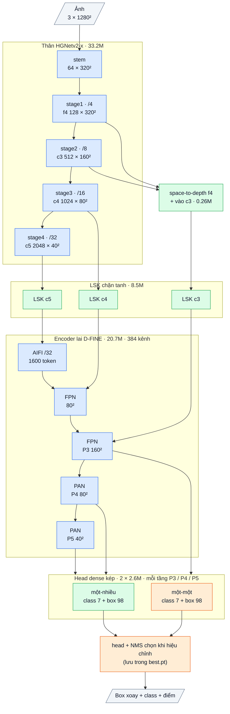

# OpenOBB12: head dense kép (một-nhiều để học, một-một để suy luận), không NMS (2026-10-13)

- `model=openobb12s | m | l | x`: lõi OpenOBB7 (HGNetv2 + LSK + hybrid encoder, pretrained COCO) + head kép.

CLI và API giữ nguyên, chỉ đổi `model=`. v12 kiểm tra cơ chế khử trùng trên lõi đã chứng minh.
OpenOBB13 (bản nhắm độ chính xác: luồng độ phân giải gốc + lưới P2, xây trên v12): [OPENOBB13.md](OPENOBB13.md).
v13 của 0.10.0 (lõi nhanh v9 + head kép) đã bị thay vì chỉ nhắm tốc độ.

## 1. Bài học từ v3 → v11

| Bài học | Số đo |
|---|---|
| Độ chính xác đến từ lõi pretrained + head dense một-nhiều | v3 / v8 / v10: 0.69–0.72 mAP50 (thước YOLO). Thêm mọi tầng phía trên (ngữ cảnh, slot, tầng quan hệ) không tăng độ chính xác: F43, F44, F47, F50 |
| Tầng quan hệ chiếm phần lớn thời gian suy luận | v11 13.6 ms so với lõi dense không tầng quan hệ 5.4 ms (G4, batch 16, F50) |
| Box trùng sinh ra từ chính head một-nhiều (tới 48 điểm dương mỗi object) | v10: 16.7% detection là box trùng; NMS IoU mù với vật mảnh (F49) |
| Một-một bằng Hungarian trên tầng quan hệ học chậm trên 250 ảnh | v11: recall tụt (wall → background 21% so với 14%), vẫn phải chọn NMS 0.5 (F50) |

## 2. Lập luận

| Mảnh | Cơ chế | Kỳ vọng | Điều sẽ chứng minh sai |
|---|---|---|---|
| **Head một-một dạng dense** (mới) | Head thứ hai cùng thiết kế với head dense, cùng đặc trưng. Gán nhãn cùng thước đo (điểm^1 × ProbIoU^6) nhưng chỉ **top-1 mỗi object**; mọi điểm khác của object là âm. Ý tưởng: gán kép nhất quán của YOLOv10 / YOLO26 (head một-nhiều chỉ để học, head một-một để suy luận) | Một box mỗi object mà không cần NMS. Học nhanh như head dense vì bài toán vẫn là "điểm nào khớp object nhất" trên lưới dense, không cần decoder | Box trùng (conf 0.25) ≥ 3% khi không NMS |
| **Bỏ tầng quan hệ** | Bốn lần đo không thấy tầng quan hệ tăng độ chính xác (mục 1) | Suy luận nhanh hơn v10 / v11 rõ rệt; độ chính xác ngang v10 | mAP50 thấp hơn v10 quá 0.02 |
| **Head một-nhiều giữ nguyên** | Loss dense của OpenOBB10 có cân bằng class (mảnh duy nhất có tín hiệu tốt ở v10, F47), không slot (slot làm tăng trùng), không `reach` | Đặc trưng được học như v10; head một-một hưởng đặc trưng đó qua lõi chung | — |
| **Khởi động head một-một** | Khi nạp checkpoint một head (v7 / v8 / v10), head một-một được chép từ head một-nhiều (`copy_head_to_o2o`) | Ngay từ đầu, điểm của head một-một bằng điểm dense; loss một-một chỉ thêm nhãn âm cho bản sao | — |
| **NMS chỉ còn là dự phòng hiệu chỉnh** | Cuối train thử: không NMS, 0.7, 0.5 trên val; lưu vào `best.pt` (như 0.9.1) | Bước hiệu chỉnh chọn "không NMS" | Hiệu chỉnh chọn NMS và fitness hơn "không NMS" quá 0.005 |

**Vì sao không làm kém các class đang tốt.**
- Head một-nhiều, loss và lõi giống v10 bỏ slot. Head một-một là thêm vào, không thay phần nào đã chạy tốt.
- Gradient của head một-một cũng đi vào lõi chung. Trọng số `w_o2o = 1`: hai head cùng mức, như YOLOv10.

**Giới hạn.**
- Hai object khác nhau rơi vào cùng một điểm lưới thì chỉ một được ra (head một-một). Với vật nhỏ sát nhau ở P3 (stride 8) đây là rủi ro: theo dõi recall của junction.

## 3. Chi tiết từng phần và tỉ lệ tận dụng

Sơ đồ khối và bảng từng lớp: mục 7 (phụ lục, cuối file).

| Phần | v12-x | Nguồn |
|---|---|---|
| Backbone | HGNetv2 33.2M | D-FINE (Apache-2.0), init COCO |
| LSK + encoder | LSK 8.5M + hybrid encoder 20.7M + nhánh stride 4 0.3M | encoder D-FINE (Apache) + LSK tự viết |
| Head một-nhiều | 2.6M | tự viết (head dense dị hướng của v3 / v7) |
| Head một-một | 2.6M | tự viết (mới) |
| Loss | `OpenOBB12Loss` = loss dense OpenOBB10 × 2 cách gán | tự viết |
| **Tổng** | **68.0M** | |

Tận dụng phần có sẵn (tính theo tham số):
- v12: khoảng 79% (backbone + encoder D-FINE). Phần mới tự viết: head một-một, loss, cách suy luận.

## 4. Chỉ số kỳ vọng (ghi TRƯỚC khi train)

Điều kiện: Wall_Color, val 53 ảnh, thước YOLO, G4, 100 epoch, cùng `imgsz` với v10. Mốc: v10 0.693 / 0.456, YOLO26x 0.746 / 0.499.

| | v10 | **v12 kỳ vọng** |
|---|---|---|
| mAP50 / mAP50-95 | 0.693 / 0.456 | 0.68–0.71 / 0.45–0.47 |
| Box trùng (conf 0.25), không NMS | 16.7% (có NMS 0.7) | < 3% |
| NMS hiệu chỉnh chọn | 0.5 | không NMS (hoặc chênh fitness ≤ 0.005) |
| Suy luận (G4, batch 16) | — | nhanh hơn v11 (13.6 ms) ít nhất 30% |

- **v12 bị bác bỏ** nếu mAP50 < 0.673, hoặc box trùng không NMS ≥ 3%.

## 5. Train (Colab)

Từ COCO (so cùng điều kiện với v10):

```bash
openobb train model=openobb12x data=/content/data.yaml imgsz=1280 epochs=100
```

- Khi val, xem dòng `Duplicate boxes`, cột `o2o_loss` trong `results.csv`, và dòng hiệu chỉnh NMS cuối train.
- Có thể đi tiếp từ checkpoint một head: `weights=<best.pt của v7 / v8 / v12>`; head một-một được chép từ head một-nhiều.

## 6. Cập nhật 0.12.0 (sau run đầu, F54)

Run v12 đầu tiên của user đạt 0.722 / 0.468, cao nhất tới nay. Hai phát hiện từ phân tích checkpoint đó:

1. **Head dùng khi suy luận là một tham số hiệu chỉnh.**
   - Trên cùng checkpoint, head một-nhiều + NMS 0.5 cho 0.741 / 0.481, còn head một-một cho 0.718 / 0.470.
   - Train kèm head một-một làm lõi tốt hơn; nhưng ở 250 ảnh, head một-nhiều + NMS vẫn tốt hơn khi suy luận.
   - Cuối train, bước hiệu chỉnh thử `{một-một: không NMS / 0.7 / 0.5; một-nhiều: 0.7 / 0.5}` trên val, lưu `args["infer_head"]` và `args["nms_iou"]` vào `best.pt`.
   - Checkpoint đã train: `openobb calibrate model=best.pt data=data.yaml [out=calibrated.pt]`.
   - Từ 0.12.1, checkpoint chưa có `infer_head` (train trước 0.12.0) và val mỗi epoch dùng head một-nhiều + NMS theo mặc định.
2. **`box=direct`: hồi quy box kiểu YOLO26.**
   - So với YOLO26x, box của v12:
     - dày hơn thật một cách hệ thống (+0.66 px trên tường 5.6 px);
     - sai số độ dày gấp đôi (1.00 so với 0.54 px);
     - đầu box sai gần gấp đôi (2.4 so với 1.3 px).
   - Nguyên nhân: độ dày và độ dài đọc từ phân phối DFL theo bin thô (stride / 2, stride). Sửa cách giải mã chỉ hết lệch, không giảm sai số (F54).
   - `box=direct` thay ba phân phối (hai đầu, độ dày) bằng ba giá trị liên tục (softplus × stride). Loss là L1 theo đơn vị stride + ProbIoU; góc và lệch ngang giữ nguyên.
   - Kỳ vọng ghi trước ở LEDGER F55.

```bash
openobb train model=openobb12x data=/content/data.yaml imgsz=1280 epochs=100 box=direct
```

## 7. Phụ lục: kiến trúc theo lớp (cỡ x)

Kích thước ghi cho ảnh vào 1 × 3 × 1280 × 1280, Wall_Color (7 class). Ký hiệu: `conv k×k sS a→b` = Conv + BN + kích hoạt,
`dw` = depthwise, `/N` = stride N so với ảnh.

### Luồng dữ liệu

Xanh dương: mượn (pretrained, Apache-2.0). Xanh lá: tự viết. Cam: mới ở v12. Mỗi stage của thân đi qua bộ chặn độ lớn (guard, không tham số).



### Thân: HGNetv2-x (mượn, Apache-2.0, trọng số D-FINE COCO), 33.23M

| Khối | Lớp | Ra | Tham số |
|---|---|---|---|
| stem | conv 3×3 s2 3→32; nhánh [conv 2×2 32→16 → conv 2×2 16→32] ∥ max-pool 2; nối 64 → conv 3×3 s2 64→32 → conv 1×1 32→64 | 64 × 320² (/4) | 0.03M |
| stage1 | 1 khối HG: 6 × conv 3×3 64→64, nối 448 kênh → 1×1 →64 → 1×1 →128 | **f4** 128 × 320² | 0.26M |
| stage2 | dw 3×3 s2; 2 khối HG: 6 × conv 3×3 128, nối → 1×1 → 512 | **c3** 512 × 160² (/8) | 3.03M |
| stage3 | dw 3×3 s2; 5 khối HG nhẹ: 6 × (1×1 → dw 5×5) 256, nối → 1×1 512 → 1×1 1024 | **c4** 1024 × 80² (/16) | 11.93M |
| stage4 | dw 3×3 s2; 2 khối HG nhẹ: 6 × (1×1 → dw 5×5) 512, nối → 1×1 → 2048 | **c5** 2048 × 40² (/32) | 17.99M |

BN của thân bị đóng băng (FrozenBatchNorm), kích hoạt ReLU.

### Chặn độ lớn + chi tiết stride 4 (tự viết), 0.26M

| Khối | Lớp | Ra | Tham số |
|---|---|---|---|
| guard | sau mỗi stage của thân: x · min(1, 4 / rms(x)) theo từng ảnh (tính fp32); đồng nhất khi rms ≤ 4 | như đầu vào | 0 |
| spd | f4 space-to-depth (128 × 320² → 512 × 160²) → conv 1×1 512→512 + BN (gamma khởi tạo 0) → **cộng** vào c3 trước LSK | 512 × 160² | 0.26M |

### Adapter LSK (tự viết, ý tưởng LSKNet), 8.54M

Trên c3 / c4 / c5, mỗi tầng một khối (c = 512 / 1024 / 2048 kênh; 0.43M / 1.65M / 6.45M):
a = dw 5×5(x); b = dw 7×7 giãn 3(a) (trường nhìn khoảng 23 ô); a, b → conv 1×1 về c/2; cổng = conv 7×7 trên [trung bình, max theo kênh]
của [a, b] → 2 kênh sigmoid; m = conv 1×1 c/2→c (khởi tạo 0) của (a·g₁ + b·g₂); ra **x + x·tanh(m)** (hệ số khuếch đại luôn trong (0, 2)). Khởi tạo = đồng nhất.

### Encoder lai D-FINE (mượn, Apache-2.0, trọng số COCO), 20.70M, 384 kênh

| Khối | Lớp | Ra | Tham số |
|---|---|---|---|
| input_proj | ba conv 1×1 + BN: c3 512→384, c4 1024→384, c5 2048→384 | | 1.38M |
| AIFI | 1 lớp transformer trên 1600 token của /32: attention 8 đầu, FFN 384→2048→384 (GELU), vị trí sin-cos 2-D | 384 × 40² | 2.17M |
| FPN (2 bước) | lateral 1×1 384→384; upsample ×2; nối 768 → RepNCSPELAN4 → 384 | 384 × 80², **P3** 384 × 160² | 8.57M |
| PAN (2 bước) | SCDown [1×1 384→384 → dw 3×3 s2]; nối 768 → RepNCSPELAN4 → 384 | **P4** 384 × 80², **P5** 384 × 40² | 8.58M |

RepNCSPELAN4(768→384): conv 1×1 768→768, tách 2 nửa 384; nửa sau qua [CSP 384→192 (3 khối RepVGG 3×3 ∥ 1×1) → conv 3×3 192] rồi
[CSP 192→192 (3 khối) → conv 3×3 192]; nối 384 + 384 + 192 + 192 → conv 1×1 → 384. Kích hoạt SiLU.

### Head dense kép (tự viết), 2 × 2.63M

Hai head cùng thiết kế (head có ngữ cảnh của v7), trọng số riêng: **một-nhiều** (gán TAL, nhiều mẫu dương mỗi object, cần NMS) và **một-một**
(một mẫu dương mỗi object, không cần NMS). Bước hiệu chỉnh cuối train thử các tổ hợp (head × không NMS / NMS 0.7 / 0.5) trên val và lưu lựa
chọn vào `best.pt`; khi suy luận chỉ chạy một head.

| Nhánh | Lớp (một tầng) | Ra mỗi điểm | Tham số (3 tầng) |
|---|---|---|---|
| class | dw 3×3 384 → 1×1 384→192 → StripMix(192, k = 11) → dw 3×3 192 → 1×1 192→192 → 1×1 →7 (bias tiên nghiệm 0.01) | 7 logit | 0.82M |
| box | conv 3×3 384→128 → conv 3×3 128→128 → 1×1 128→98 (chạy fp32) | 98 kênh | 1.81M |

98 kênh box (một nhóm): góc θ, lệch ngang tâm (× stride), phân phối 32 bin khoảng cách tới đầu sau và 32 bin tới đầu trước dọc trục
(bin = 1 stride), 32 bin độ dày (bin = 1/2 stride). Mỗi tầng một tháp riêng; điểm lưới = tâm ô.

### Tổng hợp

| Phần | Tham số | Tỉ lệ | Nguồn |
|---|---|---|---|
| Thân HGNetv2-x | 33.23M | 48.9% | mượn (Apache-2.0) |
| guard + spd | 0.26M | 0.4% | tự viết |
| LSK | 8.54M | 12.6% | tự viết |
| Encoder lai | 20.70M | 30.4% | mượn (Apache-2.0) |
| Head một-nhiều | 2.63M | 3.9% | tự viết |
| Head một-một | 2.63M | 3.9% | tự viết |
| **Tổng** | **68.00M** | | 20.7% tự viết (65.37M chạy khi suy luận) |

Suy luận: 33 600 điểm của head đã chọn → (NMS ProbIoU theo ngưỡng đã hiệu chỉnh, hoặc không NMS) → tối đa 1000 box.
