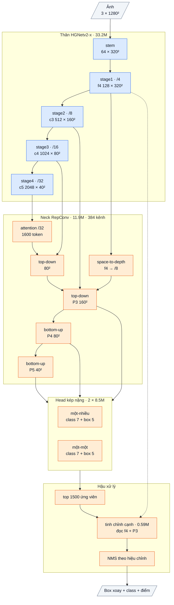

# OpenOBB14: thân pretrained + neck conv dày tái tham số hoá tự thiết kế + head kép nặng hồi quy trực tiếp + bộ tinh chỉnh box theo cạnh (2026-10-14)

`model=openobb14s | m | l | x`. Code: [openobb/models/openobb14.py](../openobb/models/openobb14.py), loss [openobb14_loss.py](../openobb/models/openobb14_loss.py).
Chưa train. Mốc so sánh (F59, log user 10-14, Wall_Color, thước YOLO): **v12-x head một-nhiều + NMS 0.7 hiệu chỉnh 0.743 / 0.472, 15.3 ms / ảnh (G4, batch 16)** và **YOLO26x 0.746 / 0.499**.

## 0. Tóm tắt

| Mục tiêu | Cách đạt | Bằng chứng |
|---|---|---|
| Chính xác hơn v12 ở mAP50-95 (độ khít box vật mảnh) | hồi quy box trực tiếp + **bộ tinh chỉnh đọc nét ở stride 4 ngay trên cạnh box dự đoán** | F59: toàn bộ khoảng cách mAP50-95 với YOLO nằm ở wall −.104, wall_300 −.131, junction −.053, note −.058 trong khi recall ngang; F54: box v12 dày hơn thật +0.66 px, sai số dày 1.00 px (YOLO 0.54), đầu box 2.4 px (YOLO 1.3) |
| Nhanh hơn v12 và không chậm hơn YOLO26x | thay LSK + encoder lai (45% FLOPs của v12, nhiều 1×1 / depthwise) bằng neck conv dày 3×3 tái tham số hoá, gộp thành một conv khi suy luận | roofline (mục 2): v14-x 586 GFLOPs / 4.08 ms so với v12-x 682 / 4.84 và YOLO26x 605 / 4.34 |
| Không mất tiên nghiệm | thân HGNetv2 giữ **nguyên** (tên tham số không đổi, weights COCO nạp thẳng); mọi mảnh mới đứng sau thân | mổ thân trên checkpoint v12 đã train (mục 1): gần như toàn bộ thân đang "sống" trên bản vẽ |
| Head đủ nặng cho phân loại vật tí hon | 1×1 + hai conv dày 3×3 (conv thứ hai của tháp class giãn 2) mỗi tháp, mỗi tầng; 22% FLOPs | F37: head v3 chỉ 5% FLOPs, YOLO26x 20%; lỗi chính là phân loại wall_300 |

Tỉ lệ tận dụng (bản x, 62.7M tham số): thân HGNetv2 33.2M (53%, D-FINE Apache-2.0, init COCO); **neck 11.9M + head kép 17.0M + bộ tinh chỉnh 0.6M = 47% tự viết**. v12 tận dụng 79%.

## 1. Mổ bên trong các backbone (đo, không đoán)

### 1.1 Thân HGNetv2-B5 trên checkpoint v12-x đã train (`research/analysis/dissect_hgnet.py`, 3 trang val, conf 0.25)

Mỗi cơ chế bên trong thân bị can thiệp một mình; đo phần detection gốc còn giữ được (cùng class, ProbIoU ≥ 0.5).

| Can thiệp | Detection còn giữ | Kết luận |
|---|---|---|
| Nhánh dư của `stages.1.blocks.1` (stride 8) = 0 | 86.8% | sống |
| Nhánh dư của 4 block stride 16 = 0 (từng block) | 92.2 / 97.4 / 96.8 / 92.1% | mỗi block đều góp; không block nào thừa |
| Nhánh dư của `stages.3.blocks.1` (stride 32) = 0 | 100% (thêm 10 box) | block này không cần; nhánh dư có RMS gấp 16 lần identity (vẫn nổ, được chặn bởi ScaleGuard) |
| Toàn bộ stage 4 = 0 | 96.3% | stage 4 góp khoảng 4% (sống nhờ guard, đúng F46) |
| **Depthwise 5×5 của LightConv stage 3 cắt còn 3×3** | **61.7%** | vùng nhìn 5×5 ở stride 16 là thiết yếu; không được thay bằng 3×3 |
| Depthwise 5×5 stage 3 cắt còn tâm 1×1 | 86.1% (box tăng 142 → 216) | mất lọc không gian → nhiều box rác |
| Depthwise 5×5 stage 4 cắt còn 3×3 / 1×1 | 99.0 / 97.8% | không gian ở stride 32 không quan trọng |
| Kênh chết (std < 10⁻³ trung bình) | stage 1–3: ≤ 3%; **stage 4: 23% chết, 25% yếu** | stage 4 (2048 kênh) thừa một phần tư |
| ESE | **B4 / B5 không có ESE** (gộp bằng hai conv 1×1, `agg='se'`); chỉ B0–B2 (cỡ s / m) có | kết luận "ESE không có thông tin vị trí" của ARCH_ANALYSIS chỉ đúng với cỡ s / m |

Rút ra: thân pretrained không phải chỗ cắt. Phần có thể cắt (stage 4) chỉ chiếm 7% FLOPs, và vẫn góp 4% detection. Toàn bộ phần phía sau thân mới là nơi thiết kế lại.

### 1.2 Phân bổ tính toán và băng thông từng mảnh (`research/analysis/roofline.py`, 960×1280, bf16, G4 195 TFLOPS / 1.7 TB/s)

| Mảnh | v12-x GFLOPs (ms roofline) | v14-x GFLOPs (ms) | YOLO26x GFLOPs (ms) |
|---|---|---|---|
| thân / trunk | 320 (2.40) | 320 (2.40) | 332 (2.73) |
| LSK | 48 (0.31) | — | — |
| encoder / neck | 260 (1.61) | **133 (0.80)** | 206 (1.07) |
| head (một head khi suy luận) | 44 (0.39) | **129 (0.76)** | 67 (0.41) |
| bộ tinh chỉnh | — | 4 (0.04) | — |
| **tổng** | **682 (4.84)** | **586 (4.08)** | **605 (4.34)** |
| cường độ FLOP / byte | 156 | 168 | 159 |
| thời gian ở conv 1×1 / depthwise | 39% / 6% | 36% / 4% | 29% / 1% |

- Encoder lai của v12 tốn 260 G mà 189 G nằm ở một khối CSP 384 kênh ở P3; AIFI (attention ở 1/32) chỉ 4 G và đã đo là phẳng trên bản vẽ (F37).
- v14 chuyển 90 G từ neck sang head: head nặng gấp 3 v12 và gấp 2 YOLO26x, vẫn tổng thấp hơn cả hai.
- Ước lượng roofline chỉ là cận dưới (chưa tính cat / cộng / nội suy); thứ tự thật phải đo bằng T1 trên G4 (`colab/speed_gpu.py`).

### 1.3 Các backbone SOTA cùng thước

Bảng đầy đủ (16 backbone: HGNetv2 B4 / B5, YOLO26x / 11x / 12x / v8x, ConvNeXt, ConvNeXt-V2, ResNet-50 / 101, Swin-B, DINOv2 ViT-B/14, EfficientNet-B5, RepVGG-B2, RegNetY, CSPDarknet53) ở [research/LEDGER.md](../research/LEDGER.md) F58, script `research/analysis/roofline_backbones.py`.
Điều rút ra cho thiết kế (chi tiết trong F58): phần tính toán của mọi backbone hiệu quả trên GPU nằm ở conv dày 3×3 ở stride 8–16; depthwise / attention cục bộ nhiều thì cường độ FLOP / byte thấp (ConvNeXt, EfficientNet, Swin); ViT patch 14 không có stride 4 / 8 (v4 đã đo chậm, F33).

### 1.4 Head: biểu diễn box và vì sao v12 thua ở mAP50-95

| | v12 (DFL dị hướng) | YOLO26 | v14 |
|---|---|---|---|
| độ dày | kỳ vọng của phân phối 32 bin, bin = stride / 2 (4 px ở P3): tường 5.6 px = 1.4 bin, sát biên 0 → kỳ vọng bị kéo lên (+0.66 px) | giá trị trực tiếp | giá trị trực tiếp (softplus × stride / 2) **+ sửa lại từ nét stride 4** |
| hai đầu | DFL bin = stride | trực tiếp | trực tiếp + sửa |
| góc | một giá trị, loss 1 − cos 2Δ | trực tiếp, ProbIoU | giữ v12 + sửa 0.2·tanh |
| đặc trưng đọc | một ô stride 8 (3×3 depthwise + 1×1) | hai conv dày 3×3 / nhánh | 1×1 + hai conv dày 3×3 / nhánh; **bộ tinh chỉnh đọc 24 điểm stride 4 trên cạnh / đầu / tim box + 6 điểm P3** |
| giải mã quanh đỉnh DFL (F54) | hết lệch nhưng sai số vẫn 1.00 px → giới hạn là độ phân giải của hồi quy, không phải cách đọc | | |

## 2. Lập luận (bài học → cơ chế → kỳ vọng → điều chứng minh sai)

| Mảnh | Bài học | Cơ chế | Kỳ vọng | Bác bỏ nếu |
|---|---|---|---|---|
| **Thân giữ nguyên** | mọi lõi train từ đầu / chưng cất từ thầy COCO đều thua xa (F25, F40, F50); thân đang sống (1.1) | HGNetv2 + ScaleGuard, tên tham số như v3 → weights COCO nạp thẳng | class hiếm, cửa, junction không kém v12 | junction hoặc door giảm quá 0.02 so với v12 |
| **Neck tự thiết kế** (`Neck14`) | encoder lai: 38% FLOPs, 1×1 nặng, attention 1/32 phẳng; LSK: cổng không chọn theo nội dung, 95% chi phí là 1×1 (F37) | chiếu 1×1 → attention nhỏ ở /32 (zero-init) → top-down RepCSP (giãn 1,2,1,3 ở P3 / P4) → bottom-up Down (có nhánh max-pool) + RepCSP; stride 4 vào P3 bằng space-to-depth; RepConv = 3×3 + 1×1 + đồng nhất lúc train, **một conv 3×3** lúc suy luận | nhanh hơn v12 ≥ 15% (T1); mAP50 không thấp hơn v12 quá 0.01 | mAP50 < 0.73 với head một-nhiều + NMS |
| **Head nặng, hồi quy trực tiếp** | head v3 5% FLOPs; wall_300 lưỡng lự (F37); DFL thô cho vật mảnh (F54) | hai tháp / tầng, conv dày; `box=direct` (DFL giữ làm đối chứng `box=dfl`) | sai số dày wall ≤ 0.7 px | sai số dày wall ≥ 0.8 px (`research/analysis/box_quality.py`) |
| **Bộ tinh chỉnh theo cạnh** (`EdgeRefiner`) | định vị dưới ô stride 8 cần đặc trưng stride 4; tầng quan hệ v8 (transformer, class + quan hệ) không tăng độ chính xác mà tốn 35% thời gian (F43–F50) | lấy mẫu song tuyến bản đồ stride 4 pretrained (chiếu 64 kênh) tại 6 điểm trên mỗi cạnh dài, 3 điểm ở mỗi đầu, 6 điểm tim box; P3 tại 6 điểm tim; MLP 1920 → 256 → 256 → 5 (zero-init) → residual hai đầu, log độ dày, lệch ngang, góc (`openobb8.refine_boxes`). Chỉ box, không class, không quan hệ. Train trên top-256 ứng viên + box nhãn rung; suy luận trên top-1500 trước NMS | R@.75 của wall ≥ 0.45 (v12 .31, YOLO .56); mAP50-95 ≥ 0.50 | mAP50-95 không hơn v12 ít nhất 0.01, hoặc `v14_off=edge` cho kết quả bằng |
| **Head kép + cân bằng class** | v12: train kèm head một-một làm lõi tốt hơn (+0.03–0.05), suy luận vẫn head một-nhiều + NMS (F54) | giữ nguyên OpenOBB12Loss; hiệu chỉnh head / NMS cuối train | như v12 | — |

**Vì sao đây là bản đột phá chứ không phải tinh chỉnh:** phần tự viết tăng từ 21% lên 47% tham số và 45% FLOPs; cơ chế định vị đổi từ "đọc một ô stride 8" sang "đọc nét ở stride 4 trên chính cạnh box"; neck và head đổi từ thiết kế cho ảnh tự nhiên (COCO, vật lớn, ngữ nghĩa ở 1/32) sang thiết kế cho vật nhỏ / mảnh (tính toán ở 1/8–1/16, ngữ cảnh giãn, head nặng). Điều chưa đổi, có chủ đích: thân pretrained, vì ba lần đổi đều thất bại.

**Giới hạn nói trước:**
- Neck mới khởi tạo ngẫu nhiên: mất tiên nghiệm COCO của encoder (20.7M tham số). Chưa ai đo encoder pretrained đáng giá bao nhiêu so với encoder ngẫu nhiên; v14 là phép đo đó. Đối chứng rẻ: v12 với encoder khởi tạo lại (xem mục 5).
- Thân vẫn có depthwise 5×5 ở stage 3–4 (nghẽn bộ nhớ) và 2048 kênh ở stride 32 với một phần tư kênh chết. Không đụng (bằng chứng 1.1: stage 3 thiết yếu; stage 4 chỉ 7% FLOPs).
- Bộ tinh chỉnh theo cạnh mới chỉ chứng minh được trên lý thuyết (BorderAlign / RoI-Align xoay cho detector một giai đoạn); v8 lấy mẫu tương tự nhưng gộp với class + quan hệ nên không tách được tác dụng của phần box.

## 3. Kiến trúc (bản x, ảnh 960×1280)

Sơ đồ khối và bảng từng lớp: mục 7 (phụ lục, cuối file).


| Cỡ | hid neck | tháp head | RepConv / khối | Tham số |
|---|---|---|---|---|
| s | 192 | 128 | 1 | 8.8M |
| m | 256 | 160 | 2 | 17.9M |
| l | 256 | 192 | 3 | 29.2M |
| x | 384 | 256 | 3 | 62.7M |

Công tắc ablation `v14_off=`: `attn`, `spd`, `edge`, `dilate`, `maxpool`, `guard`, `dual`. `box=dfl` để đối chứng biểu diễn box. `ref_k=` số ứng viên tinh chỉnh khi suy luận (0 = tắt, không cần train lại).

## 4. Chỉ số kỳ vọng (ghi TRƯỚC khi train)

Điều kiện: Wall_Color, val 53 ảnh, thước YOLO, COCO init, 100 epoch, `imgsz=1280`, cùng bước hiệu chỉnh head / NMS cuối train như v12.

| | v12-x (F59) | YOLO26x (F59) | **v14-x kỳ vọng** |
|---|---|---|---|
| mAP50 / 50-95 | 0.743 / 0.472 | 0.746 / 0.499 | **0.73–0.77 / 0.50–0.53** |
| wall / wall_300 / junction / note mAP50-95 | .520 / .310 / .531 / .459 | .624 / .441 / .584 / .517 | **mỗi class +0.03 trở lên so với v12** |
| wall_300 mAP50 (phân loại, v14 không nhắm) | .721 | .824 | không giảm |
| wall R@.75 / sai số dày / sai số đầu | .31 / 1.00 px / 2.42 px | .56 / 0.54 / 1.30 | **≥ .45 / ≤ 0.7 / ≤ 1.8** |
| junction, door, slide_door, double_door mAP50 | .900 / .976 / .410 / .572 | .910 / .965 / .345 / .494 | không giảm quá 0.02 |
| T1: suy luận G4 (`colab/speed_gpu.py`, cùng phiên) | 15.3 ms (batch 16, bf16) | chưa đo cùng phiên | **≤ 13 ms cùng điều kiện, ≤ 1.1× YOLO26x** |

**Bác bỏ** nếu: mAP50-95 không hơn v12 ít nhất 0.01 (tức < 0.482); hoặc sai số dày wall ≥ 0.8 px; hoặc T1 không đạt (khi đó không tốn CU train: sửa độ rộng neck / head trước).

Điều v14 **không** nhắm và nói trước: phân loại wall_300 (mAP50 .721 so với .824, 14% nhầm sang junction). Nếu v14 đạt mAP50-95 mà wall_300 vẫn .72, bước kế tiếp là H-DOTA (khởi tạo thân từ lõi DOTA) hoặc luồng độ phân giải gốc của v13, không phải sửa v14.

## 4b. Kết quả thật (F60, user 10-14) và bước kế tiếp

| | v12-x (F59) | **v14-x (F60)** | kỳ vọng |
|---|---|---|---|
| mAP50 / 50-95 | 0.743 / 0.472 | **0.713 / 0.469** | 0.73–0.77 / 0.50–0.53 → **không đạt** |
| tốc độ G4, batch 16 | 15.3 ms | **10.9 ms (−29%)** | ≤ 13 ms → **đạt** |
| wall 50-95 | .520 | **.565** | +0.03 → đạt |
| note / slide_door / wall_300 mAP50 | .741 / .410 / .721 | .657 / .276 / .677 | không giảm → **không đạt** |
| box trùng | 8.2% | 3.5% | |

Cơ chế box làm đúng việc (tường +.045 mAP50-95, box trùng giảm một nửa, nhanh hơn 29%); phần mất nằm ở class cần ngữ nghĩa và class hiếm,
khớp với rủi ro đã nêu: neck mới mất tiên nghiệm COCO của encoder. Phép thử tách một yếu tố: `neck=dfine`.

```bash
openobb train model=openobb14x data=/content/data.yaml imgsz=1280 epochs=100 neck=dfine
openobb val model=runs/obb/train6/weights/best.pt data=/content/data.yaml ref_k=0    # đóng góp của bộ tinh chỉnh, không train lại
```

## 4c. Vòng hai hạt giống (10-14): A và B train song song

Wall_Color đã gần trần của 250 ảnh: ba model rất khác nhau (YOLO26x, v12, v14) đều rơi trong 0.03 mAP50; slide_door / double_door chỉ có
31 / 25 object val nên lệch 0.1 là nhiễu. Vì vậy vòng này chạy trên **cả FloorPlanCAD** (810 ảnh val, 30 class; mốc YOLO26x 80.16 / 74.96,
OpenOBB tốt nhất 78.16 / 68.81, khoảng cách chính là độ khít box, F18), nơi cơ chế box của v14 phải lộ ra nếu nó có thật.

| Hạt giống | Khác nhau đúng một yếu tố | Câu hỏi | Kỳ vọng ghi trước |
|---|---|---|---|
| **A** `openobb14x neck=dfine` | neck = encoder pretrained COCO của D-FINE (giữ tiên nghiệm), head + bộ tinh chỉnh v14 | tiên nghiệm neck có phải thứ v14 mất không | Wall_Color: ≥ 0.74 / ≥ 0.49, wall 50-95 ≥ .55, note ≥ .72. FPC: mAP50-95 ≥ 70 (c6 68.8) |
| **B** `openobb14x` (neck tự thiết kế) | như A nhưng neck Neck14 khởi tạo ngẫu nhiên | khi đủ data (15k ảnh FPC) neck tự thiết kế có bắt kịp không | FPC: trong 1.5 điểm của A và nhanh hơn ≥ 20%; Wall_Color đã biết (F60) |

Kết luận có thể rút ra từ hai log: A > B rõ trên cả hai data → tiên nghiệm neck quyết định, bản sản phẩm là A, và lộ trình sở hữu trọn phải qua
chưng cất Neck14 từ encoder. A ≈ B trên FPC → neck tự thiết kế đủ tốt khi có data, chỉ thiếu pretrain; đi tiếp pretrain neck/thân trên DOTA + bản vẽ.

```bash
# Wall_Color (cả hai, 100 epoch từ COCO)
openobb train model=openobb14x data=/content/data.yaml imgsz=1280 epochs=100 neck=dfine
openobb train model=openobb14x data=/content/data.yaml imgsz=1280 epochs=100

# FloorPlanCAD (dữ liệu tự tải và chuyển đổi, khoảng 15 phút; thư mục ra là data đã chuẩn bị, dùng thẳng)
pip install -q -U gdown shapely
python colab/data/floorplancad.py --root /content/datasets
openobb train model=openobb14x data=/content/datasets/floorplancad_1024 imgsz=1024 epochs=24 batch=16 neck=dfine
openobb train model=openobb14x data=/content/datasets/floorplancad_1024 imgsz=1024 epochs=24 batch=16
```

Mốc FPC đọc theo thước DOTA in kèm trong log (số của c6 và YOLO26x ở sổ cái là thước DOTA / thước YOLO tương ứng; so cùng thước).
Tuỳ chọn thứ ba, không cần code: `weights=runs/e6-vrdet-x-dota-24e/openobb_dota_core_x.pt` (217 MB, trên máy local) với `neck=dfine`
= khởi tạo thân + encoder từ lõi DOTA thay vì COCO (H-DOTA, F51), nhắm wall_300.

## 5. Train và đối chứng (Colab)

```bash
openobb train model=openobb14x data=/content/data.yaml imgsz=1280 epochs=100
```

Thứ tự theo cổng, rẻ trước:
1. **T1 tốc độ** (vài phút, không train): `python colab/speed_gpu.py yolo26x.pt openobb12x.pt openobb14x_random.pt` (checkpoint v14 ngẫu nhiên có thể tạo bằng `openobb train ... epochs=1 time=0.01` hoặc lưu `state_dict`). Không đạt → chỉnh `SCALES14`.
2. **v14-x đầy đủ**, 100 epoch, so bảng mục 4. Gửi kèm: bảng theo class, confusion matrix, dòng `NMS calibrated`, `results.csv`, và chạy `research/analysis/box_quality.py` trên `best.pt`.
3. Nếu đạt: **tách tác dụng** bằng hai run ngắn hơn (50 epoch, cùng ngân sách nhau): `v14_off=edge` (bỏ bộ tinh chỉnh) và `box=dfl` (DFL thay hồi quy trực tiếp).
4. Đối chứng cho câu hỏi "encoder pretrained đáng giá bao nhiêu": v12 với encoder khởi tạo lại (chưa có cờ; thêm khi cần).

Fine-tune từ checkpoint khác: `weights=<best.pt của v12 / v7 / v3>` nạp thân (và head một-nhiều nếu cùng kiến trúc), các mảnh mới khởi tạo lại.

## 6. Đối chiếu với mọi version trước

| Version | Vì sao thua / dừng | v14 làm khác gì |
|---|---|---|
| v2, v6, v9 (lõi mới) | không tiên nghiệm (F25, F40, F50) | giữ thân pretrained |
| v4 / v5 (DINOv2) | chậm 38 ms, patch 14 thô (F33) | không ViT khi suy luận |
| v8 / v10 / v11 (tầng quan hệ) | không tăng độ chính xác, tốn 35% thời gian | bỏ quan hệ; chỉ tinh chỉnh box bằng nét stride 4, 0.7% FLOPs |
| v10 (slot) | tăng box trùng, ô nhầm không đổi (F47) | không slot; head kép của v12 |
| c5 (P2 cho decoder) | −9.1 trên FPC | không tầng P2; chi tiết stride 4 vào P3 (spd) và vào bộ tinh chỉnh |
| v13 (luồng độ phân giải gốc) | chưa có run hợp lệ | trực giao; ghép sau nếu F52 được xác nhận |
| v12 (bản tốt nhất) | mAP50-95 −0.027 so YOLO, nằm trọn ở độ khít tường / nút / note (F59); 45% FLOPs sau thân là phần mượn | neck + head + tinh chỉnh tự thiết kế, trên cùng thân |

## 7. Phụ lục: kiến trúc theo lớp (cỡ x)

Kích thước ghi cho ảnh vào 1 × 3 × 1280 × 1280, Wall_Color (7 class). Ký hiệu: `conv k×k sS a→b` = Conv + BN + kích hoạt,
`dw` = depthwise, `/N` = stride N so với ảnh. Mặc định `neck=own`, `box=direct`.

### Luồng dữ liệu

Xanh dương: mượn (pretrained, Apache-2.0). Cam: mới ở v14 (thay LSK + encoder lai + head của v12).



### Thân: HGNetv2-x (mượn, Apache-2.0, trọng số D-FINE COCO), 33.23M

| Khối | Lớp | Ra | Tham số |
|---|---|---|---|
| stem | conv 3×3 s2 3→32; nhánh [conv 2×2 32→16 → conv 2×2 16→32] ∥ max-pool 2; nối 64 → conv 3×3 s2 64→32 → conv 1×1 32→64 | 64 × 320² (/4) | 0.03M |
| stage1 | 1 khối HG: 6 × conv 3×3 64→64, nối 448 kênh → 1×1 →64 → 1×1 →128 | **f4** 128 × 320² | 0.26M |
| stage2 | dw 3×3 s2; 2 khối HG: 6 × conv 3×3 128, nối → 1×1 → 512 | **c3** 512 × 160² (/8) | 3.03M |
| stage3 | dw 3×3 s2; 5 khối HG nhẹ: 6 × (1×1 → dw 5×5) 256, nối → 1×1 512 → 1×1 1024 | **c4** 1024 × 80² (/16) | 11.93M |
| stage4 | dw 3×3 s2; 2 khối HG nhẹ: 6 × (1×1 → dw 5×5) 512, nối → 1×1 → 2048 | **c5** 2048 × 40² (/32) | 17.99M |

BN của thân bị đóng băng (FrozenBatchNorm), kích hoạt ReLU.

Mỗi stage đi qua bộ chặn độ lớn (guard, không tham số) như v7.

### Neck: Neck14 (tự viết, khởi tạo ngẫu nhiên; `neck=dfine` thay bằng encoder lai D-FINE 20.7M có trọng số COCO), 11.91M, 384 kênh

| Khối | Lớp | Ra | Tham số |
|---|---|---|---|
| proj | ba conv 1×1 (không kích hoạt): c3 512→384, c4 1024→384, c5 2048→384 | | 1.38M |
| attn | 1 lớp transformer trên 1600 token của /32: vị trí bằng dw 3×3; LayerNorm → attention 8 đầu; LayerNorm → FFN 384→768→384 (GELU). Hai nhánh dư nhân cổng khởi tạo 0 | 384 × 40² | 1.19M |
| lat5 | conv 1×1 → **t5** | 384 × 40² | 0.15M |
| td4 | nối [proj c4, upsample ×2 t5] 768 → RepCSP (3 RepConv, giãn 1 / 2 / 1) → n4 → lat4 1×1 → **t4** | 384 × 80² | 1.92M |
| spd | f4 space-to-depth (128 × 320² → 512 × 160²) → conv 1×1 512→192: chi tiết /4 vào P3 | 192 × 160² | 0.10M |
| td3 | nối [proj c3, upsample ×2 t4, spd] 960 → RepCSP | **P3** 384 × 160² | 1.85M |
| dn3 + bu4 | Down [conv 3×3 s2 384→192 ∥ max-pool 2] → 1×1 576→384; nối t4 → RepCSP | **P4** 384 × 80² | 2.66M |
| dn4 + bu5 | như trên, nối t5, RepCSP không giãn | **P5** 384 × 40² | 2.66M |

RepCSP(a→384, n=3): conv 1×1 a→384, tách 2 nửa 192; nửa sau qua lần lượt 3 RepConv 192 (3×3 ∥ 1×1 ∥ BN đồng nhất, gộp thành một
conv 3×3 khi suy luận); nối 2 nửa + 3 đầu ra (960) → conv 1×1 → 384.

### Head kép nặng (tự viết), 2 × 8.49M

Hai head cùng thiết kế, trọng số riêng: một-nhiều và một-một; bước hiệu chỉnh cuối train chọn head và NMS. Tháp riêng cho mỗi tầng.

| Nhánh | Lớp (một tầng) | Ra mỗi điểm | Tham số (3 tầng) |
|---|---|---|---|
| class | Tower: conv 1×1 384→256 → RepConv 3×3 256 → RepConv 3×3 giãn 2 256 → 1×1 →7 (bias tiên nghiệm 0.01) | 7 logit | 4.24M |
| box | Tower: conv 1×1 384→256 → RepConv 3×3 256 → RepConv 3×3 256 → 1×1 →5 (khởi tạo 0) | 5 giá trị (`box=direct`): góc, lệch ngang, khoảng cách tới hai đầu, độ dày | 4.24M |

### Tinh chỉnh cạnh (tự viết), 0.59M

Bộ tinh chỉnh cạnh (EdgeRefiner, 0.59M): với mỗi box ứng viên, lấy mẫu song tuyến 24 điểm trong khung box (6 trên mỗi cạnh dài, 3 trên
mỗi đầu, 6 trên đường tâm) trên f4 của thân (128 kênh, /4) chiếu 1×1 → 64 kênh, và 6 điểm đường tâm trên P3 chiếu 1×1 384→64; nối với 4 số hình học
(log dài, log dày, sin / cos 2θ) → MLP 1924→256→256→5 (dịch hai đầu, log độ dày, lệch ngang, góc 0.2·tanh). Lớp cuối khởi tạo 0.

### Tổng hợp

| Phần | Tham số | Tỉ lệ | Nguồn |
|---|---|---|---|
| Thân HGNetv2-x | 33.23M | 53.0% | mượn (Apache-2.0) |
| Neck | 11.91M | 19.0% | tự viết |
| Head một-nhiều | 8.49M | 13.5% | tự viết |
| Head một-một | 8.49M | 13.5% | tự viết |
| Tinh chỉnh cạnh | 0.59M | 0.9% | tự viết |
| **Tổng** | **62.70M** | | 47.0% tự viết (54.2M chạy khi suy luận) |

GFLOPs (ảnh 960 × 1280, một head): thân 320, neck 129 (proj + attention 14, top-down 84, bottom-up 31), head 129, tinh chỉnh 4,
tổng 586.

Suy luận: RepConv và BN gộp (`fuse()`); 33 600 điểm của head đã chọn → top 1500 → tinh chỉnh cạnh → NMS theo hiệu chỉnh → tối đa 1000 box.
