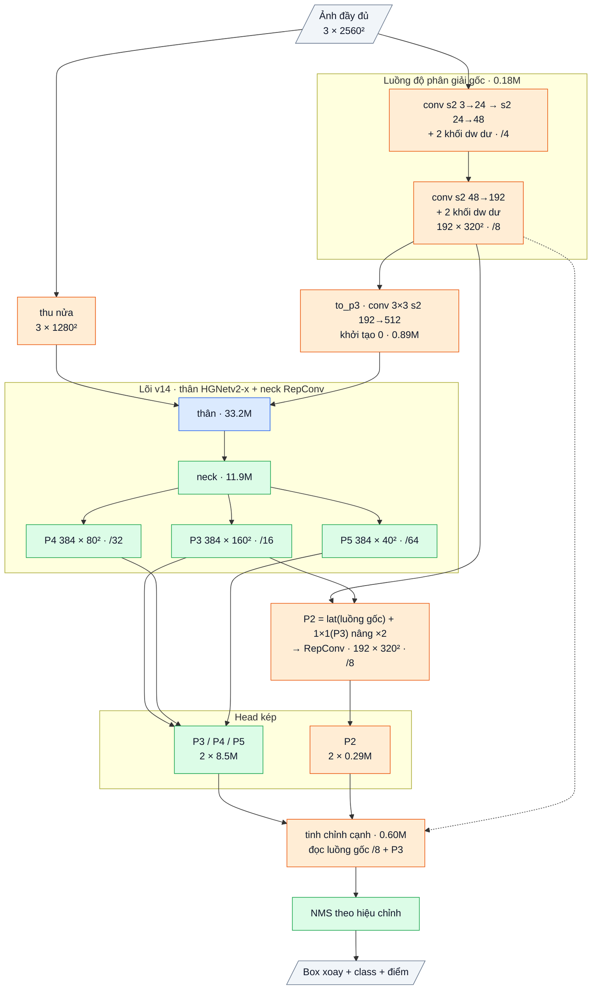

# OpenOBB15: OpenOBB14 + luồng độ phân giải gốc + lưới P2, bộ tinh chỉnh đọc nét ở độ phân giải gốc (2026-10-14)

`model=openobb15s | m | l | x`. Code: [openobb/models/openobb15.py](../openobb/models/openobb15.py) (kế thừa OpenOBB14).
`imgsz` là cỡ của lõi (như mọi model, ví dụ 1280); khung tự chuẩn bị ảnh ở 2 × imgsz (2560) cho luồng chi tiết. Chưa train.
Mốc: YOLO26x 0.746 / 0.499; v12 0.743 / 0.472 (15.3 ms); v14 0.713 / 0.469 (10.9 ms) (F59, F60).

## 1. Bằng chứng: phần thua nằm ở vật tí hon, và pixel là thứ YOLO không có

| Class (số object val) | v14 mAP50-95 | YOLO26x | Kích thước ở 1280 | ở ảnh gốc 2381 px |
|---|---|---|---|---|
| junction (1773) | .542 | .584 | 9.5 × 9 px | 18 × 17 px |
| wall (1044) | .565 | .624 | dày 5.6 px | dày 10.8 px |
| wall_300 (141) | .291 (mAP50 .677) | .441 (.824) | 10 × 6 px | 19 × 11 px |
| note (60) | .450 | .517 | | |

- mAP50-95 phạt sai số **tương đối**: 1 px lệch trên nút 9 px làm IoU rơi dưới 0.75; cùng 1 px trên nút 18 px thì không.
- 53% wall_300 chung ô P3 với một junction ở 1280; ở lưới stride 4 trên ảnh 2560 chỉ còn 6% (F52) → wall_300 có điểm lưới và đặc trưng riêng.
- YOLO26x đọc ảnh ở 1280 nên cũng chỉ thấy 9 px. Muốn thấy 18 px, YOLO phải chạy cả mạng ở 2560: gấp 4 lần chi phí (905 → 3620 GFLOPs).
  v15 chỉ chạy một luồng nhẹ ở độ phân giải gốc (36 GFLOPs) và một head P2 (40 GFLOPs).
- v13 (0.11.0) là ý này trên lõi v12, nhưng chưa bao giờ có run hợp lệ (F54: đặt sai `imgsz`). v15 ghép ý đó với bộ box của v14 đã chứng minh tác dụng trên tường (+.045, F60).

## 2. Lập luận

| Mảnh | Cơ chế | Kỳ vọng | Bác bỏ nếu |
|---|---|---|---|
| **Luồng độ phân giải gốc** (`hires`) | CNN nhẹ trên ảnh 2560 → bản đồ stride 8 (ảnh gốc) = stride 4 theo thang lõi, 192 kênh; lõi (thân + neck) chạy trên ảnh thu một nửa, đúng như v14 ở 1280 | đặc trưng thấy gấp 4 lần số pixel ở vật tí hon | — |
| **Lưới P2** (`p2_lat`, `p2_down`, `p2_fuse`, `p2_head`, `p2_head_o2o`) | lateral của luồng gốc + P3 phóng lên → RepConv → head kép riêng, hồi quy trực tiếp; stride 8 ảnh gốc | junction / wall_300 có ô riêng: wall_300 mAP50 ≥ .78, ô nhầm wall_300 → junction < 10% | wall_300 mAP50 không tăng ≥ 0.05 so với v14 |
| **Bộ tinh chỉnh đọc luồng gốc** (`edge`, s4 = 8, s3 = 16 px ảnh gốc) | 24 điểm trên cạnh / đầu / tim box lấy mẫu trên bản đồ mang pixel gốc; tường dày 11 px được đọc ở bước ~2 px theo thang lõi | wall mAP50-95 ≥ .60, junction ≥ .58 | junction 50-95 không hơn v14 (.542) ≥ 0.02 |
| **`to_p3`** | tóm tắt stride 16 (ảnh gốc) của luồng gốc cộng vào bản đồ stride 8 của thân, khởi tạo 0 | lõi bắt đầu đúng bằng v14 (test `test_v15_core_levels_start_as_v14_at_half_resolution`) | — |
| **Neck** | `neck=dfine` (encoder pretrained) mặc định cho vòng này, vì F60 cho thấy neck tự thiết kế mất tiên nghiệm trên 250 ảnh; `neck=own` vẫn có | | |

**Vì sao không lặp lại c5 (P2 cho decoder, −9.1 trên FPC):** c5 lấy P2 từ chính ảnh 1024 của lõi (không thêm pixel) và đưa vào decoder DETR 300 query; ở đây P2 mang pixel mới và có head dense riêng.

**Giới hạn nói trước:** chi phí tăng (mục 3) nên v15 nhắm độ chính xác, v14 nhắm tốc độ. Ảnh Wall_Color gốc 2000–3000 px; data nào có ảnh nhỏ hơn 2 × imgsz thì luồng gốc chỉ thấy ảnh phóng, không có pixel mới, lợi ích giảm.

## 3. Kích thước (bản x, đường suy luận, một head)

Sơ đồ khối và bảng từng lớp: mục 7 (phụ lục, cuối file).

| | Tham số | GFLOPs | Đầu vào |
|---|---|---|---|
| v12-x | 68.0M | 682 | 960 × 1280 |
| v14-x `neck=dfine` | 69.0M | 713 | 960 × 1280 |
| **v15-x `neck=dfine`** | **71.1M** | **882** (luồng gốc 36, head P2 40) | 1920 × 2560 |
| v15-x `neck=own` | 62.7M | 752 | 1920 × 2560 |

Tận dụng có sẵn (bản `neck=dfine`): thân + encoder D-FINE 53.9M = 76%; tự viết 24% (head kép, head P2, luồng gốc, bộ tinh chỉnh). Bản `neck=own`: 53% / 47%.

## 4. Chỉ số kỳ vọng (ghi TRƯỚC khi train)

Wall_Color, val 53 ảnh, thước YOLO, COCO init, 100 epoch, `imgsz=1280` (ảnh vào 2560), cùng hiệu chỉnh head / NMS cuối train.

| | v14 (F60) | YOLO26x | **v15 `neck=dfine` kỳ vọng** |
|---|---|---|---|
| mAP50 / 50-95 | 0.713 / 0.469 | 0.746 / 0.499 | **≥ 0.76 / ≥ 0.51** |
| junction 50-95 | .542 | .584 | ≥ .58 |
| wall 50-95 | .565 | .624 | ≥ .60 |
| wall_300 mAP50 / 50-95 | .677 / .291 | .824 / .441 | ≥ .78 / ≥ .38 |
| note mAP50 | .657 | .764 | ≥ .72 |
| tốc độ G4, batch 16 | 10.9 ms | — | ≤ 20 ms (khoảng 1.3 × v12) |

**Bác bỏ** nếu mAP50-95 < 0.49, hoặc junction 50-95 không hơn v14 ≥ 0.02, hoặc wall_300 mAP50 tăng < 0.05.

## 5. Vòng hai hạt giống

Khác nhau đúng một yếu tố (luồng gốc + P2 + bộ tinh chỉnh đọc luồng gốc); cả hai dùng encoder pretrained:

```bash
openobb train model=openobb15x data=/content/data.yaml imgsz=1280 epochs=100 neck=dfine
openobb train model=openobb14x data=/content/data.yaml imgsz=1280 epochs=100 neck=dfine
```

Log in `OpenOBB15: imgsz 1280 is the core's size; images are prepared at 2560 px`. Batch tự chọn theo VRAM và tự giảm khi thiếu.
Khi gửi log: bảng theo class, confusion matrix (ô wall_300 → junction), `Duplicate boxes`, `NMS calibrated`, dòng `Speed`.
Fine-tune từ checkpoint v14 (`weights=`): thân, neck, head P3–P5 nạp thẳng; luồng gốc, P2 và bộ tinh chỉnh khởi tạo mới.

## 6. Kết quả thật

### 6a. `openobb15x` neck mặc định (`neck=own`), user, 10-14 (LEDGER F63)

Không phải hạt giống đã đăng ký (`neck=dfine`); ghi lại vì cơ chế luồng gốc / P2 giống hệt. Điều kiện: 0.14.0, COCO init, 100 epoch,
`imgsz=1280` (ảnh vào 2560), batch 16 OOM → **batch 8** (31 bước / epoch, 3100 bước), lr 1e-3 cos, G4. Best ở epoch 97 (vẫn tăng rất chậm
từ epoch 85). Hiệu chỉnh: o2o none .3903 | o2o 0.7 .4309 | o2m 0.7 .4397 | **o2m 0.5 .4398**.

| | v15 own | v14 own (F60) | Δ |
|---|---|---|---|
| all | **0.653 / 0.416** | 0.713 / 0.469 | −.060 / −.053 |
| wall | .889 / .566 | .878 / .565 | +.011 / +.001 |
| junction | .887 / .536 | .899 / .542 | −.012 / −.006 |
| door | .962 / .802 | .970 / .813 | −.008 / −.011 |
| double_door | .551 / .439 | .634 / .510 | −.083 / −.071 |
| note | **.439 / .205** | .657 / .450 | **−.218 / −.245** |
| slide_door | .149 / .067 | .276 / .116 | −.127 / −.049 |
| wall_300 | .690 / .299 | .677 / .291 | +.013 / +.008 |

Lỗi hay gặp: junction → nền 89 (5%), wall → nền 67, slide_door → wall 18 (58%), note → nền 16 (27%). Box trùng 4.2%.
Tốc độ 14.5 ms / ảnh (batch 8, 2560, trung bình 1906 × 2560).

Đối chiếu bảng mục 4 (tiêu chí viết cho `neck=dfine`; dùng để đọc cơ chế, không phải phán quyết cuối):
- mAP50-95 ≥ 0.49: **không đạt** (0.416).
- junction 50-95 hơn v14 ≥ 0.02: **không đạt** (−.006).
- wall_300 mAP50 tăng ≥ 0.05: **không đạt** (+.013).
- tốc độ ≤ 20 ms: **đạt** (14.5 ms, batch 8).

Đọc: ở neck tự thiết kế, luồng gốc + P2 **không làm tăng** đúng ba class nó nhắm (wall, junction, wall_300 đứng yên trong ±0.01), còn toàn bộ
phần mất nằm ở class ngữ nghĩa / hiếm (note −.245, double_door −.071, slide_door −.049), cùng kiểu đã thấy ở v14 (F60) nhưng nặng hơn.
Lưu ý gây nhiễu: số v14 own là sau một vòng fine-tune thêm 20 epoch, không cùng lịch. Phán quyết cho cơ chế chờ cặp `neck=dfine` ở mục 5.

## 7. Phụ lục: kiến trúc theo lớp (cỡ x)

Ảnh vào **độ phân giải đầy đủ** 1 × 3 × 2560 × 2560 (`imgsz=1280` là cỡ của lõi; v15 tự nhân đôi), lõi v14 chạy trên ảnh thu nửa 1280².
Wall_Color (7 class). Ký hiệu: `conv k×k sS a→b` = Conv + BN + kích hoạt, `dw` = depthwise. Stride ghi theo điểm ảnh đầu vào.

### Luồng dữ liệu

Xanh dương: mượn (pretrained, Apache-2.0). Xanh lá: tự viết (của v14). Cam: mới ở v15.



Lõi trên ảnh thu nửa giống hệt v14 (thân HGNetv2-x, guard, Neck14, head kép nặng P3–P5): bảng lớp ở thẻ [OPENOBB14](OPENOBB14.md),
kích thước ở đó (ảnh 1280) là kích thước của lõi ở đây; stride theo ảnh đầy đủ gấp đôi. to_p3 cộng vào c3 của thân trước neck.

### Phần mới của v15 (tự viết)

| Khối | Lớp | Ra | Tham số |
|---|---|---|---|
| hires | conv 3×3 s2 3→24 → conv 3×3 s2 24→48 → 2 × DWRes(48) → conv 3×3 s2 48→192 → 2 × DWRes(192) | 192 × 320² (/8) | 0.18M |
| to_p3 | conv 3×3 s2 192→512 + BN (khởi tạo 0) → cộng vào c3 của thân | 512 × 160² (/16) | 0.89M |
| p2_lat | conv 1×1 192→192 + BN trên luồng gốc | 192 × 320² | 0.04M |
| p2_down | conv 1×1 384→192 + BN trên P3, nâng ×2 (nearest), cộng với p2_lat | 192 × 320² | 0.07M |
| p2_fuse | RepConv 3×3 192 | **P2** 192 × 320² (/8) | 0.37M |
| p2_head | Head14 trên P2, rộng 80: class Tower 192→80 (RepConv, RepConv giãn 2) → 7; box Tower 192→80 → 5 | 102 400 điểm | 0.29M |
| p2_head_o2o | như p2_head, trọng số riêng (một-một) | | 0.29M |
| edge | tinh chỉnh cạnh của v14, nhưng chi tiết đọc từ luồng gốc (192 kênh, /8 theo ảnh đầy đủ = /4 theo lõi) thay cho f4 của thân | 1500 box | 0.60M |

DWRes(c): x + conv 1×1 (BN khởi tạo 0) của dw 3×3(x).

Bộ tinh chỉnh cạnh (EdgeRefiner, 0.60M): với mỗi box ứng viên, lấy mẫu song tuyến 24 điểm trong khung box (6 trên mỗi cạnh dài, 3 trên
mỗi đầu, 6 trên đường tâm) trên luồng gốc (192 kênh) chiếu 1×1 → 64 kênh, và 6 điểm đường tâm trên P3 chiếu 1×1 384→64; nối với 4 số hình học
(log dài, log dày, sin / cos 2θ) → MLP 1924→256→256→5 (dịch hai đầu, log độ dày, lệch ngang, góc 0.2·tanh). Lớp cuối khởi tạo 0.

### Tổng hợp

| Phần | Tham số | Tỉ lệ | Nguồn |
|---|---|---|---|
| Thân HGNetv2-x | 33.23M | 51.3% | mượn (Apache-2.0) |
| Neck | 11.91M | 18.4% | tự viết |
| Head kép P3–P5 | 16.97M | 26.2% | tự viết |
| Luồng gốc + to_p3 + P2 | 1.55M | 2.4% | tự viết |
| Head kép P2 | 0.58M | 0.9% | tự viết |
| Tinh chỉnh cạnh | 0.60M | 0.9% | tự viết |
| **Tổng** | **64.83M** | | 48.7% tự viết |

Suy luận: 33 600 điểm (P3–P5) + 102 400 điểm (P2) của head đã chọn → top 1500 → tinh chỉnh cạnh → NMS theo hiệu chỉnh → tối đa 1000 box.
