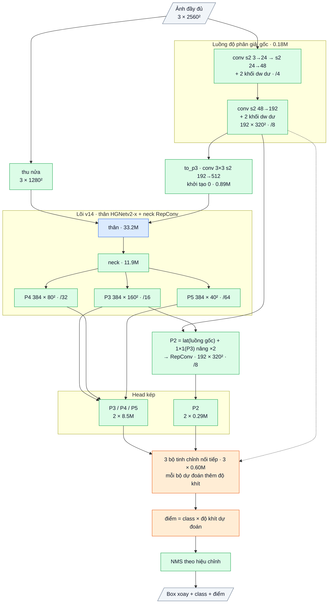

# OpenOBB16: OpenOBB15 + tinh chỉnh box theo tầng (cascade 3 bước) + chấm điểm theo độ khít (2026-10-14)

`model=openobb16s | m | l | x`. Code: [openobb/models/openobb16.py](../openobb/models/openobb16.py) (kế thừa OpenOBB15; cơ chế nằm trong
`openobb14.py`: `run_cascade`, `fit_scores`; loss trong `openobb14_loss.py`). `imgsz` = cỡ lõi (1280), ảnh vào 2× như v15. Chưa train.
Mốc: YOLO26x 0.746 / 0.499; v12 0.743 / 0.472; v14 0.713 / 0.469 (F59, F60). v15 đang train (user).


Sơ đồ khối và bảng từng lớp: mục 5 (phụ lục, cuối file).

## 1. Vì sao: thước mAP50-95 đo hai thứ, v16 nhắm cả hai

mAP50-95 = trung bình AP ở IoU 0.50, 0.55, …, 0.95. Ở ngưỡng cao nó đo (a) **box khít tới đâu** và (b) **box khít có được xếp trên box lỏng không**
(một box lỏng điểm cao là false positive ở IoU 0.8 và đẩy box khít xuống dưới). Khoảng cách với YOLO nằm trọn ở đây (F59: wall −.104,
wall_300 −.131, junction −.053, note −.058 ở mAP50-95 trong khi mAP50 ngang).

| Cơ chế | Bài học → lập luận | Bằng chứng ngoài |
|---|---|---|
| **Cascade 3 bước** (`edge` → `edge_more[0]` → `edge_more[1]`), mỗi bước cùng thiết kế, trọng số riêng, đọc lại nét ở độ phân giải gốc **trên box bước trước vừa sửa** | Bộ tinh chỉnh v14 học trên ứng viên ProbIoU ≥ 0.5 và chỉ nhìn cạnh của box dense; đầu ra của nó khít hơn đầu vào, nên bước sau nhìn cạnh đúng chỗ hơn và học trên ứng viên tốt hơn (ngưỡng 0.5 → 0.6 → 0.7). Đây là lập luận Cascade R-CNN; ở đây mỗi bước chỉ 30 điểm lấy mẫu + MLP, khoảng 4 GFLOPs | Cascade R-CNN: +3–4 AP, phần lớn ở IoU ≥ 0.75 |
| **Chấm điểm theo độ khít** (`fit`): bước cuối dự đoán logit của ProbIoU(box đã sửa, object); khi suy luận điểm class của ứng viên được sửa = điểm × fit^0.5, rồi mới NMS | Head class không biết box khít hay không; mAP50-95 phạt xếp hạng sai. Điểm nhân với chất lượng box dự đoán là cách GFL / VarifocalNet, nhưng ở đây áp lên box **đã tinh chỉnh**, nên fit là của box cuối cùng | GFL +1–2 AP; v8 từng đặt đích class = ProbIoU trên tầng quan hệ (không tách được) |
| **Đồng nhất lúc đầu** | mọi bước zero-init, fit khởi tạo logit +4 (p 0.98): v16 bắt đầu đúng bằng v15 (test `test_v16_starts_as_v15`) | luật của repo (OPENOBB7 → 15) |

Chi phí: +2 bước × 4 GFLOPs + head fit ≈ +8 GFLOPs trên v15 (882 → khoảng 890 ở 1920 × 2560, `neck=dfine`). Tham số +1.2M.

## 2. Loss

- Bước 1: như v14 (ngưỡng 0.5). Bước 2, 3: cùng loss, ứng viên là đầu ra (tách gradient) của bước trước, ngưỡng dương 0.6, 0.7 (`loss_ref_box2`, `loss_ref_box3`).
- `loss_ref_fit`: BCE của logit fit với ProbIoU(box cuối, object khớp) nếu ≥ 0.5, với 0 nếu không khớp; trên mọi ứng viên hợp lệ.
- Head dense và head một-một không đổi; `ref_k=0` tắt toàn bộ cascade khi suy luận (không cần train lại) để đo đóng góp.

## 3. Chỉ số kỳ vọng (ghi TRƯỚC khi train)

Wall_Color, COCO init, 100 epoch, `imgsz=1280` (ảnh vào 2560), `neck=dfine`, cùng hiệu chỉnh head / NMS.

| | v14 (F60) | YOLO26x | v15 kỳ vọng | **v16 kỳ vọng** |
|---|---|---|---|---|
| mAP50 / 50-95 | 0.713 / 0.469 | 0.746 / 0.499 | ≥ 0.76 / ≥ 0.51 | **≥ 0.76 / ≥ 0.53** |
| junction 50-95 | .542 | .584 | ≥ .58 | ≥ .60 |
| wall 50-95 | .565 | .624 | ≥ .60 | ≥ .63 |
| wall R@.75 (`box_quality.py`) | — | .56 | — | ≥ .55 |
| tốc độ G4, batch 16 | 10.9 ms | — | ≤ 20 ms | ≤ 21 ms |

**Bác bỏ** nếu v16 không hơn v15 ≥ 0.01 mAP50-95 (cùng điều kiện), hoặc `ref_k=0` trên checkpoint v16 cho mAP50-95 giảm < 0.01 (cascade không làm gì).

## 4. Train

```bash
openobb train model=openobb16x data=/content/data.yaml imgsz=1280 epochs=100 neck=dfine
```

Đi tiếp từ checkpoint v15 (`weights=`): mọi phần nạp thẳng, hai bước cascade và head fit khởi tạo mới (đồng nhất) → so v16 với v15 cùng xuất phát.
Khi gửi log: bảng theo class, `NMS calibrated`, `Duplicate boxes`, `Speed`, và `openobb val model=best.pt data=... ref_k=0`.

## 5. Phụ lục: kiến trúc theo lớp (cỡ x)

Ảnh vào **độ phân giải đầy đủ** 1 × 3 × 2560 × 2560 (`imgsz=1280` là cỡ của lõi; v15 tự nhân đôi), lõi v14 chạy trên ảnh thu nửa 1280². v16 = v15 + chuỗi 3 bộ tinh chỉnh + điểm × độ khít dự đoán.
Wall_Color (7 class). Ký hiệu: `conv k×k sS a→b` = Conv + BN + kích hoạt, `dw` = depthwise. Stride ghi theo điểm ảnh đầu vào.

### Luồng dữ liệu

Xanh dương: mượn (pretrained, Apache-2.0). Xanh lá: tự viết (của v14). Xanh lá cũng gồm phần của v15. Cam: mới ở v16.



Lõi trên ảnh thu nửa giống hệt v14 (thân HGNetv2-x, guard, Neck14, head kép nặng P3–P5): bảng lớp ở thẻ [OPENOBB14](OPENOBB14.md),
kích thước ở đó (ảnh 1280) là kích thước của lõi ở đây; stride theo ảnh đầy đủ gấp đôi. to_p3 cộng vào c3 của thân trước neck.

Phần luồng gốc, to_p3, P2 và head P2 giống hệt v15: bảng lớp ở thẻ [OPENOBB15](OPENOBB15.md).

### Phần mới của v16: chuỗi tinh chỉnh + độ khít (tự viết), 1.80M

| Khối | Lớp | Ra | Tham số |
|---|---|---|---|
| edge (bước 1) | tinh chỉnh cạnh của v15 (đọc luồng gốc + P3) + `fit`: Linear 256→1 trên lớp ẩn của MLP, logit ProbIoU(box đã sửa, object); bias +4 (p = 0.98 lúc đầu) | 1500 box + 1500 độ khít | 0.60M |
| edge_more.0 (bước 2) | cùng thiết kế, trọng số riêng, đọc box ra của bước 1 | | 0.60M |
| edge_more.1 (bước 3) | cùng thiết kế, trọng số riêng, đọc box ra của bước 2 | | 0.60M |
| điểm cuối | điểm class × sigmoid(fit) của bước cuối | | 0 |

Bộ tinh chỉnh cạnh (EdgeRefiner, 0.60M mỗi bước): với mỗi box ứng viên, lấy mẫu song tuyến 24 điểm trong khung box (6 trên mỗi cạnh dài, 3 trên
mỗi đầu, 6 trên đường tâm) trên luồng gốc (192 kênh) chiếu 1×1 → 64 kênh, và 6 điểm đường tâm trên P3 chiếu 1×1 384→64; nối với 4 số hình học
(log dài, log dày, sin / cos 2θ) → MLP 1924→256→256→5 (dịch hai đầu, log độ dày, lệch ngang, góc 0.2·tanh). Lớp cuối khởi tạo 0.

### Tổng hợp

| Phần | Tham số | Tỉ lệ | Nguồn |
|---|---|---|---|
| Thân HGNetv2-x | 33.23M | 50.3% | mượn (Apache-2.0) |
| Neck | 11.91M | 18.0% | tự viết |
| Head kép P3–P5 | 16.97M | 25.7% | tự viết |
| Luồng gốc + to_p3 + P2 | 1.55M | 2.3% | tự viết |
| Head kép P2 | 0.58M | 0.9% | tự viết |
| Chuỗi 3 bộ tinh chỉnh + độ khít | 1.80M | 2.7% | tự viết |
| **Tổng** | **66.02M** | | 49.7% tự viết |

Suy luận: 33 600 điểm (P3–P5) + 102 400 điểm (P2) của head đã chọn → top 1500 → 3 bước tinh chỉnh → điểm × độ khít → NMS theo hiệu chỉnh → tối đa 1000 box.
