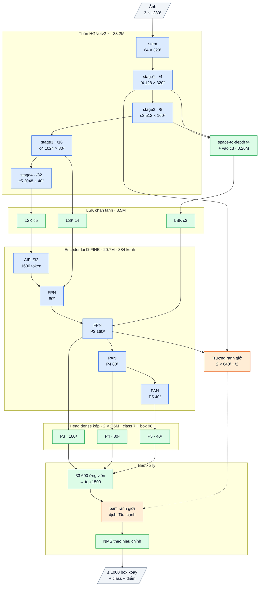

# OpenOBB17: detector theo ranh giới (trường ranh giới + bám ranh giới)

`model=openobb17s|m|l|x`. Code: `openobb/models/openobb17.py`, `openobb17_loss.py`. Test: `tests/test_openobb17.py`.
Sổ cái: F64 (chẩn đoán), F65 (thiết kế, kỳ vọng ghi trước).

## 1. Bằng chứng (F64, đo trên CPU với checkpoint v12, 53 ảnh val Wall_Color)

| Đo | Kết quả | Hệ quả |
|---|---|---|
| Thay một thành phần box của mỗi detection bằng giá trị nhãn | box hoàn hảo: 0.478 → 0.799 mAP50-95. **Hai đầu dọc trục +0.116** (wall_300 +.235, note +.160, junction +.132, slide_door +.123); lệch ngang +.049; độ dày +.036; góc +.003 | Phần còn thiếu là hình học box, lớn nhất là chỗ object kết thúc |
| Kéo cạnh box NHÃN về mép ảnh mạnh nhất trong ±2 px | IoU trung vị với chính nó: wall .61, junction .60, wall_300 .51; làm trên detection: −0.090 | Box là quy ước gán nhãn, không phải mép nét thấy được; "nhìn kỹ pixel hơn" (v15) không đủ |
| Tâm cạnh đầu của object nằm trên cạnh object khác (≤ 2 px) | wall_300 85%, slide_door 77%, wall 66%, junction 56% | Nét tường được chia đoạn; đầu object = ranh giới với object kế tiếp |
| Bootstrap thước | ±0.024 mAP50-95 (1σ) | Chỉ tính kết quả khi chênh ≥ 2σ hoặc có cặp hạt giống cùng phiên |
| Họ v14–v16 (head mới, `box=direct`) | v14 `neck=dfine` 50 ep: khoảng 0.62 / 0.38; v15 / v16: 0.60–0.67 / 0.39–0.42 | Không làm gốc; v17 xây trên **v12** (0.743 / 0.472, F59) |

## 2. Lập luận

| Bài học | Cơ chế | Kỳ vọng | Điều chứng minh sai |
|---|---|---|---|
| Mọi detector (v1–v16, YOLO) cho mỗi object tự hồi quy độ dài từ một điểm neo, độc lập với hàng xóm; sai số lớn nhất lại ở đầu box | **Trường ranh giới** stride 2, hai kênh: đầu (cạnh ngắn) và cạnh dài; giám sát bằng **mọi cạnh của mọi box nhãn** (dải Gaussian σ = 1 px, quality focal loss) | Đầu box định vị bằng bằng chứng cục bộ, sai số không tăng theo độ dài box | Thành phần "hai đầu" của `box_error_oracle.py` trên checkpoint v17 giảm < 15% |
| Hai object kề nhau có chung ranh giới | Cả hai đọc cùng một dải trên trường → ranh giới khớp nhau | wall / wall_300 / junction cùng tăng mAP50-95 | Tăng chỉ ở một class, class kề bên giảm |
| Box là quy ước, không phải mép ảnh (bám mép ảnh làm hại −0.09) | Trường **học** quy ước từ nhãn, không dùng gradient ảnh | Bám ranh giới học được không làm hại như bám mép ảnh | Hệ số bám (`snap.gain × 20`) cuối train ≈ 0: model tự tắt cơ chế |
| 250 ảnh, mỗi object chỉ một đích box | Giám sát dày đặc: khoảng 13 nghìn object × 4 cạnh mỗi epoch, hàng trăm nghìn pixel | Học nhanh, ít overfit hơn head box | `loss_field` không giảm sau 10 epoch |
| Phần mới phải bắt đầu đúng bằng bản trước | Hệ số bám khởi tạo 0, nhân với GAIN_SCALE = 20 để học nhanh | v17 lúc đầu = v12 (test `test_v17_starts_as_v12`) | — |

## 3. Chi tiết từng phần, tỉ lệ tận dụng

Sơ đồ khối và bảng từng lớp: mục 7 (phụ lục, cuối file).

| Phần | Nội dung | Nguồn | Tham số (x) |
|---|---|---|---|
| Thân HGNetv2 + LSK có chặn + encoder lai + head kép DFL | nguyên v12 | D-FINE COCO (Apache-2.0) + phần OpenOBB tự viết | 68.0M |
| `BoundaryField` | 1x1 chiếu stride-4 thân (128 kênh) + P3 (384) → 1x1 trộn → RepConv 3×3 → RepConv 3×3 dilation 2 (64 kênh) ở stride 4 → 1x1 ra 8 kênh → pixel shuffle ×2: 2 bản đồ logit ở stride 2. Bias khởi tạo ở xác suất 1% | tự viết | 0.12M |
| `BoundarySnap` | Với mỗi box: 4 cạnh, mỗi cạnh 3 đường song song × 33 mẫu song tuyến trong bán kính tìm (đầu: clamp(0.15 L, 3, 16) px; cạnh: clamp(0.5 T, 2, 6) px), lấy trung bình, softmax(logit / τ) → độ dời kỳ vọng t*, nhân độ tin cậy (xác suất đỉnh) và hệ số bám (đầu, cạnh). Box mới dựng lại từ 4 cạnh | tự viết | 3 số |
| Loss | v12 (một-nhiều + một-một, cân bằng class) + loss box của bước bám (như bộ tinh chỉnh v14, ngưỡng ProbIoU 0.5, ứng viên top-256 + box nhãn rung) + quality focal loss của trường | v12 / v14 + tự viết | — |
| Suy luận | top-1500 ứng viên của head đang dùng (o2m hoặc o2o) được bám ranh giới trước NMS; hiệu chỉnh head / NMS cuối train như v12 | tự viết | — |

- Phần mới chiếm **0.18% tham số**, khoảng **16 GFLOPs** ở 960 × 1280 (+2.4% so với 682 của v12), 100% tự viết.
- Tắt phần mới: `v7_off=field` (model khi đó là v12).
- Fine-tune từ checkpoint v12 (`weights=openobb12x.pt`): mọi tensor của v12 nạp thẳng, chỉ trường và bước bám là mới.

## 4. Chỉ số kỳ vọng (ghi TRƯỚC khi train)

Phép thử chính, rẻ nhất, khác đúng một yếu tố: fine-tune 30 epoch từ `openobb12x.pt`, cùng công thức với mốc F59
(lr 1e-3 cos theo iteration, batch 16, 1280, không nbs). A = v17; B = mốc F59 (chỉ chạy lại khi kết quả nằm vùng xám, mục 5).

| | B: v12 (F59: 0.743 / 0.472) | **A: v17 kỳ vọng** |
|---|---|---|
| mAP50-95 | khoảng 0.47–0.48 | **≥ B + 0.025** (khoảng 0.50) |
| mAP50 | khoảng 0.74 | không thấp hơn B quá 0.01 |
| wall_300 mAP50-95 | .29–.31 | ≥ .34 |
| junction mAP50-95 | .53 | ≥ .56 |
| wall mAP50-95 | .52 | ≥ .55 |
| Thành phần "hai đầu" (`box_error_oracle.py`) | +0.116 | ≤ +0.08 (giảm ≥ 30%) |
| `snap.gain × 20` cuối train | — | đầu ≥ 0.3 |
| Tốc độ G4 | 15.3 ms | ≤ 17 ms |

**Bác bỏ** nếu: A − B < 0.01 mAP50-95, hoặc thành phần "hai đầu" giảm < 15%, hoặc hệ số bám đầu < 0.1.
Nếu đạt: chạy FloorPlanCAD (24 ep, cặp v17 / v12) để xác nhận trên data lớn, rồi mới train dài từ COCO.

## 5. Lệnh

```bash
openobb train model=openobb17x weights=/content/openobb12x.pt data=/content/data.yaml imgsz=1280 epochs=30 batch=16 lr0=0.001 nbs=0 warmup_bias_lr=0 epoch_lr=False name=v17_ft
```

Mốc so sánh là F59 (v12 fine-tune 30 epoch từ cùng `openobb12x.pt`, cùng công thức: 0.743 / 0.472), không cần train lại v12.
Chỉ khi v17 rơi vào vùng xám (+0.01 đến +0.025 mAP50-95) mới chạy lại v12 cùng phiên để gỡ nhiễu giữa hai lần train:

```bash
openobb train model=openobb12x weights=/content/openobb12x.pt data=/content/data.yaml imgsz=1280 epochs=30 batch=16 lr0=0.001 nbs=0 warmup_bias_lr=0 epoch_lr=False name=v12_ft
```

`nbs=0 warmup_bias_lr=0 epoch_lr=False` giữ đúng công thức train cũ (cùng điều kiện với F59); bỏ ba tham số này là dùng công thức kiểu YOLO mới
(0.16.0). Dòng `model` trong log phải có "boundary field (stride 2) + boundary snapping".
Gửi lại: bảng theo class, confusion matrix, `Duplicate boxes`, `NMS calibrated`, `Speed`, và hai file `best.pt` (để chạy
`research/analysis/box_error_oracle.py` và đọc `snap.gain`).

## 6. Kết quả thật

**Run 1 (user, 10-15, F68):** 0.754 / 0.485, 15.9 ms. Không cùng điều kiện mục 4: công thức YOLO mới (`nbs 64`) và hai vòng fine-tune
(vòng 2 từ `best.pt` vòng 1). Tổng +0.013 so với F59 (vùng xám). wall .521, junction .515, wall_300 .270: **không đạt** cả ba mục tiêu class;
tốc độ đạt. Phần tăng nằm ở note / slide_door / double_door. Chưa kết luận cơ chế: chờ `snap.gain` và `box_error_oracle.py` trên `best.pt`.

**Vòng 2 (F69): `box=direct`.** Hậu xử lý không sửa được độ khít (box điểm cao nhất đã gần box tốt nhất); box trùng là do ngưỡng NMS
(0.5 thay 0.7: 9.7% → 1.6%, mAP giữ nguyên) và từ 0.17.1 bước hiệu chỉnh tự chọn ngưỡng ít trùng khi chênh fitness < 0.005.

```bash
openobb train data=/content/data.yaml model=openobb17x epochs=30 imgsz=1280 batch=16 lr=0.001 box=direct weights=/content/runs/obb/train4/weights/best.pt
openobb calibrate model=/content/runs/obb/train4/weights/best.pt data=/content/data.yaml
```

Lệnh thứ hai hiệu chỉnh lại checkpoint F68 theo luật mới (giảm box trùng ngay, không cần train). Kỳ vọng vòng 2: xem LEDGER F69.

## 7. Phụ lục: kiến trúc theo lớp (cỡ x)

Kích thước ghi cho ảnh vào 1 × 3 × 1280 × 1280, Wall_Color (7 class). Ký hiệu: `conv k×k sS a→b` = Conv + BN + kích hoạt,
`dw` = depthwise, `/N` = stride N so với ảnh.

### Luồng dữ liệu

Xanh dương: mượn (pretrained, Apache-2.0). Xanh lá: tự viết. Cam: mới ở v17 (v12 + trường ranh giới + bám ranh giới). Nét đứt: đọc trường ranh giới.



### Thân: HGNetv2-x (mượn, Apache-2.0, trọng số D-FINE COCO), 33.23M

| Khối | Lớp | Ra | Tham số |
|---|---|---|---|
| stem | conv 3×3 s2 3→32; nhánh [conv 2×2 32→16 → conv 2×2 16→32] ∥ max-pool 2; nối 64 → conv 3×3 s2 64→32 → conv 1×1 32→64 | 64 × 320² (/4) | 0.03M |
| stage1 | 1 khối HG: 6 × conv 3×3 64→64, nối 448 kênh → 1×1 →64 → 1×1 →128 | **f4** 128 × 320² | 0.26M |
| stage2 | dw 3×3 s2; 2 khối HG: 6 × conv 3×3 128, nối → 1×1 → 512 | **c3** 512 × 160² (/8) | 3.03M |
| stage3 | dw 3×3 s2; 5 khối HG nhẹ: 6 × (1×1 → dw 5×5) 256, nối → 1×1 512 → 1×1 1024 | **c4** 1024 × 80² (/16) | 11.93M |
| stage4 | dw 3×3 s2; 2 khối HG nhẹ: 6 × (1×1 → dw 5×5) 512, nối → 1×1 → 2048 | **c5** 2048 × 40² (/32) | 17.99M |

BN của thân bị đóng băng (FrozenBatchNorm), kích hoạt ReLU.

### Chặn độ lớn + chi tiết stride 4 (tự viết), 0.26M

| Khối | Lớp | Ra | Tham số |
|---|---|---|---|
| guard | sau mỗi stage của thân: x · min(1, 4 / rms(x)) theo từng ảnh (tính fp32); đồng nhất khi rms ≤ 4 | như đầu vào | 0 |
| spd | f4 space-to-depth (128 × 320² → 512 × 160²) → conv 1×1 512→512 + BN (gamma khởi tạo 0) → **cộng** vào c3 trước LSK | 512 × 160² | 0.26M |

### Adapter LSK (tự viết, ý tưởng LSKNet), 8.54M

Trên c3 / c4 / c5, mỗi tầng một khối (c = 512 / 1024 / 2048 kênh; 0.43M / 1.65M / 6.45M):
a = dw 5×5(x); b = dw 7×7 giãn 3(a) (trường nhìn khoảng 23 ô); a, b → conv 1×1 về c/2; cổng = conv 7×7 trên [trung bình, max theo kênh]
của [a, b] → 2 kênh sigmoid; m = conv 1×1 c/2→c (khởi tạo 0) của (a·g₁ + b·g₂); ra **x + x·tanh(m)** (hệ số khuếch đại luôn trong (0, 2)). Khởi tạo = đồng nhất.

### Encoder lai D-FINE (mượn, Apache-2.0, trọng số COCO), 20.70M, 384 kênh

| Khối | Lớp | Ra | Tham số |
|---|---|---|---|
| input_proj | ba conv 1×1 + BN: c3 512→384, c4 1024→384, c5 2048→384 | | 1.38M |
| AIFI | 1 lớp transformer trên 1600 token của /32: attention 8 đầu, FFN 384→2048→384 (GELU), vị trí sin-cos 2-D | 384 × 40² | 2.17M |
| FPN (2 bước) | lateral 1×1 384→384; upsample ×2; nối 768 → RepNCSPELAN4 → 384 | 384 × 80², **P3** 384 × 160² | 8.57M |
| PAN (2 bước) | SCDown [1×1 384→384 → dw 3×3 s2]; nối 768 → RepNCSPELAN4 → 384 | **P4** 384 × 80², **P5** 384 × 40² | 8.58M |

RepNCSPELAN4(768→384): conv 1×1 768→768, tách 2 nửa 384; nửa sau qua [CSP 384→192 (3 khối RepVGG 3×3 ∥ 1×1) → conv 3×3 192] rồi
[CSP 192→192 (3 khối) → conv 3×3 192]; nối 384 + 384 + 192 + 192 → conv 1×1 → 384. Kích hoạt SiLU.

### Head dense kép (tự viết), 2 × 2.63M

Hai head cùng thiết kế (head có ngữ cảnh của v7), trọng số riêng: **một-nhiều** (học, cần NMS) và **một-một**. Bước hiệu chỉnh cuối train chọn head và NMS dùng khi suy luận, lưu vào `best.pt`; khi suy luận chỉ chạy một head.

| Nhánh | Lớp (một tầng) | Ra mỗi điểm | Tham số (3 tầng) |
|---|---|---|---|
| class | dw 3×3 384 → 1×1 384→192 → StripMix(192, k = 11) → dw 3×3 192 → 1×1 192→192 → 1×1 →7 (bias tiên nghiệm 0.01) | 7 logit | 0.82M |
| box | conv 3×3 384→128 → conv 3×3 128→128 → 1×1 128→98 (chạy fp32) | 98 kênh | 1.81M |

98 kênh box (một nhóm): góc θ, lệch ngang tâm (× stride), phân phối 32 bin khoảng cách tới đầu sau và 32 bin tới đầu trước dọc trục
(bin = 1 stride), 32 bin độ dày (bin = 1/2 stride). Mỗi tầng một tháp riêng; điểm lưới = tâm ô.


### Trường ranh giới (tự viết), 0.125M

f4 → 1×1 128→64; P3 → 1×1 384→64 → upsample ×2; nối 128 → 1×1 →64 → RepConv 3×3 → RepConv 3×3 giãn 2 → 1×1 64→8 → pixel shuffle ×2
→ **2 × 640 × 640 (/2)**: kênh 0 = hai đầu object, kênh 1 = hai cạnh dài. Học vạch Gauss rộng 1 px vẽ trên các cạnh của box nhãn.

### Hậu xử lý có tham số (tự viết)

| Bước | Cơ chế | Tham số |
|---|---|---|
| chọn ứng viên | 33 600 điểm, điểm = max sigmoid class → top 1500 | 0 |
| bám ranh giới | dịch hai đầu / hai cạnh tới soft-argmax của trường trên 3 profile song song × 33 mẫu (bán kính đầu clamp(0.15 L, 3, 16) px, cạnh clamp(0.5 T, 2, 6) px); hệ số khởi tạo 0 | 3 |
| NMS | ProbIoU, chỉ chấm cặp cùng class có tâm gần; ngưỡng (hoặc không NMS) lấy từ hiệu chỉnh; tối đa 1000 box | 0 |

### Tổng hợp

| Phần | Tham số | Tỉ lệ | Nguồn |
|---|---|---|---|
| Thân HGNetv2-x | 33.23M | 48.8% | mượn (Apache-2.0) |
| guard + spd | 0.26M | 0.4% | tự viết |
| LSK | 8.54M | 12.5% | tự viết |
| Encoder lai | 20.70M | 30.4% | mượn (Apache-2.0) |
| Head (×2, chạy 1) | 5.26M | 7.7% | tự viết |
| Trường ranh giới | 0.13M | 0.2% | tự viết |
| **Tổng** | **68.12M** | | 20.8% tự viết (65.5M chạy khi suy luận) |

Suy luận: BN và RepConv gộp vào conv; head đã chọn → top 1500 → bám ranh giới → NMS theo hiệu chỉnh → tối đa 1000 box.
