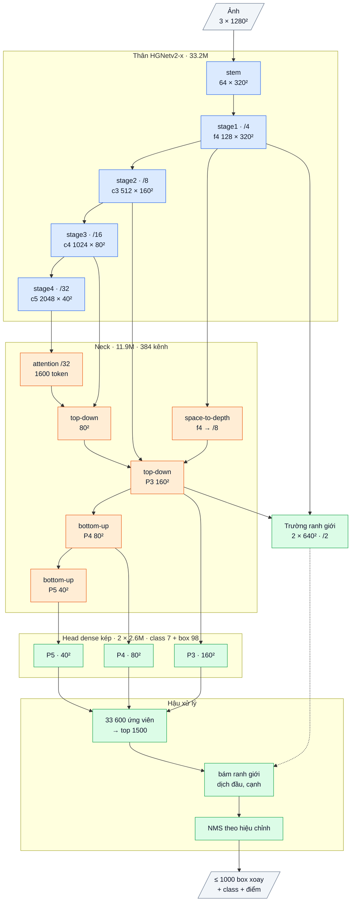

# OpenOBB18: lõi CAD nhanh (neck tự viết, chưng cất từ encoder đã train)

`model=openobb18s|m|l|x`, train với `teacher=<checkpoint v12 / v17 đã train>`. Code: `openobb/models/openobb18.py`,
`openobb18_loss.py`. Test: `tests/test_openobb18.py`. Sổ cái: F67.

Vòng này theo luật mới của user (10-15): mỗi vòng **hai version train song song**: v17 = tinh chỉnh nhỏ để dò trần,
v18 = bản đột phá về **cả tốc độ lẫn độ chính xác**.

## 1. Vì sao các lõi tự viết trước đây đều tệ, và v18 tránh điều đó thế nào

| Bản | Phần tự viết | Khởi tạo | Kết quả | Nguyên nhân |
|---|---|---|---|---|
| v2, v6, v9 (F25, F40, F50) | cả lõi | ngẫu nhiên / chưng cất từ thầy COCO | 0.36–0.56 mAP50 | 250 ảnh không đủ để học tiên nghiệm; thầy COCO không biết bản vẽ |
| v14 own (F60) | neck + head + bộ tinh chỉnh | thân COCO, neck ngẫu nhiên | 0.713 / 0.469 | class ngữ nghĩa / hiếm tụt (note −.084, slide_door −.134) |
| v14 `neck=dfine` (F65) | head + bộ tinh chỉnh | thân + encoder COCO | khoảng 0.62 / 0.38 sau 50 ep | **head mới** là phần hỏng, không phải neck |

Ý tưởng của backbone SOTA (RepVGG, CSP, dilation, kernel lớn) vẫn đúng và đã được dùng. Phần thiếu là **trọng số**: một backbone
SOTA mạnh vì được pretrain trên hàng triệu ảnh, không vì sơ đồ của nó. Kiến trúc mới mà khởi tạo ngẫu nhiên thì thua cả kiến trúc
cũ có tiên nghiệm khoảng 0.15 mAP (F39). v18 không bắt phần nào học từ đầu:

- **Thân HGNetv2 và head kép DFL:** nạp thẳng từ checkpoint v12 **đã train trên bản vẽ** (đầu ra v12 cho 0.743 / 0.472).
- **Neck mới (phần duy nhất mới, ngoài trường ranh giới):** học bắt chước đầu ra P3 / P4 / P5 của chính encoder v12 đã train,
  trên chính ảnh bản vẽ, cùng đầu vào là đặc trưng thân. Thầy cùng miền, cùng thân: bài toán dễ hơn nhiều so với F50 (thầy COCO,
  thân mới).

## 2. Lập luận

| Bài học | Cơ chế | Kỳ vọng | Điều chứng minh sai |
|---|---|---|---|
| Encoder lai (38% FLOPs) + LSK (7%) nghẽn băng thông bộ nhớ; attention ở 1/32 phẳng trên bản vẽ (F37, F58) | Thay bằng neck RepConv 3×3 dày của v14 (gộp thành 1 conv lúc suy luận), cùng độ rộng với encoder | Phần giữa 322 → 140 GFLOPs; toàn model 686 → 520 (−24%); thời gian −30–40% (v14: FLOPs −14% mà thời gian −29%) | Thời gian G4 > 0.85 × v12 |
| Neck tự viết khởi tạo ngẫu nhiên làm mất ngữ nghĩa (F60) | Chưng cất: sai số bình phương tương đối giữa P3–P5 của neck và của encoder v12 đã train, trọng số 2 | note / slide_door / wall_300 giữ gần mức v12 | note hoặc slide_door tụt > 0.08 so với v12; `loss_distill` không xuống dưới 0.1 |
| Head v14 là phần hỏng (F65) | Giữ head kép DFL của v12, nạp nguyên trọng số đã train | Học nhanh: epoch đầu đã gần mức v12 khi neck bắt kịp | mAP50 epoch 10 < 0.6 |
| Phần neck v14 giúp vật hình học (wall 50-95 +0.045, F60): space-to-depth stride 4, dilation | Giữ nguyên trong neck | wall / junction 50-95 ≥ v12 | wall 50-95 < v12 − 0.02 |
| Đầu box là sai số lớn nhất (F64) | Trường ranh giới + bám ranh giới của v17 | cộng thêm như v17 | xem thẻ v17 |

## 3. Chi tiết từng phần, tỉ lệ tận dụng

Sơ đồ khối và bảng từng lớp: mục 8 (phụ lục, cuối file).

| Phần | Nội dung | Nguồn | Tham số (x) | GFLOPs (960 × 1280) |
|---|---|---|---|---|
| Thân HGNetv2-B5 | 4 stage, ScaleGuard chặn độ lớn | D-FINE COCO (Apache-2.0), trọng số lấy từ v12 đã train | 33.2M | 320 |
| Neck | `Neck14` của v14: chiếu 1x1 → attention ở 1/32 → top-down / bottom-up bằng RepCSP (RepConv 3×3, dilation 1 / 2 / 1 / 3), space-to-depth stride 4 vào P3, max-pool khi hạ độ phân giải; rộng 384 (bằng encoder) | tự viết | 11.9M | 140 |
| Head kép DFL (một-nhiều + một-một) | của v12 | OpenOBB tự viết, trọng số lấy từ v12 | 2 × 2.6M | 44 |
| Trường ranh giới + bám ranh giới | của v17 | tự viết | 0.12M | 16 |
| **Tổng** | | | **50.6M** (v12: 67.1M) | **520** (v12: 686) |

- Phần mượn còn lại: **chỉ thân HGNetv2** (Apache-2.0, 33.2M = 66% tham số); 34% tham số và 39% FLOPs là code OpenOBB tự viết. Encoder D-FINE và LSK đã bỏ hẳn. Toàn bộ phần sau thân là code của OpenOBB.
- Thầy chỉ dùng lúc train, không nằm trong model lưu ra.
- `v7_off=field` tắt trường ranh giới (neck nhanh + head v12 thuần).

## 4. Chỉ số kỳ vọng (ghi TRƯỚC khi train)

Wall_Color, thước YOLO, khởi tạo + thầy = `openobb12x.pt`, 60 epoch, công thức cũ (`nbs=0 warmup_bias_lr=0 epoch_lr=False`), lr 1e-3, batch 16.

| | v12 (F59) | YOLO26x | **v18 kỳ vọng** |
|---|---|---|---|
| mAP50 / 50-95 | 0.743 / 0.472 | 0.746 / 0.499 | **≥ 0.73 / ≥ 0.48** |
| note mAP50 | .741 | .764 | ≥ .68 |
| slide_door mAP50 | .410 | .345 | ≥ .33 |
| wall 50-95 | .520 | .624 | ≥ .53 |
| tốc độ G4, batch 16 | 15.3 ms | — | **≤ 11.5 ms** (≤ 0.75 × v12) |
| `loss_distill` cuối train | — | — | < 0.1 |

**Đạt đột phá** nếu cùng lúc: tốc độ ≤ 0.75 × v12 **và** mAP50-95 ≥ v12 − 0.01.
**Bác bỏ** nếu: tốc độ > 0.85 × v12, hoặc mAP50-95 < 0.45, hoặc note / slide_door tụt > 0.08 so với v12.

## 5. Lệnh

```bash
openobb train data=/content/data.yaml model=openobb18x epochs=60 imgsz=1280 batch=16 lr=0.001 nbs=0 warmup_bias_lr=0 epoch_lr=False weights=/content/openobb12x.pt teacher=/content/openobb12x.pt
```

Log phải có dòng `[distill] neck distilled from the encoder of ...` và cột `loss_distill` trong `results.csv`.
Train song song với v17 (thẻ v17 mục 5). Gửi lại: bảng theo class, confusion matrix, `NMS calibrated`, `Speed`, `results.csv`.

## 6. Kết quả thật

**Run 1 (user, 10-15, F70): sai thiết kế** (không `weights=`, không `teacher=`: neck học từ đầu trên thân COCO): 0.623 / 0.369.
**Tốc độ 12.2 ms** so với v17 15.9 ms (−23%), v12 15.3 ms (−20%): phần tốc độ đạt. Phần độ chính xác chưa được thử.
Từ 0.17.2, `weights=` tự được dùng làm `teacher=` (từ 0.17.3: chỉ khi `weights=` là v12 / v17).

## 7. Kế hoạch vượt YOLO (F71)

```bash
# A: v18 đúng thiết kế trên Wall_Color (thầy = openobb12x.pt, tự bật)
openobb train data=/content/data.yaml model=openobb18x epochs=60 imgsz=1280 batch=16 lr=0.001 nbs=0 warmup_bias_lr=0 epoch_lr=False weights=/content/openobb12x.pt
# B: pretrain v18 trên FloorPlanCAD (tự tải + chuyển đổi khoảng 15 phút)
git clone -q https://github.com/Nguyenchitrai62/OpenOBB /content/OpenOBB
python /content/OpenOBB/colab/data/floorplancad.py --root /content/datasets
openobb train model=openobb18x data=/content/datasets/floorplancad_1024 imgsz=1024 epochs=24 batch=16
# Bước 2 (sau B): finetune Wall_Color từ checkpoint FloorPlanCAD
openobb train data=/content/data.yaml model=openobb18x epochs=60 imgsz=1280 batch=16 lr=0.001 nbs=0 warmup_bias_lr=0 epoch_lr=False weights=<best.pt của B>
```

## 8. Phụ lục: kiến trúc theo lớp (cỡ x)

Kích thước ghi cho ảnh vào 1 × 3 × 1280 × 1280, Wall_Color (7 class). Ký hiệu: `conv k×k sS a→b` = Conv + BN + kích hoạt,
`dw` = depthwise, `/N` = stride N so với ảnh.

### Luồng dữ liệu

Xanh dương: mượn (pretrained, Apache-2.0). Xanh lá: tự viết. Cam: mới ở v18 (v17 với neck RepConv tự viết thay LSK + encoder lai). Nét đứt: đọc trường ranh giới.



### Thân: HGNetv2-x (mượn, Apache-2.0, trọng số D-FINE COCO), 33.23M

| Khối | Lớp | Ra | Tham số |
|---|---|---|---|
| stem | conv 3×3 s2 3→32; nhánh [conv 2×2 32→16 → conv 2×2 16→32] ∥ max-pool 2; nối 64 → conv 3×3 s2 64→32 → conv 1×1 32→64 | 64 × 320² (/4) | 0.03M |
| stage1 | 1 khối HG: 6 × conv 3×3 64→64, nối 448 kênh → 1×1 →64 → 1×1 →128 | **f4** 128 × 320² | 0.26M |
| stage2 | dw 3×3 s2; 2 khối HG: 6 × conv 3×3 128, nối → 1×1 → 512 | **c3** 512 × 160² (/8) | 3.03M |
| stage3 | dw 3×3 s2; 5 khối HG nhẹ: 6 × (1×1 → dw 5×5) 256, nối → 1×1 512 → 1×1 1024 | **c4** 1024 × 80² (/16) | 11.93M |
| stage4 | dw 3×3 s2; 2 khối HG nhẹ: 6 × (1×1 → dw 5×5) 512, nối → 1×1 → 2048 | **c5** 2048 × 40² (/32) | 17.99M |

BN của thân bị đóng băng (FrozenBatchNorm), kích hoạt ReLU.

Mỗi stage đi qua bộ chặn độ lớn (guard, không tham số) như v7.

### Neck: Neck14 (tự viết, khởi tạo ngẫu nhiên; train bằng chưng cất từ encoder của một model v12 / v17 đã train khi có `teacher=`), 11.91M, 384 kênh

| Khối | Lớp | Ra | Tham số |
|---|---|---|---|
| proj | ba conv 1×1 (không kích hoạt): c3 512→384, c4 1024→384, c5 2048→384 | | 1.38M |
| attn | 1 lớp transformer trên 1600 token của /32: vị trí bằng dw 3×3; LayerNorm → attention 8 đầu; LayerNorm → FFN 384→768→384 (GELU). Hai nhánh dư nhân cổng khởi tạo 0 | 384 × 40² | 1.19M |
| lat5 | conv 1×1 → **t5** | 384 × 40² | 0.15M |
| td4 | nối [proj c4, upsample ×2 t5] 768 → RepCSP (3 RepConv, giãn 1 / 2 / 1) → n4 → lat4 1×1 → **t4** | 384 × 80² | 1.92M |
| spd | f4 space-to-depth (128 × 320² → 512 × 160²) → conv 1×1 512→192: chi tiết /4 vào P3 | 192 × 160² | 0.10M |
| td3 | nối [proj c3, upsample ×2 t4, spd] 960 → RepCSP | **P3** 384 × 160² | 1.85M |
| dn3 + bu4 | Down [conv 3×3 s2 384→192 ∥ max-pool 2] → 1×1 576→384; nối t4 → RepCSP | **P4** 384 × 80² | 2.66M |
| dn4 + bu5 | như trên, nối t5, RepCSP không giãn | **P5** 384 × 40² | 2.66M |

RepCSP(a→384, n=3): conv 1×1 a→384, tách 2 nửa 192; nửa sau qua lần lượt 3 RepConv 192 (3×3 ∥ 1×1 ∥ BN đồng nhất, gộp thành một
conv 3×3 khi suy luận); nối 2 nửa + 3 đầu ra (960) → conv 1×1 → 384.

### Head dense kép (tự viết), 2 × 2.63M

Hai head cùng thiết kế (head có ngữ cảnh của v7), trọng số riêng: **một-nhiều** (học, cần NMS) và **một-một**. Bước hiệu chỉnh cuối train chọn head và NMS dùng khi suy luận, lưu vào `best.pt`; khi suy luận chỉ chạy một head.

| Nhánh | Lớp (một tầng) | Ra mỗi điểm | Tham số (3 tầng) |
|---|---|---|---|
| class | dw 3×3 384 → 1×1 384→192 → StripMix(192, k = 11) → dw 3×3 192 → 1×1 192→192 → 1×1 →7 (bias tiên nghiệm 0.01) | 7 logit | 0.82M |
| box | conv 3×3 384→128 → conv 3×3 128→128 → 1×1 128→98 (chạy fp32) | 98 kênh | 1.81M |

98 kênh box (một nhóm): góc θ, lệch ngang tâm (× stride), phân phối 32 bin khoảng cách tới đầu sau và 32 bin tới đầu trước dọc trục
(bin = 1 stride), 32 bin độ dày (bin = 1/2 stride). Mỗi tầng một tháp riêng; điểm lưới = tâm ô.


### Trường ranh giới (tự viết), 0.125M

f4 → 1×1 128→64; P3 → 1×1 384→64 → upsample ×2; nối 128 → 1×1 →64 → RepConv 3×3 → RepConv 3×3 giãn 2 → 1×1 64→8 → pixel shuffle ×2
→ **2 × 640 × 640 (/2)**: kênh 0 = hai đầu object, kênh 1 = hai cạnh dài. Học vạch Gauss rộng 1 px vẽ trên các cạnh của box nhãn.

### Hậu xử lý có tham số (tự viết)

| Bước | Cơ chế | Tham số |
|---|---|---|
| chọn ứng viên | 33 600 điểm, điểm = max sigmoid class → top 1500 | 0 |
| bám ranh giới | dịch hai đầu / hai cạnh tới soft-argmax của trường trên 3 profile song song × 33 mẫu (bán kính đầu clamp(0.15 L, 3, 16) px, cạnh clamp(0.5 T, 2, 6) px); hệ số khởi tạo 0 | 3 |
| NMS | ProbIoU, chỉ chấm cặp cùng class có tâm gần; ngưỡng (hoặc không NMS) lấy từ hiệu chỉnh; tối đa 1000 box | 0 |

### Tổng hợp

| Phần | Tham số | Tỉ lệ | Nguồn |
|---|---|---|---|
| Thân HGNetv2-x | 33.23M | 65.8% | mượn (Apache-2.0) |
| Neck | 11.91M | 23.6% | tự viết |
| Head (×2, chạy 1) | 5.26M | 10.4% | tự viết |
| Trường ranh giới | 0.13M | 0.2% | tự viết |
| **Tổng** | **50.53M** | | 34.2% tự viết (47.9M chạy khi suy luận) |

Suy luận: BN và RepConv gộp vào conv; head đã chọn → top 1500 → bám ranh giới → NMS theo hiệu chỉnh → tối đa 1000 box.
