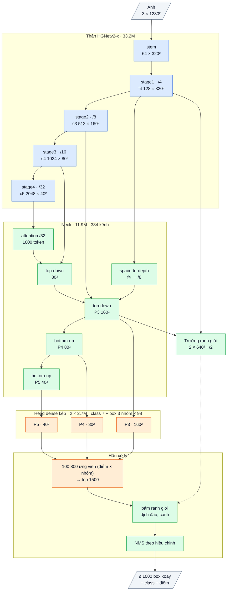

# OpenOBB19: head theo nhóm tranh chấp (mỗi điểm lưới một box cho mỗi nhóm class)

`model=openobb19x` (= v18 + nhóm), hoặc công tắc `groups=auto` cho v17 / v18. Code: `openobb/models/groups.py`,
`openobb18.py` (`OpenOBB19`), `openobb17.py` (head nhóm), `openobb10_loss.py` (`group_assign`, `grouped_dense_losses`).
Test: `tests/test_openobb19.py`. Sổ cái: F72.

## 1. Bằng chứng (F72, đo trên nhãn và trên ứng viên của v12; CPU)

| Đo | Kết quả |
|---|---|
| Recall wall theo độ dài (ProbIoU 0.5, conf 0.25), v12 / YOLO26x | < 12 px: **0.33 / 0.69**; 12–24 px: 0.72 / 0.85; ≥ 24 px: 0.94–0.97 / 0.89–0.96 |
| Recall wall_300 < 12 px, v12 / YOLO26x | 0.63 / 0.75 |
| Object không có điểm lưới riêng (stride 8, một box mỗi điểm) | **junction 60%**, wall ngắn 86%, wall_300 ngắn 86% |
| Cùng chỉ số ở stride 4 / ảnh 1920 | wall ngắn vẫn 72% / 76%: lưới mịn hơn không giải quyết |
| Nới box nhỏ lên 16 px (kiểu STAL của YOLO26) | tranh chấp tăng 86% → 93% |
| Ai giành điểm của mẩu tường | junction 753, wall 245, door 99 |
| Ma trận tranh chấp (nghìn lần) | junction ↔ wall 7.4, junction ↔ door 1.6, wall ↔ door 1.3, wall ↔ wall 2.4 |
| Tách 3 nhóm (junction / wall_300 / còn lại) | không có điểm riêng: junction 60% → **2%**, wall_300 ngắn 86% → **1%**, wall ngắn 86% → 39% |

Khoảng cách mAP50 lớn nhất với YOLO là wall (−0.075): đúng bằng phần tường ngắn bị sót.
Nguyên nhân là **khuôn "một điểm lưới, một object"** (chung cho YOLO và mọi OpenOBB). Trên bản vẽ, các object chạm và chồng
nhau ở đầu (mẩu tường nằm trong box junction), nên phần lớn object không có điểm của riêng mình.

## 2. Cơ chế

Sơ đồ khối và bảng từng lớp: mục 7 (phụ lục, cuối file).

- Các class được chia thành G nhóm (mặc định 3) **tự động từ nhãn train**: tô màu tham lam ma trận tranh chấp; class hay
  giành điểm của nhau nằm ở nhóm khác nhau. Wall_Color: junction | wall + wall_300 | door + slide_door + double_door + note.
- Head kép của v12 giữ nguyên; lớp ra của nhánh box có G × kênh: mỗi điểm đoán **một box cho mỗi nhóm**. Logit class vẫn
  một bộ cho mọi class.
- Gán nhãn: mỗi nhóm gán riêng (object của nhóm, box của nhóm). Hai object khác nhóm chồng nhau đều có điểm dương ở cùng vị trí.
  Mục tiêu class của các nhóm cộng lại (cột rời nhau) thành một loss phân loại.
- Suy luận: mỗi (điểm, nhóm) là một ứng viên, chỉ mang các class của nhóm đó; NMS theo class như cũ (không có box trùng chéo
  nhóm vì class rời nhau). Bám ranh giới (v17) chạy trên các ứng viên này.
- Khởi tạo từ checkpoint một nhóm (v12 / v17 / v18): box của nhóm 0 được chép sang mọi nhóm → lúc đầu cho đúng kết quả của
  model gốc (test `test_grouped_model_starts_as_one_group_model`).
- Chi phí: lớp ra nhánh box × 3 (khoảng +0.7 GFLOPs, < 0.2%), NMS trên 3 × ứng viên (vẫn cắt top 4000).

## 3. Ba mặt so với YOLO

| Mặt | Cơ chế | Nguồn |
|---|---|---|
| Chính xác | head nhóm (tường ngắn, wall_300, junction có điểm riêng) + trường ranh giới | F72, F64 |
| Nhanh | neck RepConv chưng cất (v18): 12.2 ms so với 15.3–15.9 ms | F70 |
| Ít box trùng | hiệu chỉnh ưu tiên NMS ít trùng (7.3% → 2.2% trên v17) | F69 |

## 4. Chỉ số kỳ vọng (ghi TRƯỚC khi train)

**A. `openobb17x groups=auto`** từ `openobb17x.pt` (F68), 30 ep, cùng công thức với F68 (một yếu tố: nhóm):
mAP50 ≥ 0.775 (F68 0.754), wall mAP50 ≥ .88 (.844), wall_300 mAP50 ≥ .76 (.712), junction 50-95 ≥ .53 (.515), box trùng ≤ 3%.

**B. `openobb19x`** từ `openobb12x.pt` (thân + head, thầy tự bật), 60 ep, công thức cũ:
≥ 0.77 / ≥ 0.50 (YOLO26x 0.746 / 0.499), ≤ 12.5 ms G4 batch 16, box trùng ≤ 3%.

Chẩn đoán đi kèm: `research/analysis/miss_by_length.py` trên checkpoint mới: recall wall < 12 px ≥ 0.6 (v12 0.33, YOLO 0.69).
**Bác bỏ** nếu recall wall < 12 px < 0.5, hoặc wall mAP50 tăng < 0.02 so với model gốc cùng điều kiện.

## 5. Lệnh

```bash
# A: cơ chế nhóm trên bản tốt nhất (v17)
openobb train data=/content/data.yaml model=openobb17x groups=auto epochs=30 imgsz=1280 batch=16 lr=0.001 weights=/content/openobb17x.pt
# B: bản đột phá đủ ba mặt
openobb train data=/content/data.yaml model=openobb19x epochs=60 imgsz=1280 batch=16 lr=0.001 nbs=0 warmup_bias_lr=0 epoch_lr=False weights=/content/openobb12x.pt
```

Log phải có dòng `[groups] contention-aware class groups (from the training labels): ...`.

## 6. Kết quả thật

**A. `openobb17x groups=auto` (F74):** 0.757 / 0.487 so với cùng điều kiện không nhóm (F73) 0.749 / 0.483. wall mAP50 +0.032 (tường bị sót −33%),
junction 50-95 +0.026, wall_300 −0.072 (nhầm sang junction 13% → 21%). Tiêu chí: junction đạt; mAP50 tổng, wall ≥ .88, wall_300, box trùng không đạt;
không bị bác bỏ. Box trùng 7.4% do hiệu chỉnh giữ NMS 0.7; từ 0.18.2 (DUP_TOL 0.01) sẽ chọn 0.5 (2.2%).

**B. `openobb19x` vòng 2 (F75):** 0.755 / 0.462, **12.4 ms** (v12 15.3, v17 16.1), box trùng **2.8%**. wall mAP50 .879 (cao nhất từ trước).
Tiêu chí: tốc độ ≤ 12.5 ms đạt, box trùng ≤ 3% đạt, ≥ 0.77 / ≥ 0.50 không đạt (mAP50-95 hụt do độ khít: junction / door / note).

## 7. Phụ lục: kiến trúc theo lớp (cỡ x)

Kích thước ghi cho ảnh vào 1 × 3 × 1280 × 1280, Wall_Color (7 class, 3 nhóm class). Ký hiệu: `conv k×k sS a→b` = Conv + BN + kích hoạt,
`dw` = depthwise, `/N` = stride N so với ảnh.

### Luồng dữ liệu

Xanh dương: mượn (pretrained, Apache-2.0). Xanh lá: tự viết. Cam: mới ở v19 (v18 + một box mỗi nhóm class). Nét đứt: đọc trường ranh giới.



### Thân: HGNetv2-x (mượn, Apache-2.0, trọng số D-FINE COCO), 33.23M

| Khối | Lớp | Ra | Tham số |
|---|---|---|---|
| stem | conv 3×3 s2 3→32; nhánh [conv 2×2 32→16 → conv 2×2 16→32] ∥ max-pool 2; nối 64 → conv 3×3 s2 64→32 → conv 1×1 32→64 | 64 × 320² (/4) | 0.03M |
| stage1 | 1 khối HG: 6 × conv 3×3 64→64, nối 448 kênh → 1×1 →64 → 1×1 →128 | **f4** 128 × 320² | 0.26M |
| stage2 | dw 3×3 s2; 2 khối HG: 6 × conv 3×3 128, nối → 1×1 → 512 | **c3** 512 × 160² (/8) | 3.03M |
| stage3 | dw 3×3 s2; 5 khối HG nhẹ: 6 × (1×1 → dw 5×5) 256, nối → 1×1 512 → 1×1 1024 | **c4** 1024 × 80² (/16) | 11.93M |
| stage4 | dw 3×3 s2; 2 khối HG nhẹ: 6 × (1×1 → dw 5×5) 512, nối → 1×1 → 2048 | **c5** 2048 × 40² (/32) | 17.99M |

BN của thân bị đóng băng (FrozenBatchNorm), kích hoạt ReLU.

Mỗi stage đi qua bộ chặn độ lớn (guard, không tham số) như v7.

### Neck: Neck14 (tự viết, khởi tạo ngẫu nhiên; train bằng chưng cất từ encoder của một model v12 / v17 đã train khi có `teacher=`), 11.91M, 384 kênh

| Khối | Lớp | Ra | Tham số |
|---|---|---|---|
| proj | ba conv 1×1 (không kích hoạt): c3 512→384, c4 1024→384, c5 2048→384 | | 1.38M |
| attn | 1 lớp transformer trên 1600 token của /32: vị trí bằng dw 3×3; LayerNorm → attention 8 đầu; LayerNorm → FFN 384→768→384 (GELU). Hai nhánh dư nhân cổng khởi tạo 0 | 384 × 40² | 1.19M |
| lat5 | conv 1×1 → **t5** | 384 × 40² | 0.15M |
| td4 | nối [proj c4, upsample ×2 t5] 768 → RepCSP (3 RepConv, giãn 1 / 2 / 1) → n4 → lat4 1×1 → **t4** | 384 × 80² | 1.92M |
| spd | f4 space-to-depth (128 × 320² → 512 × 160²) → conv 1×1 512→192: chi tiết /4 vào P3 | 192 × 160² | 0.10M |
| td3 | nối [proj c3, upsample ×2 t4, spd] 960 → RepCSP | **P3** 384 × 160² | 1.85M |
| dn3 + bu4 | Down [conv 3×3 s2 384→192 ∥ max-pool 2] → 1×1 576→384; nối t4 → RepCSP | **P4** 384 × 80² | 2.66M |
| dn4 + bu5 | như trên, nối t5, RepCSP không giãn | **P5** 384 × 40² | 2.66M |

RepCSP(a→384, n=3): conv 1×1 a→384, tách 2 nửa 192; nửa sau qua lần lượt 3 RepConv 192 (3×3 ∥ 1×1 ∥ BN đồng nhất, gộp thành một
conv 3×3 khi suy luận); nối 2 nửa + 3 đầu ra (960) → conv 1×1 → 384.

### Head dense kép (tự viết), 2 × 2.71M

Hai head cùng thiết kế (head có ngữ cảnh của v7), trọng số riêng: **một-nhiều** (học, cần NMS) và **một-một**. Bước hiệu chỉnh cuối train chọn head và NMS dùng khi suy luận, lưu vào `best.pt`; khi suy luận chỉ chạy một head.

| Nhánh | Lớp (một tầng) | Ra mỗi điểm | Tham số (3 tầng) |
|---|---|---|---|
| class | dw 3×3 384 → 1×1 384→192 → StripMix(192, k = 11) → dw 3×3 192 → 1×1 192→192 → 1×1 →7 (bias tiên nghiệm 0.01) | 7 logit | 0.82M |
| box | conv 3×3 384→128 → conv 3×3 128→128 → 1×1 128→294 (chạy fp32) | 3 nhóm × 98 kênh | 1.89M |

98 kênh box (một nhóm): góc θ, lệch ngang tâm (× stride), phân phối 32 bin khoảng cách tới đầu sau và 32 bin tới đầu trước dọc trục
(bin = 1 stride), 32 bin độ dày (bin = 1/2 stride). Mỗi tầng một tháp riêng; điểm lưới = tâm ô.

Mỗi điểm lưới cho một box cho mỗi **nhóm class** (3 nhóm trên Wall_Color, tự chia từ nhãn bằng `groups=auto`: các class hay chung ô lưới vào nhóm khác nhau); class nào dùng box của nhóm nó.

### Trường ranh giới (tự viết), 0.125M

f4 → 1×1 128→64; P3 → 1×1 384→64 → upsample ×2; nối 128 → 1×1 →64 → RepConv 3×3 → RepConv 3×3 giãn 2 → 1×1 64→8 → pixel shuffle ×2
→ **2 × 640 × 640 (/2)**: kênh 0 = hai đầu object, kênh 1 = hai cạnh dài. Học vạch Gauss rộng 1 px vẽ trên các cạnh của box nhãn.

### Hậu xử lý có tham số (tự viết)

| Bước | Cơ chế | Tham số |
|---|---|---|
| chọn ứng viên | 33 600 điểm × 3 nhóm, điểm = max sigmoid class → top 1500 | 0 |
| bám ranh giới | dịch hai đầu / hai cạnh tới soft-argmax của trường trên 3 profile song song × 33 mẫu (bán kính đầu clamp(0.15 L, 3, 16) px, cạnh clamp(0.5 T, 2, 6) px); hệ số khởi tạo 0 | 3 |
| NMS | ProbIoU, chỉ chấm cặp cùng class có tâm gần; ngưỡng (hoặc không NMS) lấy từ hiệu chỉnh; tối đa 1000 box | 0 |

### Tổng hợp

| Phần | Tham số | Tỉ lệ | Nguồn |
|---|---|---|---|
| Thân HGNetv2-x | 33.23M | 65.6% | mượn (Apache-2.0) |
| Neck | 11.91M | 23.5% | tự viết |
| Head (×2, chạy 1) | 5.42M | 10.7% | tự viết |
| Trường ranh giới | 0.13M | 0.2% | tự viết |
| **Tổng** | **50.68M** | | 34.4% tự viết (48.0M chạy khi suy luận) |

Suy luận: BN và RepConv gộp vào conv; head đã chọn → top 1500 → bám ranh giới → NMS theo hiệu chỉnh → tối đa 1000 box.
