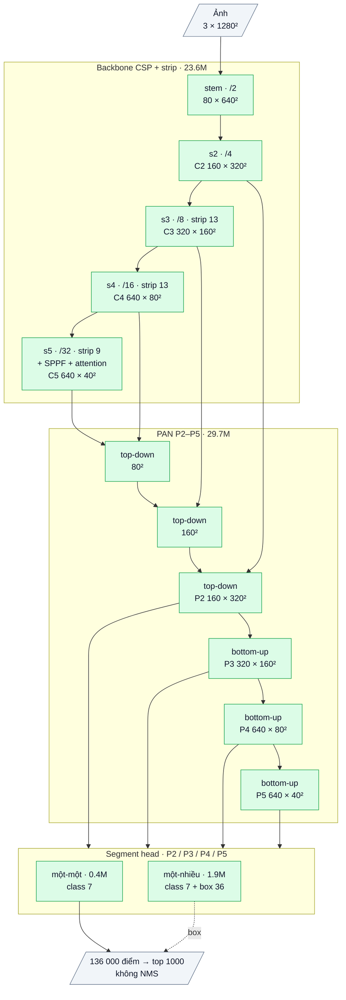

# OpenOBB2: kiến trúc dense segment-aware (bản 2, 2026-10-09)

Dùng: CLI giữ nguyên, chỉ đổi `model=`.

```bash
openobb train data=path/data.yaml model=openobb2x epochs=300 imgsz=1024
```

- `model=openobb2x`: kiến trúc mới (OpenOBB2), train từ đầu.
- `model=openobb1x`: kiến trúc cũ (OpenOBB1, D-FINE-OBB).
- Fine-tune từ `best.pt` của OpenOBB2 tự nhận ra kiến trúc.
- Checkpoint OpenOBB1 **không** nạp được vào OpenOBB2 (khác hình dạng).

## 1. Vì sao phải đổi kiến trúc

OpenOBB1 là DETR (D-FINE). Trên Wall_Color thua YOLO11x (0.63/0.35 so với 0.74/0.50) vì 4 trần cứng:

| Trần cứng của OpenOBB1 | Hậu quả với object nhỏ, dài, mảnh |
|---|---|
| Chọn top-K query (300–900) trước decoder | Ảnh dày object thì object bị bỏ trước khi kịp đoán |
| Ghép one-to-one Hungarian: mỗi object chỉ 1 mẫu dương | Ít ảnh thì học chậm, hội tụ sớm ở mức thấp |
| Deformable sampling ở stride ≥ 8 | Nét dày 2–3 px chỉ chiếm vài phần trăm của một ô, box không khít (mAP50-95 thấp) |
| Backbone B5 + 6 lớp decoder + `grid_sample` | Suy luận chậm |

OpenOBB2 bỏ hết cả bốn: dự đoán dày đặc ở **mọi điểm** của P2–P5, nhiều mẫu dương mỗi object, không có `grid_sample`, không NMS.

## 2. Các phần của kiến trúc (bản x)

Sơ đồ khối và bảng từng lớp: mục 8 (phụ lục, cuối file).

Tổng **55.6M tham số** (YOLO11x-OBB khoảng 58.8M).

| # | Phần | Làm gì | Tham số x | Ý tưởng lấy từ | Code |
|---|---|---|---|---|---|
| 1 | **Backbone CSP + strip conv**: stem → 4 stage (stride 4/8/16/32), mỗi stage = Conv s2 + khối CSP. Ở stage 3–5, bottleneck dùng `_StripMix`: depthwise 3×3 + **1×k và k×1** (k = 13, 13, 9), trộn bằng 1×1 | Trường nhìn dài, mảnh theo cả 2 trục, rẻ (depthwise). Một ô thấy được cả đoạn tường/ống dài 100–400 px | 22.5M | CSP/C2f của họ YOLO; strip conv của Strip R-CNN / LSKNet | Tự viết |
| 2 | **SPPF + Global Attention ở P5**: 1 lớp transformer (d=256, 8 head, pos sin-cos 2-D), out-conv khởi tạo 0 | Ngữ cảnh toàn trang (legend, lưới trục, mật độ) cho phân loại | 1.1M | SPPF (YOLO), AIFI (RT-DETR) / C2PSA (YOLO11) | Tự viết |
| 3 | **PAN 2 chiều P2–P5**: top-down C5→C4→C3→**C2**, rồi bottom-up P2→P3→P4→P5; khối CSP có strip ở P2/P3 | **P2 (stride 4) là tầng đã trộn ngữ nghĩa thật**, không phải feature thô, nên nét 2–3 px và junction nhỏ có ô riêng | 29.7M | PAN/FPN (YOLO, PANet) | Tự viết |
| 4 | **Segment head** (mới, phần chính của OpenOBB2). Mỗi điểm đoán 4 số + 1 phân phối (chi tiết ở bảng dưới). Box = (cx, cy, dài, dày, θ) | Đọc box như một **đoạn thẳng có độ dày**. Chiều dài không giới hạn, độ dày chính xác dưới 1 stride | 1.9M | Không có trong YOLO/DETR. DFL (GFL) chỉ dùng cho độ dày | Tự viết, **mới** |
| 5 | **Đầu o2o (one-to-one)**: chỉ có nhánh phân loại, chạy trên feature đã detach, **dùng chung nhánh box** với o2m | Mỗi object ra đúng 1 điểm → **không cần NMS**. Box học từ mọi mẫu dương của o2m nên vẫn khít | 0.4M | Dual assignment YOLOv10 / YOLO26 | Tự viết. **Mới:** chia sẻ box nhờ thiết kế segment |
| 6 | **Gán nhãn (assign)**, chỉ dùng lúc train | Chọn điểm nào học object nào (chi tiết ở bảng dưới) | 0 | TAL (TOOD/YOLOv8), STAL (YOLO26) | Tự viết. **Mới:** top-k theo độ dài, vùng bỏ qua, ưu tiên điểm giữa |
| 7 | **Loss**: QFL (cls), 1 − ProbIoU, sai số **2 đầu mút / chiều dài**, lệch tâm ngang `log(1 + lệch/độ dày)`, DFL độ dày, góc tuần hoàn (π cho vật dài, π/2 cho vật vuông) | Thêm 2 loss riêng cho vật mảnh: đầu mút (khít theo chiều dọc) và lệch ngang tương đối độ dày (1 px quan trọng) | 0 | QFL/DFL (GFL), ProbIoU (YOLO-OBB) | Tự viết. **Mới:** end loss + across loss |

**Segment head (phần 4):** mỗi điểm đoán

| Đại lượng | Công thức |
|---|---|
| Góc trục | θ |
| Vị trí của chính nó dọc đoạn | `du = raw · dài / 2` |
| Chiều dài | `exp(raw) · stride` (log, không giới hạn) |
| Lệch ngang | `raw · stride` |
| Độ dày | phân phối 32 bin, mỗi bin = stride / 2 |

Hệ quả: **mọi điểm trên một bức tường dài đều đọc ra cùng một box**.

**Gán nhãn (phần 6):** điểm dương phải nằm trong box.
- Độ dày được nâng tối thiểu 8 px, để line 1–3 px vẫn có điểm.
- Metric = score × ProbIoU⁶.
- Đầu o2m: top-k = 10 + dài / 16 (tối đa 48), nên **vật dài có nhiều mẫu dương hơn**. Các điểm nằm trên vật nhưng không được chọn thì **bỏ qua**, không ép thành nền, vì mọi điểm trên một line trông giống nhau.
- Đầu o2o: k = 1, metric nhân thêm **ưu tiên điểm giữa đoạn**, để điểm được chọn ổn định qua các bước.

**Suy luận:** backbone → PAN → cls o2o + box dùng chung → top 1000 điểm. Không có NMS, không có `grid_sample`, không có decoder lặp. Phần ghép tile (nếu bật `tile=True`) giữ nguyên như OpenOBB1.

## 3. Tận dụng bao nhiêu cái có sẵn

| Loại | OpenOBB1 (D-FINE-OBB) | OpenOBB2 |
|---|---|---|
| Code chép/chuyển từ repo khác | Backbone + encoder D-FINE (Apache-2.0), khoảng 86% tham số | **0%**: toàn bộ model, assign và loss tự viết trong `openobb/models/openobb2.py`, `openobb2_loss.py` |
| Weights pretrained | D-FINE COCO (Apache-2.0) | **Không có**: train từ đầu (random init) |
| Ý tưởng công bố (không bản quyền) | DETR, deformable attention, FDR | CSP/PAN/SPPF/TAL/dual-assign của họ YOLO, strip conv (Strip R-CNN, LSKNet), AIFI, GFL (QFL/DFL), ProbIoU |
| Phần mới của OpenOBB2 | — | Segment head (vị trí dọc, log-length, độ dày phân phối); o2o dùng chung box; top-k theo độ dài; vùng bỏ qua; ưu tiên điểm giữa; end loss + across loss |
| Bộ khung train/val/predict (`openobb/cli.py`, `train.py`, `engine.py`, data, eval) | Dùng chung | Dùng chung, không đổi gì ngoài chọn kiến trúc |
| License | Apache-2.0 notice cho D-FINE | Không phụ thuộc bên thứ ba ngoài PyTorch → **sở hữu hoàn toàn** |

## 4. Công thức train mặc định của `openobb2x`

CLI tự đặt:
- **AdamW, lr 1e-3**, mọi lớp cùng LR (không có backbone pretrained), weight decay 0.05 (không áp cho BN/bias).
- Warmup 3 epoch, LR giảm tuyến tính về 1% (`lrf=0.01`), EMA.
- Clip grad 10, batch 8, top 1000 detections.
- RFS 0.1, mosaic 1.0 (tắt 10 epoch cuối), scale 0.5, translate 0.1, lật, xoay 90°, HSV.

`lr0=` truyền vào thì dùng đúng giá trị đó. Mọi tham số khác giống OpenOBB1.

**Khuyến nghị:** `epochs=300`. Lý do: train từ đầu không có pretrained, cần nhiều bước hơn fine-tune, giống YOLO train từ đầu.

## 5. Đọc log

```
Epoch  GPU_mem  cls_loss  box_loss  end_loss  thick_loss  angle_loss  Instances  Size
```

| Cột | Ý nghĩa |
|---|---|
| `cls_loss` | QFL của đầu o2m |
| `box_loss` | 1 − ProbIoU |
| `end_loss` | Sai số 2 đầu mút chia cho chiều dài. Giảm chậm nghĩa là chiều dài vật dài chưa khít |
| `thick_loss` | DFL độ dày. Liên quan trực tiếp tới mAP50-95 của vật mảnh |
| `angle_loss` | Sai số góc |

`results.csv` có đủ các loss, kể cả `*_o2o` (cls của đầu xuất kết quả).

## 6. Đã kiểm chứng tới đâu

- **CPU** (`tests/test_openobb2.py`):
  - decode đúng công thức;
  - loss hữu hạn, backward đúng, shape eval đúng;
  - CLI `model=openobb2x` ra đúng cờ;
  - nạp `best.pt`;
  - chạy thử train → val → predict qua CLI (`OPENOBB_SLOW=1`).
- **Overfit 1 ảnh tổng hợp** (openobb2n, 256 px, 300 bước CPU):
  - Block 12×10 px: score 0.93, box gần đúng.
  - Line dài 156 px, dày 3 px: box (dài 154.5, dày 3.4, góc 0), score còn thấp (0.3) nhưng đang tăng.
  - Hai sửa đổi đã giúp line:
    1. vùng bỏ qua + ưu tiên điểm giữa;
    2. o2o dùng chung box.
- **Chưa chạy trên GPU / data thật.** Chưa có số mAP và FPS. Số đầu tiên sẽ là log Wall_Color của user.

## 7. Rủi ro đã biết, cần xem trong log

- **Train từ đầu trên data nhỏ** là bất lợi so với YOLO11x có pretrained COCO.
  - Nếu mAP tăng chậm mà loss train vẫn giảm đều: tăng epoch.
  - Nếu train loss giảm mà val đứng yên: thêm augment. Đó là overfit.
- **Bộ nhớ:** P2 ở 1024 px cho khoảng 87k điểm mỗi ảnh. Batch tự giảm khi OOM.
- **Score của line dài** là điểm yếu còn lại (xem overfit). Log sẽ cho biết: AP của class line thấp hơn hẳn class khối là dấu hiệu cần sửa.

## 8. Phụ lục: kiến trúc theo lớp (cỡ x)

Kích thước ghi cho ảnh vào 1 × 3 × 1280 × 1280, Wall_Color (7 class). Ký hiệu: `conv k×k sS a→b` = Conv + BN + SiLU,
`dw` = depthwise, `/N` = stride N so với ảnh. Toàn bộ tự viết, khởi tạo ngẫu nhiên (không pretrained).

### Luồng dữ liệu

Xanh lá: tự viết. Mỗi tầng P2–P5 có hai head: một-nhiều (class + box, để học) và một-một (chỉ class, dùng khi suy luận, đọc box của head một-nhiều).



### Backbone CSP + strip (tự viết), 23.61M

| Khối | Lớp | Ra | Tham số |
|---|---|---|---|
| stem | conv 3×3 s2 3→80 | 80 × 640² (/2) | 0.002M |
| s2 | conv 3×3 s2 80→160; CSP(n = 3) | **C2** 160 × 320² (/4) | 0.55M |
| s3 | conv 3×3 s2 160→320; CSP(n = 6, strip 13) | **C3** 320 × 160² (/8) | 2.55M |
| s4 | conv 3×3 s2 320→640; CSP(n = 6, strip 13) | **C4** 640 × 80² (/16) | 10.13M |
| s5 | conv 3×3 s2 640→640; CSP(n = 3, strip 9); SPPF; attention toàn cục | **C5** 640 × 40² (/32) | 10.38M |

- CSP(a→b, n): conv 1×1 a→b, tách hai nửa; nửa sau qua n bottleneck nối tiếp; nối 2 nửa + n đầu ra → conv 1×1 → b.
- Bottleneck: x + B(conv 3×3(x)). B = conv 3×3, hoặc **StripMix** khi có strip k: [dw 3×3 + dw 1×k + dw k×1] → conv 1×1.
- SPPF: conv 1×1 640→320, ba max-pool 5×5 nối tiếp, nối 4 nhánh → conv 1×1 → 640.
- Attention toàn cục (1.12M): conv 1×1 640→256; 1600 token, vị trí sin-cos 2-D; LayerNorm → attention 8 đầu; LayerNorm → FFN 256→1024→256 (GELU);
  conv 1×1 256→640 khởi tạo 0, cộng dư vào C5.

### PAN P2–P5 (tự viết), 29.67M

| Khối | Lớp | Ra | Tham số |
|---|---|---|---|
| td4 | nối [upsample C5, C4] 1280 → CSP(n = 3) | 640 × 80² | 7.38M |
| td3 | nối [upsample td4, C3] 960 → CSP(n = 3, strip 13) | 320 × 160² | 1.35M |
| td2 | nối [upsample td3, C2] 480 → CSP(n = 3, strip 13) | **P2** 160 × 320² | 0.34M |
| dn3 + bu3 | conv 3×3 s2 160→160; nối td3 → CSP(n = 3, strip 13) | **P3** 320 × 160² | 1.43M |
| dn4 + bu4 | conv 3×3 s2 320→320; nối td4 → CSP(n = 3) | **P4** 640 × 80² | 8.10M |
| dn5 + bu5 | conv 3×3 s2 640→640; nối C5 → CSP(n = 3) | **P5** 640 × 40² | 11.07M |

### Segment head (tự viết)

Mỗi tầng một tháp riêng; điểm lưới = tâm ô. Head một-một đọc đặc trưng đã tách gradient.

| Head | Nhánh | Lớp (một tầng, c = kênh của tầng) | Ra mỗi điểm | Tham số |
|---|---|---|---|---|
| một-nhiều | class | dw 3×3 c → 1×1 c→160 → dw 3×3 160 → 1×1 160→160 → 1×1 →7 (bias tiên nghiệm 0.01) | 7 logit | 0.42M (4 tầng) |
| một-nhiều | box | conv 3×3 c→80 → conv 3×3 80→80 → 1×1 →36 | góc θ, vị trí dọc đoạn, log chiều dài, lệch ngang, 32 bin độ dày | 1.51M (4 tầng) |
| một-một | class | như class một-nhiều | 7 logit | 0.42M |

Giải mã box: chiều dài = exp(raw) × stride; vị trí dọc = raw × dài / 2; lệch ngang = raw × stride; độ dày = kỳ vọng của 32 bin, bin = stride / 2.

### Tổng hợp

| Phần | Tham số | Tỉ lệ | Nguồn |
|---|---|---|---|
| Backbone | 23.61M | 42.4% | tự viết |
| PAN | 29.67M | 53.3% | tự viết |
| Head một-nhiều | 1.93M | 3.5% | tự viết |
| Head một-một | 0.42M | 0.8% | tự viết |
| **Tổng** | **55.63M** | | 100% tự viết, không pretrained |

Suy luận: 136 000 điểm (P2 102 400 + P3 25 600 + P4 6 400 + P5 1 600) → điểm class của head một-một + box của head một-nhiều → top 1000,
không NMS.
