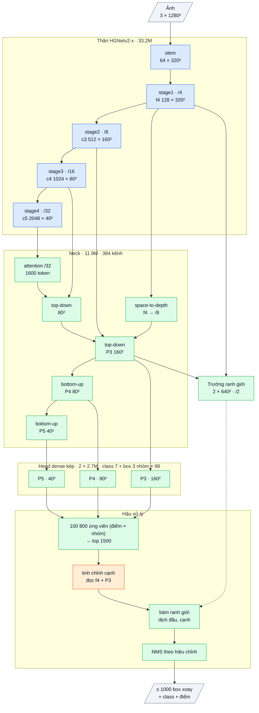

# Vòng nhắm mAP50-95: v19 + chưng cất box (LD), và OpenOBB20 (bộ tinh chỉnh cạnh đọc thân)

User (10-15): v19 đã đạt mAP50 (0.755), tốc độ (12.4 ms) và box trùng (2.8%); chỉ còn **mAP50-95** (độ khít box). Hai bản train song song:
một bản cải tiến v19, một bản do agent chọn. Sổ cái: F77.

Code: `openobb/models/openobb18_loss.py` (chưng cất box, `--w-ld`, `--w-kd-cls`), `openobb18.py` (`OpenOBB20`),
`openobb17.py` (`refine_stages`). Test: `tests/test_openobb20.py`.

## 1. Bằng chứng

| Đo | Số | Nguồn |
|---|---|---|
| v19 so với v17 + nhóm (khác nhau đúng ở neck) | mAP50-95 0.462 so với 0.487; junction 50-95 .496 so với .531, note .441 / .493, door .793 / .808; mAP50 ngang (0.755 / 0.757) | F74, F75 |
| Neck nhanh: tìm object tốt, đặt box kém khít hơn encoder | P 0.672 so với 0.711; recall .764 so với .717 | F75 |
| Xếp hạng không phải vấn đề, ứng viên chưa đủ khít | box điểm cao nhất gần box tốt nhất (chênh 0.000–0.008) | F69 |
| Bộ tinh chỉnh đọc nét stride 4 trên cạnh box (v14) | wall mAP50-95 +0.045 so với v12 | F60 |
| Vòng 2 của v19 chưa hội tụ | không thầy, `nbs 64` (khoảng 112 lần cập nhật), mAP50-95 còn tăng ở epoch cuối | F75 |

## 2. Hai bản

Sơ đồ khối và bảng từng lớp: mục 6 (phụ lục, cuối file).

| | Bản 1: v19 + chưng cất box | Bản 2: OpenOBB20 |
|---|---|---|
| Kiến trúc | v19 (không đổi) | v19 + `EdgeRefiner` (v14) đọc **thân stride 4** + P3 trên cạnh box, trước bước bám ranh giới |
| Lập luận | thầy v17 + nhóm có box khít hơn và **cùng cấu trúc head nhóm** → học thẳng phân phối DFL (hai đầu, độ dày), góc, lệch ngang và xác suất class của thầy (Localization Distillation; tăng mạnh ở IoU cao) | neck mới làm mất độ khít; bộ tinh chỉnh đi vòng qua neck, lấy chi tiết từ thân pretrained (không đổi), sửa đầu / độ dày / lệch ngang |
| Chi phí suy luận | 0 | khoảng 0.3% FLOPs (30 điểm lấy mẫu + MLP nhỏ trên 1500 ứng viên) |
| Khởi tạo | từ `best.pt` của v19 | từ `best.pt` của v19; lớp cuối bộ tinh chỉnh = 0 → bắt đầu đúng bằng v19 (test `test_v20_starts_as_v19`) |
| Train | thầy = v17 + nhóm (run A), chưng cất neck + box + class; 30 ep, công thức cũ (`nbs=0`) | y hệt bản 1; **khác đúng một yếu tố**: bộ tinh chỉnh |

Chưng cất box (cả hai bản, tự bật khi có `teacher=`): trên các điểm thầy chấm ≥ 0.05, KL với nhiệt độ T = 10 cho ba phân phối DFL
(trọng số 0.25, `w_ld`), L1 cho góc và lệch ngang; xác suất class: BCE kiểu quality focal tới xác suất của thầy (0.5, `w_kd_cls`).
Head nhóm của học trò học từ box cùng nhóm của thầy (thầy một nhóm thì dùng box duy nhất của thầy), trọng số = điểm cao nhất của thầy trong nhóm.

## 3. Chỉ số kỳ vọng (ghi TRƯỚC khi train)

Wall_Color, thước YOLO, khởi tạo `best.pt` v19 (F75: 0.755 / 0.462, 12.4 ms), thầy = run A (F74 / F76), 30 ep, `nbs=0 warmup_bias_lr=0 epoch_lr=False`.

| | v19 (F75) | YOLO26x | **Bản 1 kỳ vọng** | **Bản 2 kỳ vọng** |
|---|---|---|---|---|
| mAP50-95 | 0.462 | 0.499 | ≥ 0.475 | ≥ bản 1 + 0.01 |
| mAP50 | 0.755 | 0.746 | ≥ 0.75 | ≥ 0.75 |
| junction 50-95 | .496 | .584 | ≥ .52 | ≥ .53 |
| wall 50-95 | .521 | .624 | ≥ .53 | ≥ .55 |
| tốc độ G4 batch 16 | 12.4 ms | — | như v19 (± 0.3) | ≤ 13.0 ms |
| box trùng | 2.8% | — | ≤ 3% | ≤ 3% |

**Mục tiêu đột phá:** mAP50-95 ≥ 0.499 (bằng YOLO26x) với ≤ 13 ms.
**Bác bỏ** bộ tinh chỉnh nếu bản 2 không hơn bản 1 ≥ 0.005 mAP50-95. Chưng cất box chưa tách riêng được khỏi "train thêm có thầy"
(không có đối chứng `w_ld=0`); nếu bản 1 < 0.468 thì coi là không có tác dụng.

## 4. Lệnh

```bash
# Bản 1: v19 + chưng cất box từ v17 + nhóm
openobb train data=/content/data.yaml model=openobb19x epochs=30 imgsz=1280 batch=16 lr=0.001 nbs=0 warmup_bias_lr=0 epoch_lr=False weights=<best.pt của v19> teacher=<best.pt của v17 + nhóm>
# Bản 2: OpenOBB20 (v19 + bộ tinh chỉnh cạnh), cùng mọi thứ còn lại
openobb train data=/content/data.yaml model=openobb20x epochs=30 imgsz=1280 batch=16 lr=0.001 nbs=0 warmup_bias_lr=0 epoch_lr=False weights=<best.pt của v19> teacher=<best.pt của v17 + nhóm>
```

Log phải có `[distill] neck distilled from ...` và các loss `ld`, `kd_cls` trong `results.csv`; bản 2 có "edge refiner on the trunk's
stride-4 map" trong dòng `model`.

## 5. Kết quả thật

**Lần 1 của bản 1 (F78): chạy lệch thiết kế, không dùng để chấm.** File `openobb19x.pt` trên Drive là v17 + nhóm (run A), còn
`openobb17x_v2.pt` là v17 một nhóm. Vậy neck của v19 học lại từ đầu (328 tensor mới) và thầy không có head nhóm.
Kết quả: 0.752 / 0.464, 12.4 ms, box trùng 2.9%; wall .826 / .498 (wall → nền 13%), junction .895 / .518.

| Bản 1 | Kỳ vọng | Lần 1 (lệch) |
|---|---|---|
| mAP50-95 | ≥ 0.475 | 0.464, không đạt |
| mAP50 | ≥ 0.75 | 0.752, đạt |
| junction 50-95 | ≥ .52 | .518, không đạt |
| wall 50-95 | ≥ .53 | .498, không đạt |
| tốc độ | 12.4 ± 0.3 ms | 12.4 ms, đạt |
| box trùng | ≤ 3% | 2.9%, đạt |

**Bản 2 (F79): OpenOBB20-x, cùng xuất phát lệch như lần 1 của bản 1** (cùng `weights=`, `teacher=`; `[init]` 346 tensor mới = 328 neck + 18 bộ tinh
chỉnh). Hai run khác nhau đúng ở bộ tinh chỉnh, nên phép thử bộ tinh chỉnh vẫn hợp lệ.
Kết quả: **0.764 / 0.482**, 12.6 ms, box trùng 2.6%.

| Bản 2 | Kỳ vọng | Kết quả |
|---|---|---|
| mAP50-95 | ≥ bản 1 + 0.01 (0.474) | 0.482 (+0.018), đạt |
| mAP50 | ≥ 0.75 | 0.764, đạt |
| junction 50-95 | ≥ .53 | .529, không đạt (sát) |
| wall 50-95 | ≥ .55 | .526 (+.028 so với bản 1), không đạt |
| tốc độ | ≤ 13.0 ms | 12.6 ms, đạt |
| box trùng | ≤ 3% | 2.6%, đạt |

Bộ tinh chỉnh **giữ lại**: không chạm tiêu chí bác bỏ, 6 / 7 class tăng mAP50-95. Đây là một hạt giống, +0.018 vào khoảng 0.75σ của thước.
Mục tiêu đột phá (≥ 0.499) chưa đạt: so với YOLO26x là +0.018 mAP50 và −0.017 mAP50-95. Recall wall vẫn kém run A (wall → nền 11% so với 7.6%).

Đề xuất đổi thầy (v17 + nhóm so với một nhóm) đã bỏ: v19 qua ba kiểu thầy mà tổng không đổi (F75, F78), xem F79.
Vòng sau chưa chốt.

## 6. Phụ lục: kiến trúc theo lớp (cỡ x)

Kích thước ghi cho ảnh vào 1 × 3 × 1280 × 1280, Wall_Color (7 class, 3 nhóm class). Ký hiệu: `conv k×k sS a→b` = Conv + BN + kích hoạt,
`dw` = depthwise, `/N` = stride N so với ảnh.

### Luồng dữ liệu

Xanh dương: mượn (pretrained, Apache-2.0). Xanh lá: tự viết. Cam: mới ở v20 (v19 + bộ tinh chỉnh cạnh đọc f4 của thân). Nét đứt: đọc trường ranh giới.



### Thân: HGNetv2-x (mượn, Apache-2.0, trọng số D-FINE COCO), 33.23M

| Khối | Lớp | Ra | Tham số |
|---|---|---|---|
| stem | conv 3×3 s2 3→32; nhánh [conv 2×2 32→16 → conv 2×2 16→32] ∥ max-pool 2; nối 64 → conv 3×3 s2 64→32 → conv 1×1 32→64 | 64 × 320² (/4) | 0.03M |
| stage1 | 1 khối HG: 6 × conv 3×3 64→64, nối 448 kênh → 1×1 →64 → 1×1 →128 | **f4** 128 × 320² | 0.26M |
| stage2 | dw 3×3 s2; 2 khối HG: 6 × conv 3×3 128, nối → 1×1 → 512 | **c3** 512 × 160² (/8) | 3.03M |
| stage3 | dw 3×3 s2; 5 khối HG nhẹ: 6 × (1×1 → dw 5×5) 256, nối → 1×1 512 → 1×1 1024 | **c4** 1024 × 80² (/16) | 11.93M |
| stage4 | dw 3×3 s2; 2 khối HG nhẹ: 6 × (1×1 → dw 5×5) 512, nối → 1×1 → 2048 | **c5** 2048 × 40² (/32) | 17.99M |

BN của thân bị đóng băng (FrozenBatchNorm), kích hoạt ReLU.

Mỗi stage đi qua bộ chặn độ lớn (guard, không tham số) như v7.

### Neck: Neck14 (tự viết, khởi tạo ngẫu nhiên; train bằng chưng cất từ encoder của một model v12 / v17 đã train khi có `teacher=`), 11.91M, 384 kênh

| Khối | Lớp | Ra | Tham số |
|---|---|---|---|
| proj | ba conv 1×1 (không kích hoạt): c3 512→384, c4 1024→384, c5 2048→384 | | 1.38M |
| attn | 1 lớp transformer trên 1600 token của /32: vị trí bằng dw 3×3; LayerNorm → attention 8 đầu; LayerNorm → FFN 384→768→384 (GELU). Hai nhánh dư nhân cổng khởi tạo 0 | 384 × 40² | 1.19M |
| lat5 | conv 1×1 → **t5** | 384 × 40² | 0.15M |
| td4 | nối [proj c4, upsample ×2 t5] 768 → RepCSP (3 RepConv, giãn 1 / 2 / 1) → n4 → lat4 1×1 → **t4** | 384 × 80² | 1.92M |
| spd | f4 space-to-depth (128 × 320² → 512 × 160²) → conv 1×1 512→192: chi tiết /4 vào P3 | 192 × 160² | 0.10M |
| td3 | nối [proj c3, upsample ×2 t4, spd] 960 → RepCSP | **P3** 384 × 160² | 1.85M |
| dn3 + bu4 | Down [conv 3×3 s2 384→192 ∥ max-pool 2] → 1×1 576→384; nối t4 → RepCSP | **P4** 384 × 80² | 2.66M |
| dn4 + bu5 | như trên, nối t5, RepCSP không giãn | **P5** 384 × 40² | 2.66M |

RepCSP(a→384, n=3): conv 1×1 a→384, tách 2 nửa 192; nửa sau qua lần lượt 3 RepConv 192 (3×3 ∥ 1×1 ∥ BN đồng nhất, gộp thành một
conv 3×3 khi suy luận); nối 2 nửa + 3 đầu ra (960) → conv 1×1 → 384.

### Head dense kép (tự viết), 2 × 2.71M

Hai head cùng thiết kế (head có ngữ cảnh của v7), trọng số riêng: **một-nhiều** (học, cần NMS) và **một-một**. Bước hiệu chỉnh cuối train chọn head và NMS dùng khi suy luận, lưu vào `best.pt`; khi suy luận chỉ chạy một head.

| Nhánh | Lớp (một tầng) | Ra mỗi điểm | Tham số (3 tầng) |
|---|---|---|---|
| class | dw 3×3 384 → 1×1 384→192 → StripMix(192, k = 11) → dw 3×3 192 → 1×1 192→192 → 1×1 →7 (bias tiên nghiệm 0.01) | 7 logit | 0.82M |
| box | conv 3×3 384→128 → conv 3×3 128→128 → 1×1 128→294 (chạy fp32) | 3 nhóm × 98 kênh | 1.89M |

98 kênh box (một nhóm): góc θ, lệch ngang tâm (× stride), phân phối 32 bin khoảng cách tới đầu sau và 32 bin tới đầu trước dọc trục
(bin = 1 stride), 32 bin độ dày (bin = 1/2 stride). Mỗi tầng một tháp riêng; điểm lưới = tâm ô.

Mỗi điểm lưới cho một box cho mỗi **nhóm class** (3 nhóm trên Wall_Color, tự chia từ nhãn bằng `groups=auto`: các class hay chung ô lưới vào nhóm khác nhau); class nào dùng box của nhóm nó.

### Trường ranh giới (tự viết), 0.125M

f4 → 1×1 128→64; P3 → 1×1 384→64 → upsample ×2; nối 128 → 1×1 →64 → RepConv 3×3 → RepConv 3×3 giãn 2 → 1×1 64→8 → pixel shuffle ×2
→ **2 × 640 × 640 (/2)**: kênh 0 = hai đầu object, kênh 1 = hai cạnh dài. Học vạch Gauss rộng 1 px vẽ trên các cạnh của box nhãn.

### Hậu xử lý có tham số (tự viết)

| Bước | Cơ chế | Tham số |
|---|---|---|
| chọn ứng viên | 33 600 điểm × 3 nhóm, điểm = max sigmoid class → top 1500 | 0 |
| tinh chỉnh cạnh | lấy mẫu 24 điểm trong khung box (6 trên mỗi cạnh dài, 3 trên mỗi đầu, 6 trên đường tâm) trên f4 chiếu 64 kênh, 6 điểm đường tâm trên P3 chiếu 64 kênh, + 4 số hình học → MLP 1924→256→256→5 (dịch hai đầu, log độ dày, lệch ngang, góc 0.2·tanh); lớp cuối khởi tạo 0 | 0.59M |
| bám ranh giới | dịch hai đầu / hai cạnh tới soft-argmax của trường trên 3 profile song song × 33 mẫu (bán kính đầu clamp(0.15 L, 3, 16) px, cạnh clamp(0.5 T, 2, 6) px); hệ số khởi tạo 0 | 3 |
| NMS | ProbIoU, chỉ chấm cặp cùng class có tâm gần; ngưỡng (hoặc không NMS) lấy từ hiệu chỉnh; tối đa 1000 box | 0 |

### Tổng hợp

| Phần | Tham số | Tỉ lệ | Nguồn |
|---|---|---|---|
| Thân HGNetv2-x | 33.23M | 64.8% | mượn (Apache-2.0) |
| Neck | 11.91M | 23.2% | tự viết |
| Head (×2, chạy 1) | 5.42M | 10.6% | tự viết |
| Trường ranh giới | 0.13M | 0.2% | tự viết |
| Tinh chỉnh cạnh | 0.59M | 1.2% | tự viết |
| **Tổng** | **51.27M** | | 35.2% tự viết (48.6M chạy khi suy luận) |

Suy luận: BN và RepConv gộp vào conv; head đã chọn → top 1500 → tinh chỉnh cạnh → bám ranh giới → NMS theo hiệu chỉnh → tối đa 1000 box.
