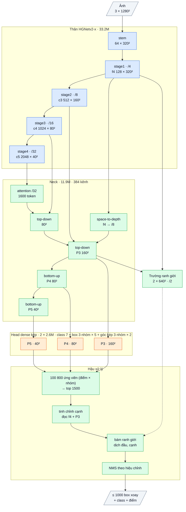

# OpenOBB22: head hình học kiểu YOLO26 trên nền v21

Sổ cái: F81, F84–F90 (bằng chứng), F91 (thiết kế + kỳ vọng). Code: `openobb/models/openobb18.py` (`OpenOBB22`), test `tests/test_openobb22.py`.
Model: `model=openobb22s|m|l|x`.

## 1. Bằng chứng

| Đo | v21 (F90) | YOLO26x (F89, cùng G4, cùng thước) | Nguồn |
|---|---|---|---|
| mAP50 / mAP50-95 | **0.769** / 0.492 | 0.743 / **0.499** | F89, F90 |
| Box trùng | 1.8% | 1.6% | F89, F90 |
| Box tường dài lệch trục > 1° | 14.4% | **0.3%** | F89, F90 |
| Vật dài lệch góc > 1° / đầu lệch khỏi object | 11.3% / 1.9% | **0.0% / 0.0%** | F89, F90 |
| mAP50-95 wall / junction / wall_300 | .545 / .538 / .310 | **.624 / .584 / .441** | F89, F90 |
| mAP50-95 slide_door / double_door / note | **.320 / .435** / .487 | .123 / .392 / .517 | F89, F90 |
| Sai số đầu box của wall (trung vị) | 1.92 px (v20) | 1.30 px | F81 |
| Mẫu dương của tường dọc lúc train | góc dự đoán ~5° (nằm ngang), trọng số TAL ~0 | — | F86 |
| Tốc độ G4 batch 16 (máy nóng) | 9.7 + 3.0 ms | 6.6 + 0.7 ms | F90 |

→ v21 thắng hoặc ngang YOLO ở nhận diện (mAP50, lớp hiếm, box trùng). Phần thua là **hình học box** của các lớp dài, mảnh, nhiều
(hướng + hai đầu), đúng chỗ head của mình khác YOLO26.

## 2. Bài học → cơ chế → kỳ vọng → điều chứng minh sai

| Bài học | Cơ chế trong v22 | Kỳ vọng | Chứng minh sai |
|---|---|---|---|
| Góc thô khởi tạo 0 = nằm ngang; mẫu dương tường dọc sai 90° → ProbIoU ~0 → trọng số TAL ~0 → không bao giờ học (F86) | góc = (sigmoid(u) − ¼)·π ∈ (−45°, 135°), khởi tạo 45°: 0° và 90° nằm trong khoảng và sai ĐỀU nhau lúc đầu (ý tưởng YOLO-OBB) | box dài lệch trục ≤ 2% | ≥ 8% |
| DFL 32 bin, bin = stride (8 px ở P3), đọc bằng trung bình: đầu box sai 1.5–1.8× YOLO; YOLO26 bỏ DFL | hồi quy thẳng hai đầu + độ dày (softplus × stride), L1 + ProbIoU (`box=direct`, có sẵn từ F55, nay đúng cho nhóm class) | mAP50-95 wall ≥ .60, wall_300 ≥ .40, junction ≥ .57 | wall < .55 |
| Phần thắng YOLO đến từ nhóm class, bộ tinh chỉnh, bám ranh giới (F72–F79) | giữ nguyên | mAP50 ≥ 0.765, box trùng ≤ 2.0%, lớp hiếm giữ | mAP50 < 0.75 |

## 3. Chi tiết từng phần

Sơ đồ khối và bảng từng lớp: mục 7 (phụ lục, cuối file).

| Phần | v22 | Nguồn |
|---|---|---|
| Thân | HGNetv2-x pretrained (D-FINE COCO, Apache-2.0), 33.2M | mượn |
| Neck | RepConv tự viết (v18) | tự viết |
| Head | dense kép (một-nhiều + một-một), 3 nhóm class; mỗi nhóm: góc (sigmoid, 45° lúc đầu), lệch ngang, 2 khoảng cách đầu, độ dày (giá trị trực tiếp) + nhánh sửa góc góc kép (v21) | tự viết |
| Sau head | bộ tinh chỉnh cạnh (v20) → bám ranh giới (v17) → NMS hiệu chỉnh | tự viết |
| Loss | TAL + quality focal (cls), ProbIoU + L1 (box, theo stride), loss góc vectơ (cos 2θ, sin 2θ) trọng số đều (0.20.1) | tự viết |

Tham số 51.06M (v21: 51.28M; head nhẹ hơn vì bỏ 3 × 32 bin mỗi nhóm). Tỉ lệ mượn: thân ~66% tham số; code 100% tự viết.

**Khởi tạo khi fine-tune từ v20 / v21** (`after_weights`): thân, neck, tháp phân loại, bộ tinh chỉnh, trường ranh giới giữ nguyên; hàng ra box
dựng lại theo từng nhóm: góc về 45°, hai đầu + độ dày bắt đầu lại, lệch ngang chép từ checkpoint. Không bắt đầu đúng bằng v21 (đổi nghĩa đầu ra),
nên cần nhiều lần cập nhật hơn: 150 epoch như YOLO.

## 4. Chỉ số kỳ vọng (ghi TRƯỚC khi train)

Wall_Color, fine-tune 150 ep từ best.pt của v21 (F90), mặc định (không `rotate_p`), thước YOLO, NMS hiệu chỉnh. Cặp so sánh: A = v21 cùng số epoch
(run user đang chạy, tắt `rotate_p`), B = v22.

| | v21 (F90) | YOLO26x | **Kỳ vọng v22** |
|---|---|---|---|
| Box dài lệch trục > 1° (`Box geometry`) | 14.4% | 0.3% | ≤ 2% |
| Vật dài lệch góc > 1° | 11.3% | 0.0% | ≤ 2% |
| mAP50-95 | 0.492 | 0.499 | ≥ 0.51 |
| wall / junction / wall_300 (50-95) | .545 / .538 / .310 | .624 / .584 / .441 | ≥ .60 / ≥ .57 / ≥ .40 |
| mAP50 | 0.769 | 0.743 | ≥ 0.765 |
| Box trùng | 1.8% | 1.6% | ≤ 2.0% |
| Tốc độ G4 batch 16 | 12.7 ms | 7.3 ms | ≤ 12.7 ms |

**Bác bỏ** góc sigmoid nếu box dài lệch trục ≥ 8%; bác bỏ hồi quy thẳng nếu wall 50-95 < .55. Nếu run A (v21, không xoay) đã ≤ 2% lệch thì phần góc
của v22 không còn là yếu tố quyết định; khi đó v22 chỉ được chấm ở độ khít (đầu box, mAP50-95 của wall / junction / wall_300).

## 5. Lệnh

```bash
openobb train data=/content/data.yaml model=openobb22x epochs=150 imgsz=1280 batch=16 weights=<best.pt của v21>
```

Log cần thấy: `OpenOBB 0.21.0`; `[init] OpenOBB22: box outputs rebuilt per class group`; dòng `model` có "angle in (-45, 135) deg from 45 deg"
và "direct box regression (no DFL)"; dòng `augment` không có `rotate any angle`. mAP vài epoch đầu sẽ thấp (box bắt đầu lại), rồi tăng.

## 6. Kết quả thật

**Lần 1 (F93), lệch điều kiện:** 30 ep, lr 0.0005, `nbs 64` (112 cập nhật), còn `rotate_p=0.5`; khởi tạo từ một checkpoint mang `arch v22` (không có
dòng "box outputs rebuilt"). 0.760 / 0.479, trùng 2.4%, 9.5 + 3.0 ms; **wall .747 / .466 (wall → nền 24%)**, junction .905 / .533, wall_300 .746 / .288;
box dài lệch trục 16.2%.

| | Kỳ vọng | Lần 1 |
|---|---|---|
| Box dài lệch > 1° | ≤ 2% | 16.2%, không đạt |
| mAP50-95 | ≥ 0.51 | 0.479, không đạt |
| wall / junction / wall_300 | ≥ .60 / .57 / .40 | .466 / .533 / .288, không đạt (wall < .55: ngưỡng bác bỏ) |
| mAP50 | ≥ 0.765 | 0.760, không đạt |
| Box trùng | ≤ 2.0% | 2.4%, không đạt |
| Tốc độ | ≤ 12.7 ms | 12.5 ms, đạt |

Chưa phải phép thử theo điều kiện ghi trước; cần run 150 ep, không xoay, từ best.pt v21.

## 7. Phụ lục: kiến trúc theo lớp (cỡ x)

Kích thước ghi cho ảnh vào 1 × 3 × 1280 × 1280, Wall_Color (7 class, 3 nhóm class). Ký hiệu: `conv k×k sS a→b` = Conv + BN + kích hoạt,
`dw` = depthwise, `/N` = stride N so với ảnh.

### Luồng dữ liệu

Xanh dương: mượn (pretrained, Apache-2.0). Xanh lá: tự viết. Cam: mới ở v22 (v21 + góc sigmoid từ 45° + hồi quy box trực tiếp). Nét đứt: đọc trường ranh giới.



### Thân: HGNetv2-x (mượn, Apache-2.0, trọng số D-FINE COCO), 33.23M

| Khối | Lớp | Ra | Tham số |
|---|---|---|---|
| stem | conv 3×3 s2 3→32; nhánh [conv 2×2 32→16 → conv 2×2 16→32] ∥ max-pool 2; nối 64 → conv 3×3 s2 64→32 → conv 1×1 32→64 | 64 × 320² (/4) | 0.03M |
| stage1 | 1 khối HG: 6 × conv 3×3 64→64, nối 448 kênh → 1×1 →64 → 1×1 →128 | **f4** 128 × 320² | 0.26M |
| stage2 | dw 3×3 s2; 2 khối HG: 6 × conv 3×3 128, nối → 1×1 → 512 | **c3** 512 × 160² (/8) | 3.03M |
| stage3 | dw 3×3 s2; 5 khối HG nhẹ: 6 × (1×1 → dw 5×5) 256, nối → 1×1 512 → 1×1 1024 | **c4** 1024 × 80² (/16) | 11.93M |
| stage4 | dw 3×3 s2; 2 khối HG nhẹ: 6 × (1×1 → dw 5×5) 512, nối → 1×1 → 2048 | **c5** 2048 × 40² (/32) | 17.99M |

BN của thân bị đóng băng (FrozenBatchNorm), kích hoạt ReLU.

Mỗi stage đi qua bộ chặn độ lớn (guard, không tham số) như v7.

### Neck: Neck14 (tự viết, khởi tạo ngẫu nhiên; train bằng chưng cất từ encoder của một model v12 / v17 đã train khi có `teacher=`), 11.91M, 384 kênh

| Khối | Lớp | Ra | Tham số |
|---|---|---|---|
| proj | ba conv 1×1 (không kích hoạt): c3 512→384, c4 1024→384, c5 2048→384 | | 1.38M |
| attn | 1 lớp transformer trên 1600 token của /32: vị trí bằng dw 3×3; LayerNorm → attention 8 đầu; LayerNorm → FFN 384→768→384 (GELU). Hai nhánh dư nhân cổng khởi tạo 0 | 384 × 40² | 1.19M |
| lat5 | conv 1×1 → **t5** | 384 × 40² | 0.15M |
| td4 | nối [proj c4, upsample ×2 t5] 768 → RepCSP (3 RepConv, giãn 1 / 2 / 1) → n4 → lat4 1×1 → **t4** | 384 × 80² | 1.92M |
| spd | f4 space-to-depth (128 × 320² → 512 × 160²) → conv 1×1 512→192: chi tiết /4 vào P3 | 192 × 160² | 0.10M |
| td3 | nối [proj c3, upsample ×2 t4, spd] 960 → RepCSP | **P3** 384 × 160² | 1.85M |
| dn3 + bu4 | Down [conv 3×3 s2 384→192 ∥ max-pool 2] → 1×1 576→384; nối t4 → RepCSP | **P4** 384 × 80² | 2.66M |
| dn4 + bu5 | như trên, nối t5, RepCSP không giãn | **P5** 384 × 40² | 2.66M |

RepCSP(a→384, n=3): conv 1×1 a→384, tách 2 nửa 192; nửa sau qua lần lượt 3 RepConv 192 (3×3 ∥ 1×1 ∥ BN đồng nhất, gộp thành một
conv 3×3 khi suy luận); nối 2 nửa + 3 đầu ra (960) → conv 1×1 → 384.

### Head dense kép (tự viết), 2 × 2.60M

Hai head cùng thiết kế (head có ngữ cảnh của v7), trọng số riêng: **một-nhiều** (học, cần NMS) và **một-một**. Bước hiệu chỉnh cuối train chọn head và NMS dùng khi suy luận, lưu vào `best.pt`; khi suy luận chỉ chạy một head.

| Nhánh | Lớp (một tầng) | Ra mỗi điểm | Tham số (3 tầng) |
|---|---|---|---|
| class | dw 3×3 384 → 1×1 384→192 → StripMix(192, k = 11) → dw 3×3 192 → 1×1 192→192 → 1×1 →7 (bias tiên nghiệm 0.01) | 7 logit | 0.82M |
| box | conv 3×3 384→128 → conv 3×3 128→128 → 1×1 128→15 (chạy fp32) | 3 nhóm × 5 giá trị | 1.78M |

98 kênh box (một nhóm): góc θ, lệch ngang tâm (× stride), phân phối 32 bin khoảng cách tới đầu sau và 32 bin tới đầu trước dọc trục
(bin = 1 stride), 32 bin độ dày (bin = 1/2 stride). Mỗi tầng một tháp riêng; điểm lưới = tâm ô.

Mỗi điểm lưới cho một box cho mỗi **nhóm class** (3 nhóm trên Wall_Color, tự chia từ nhãn bằng `groups=auto`: các class hay chung ô lưới vào nhóm khác nhau); class nào dùng box của nhóm nó.

**Nhánh góc kép** (0.002M mỗi head): conv 1×1 128→6 (fp32, khởi tạo 0) trên tháp box, cho mỗi nhóm (Δcos 2θ, Δsin 2θ); góc cuối = θ + ½·atan2 giữa (cos 2θ, sin 2θ) và nó cộng (Δcos, Δsin).

**Box trực tiếp (v22):** 5 giá trị mỗi nhóm thay cho 98: góc = (sigmoid(u) − ¼)·π, bắt đầu ở 45°; lệch ngang tâm; khoảng cách tới hai đầu và độ dày = softplus × stride. Không còn phân phối bin.

### Trường ranh giới (tự viết), 0.125M

f4 → 1×1 128→64; P3 → 1×1 384→64 → upsample ×2; nối 128 → 1×1 →64 → RepConv 3×3 → RepConv 3×3 giãn 2 → 1×1 64→8 → pixel shuffle ×2
→ **2 × 640 × 640 (/2)**: kênh 0 = hai đầu object, kênh 1 = hai cạnh dài. Học vạch Gauss rộng 1 px vẽ trên các cạnh của box nhãn.

### Hậu xử lý có tham số (tự viết)

| Bước | Cơ chế | Tham số |
|---|---|---|
| chọn ứng viên | 33 600 điểm × 3 nhóm, điểm = max sigmoid class → top 1500 | 0 |
| tinh chỉnh cạnh | lấy mẫu 24 điểm trong khung box (6 trên mỗi cạnh dài, 3 trên mỗi đầu, 6 trên đường tâm) trên f4 chiếu 64 kênh, 6 điểm đường tâm trên P3 chiếu 64 kênh, + 4 số hình học → MLP 1924→256→256→5 (dịch hai đầu, log độ dày, lệch ngang, góc 0.2·tanh); lớp cuối khởi tạo 0 | 0.59M |
| bám ranh giới | dịch hai đầu / hai cạnh tới soft-argmax của trường trên 3 profile song song × 33 mẫu (bán kính đầu clamp(0.15 L, 3, 16) px, cạnh clamp(0.5 T, 2, 6) px); hệ số khởi tạo 0 | 3 |
| NMS | ProbIoU, chỉ chấm cặp cùng class có tâm gần; ngưỡng (hoặc không NMS) lấy từ hiệu chỉnh; tối đa 1000 box | 0 |

### Tổng hợp

| Phần | Tham số | Tỉ lệ | Nguồn |
|---|---|---|---|
| Thân HGNetv2-x | 33.23M | 65.1% | mượn (Apache-2.0) |
| Neck | 11.91M | 23.3% | tự viết |
| Head (×2, chạy 1) | 5.21M | 10.2% | tự viết |
| Trường ranh giới | 0.13M | 0.2% | tự viết |
| Tinh chỉnh cạnh | 0.59M | 1.2% | tự viết |
| **Tổng** | **51.06M** | | 34.9% tự viết (48.5M chạy khi suy luận) |

Suy luận: BN và RepConv gộp vào conv; head đã chọn → top 1500 → tinh chỉnh cạnh → bám ranh giới → NMS theo hiệu chỉnh → tối đa 1000 box.
