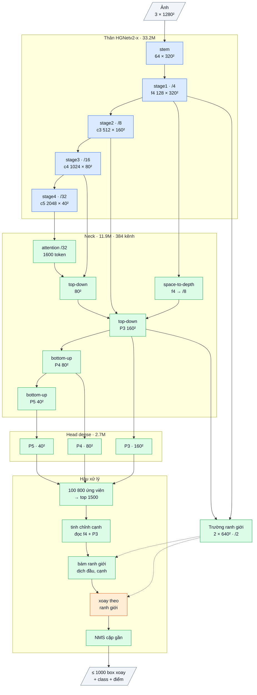

# OpenOBB23: v21 + bám ranh giới có xoay + lọc đỉnh thay NMS

Sổ cái: F90 (v21), F93 (v22 thất bại), F94 (profile GPU), F95 (thiết kế + kỳ vọng). Code: `openobb/models/openobb18.py`
(`BoundarySnapRot`, `OpenOBB23`), `openobb/models/openobb17.py` (`peak_mask`), `openobb/predict.py` (lựa chọn `peak`).
Test: `tests/test_openobb23.py`. Model: `model=openobb23s|m|l|x`.

## 1. Bằng chứng

| Đo | Số | Nguồn |
|---|---|---|
| v21: mAP50 / 50-95 / trùng | 0.769 / 0.492 / 1.8% (YOLO26x 0.743 / 0.499 / 1.6%) | F89, F90 |
| v22 (hồi quy box trực tiếp + góc sigmoid) | wall sụp .466, lệch 16.2% → bỏ hướng này, quay về head DFL của v21 | F93 |
| Box dài lệch trục > 1° | v21 14.4%, YOLO 0.3%; lỗi tăng theo độ dài box | F83, F90 |
| Sau bộ tinh chỉnh, bước bám ranh giới chỉ DỊCH cạnh, không xoay | góc không đổi qua bước bám | F84 |
| Thời gian G4 (v21-x, ms / ảnh) | thân + neck 7.5, **NMS 2.9–3.4**, head 1.0, trường 0.57, tinh chỉnh + bám 0.24; YOLO 6.6 + 0.7 | F94 |
| Box trùng của head một-một khi không NMS (v20, 10 ảnh val) | 28.7% số ứng viên tự tin; **94.5% là hai điểm neo cách ≤ 1.5 stride**, 91.8% cùng tầng, 100% cùng nhóm, 88.5% điểm số ≥ 0.5 × điểm cao nhất | F95 |

## 2. Bài học → cơ chế → kỳ vọng → điều chứng minh sai

| Bài học | Cơ chế v23 | Kỳ vọng | Chứng minh sai |
|---|---|---|---|
| Lệch góc tập trung ở vật dài; trường ranh giới (stride 2) đã học mép theo nhãn | **Bám ranh giới có xoay:** trên 2 cạnh dài của box dài (L ≥ 4T), 7 điểm u ∈ [−0.4, 0.4]·L, mỗi điểm tìm lệch ngang của mép (soft-argmax trên trường); độ dốc bình phương tối thiểu có trọng số = góc lệch, xoay quanh tâm. Box càng dài càng nhiều thông tin → càng chính xác. Hệ số khởi tạo 0 | box dài lệch trục ≤ 3% | ≥ 10% sau train, hoặc hệ số xoay học được < 0.2 |
| Trùng của head một-một = điểm neo kề nhau | **Lọc đỉnh 3×3** theo tầng + nhóm class (một max-pool) thay NMS so cặp; lựa chọn trong bước hiệu chỉnh | — | **đã đo trước khi train (F95): mất 0.035 mAP50 → không làm mặc định** |
| Head một-một cho box ít nghiêng hơn (5.5% so với 15.4%, F95) ở cùng độ chính xác | hiệu chỉnh cuối train chọn cấu hình nghiêng ít hơn khi fitness và trùng ngang nhau | box dài lệch giảm thêm nhờ chọn head | — |
| Head DFL của v21 tốt nhất cho tường (F90 so F93) | giữ nguyên v21 (DFL, nhóm class, nhánh góc góc kép, tinh chỉnh, trường) | mAP50 ≥ 0.765, mAP50-95 ≥ 0.495 | mAP50-95 < 0.485 |

## 3. Chi tiết

- Thân HGNetv2-x (Apache, mượn), neck RepConv, head dense kép DFL + 3 nhóm class + nhánh góc góc kép, bộ tinh chỉnh cạnh, trường ranh giới,
  **bám ranh giới có xoay** (mới, +1 tham số), **lọc đỉnh** (mới, không tham số).
- Tham số: như v21 (51.28M) + 1. Bắt đầu đúng bằng v21 (`test_v23_starts_as_v21`).
- Thời gian dự kiến (G4, batch 16): như v21 (khoảng 12.7 ms; lọc đỉnh không dùng được làm mặc định). Tốc độ để bản sau: thân + neck 7.5 ms,
  NMS ~3 ms; cần `openobb profile ... detail=True` để chọn khối cần làm nhẹ.

Sơ đồ và bảng từng lớp: mục 7 (cuối file).

## 4. Chỉ số kỳ vọng (ghi TRƯỚC khi train)

Fine-tune từ best.pt v21 (F90), 100 epoch, mặc định (không `rotate_p`), Wall_Color val, thước YOLO.

| | v21 (F90) | YOLO26x | **Kỳ vọng v23** |
|---|---|---|---|
| Box dài lệch trục > 1° (`Box geometry`) | 14.4% | 0.3% | ≤ 3% |
| Vật dài lệch góc > 1° | 11.3% | 0.0% | ≤ 3% |
| mAP50 / mAP50-95 | 0.769 / 0.492 | 0.743 / 0.499 | ≥ 0.765 / ≥ 0.495 |
| Box trùng | 1.8% | 1.6% | ≤ 2.5% |
| Speed (inference + postprocess) | 9.7 + 3.0 ms | 6.6 + 0.7 ms | ≤ 13.0 ms tổng (như v21) |

## 5. Lệnh

```bash
openobb train data=/content/data.yaml model=openobb23x weights=<best.pt của v21> epochs=100 imgsz=1280 batch=16
```

Log cần thấy: dòng `model` có "rotational boundary snapping"; `[init]` báo 1 tensor mới (`snap.rot_gain`); dòng `NMS calibrated` có thêm
`o2o peak` và `tilt x%`; dòng `augment` không có `rotate any angle` (nếu muốn bản tổng quát cho bản vẽ xoay thì chạy thêm một bản có `rotate_p`).

## 6. Kết quả thật

**Lần 1 (F96):** 0.22.0, từ `openobb21x.pt`, 50 ep (187 cập nhật), còn `rotate_p=0.5`. **0.800 / 0.512**, trùng 1.9%, 9.8 + 3.0 ms.

| | Kỳ vọng | Kết quả |
|---|---|---|
| Box dài lệch trục > 1° | ≤ 3% | 10.3% (v21 14.4%), không đạt; chạm ngưỡng bác bỏ ≥ 10% |
| Vật dài lệch góc > 1° | ≤ 3% | 6.6% (v21 11.3%), không đạt |
| mAP50 / mAP50-95 | ≥ 0.765 / ≥ 0.495 | 0.800 / 0.512, đạt (YOLO26x 0.743 / 0.499) |
| Box trùng | ≤ 2.5% | 1.9%, đạt |
| Tốc độ | ≤ 13.0 ms | 12.8 ms, đạt |

Theo class (mAP50-95, v23 / YOLO26x): wall .576 / .624, junction .545 / .584, wall_300 .331 / .441, note .494 / .517, door .811 / .811,
slide_door .317 / .123, double_door .505 / .392. Chưa tách được phần tăng do bám xoay khỏi phần do train dài hơn (50 so với 30 ep);
cần `snap.rot_gain` của best.pt và một v21 50 ep cùng điều kiện.

## 7. Phụ lục: kiến trúc theo lớp (cỡ x)

Kích thước ghi cho ảnh vào 1 × 3 × 1280 × 1280, Wall_Color (7 class, 3 nhóm class). Ký hiệu: `conv k×k sS a→b` = Conv + BN + kích hoạt,
`dw` = depthwise, `/N` = stride N so với ảnh. Kích hoạt: ReLU trong thân, SiLU trong phần tự viết.

### Luồng dữ liệu

Xanh dương: mượn (pretrained, Apache-2.0). Xanh lá: tự viết. Cam: mới ở v23. Nét đứt: đọc trường ranh giới. Mỗi tầng head ra 7 logit class + 3 nhóm × 98 kênh box + 3 nhóm × 2 góc kép mỗi điểm lưới.



### Thân: HGNetv2-x (mượn, Apache-2.0, trọng số D-FINE COCO), 33.23M

| Khối | Lớp | Ra | Tham số |
|---|---|---|---|
| stem | conv 3×3 s2 3→32; nhánh [conv 2×2 32→16 → conv 2×2 16→32] ∥ max-pool 2; nối 64 → conv 3×3 s2 64→32 → conv 1×1 32→64 | 64 × 320² (/4) | 0.03M |
| stage1 | 1 khối HG: 6 × conv 3×3 64→64, nối 448 kênh → 1×1 →64 → 1×1 →128 | **f4** 128 × 320² | 0.26M |
| stage2 | dw 3×3 s2; 2 khối HG: 6 × conv 3×3 128, nối → 1×1 → 512 | **c3** 512 × 160² (/8) | 3.03M |
| stage3 | dw 3×3 s2; 5 khối HG nhẹ: 6 × (1×1 → dw 5×5) 256, nối → 1×1 512 → 1×1 1024 | **c4** 1024 × 80² (/16) | 11.93M |
| stage4 | dw 3×3 s2; 2 khối HG nhẹ: 6 × (1×1 → dw 5×5) 512, nối → 1×1 → 2048 | **c5** 2048 × 40² (/32) | 17.99M |
| ScaleGuard | sau mỗi stage: x · min(1, 4 / rms(x)); không tham số, là đồng nhất khi rms ≤ 4 | | 0 |

BN của thân bị đóng băng (FrozenBatchNorm).

### Neck: Neck14 (tự viết, khởi tạo ngẫu nhiên), 11.91M, 384 kênh

| Khối | Lớp | Ra | Tham số |
|---|---|---|---|
| proj | ba conv 1×1 (không kích hoạt): c3 512→384, c4 1024→384, c5 2048→384 | | 1.38M |
| attn | 1 lớp transformer trên 1600 token của /32: vị trí bằng dw 3×3; LayerNorm → attention 8 đầu; LayerNorm → FFN 384→768→384 (GELU). Hai nhánh dư nhân cổng khởi tạo 0 | 384 × 40² | 1.19M |
| lat5 | conv 1×1 → **t5** | 384 × 40² | 0.15M |
| td4 | nối [proj c4, upsample ×2 t5] 768 → RepCSP (3 RepConv, giãn 1 / 2 / 1) → n4 → lat4 1×1 → **t4** | 384 × 80² | 1.92M |
| spd | f4 space-to-depth (128 × 320² → 512 × 160²) → conv 1×1 512→192: chi tiết /4 vào P3 | 192 × 160² | 0.10M |
| td3 | nối [proj c3, upsample ×2 t4, spd] 960 → RepCSP | **P3** 384 × 160² | 1.85M |
| dn3 + bu4 | Down [conv 3×3 s2 384→192 ∥ max-pool 2] → 1×1 576→384; nối t4 → RepCSP | **P4** 384 × 80² | 2.66M |
| dn4 + bu5 | như trên, nối t5, RepCSP không giãn | **P5** 384 × 40² | 2.66M |

RepCSP(a→384, n=3): conv 1×1 a→384, tách 2 nửa 192; nửa sau qua lần lượt 3 RepConv 192 (3×3 ∥ 1×1 ∥ BN đồng nhất, gộp thành một
conv 3×3 khi suy luận); nối 2 nửa + 3 đầu ra (960) → conv 1×1 → 384.

### Head dense kép (tự viết), 2 × 2.71M

Mỗi tầng P3 / P4 / P5 có một tháp riêng (không chia sẻ trọng số); điểm lưới = tâm ô.

| Nhánh | Lớp (một tầng) | Ra mỗi điểm | Tham số / tầng |
|---|---|---|---|
| class | dw 3×3 384 → 1×1 384→192 → **StripMix** → dw 3×3 192 → 1×1 192→192 → 1×1 →7 (bias tiên nghiệm 0.01) | 7 logit | 0.27M |
| StripMix | x + MLP(dw 3×3 x + dw 11×1(dw 1×11 x)): trường nhìn dải 11 cho object dài; MLP 1×1 192→384→192, lớp cuối khởi tạo 0 | | (trong class) |
| box | conv 3×3 384→128 → conv 3×3 128→128 → 1×1 128→294, chạy fp32 | 3 nhóm × 98 | 0.63M |
| góc kép | 1×1 128→6 (fp32, khởi tạo 0) trên cùng tháp box | 3 nhóm × (Δcos 2θ, Δsin 2θ) | 0.001M |

98 kênh box của một nhóm: góc θ, lệch ngang tâm, phân phối 32 bin khoảng cách tới đầu trái, 32 bin tới đầu phải (bin = 1 stride),
32 bin độ dày (bin = 1/2 stride). Góc cuối = θ + ½·atan2 giữa (cos 2θ, sin 2θ) và nó cộng (Δcos, Δsin). Mỗi điểm cho một box cho mỗi
nhóm class (nhóm tự chia từ nhãn, `groups=auto`); class nào dùng box của nhóm nó.
Hai head giống hệt cấu trúc: một-nhiều (học, có NMS) và một-một; bước hiệu chỉnh cuối train chọn head dùng khi suy luận và lưu vào `best.pt`.
Khi suy luận chỉ chạy một head (48.6M tham số hoạt động).

### Trường ranh giới (tự viết), 0.125M

f4 → 1×1 128→64; P3 → 1×1 384→64 → upsample ×2; nối 128 → 1×1 →64 → RepConv 3×3 → RepConv 3×3 giãn 2 → 1×1 64→8 → pixel shuffle ×2
→ **2 × 640 × 640 (/2)**. Học vạch Gauss rộng 1 px vẽ trên các cạnh của box nhãn. Bias tiên nghiệm 0.01.

### Hậu xử lý có tham số (tự viết)

| Bước | Cơ chế | Tham số |
|---|---|---|
| chọn ứng viên | 33 600 điểm × 3 nhóm, điểm = max sigmoid class → top 1500 | 0 |
| tinh chỉnh cạnh | lấy mẫu song tuyến: 24 điểm trong khung box (6 trên mỗi cạnh dài, 3 trên mỗi đầu, 6 trên đường tâm) trên f4 chiếu 64 kênh, 6 điểm đường tâm trên P3 chiếu 64 kênh, + 4 số hình học → MLP 1924→256→256→5 (dịch hai đầu, log độ dày, lệch ngang, góc 0.2·tanh). Lớp cuối khởi tạo 0 | 0.59M |
| bám ranh giới | dịch hai đầu / hai cạnh tới soft-argmax của trường trên 3 profile song song × 33 mẫu (bán kính đầu clamp(0.15 L, 3, 16) px, cạnh clamp(0.5 T, 2, 6) px) | 3 |
| **xoay theo ranh giới (mới)** | box dài (L ≥ 4T): 7 vị trí u ∈ [−0.4, 0.4]·L, mỗi vị trí một profile 49 mẫu cắt ngang cả box trên kênh cạnh dài → lệch đường tâm t(u); độ dốc bình phương tối thiểu có trọng số → góc lệch, xoay quanh tâm | 1 |
| NMS | ProbIoU, chỉ chấm cặp cùng class có tâm gần (≤ 1.5 × tổng nửa đường chéo), ngưỡng lấy từ hiệu chỉnh; tối đa 1000 box | 0 |

### Tổng hợp

| Phần | Tham số | Tỉ lệ | Nguồn | Thời gian G4 (ms / ảnh, F97) |
|---|---|---|---|---|
| Thân HGNetv2-x | 33.23M | 64.8% | mượn (Apache-2.0) | stem 0.67, stage1 0.74, stage2 1.05, **stage3 1.68**, stage4 0.39 |
| Neck | 11.91M | 23.2% | tự viết | `td3` **0.82**, khối khác ≤ 0.16 mỗi khối |
| Head (×2, chạy 1) | 5.42M | 10.6% | tự viết | 1.2 |
| Tinh chỉnh + trường + bám | 0.72M | 1.4% | tự viết | trường 0.22; tinh chỉnh + bám ≈ 0.24 (F94) |
| NMS | 0 | | tự viết | 1.2 |
| **Tổng** | **51.28M** | | 35.2% tự viết | 9.1 ms (8.0 ms với compile) |

Thời gian thân theo từng stage đo ở bố cục NCHW cũ (F97); với channels_last mặc định, thân + neck tổng 5.75 ms.
Khi suy luận: BN và RepConv được gộp vào conv, chạy bf16; trọng số không đổi.
