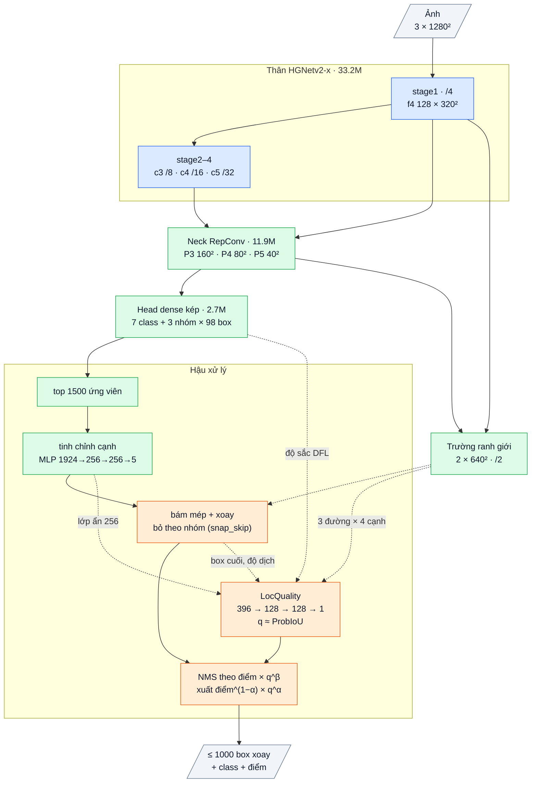

# OpenOBB24: v23 + độ khít học được của box đã tinh chỉnh, dùng để chọn box trong NMS

Sổ cái: F107 (mốc v23 0.798 / 0.526), **F109** (chẩn đoán + thiết kế + kỳ vọng ghi trước). Code: `openobb/models/openobb24.py`
(`LocQuality`, `OpenOBB24`), `openobb/models/openobb3.py` (`fast_nms(out_logits=)`), `openobb/predict.py` (`apply_quality`,
`quality_options`, `snap_skip_options`). Test: `tests/test_openobb24.py`. Model: `model=openobb24s|m|l|x`.

## 1. Bằng chứng (đo trên checkpoint F107, Wall_Color val, CPU)

Script trong `research/analysis/`; log `*_v23f107*.log`.

| Đo | Số | Script |
|---|---|---|
| Recall ở ProbIoU 0.5 so với YOLO26x theo độ dài | bằng hoặc hơn ở mọi nhóm (tường < 12 px 0.68 / 0.69; wall_300 ngắn 0.88 / 0.75) → **tìm object không còn là vấn đề** | `miss_by_length.py` |
| Recall ở ProbIoU 0.75 (v23 / YOLO) | wall 0.50 / 0.56, junction 0.38 / 0.47, wall_300 0.17 / 0.24 → **khoảng hụt là độ khít box** | `box_quality.py` |
| AP50-95 chỉ tính detection conf ≥ 0.25 (v23 / YOLO) | wall .632 / .687, junction .579 / .652, wall_300 .398 / .504 | `score_iou_corr.py` |
| Trần nếu sửa một thành phần box | hai đầu +0.119, lệch ngang +0.054, độ dày +0.037, góc +0.005 | `box_error_oracle.py` |
| Trong mỗi cụm NMS có ứng viên khít hơn box được giữ | **+0.052** nếu giữ đúng ứng viên đó | `rank_vote_oracle.py` (pick) |
| Hệ số chất lượng hoàn hảo trên điểm số (box sai × IoU trung vị) | v23 **+0.044**, YOLO +0.048; tương quan điểm–IoU ρ 0.33 / 0.37 (wall 0.22, junction 0.19) | `score_iou_corr.py` |
| Bỏ phiếu toạ độ trong cụm (không cần nhãn) | +0.003 | `rank_vote_oracle.py` |
| Đóng góp từng bước (NMS 0.5) | box head 0.517 → tinh chỉnh cạnh 0.527 → bám mép 0.528; bám mép làm junction **−0.015**, wall_300 −0.004 | `dup_analysis.py DUP_STAGES=` + `consensus_probe.py` |
| Điểm số học trên box của head; box được giữ là box sau tinh chỉnh + bám mép | độ dày / góc không đổi qua hai bước; bám mép làm junction quá mỏng (lệch −0.50 px) | `box_quality.py` từng bước |
| Độ dày nhãn theo bản vẽ | lệch so với trung vị của chính bản vẽ: junction 0.20 px, wall 0.58 px; giữa các bản vẽ 1–2 px. Trần "đồng thuận theo bản vẽ" chỉ +0.016, thực tế +0.002 → **không theo hướng này** | `consensus_probe.py` |
| Bề rộng dải màu trên ảnh gốc dự đoán độ dày nhãn | tương quan 0.31, sai số dư 1.26 px (tệ hơn model) → **nhãn không bám nét ảnh** (như F64) | `band_width_probe.py` |
| **Không train gì:** dùng độ khớp của trường ranh giới với 4 cạnh box cuối để chọn box trong cụm NMS | **+0.015 mAP50-95** (junction +0.019, wall +0.012), mAP50 +0.002; nhưng trường kém điểm số để xếp hạng giữa các object | `quality_probe.py` |

## 2. Bài học → cơ chế → kỳ vọng → điều chứng minh sai

| Bài học | Cơ chế v24 | Kỳ vọng | Chứng minh sai |
|---|---|---|---|
| Head một-nhiều để lại nhiều ứng viên trên mỗi object; NMS giữ box có **điểm class** cao nhất, mà điểm class gần như không biết độ khít (ρ 0.19–0.22 trên tường / junction) | **Đầu độ khít `LocQuality`**: MLP nhỏ dự đoán q = ProbIoU(box cuối, object) của từng ứng viên đã tinh chỉnh | q tương quan với IoU tốt hơn điểm class | hiệu chỉnh chọn q^0 (không dùng) |
| Box được giữ là box SAU tinh chỉnh + bám mép, điểm số lại học trên box của head | q đọc đúng box cuối: lớp ẩn của bộ tinh chỉnh (mẫu f4 + P3 trên cạnh box), **trường ranh giới trên 3 đường × 4 cạnh của box cuối**, độ sắc / entropy 3 phân phối DFL (ý GFLv2), độ dịch của hai bước, hình học | — | — |
| Tín hiệu trường ranh giới thô đã cho +0.015 khi chỉ dùng để chọn box trong cụm | **NMS theo điểm × q^β**: mỗi cụm giữ box khít; điểm xuất ra vẫn là điểm class (α = 0) hoặc trộn q (α > 0). β, α chọn trên val cuối train như NMS; (0, 0) = v23 | mAP50-95 ≥ đối chứng + 0.010 | < đối chứng + 0.005 |
| Bám mép làm hại junction (−0.015) và giúp các class khác | **bỏ bám mép theo nhóm class** (`snap_skip`), chọn trên val | junction 50-95 tăng | — |
| Mọi thay đổi trước đây làm lệch phần đã tốt (v22) | mọi đầu vào của q đều **detach**: loss mới không chạm phần của v23; lớp cuối khởi tạo 0 → bắt đầu đúng bằng v23 (`test_v24_starts_as_v23`) | mAP50 không tụt | mAP50 < đối chứng − 0.01 |

## 3. Chi tiết

- Kế thừa nguyên OpenOBB23 (thân HGNetv2, neck RepConv, head dense kép DFL + 3 nhóm class + góc kép, bộ tinh chỉnh cạnh, trường ranh
  giới, bám mép có xoay).
- **Mới:** `LocQuality` (0.068M tham số): đầu vào 396 số mỗi ứng viên = lớp ẩn bộ tinh chỉnh 256 + trường ranh giới 120 (4 cạnh × 3 đường
  −1 / 0 / +1 px × 5 điểm × 2 kênh) + DFL 6 + hình học 4 + độ dịch tinh chỉnh 5 + độ dịch bám mép 5 → LayerNorm → 128 → 128 → 1.
  Học bằng loss `fit` có sẵn (BCE với ProbIoU ≥ 0.5, còn lại 0) trên 256 ứng viên dày đặc mỗi ảnh (không trên box nhãn bị rung).
- **Mới ở suy luận:** `fast_nms(out_logits=)` xếp hạng theo điểm × q^β nhưng xuất điểm class; `snap_skip` theo nhóm.
- Hiệu chỉnh cuối train (sau NMS): thử (β, α) ∈ {(0, 0), (1, 0), (2, 0), (4, 0), (1, 0.5), (2, 0.5)}, rồi bỏ bám mép từng nhóm,
  rồi (từ 0.25.2) ứng viên ngoài top `ref_k` giữ (`min`) hay bỏ (`drop`); lưu `q_beta`, `q_alpha`, `snap_skip`, `q_outside` vào `best.pt`; `openobb calibrate` làm lại được trên checkpoint.
- Tận dụng phần có sẵn: 99.9% tham số là của v23 (thân mượn 64.7%, phần tự viết của v23 35.2%); v24 thêm 0.1%.
- Chi phí: một MLP trên 1500 ứng viên, khoảng 0.1 ms (G4); không đổi khi β = α = 0.
- Công tắc: `v24_off=quality` (không có đầu độ khít; còn `snap_skip`).

Sơ đồ và bảng từng lớp: mục 7 (cuối file).

## 4. Chỉ số kỳ vọng (ghi TRƯỚC khi train)

Mốc so sánh: **F107** (`openobb23x_new.pt` = v23 đã fine-tune nối tiếp F96 → F103 → F107, 0.798 / 0.526). Theo user (10-19) không chạy
đối chứng v23 riêng: lần fine-tune gần nhất chỉ thêm +0.003 mAP50-95 (F103 → F107), nằm trong dao động giữa hai run giống hệt
(±0.006 / ±0.002, F102), nên phần tăng do "train thêm" được coi là ≤ 0.005. Run của user: `openobb24x` từ chính file F107, 50 epoch,
`lr=0.001`, `rotate_p=0.5`, LR cosine mặc định (F108).

| | Mốc F107 (v23) | **v24** | Bác bỏ nếu |
|---|---|---|---|
| mAP50-95 | 0.526 | **≥ 0.536** (mục tiêu 0.535–0.545) | < 0.531 |
| mAP50 | 0.798 | ≥ 0.793 | < 0.788 |
| wall / junction / wall_300 mAP50-95 | .599 / .542 / .362 | mỗi class ≥ mốc + 0.008 | cả ba < mốc + 0.003 |
| Dòng `Localisation quality calibrated` | — | chọn β > 0 | chọn q^0 (đầu độ khít không giúp) |
| Box trùng | 1.8% | ≤ 2.3% | |
| Tốc độ (inference + postprocess) | 7.9 + 1.3 ms | ≤ 9.5 ms | |

Đọc kết quả: phần tăng do cơ chế = fitness (0.1·mAP50 + 0.9·mAP50-95) của v24 với β, α đã hiệu chỉnh − fitness của cùng checkpoint ở
q^0 (số "base" in ngay trong dòng `Localisation quality calibrated`). So sánh này cùng trọng số, nên tách được hẳn khỏi phần do train thêm 50 epoch. Nếu phần tăng chỉ khoảng +0.015
(bằng tín hiệu trường thô chưa học, F109), phần học được không thêm gì; khi đó cân nhắc dùng thẳng tín hiệu trường làm công tắc.

## 5. Lệnh (Colab, G4)

```bash
openobb train data=/content/data.yaml model=openobb24x epochs=50 imgsz=1280 batch=16 rotate_p=0.5 lr=0.001 weights=/content/drive/MyDrive/Train/tu_ph/Wall_Color/model/openobb23x_new.pt
```

Dòng `[init]` phải báo 8 tensor mới (`quality.*`).

Gửi lại: bảng theo class, dòng `NMS calibrated`, dòng **`Localisation quality calibrated`**, `Duplicate boxes`, `Box geometry`, `Speed`.

## 6. Kết quả thật

**Lần 1 (F110, log user 10-19):** 0.25.1, từ `openobb23x_new.pt` (F107), 50 epoch, `lr=0.001` cosine, nbs 64 (187 bước), `rotate_p=0.5`.
**0.802 / 0.531**, trùng 1.9%, 9.2 ms. Hiệu chỉnh: mọi cách dùng q kém base (q^0 0.5564; q^2 0.5526, q^1 0.5494) → chọn q^0;
bỏ bám mép nhóm note + junction (0.5578) được chọn.

| | Kỳ vọng | Kết quả |
|---|---|---|
| mAP50-95 | ≥ 0.536 (bác bỏ < 0.531) | 0.531, **không đạt** (chạm ngưỡng bác bỏ) |
| mAP50 | ≥ 0.793 | 0.802, đạt |
| wall / junction / wall_300 | mỗi class ≥ mốc + 0.008 | .591 / .559 / .346 (−.008 / +.017 / −.016), không đạt |
| Hiệu chỉnh chọn β > 0 | có | chọn q^0, **bác bỏ: đầu độ khít học được không giúp** |
| Box trùng | ≤ 2.3% | 1.9%, đạt |
| Tốc độ | ≤ 9.5 ms | 9.2 ms, đạt |

Kết luận: cơ chế "đầu độ khít học được" bị bác bỏ ở lần train này; phần giữ lại là bỏ bám mép cho junction (+.017 junction, đúng như
đo trước ở F109). Tín hiệu trường ranh giới thô (không học) đã cho +0.015 trên F107 vẫn chưa được thử như một lựa chọn: xem F110.

**Phân tích sau (F111):** hiệu chỉnh bác bỏ q vì hai lỗi ở đường suy luận 0.25.1: ứng viên ngoài top 1500 (chưa tinh chỉnh) nhận q cố
định 0.6 nên thắng cụm NMS khi β > 0, và ngưỡng conf của NMS áp lên điểm × q^β nên xoá box điểm thấp. Sửa ở 0.25.2 (`q_outside="min"`,
ngưỡng theo điểm xuất ra). Đo lại trên chính `best.pt` này (CPU, đường suy luận thật): q^0 0.5523, **q^2 0.5546 (+0.0023)**: q học được có
ích nhưng nhỏ, vẫn dưới kỳ vọng ≥ +0.010. Bỏ hẳn ứng viên chưa tinh chỉnh (`q_outside="drop"`) cho q^0 0.5536, q^2 0.5554, nên từ
0.25.2 hiệu chỉnh thử thêm `min` / `drop` và lưu `q_outside`. Checkpoint F110 cần `openobb calibrate` lại bằng 0.25.2 trên GPU.

## 7. Phụ lục: kiến trúc theo lớp (cỡ x)

Kích thước ghi cho ảnh vào 1 × 3 × 1280 × 1280, Wall_Color (7 class, 3 nhóm class). Thân, neck, head, trường ranh giới, bộ tinh chỉnh,
bám mép: giống hệt OpenOBB23 ([OPENOBB23.md](OPENOBB23.md) mục 7, bảng từng lớp). Dưới đây là luồng dữ liệu và các phần mới.

### Luồng dữ liệu

Xanh dương: mượn (pretrained, Apache-2.0). Xanh lá: tự viết. Cam: mới ở v24. Nét đứt: đọc trường ranh giới / không truyền gradient.



### Phần mới: LocQuality, 0.068M

| Khối | Lớp | Ra | Tham số |
|---|---|---|---|
| đầu vào | lớp ẩn cuối của bộ tinh chỉnh 256; trường ranh giới (logit / 4, cắt ±5) trên 4 cạnh của box cuối × 3 đường (−1 / 0 / +1 px theo pháp tuyến) × 5 điểm × 2 kênh = 120; mỗi phân phối DFL (đầu trái / phải / độ dày): khối lượng 2 bin cao nhất + entropy chuẩn hoá = 6; log độ dài, log độ dày, sin 2θ, cos 2θ = 4; độ dịch head → tinh chỉnh và tinh chỉnh → bám mép trong hệ toạ độ của box (dọc, ngang theo độ dày; log tỉ lệ dài, dày; góc × 5) = 10. Tất cả detach | 396 | 0 |
| norm | LayerNorm 396 | 396 | 0.001M |
| mlp | Linear 396→128, SiLU, Linear 128→128, SiLU, Linear 128→1 (trọng số 0, bias logit 0.6) | 1 logit | 0.067M |

### Phần mới ở suy luận (không tham số)

| Bước | Cơ chế |
|---|---|
| q | sigmoid(LocQuality) cho 1500 ứng viên đã tinh chỉnh; ứng viên khác q = 0.6 |
| NMS theo độ khít | `fast_nms` xếp hạng theo điểm × q^β (β ∈ {0, 1, 2, 4}), ngưỡng ProbIoU như v23; điểm xuất ra = điểm^(1−α) × q^α (α ∈ {0, 0.5}) |
| bỏ bám mép theo nhóm | nhóm class trong `snap_skip` giữ box của bộ tinh chỉnh |

### Tổng hợp

| Phần | Tham số | Tỉ lệ | Nguồn |
|---|---|---|---|
| Thân HGNetv2-x | 33.23M | 64.7% | mượn (Apache-2.0) |
| Neck + head ×2 + trường + tinh chỉnh + bám mép (v23) | 18.04M | 35.1% | tự viết |
| **LocQuality (mới)** | **0.068M** | **0.1%** | tự viết |
| **Tổng** | **51.34M** | | 35.3% tự viết |
