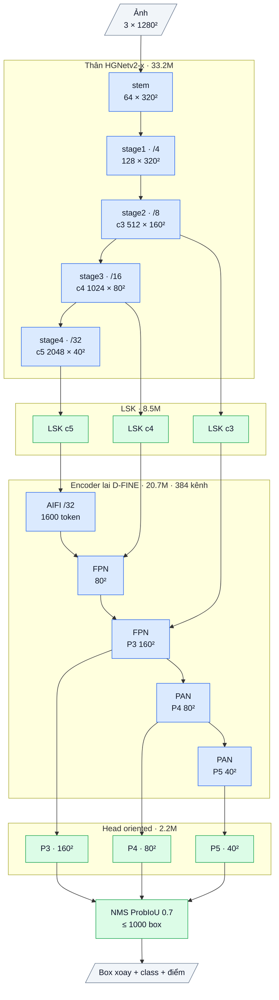

# OpenOBB3: encoder pretrained + head dense oriented dị hướng (bản 3, 2026-10-09)

Dùng: CLI giữ nguyên, chỉ đổi `model=`.

```bash
openobb train data=/content/data.yaml model=openobb3x epochs=100 imgsz=1280
```

- Mặc định: backbone + encoder khởi tạo từ D-FINE-X COCO (Apache-2.0), tự tải về.
- **Tuỳ chọn:** khởi tạo từ checkpoint OpenOBB1 đã fine-tune trên data của bạn (bản đạt 0.63/0.35). Thêm
  `weights=/content/drive/MyDrive/Train/tu_ph/Wall_Color/model/<checkpoint OpenOBB1-x>.pt`. Backbone, encoder và LSK được chép
  nguyên (702 tensor), head mới khởi tạo ngẫu nhiên, class ghép theo tên.
- Fine-tune tiếp từ `best.pt` của OpenOBB3: `model=.../best.pt`, tự nhận kiến trúc v3.

## 1. Vì sao có v3: rút từ kết quả thật trên Wall_Color

| Bản | Thiết kế | mAP50 / mAP50-95 | Bài học |
|---|---|---|---|
| YOLO11x | CNN dense + NMS, pretrained COCO | 0.74 / 0.50 | Mốc cần vượt |
| OpenOBB1-X | D-FINE (DETR) + LSK, pretrained COCO | 0.63 / 0.35 | Feature pretrained tốt. Decoder là nút thắt: trần query, 1 mẫu dương/object, chậm |
| OpenOBB2-x | Dense segment-aware, **train từ đầu** | 0.27 / 0.10 (50 ep) | Trên 250 ảnh, pretrained quyết định. Cách hồi quy segment không làm khít chiều dọc (`end_loss` đứng ở khoảng 0.93) |

**OpenOBB3 = phần tốt nhất của mỗi bản:**
- Từ v1: feature pretrained và adapter LSK.
- Từ YOLO và v2: head dense nhiều mẫu dương, NMS, gán nhãn TAL theo độ dài.
- Mới: cách hồi quy dọc trục được viết lại.

## 2. Các phần của kiến trúc (bản x)

Sơ đồ khối và bảng từng lớp: mục 8 (phụ lục, cuối file).

Tổng **64.6M tham số**.

| # | Phần | Làm gì | Tham số | Nguồn |
|---|---|---|---|---|
| 1 | **Backbone HGNetv2-B5**: stem và BN đóng băng như D-FINE-X | Feature đa tầng, **pretrained COCO** | 33.2M | Code D-FINE (Apache-2.0) đã port từ v1. Weights COCO Apache-2.0 |
| 2 | **LSK adapter** (selective large kernel) ở 3 tầng | Trường nhìn thích nghi theo vị trí: gần (5×5) hoặc xa (7×7 dilation 3). Khởi tạo bằng identity | 8.5M | Ý tưởng LSKNet; code OpenOBB tự viết (đã xác nhận c6: +1.3 mAP50 trên FloorPlanCAD) |
| 3 | **Hybrid encoder**: AIFI (attention toàn cục trên P5) + CCFF (PAN 2 chiều) | Ngữ cảnh toàn trang + trộn đa tầng, **pretrained COCO** | 20.7M | Code D-FINE (Apache-2.0) |
| 4 | **Head oriented dị hướng** P3–P5 (**mới**). Mỗi điểm dự đoán 5 nhóm số, xem bảng dưới | Đoán box ở mọi điểm, mỗi object nhiều mẫu dương, không có trần query | 2.2M | Ý tưởng DFL (GFL/YOLO); thiết kế dị hướng + lệch ngang là của OpenOBB |
| 5 | **Gán nhãn TAL xoay** | Top-k theo chiều dài (vật dài nhiều mẫu dương). **Mỗi tầng có một hàng ứng viên dọc mỗi object** (dải ngang ≥ 1 stride), để điểm P4/P5, vốn nhìn thấy cả hai đầu bức tường, được học object dài | 0 | TAL (TOOD/YOLO). Dải đa tầng là của OpenOBB |
| 6 | **Mục tiêu theo hệ trục gần góc dự đoán** (**mới**) | Hướng đoán ngược thì đổi chỗ trái/phải. Vật gần vuông được dùng cạnh ngắn làm trục. **Không nhảy gián đoạn ở tường dọc** (le90 ±90°) | 0 | OpenOBB |
| 7 | **Loss**: QFL (cls), 1 − ProbIoU, DFL ×3, lệch ngang tương đối độ dày, 1 − cos 2Δθ | | 0 | GFL, ProbIoU; lệch ngang lấy từ v2 (đã chạy tốt) |
| 8 | **Đầu ra**: Fast-NMS theo class trên ProbIoU (IoU 0.7), tối đa 1000 box | Giống YOLO; khung eval/predict dùng nguyên như cũ | 0 | Ý tưởng Fast-NMS (YOLACT/YOLO-OBB), tự viết |

**Head oriented (phần 4).** Mỗi điểm dự đoán:

| Đại lượng | Cách dự đoán | Ghi chú |
|---|---|---|
| Góc θ | hồi quy trực tiếp | |
| Lệch ngang tới tâm | `raw · stride`, có dấu | Điểm nằm cạnh line mảnh vẫn đoán được line |
| Khoảng cách tới **đầu sau** dọc trục | phân phối 32 bin, mỗi bin = 1 stride | Tầm với 31 stride: P3 248 px, P5 992 px, đủ cho tường dài |
| Khoảng cách tới **đầu trước** dọc trục | phân phối 32 bin, mỗi bin = 1 stride | Như trên |
| Độ dày | phân phối 32 bin, mỗi bin = stride / 2 | Mịn hơn 2 lần, cho vật mảnh |

**Khác v2 ở chỗ quan trọng:** v2 đoán "vị trí tương đối × log(chiều dài)". Hai đại lượng đó nhân với nhau, nên sai số đầu mút không giảm được. v3 đoán **hai khoảng cách độc lập tới hai đầu mút, dưới dạng phân phối**, đúng cách YOLO làm cho 4 cạnh box. Khác YOLO ở chỗ lưới bin dị hướng: dọc thô và xa, ngang mịn. YOLO dùng cùng 16 bin cho cả 4 cạnh.

## 3. Tận dụng bao nhiêu cái có sẵn

| | OpenOBB1 | OpenOBB2 | **OpenOBB3** |
|---|---|---|---|
| Tham số từ code D-FINE (Apache) | khoảng 86% | 0% | **83%** (backbone 33.2M + encoder 20.7M) |
| Tham số code OpenOBB tự viết | khoảng 14% (decoder OBB) | 100% | **17%** (LSK 8.5M + head 2.2M) |
| Weights pretrained | COCO | không | **COCO** (hoặc OpenOBB1 của bạn) |
| Phần mới | decoder xoay, LSK | segment head, o2o dùng chung box | head dị hướng, mục tiêu theo hệ trục dự đoán, dải ứng viên đa tầng |
| License | Apache notice | không phụ thuộc | Apache notice, như v1. **Thương mại được** |

**Nói thẳng:** v3 không phải "viết lại toàn bộ". Bằng chứng từ v2 cho thấy trên 250 ảnh, pretrained quan trọng hơn mọi thay đổi kiến trúc. Phần mới của v3 nằm đúng ở chỗ v1 yếu: decoder và độ khít của object dài.

## 4. Công thức train mặc định của `openobb3x`

CLI tự đặt:
- **AdamW, lr 5e-4.** Backbone lr × 0.1 để giữ feature pretrained; encoder và head chạy LR đầy đủ.
- Weight decay 1e-4, clip grad 10, batch 8.
- LSK, RFS 0.1, tối đa 1000 detection.
- Augment như cũ.

**Về LR:** với backbone pretrained, LR quá cao sẽ phá feature COCO. OpenOBB1 từng ra NaN ở 1e-3, F22. Nên giữ mặc định, hoặc tối đa `lr0=0.001`.

## 5. Đọc log

```
Epoch  GPU_mem  cls_loss  box_loss  dfl_loss  acr_loss  angle_loss  Instances  Size
```

| Cột | Ý nghĩa |
|---|---|
| `dfl_loss` | Trung bình DFL của 2 khoảng cách dọc trục và độ dày. **Chỉ số chính về độ khít:** phải giảm đều. Đây là chỗ `end_loss` của v2 bị kẹt |
| `acr_loss` | Lệch ngang tương đối độ dày |

## 6. Đã kiểm chứng tới đâu

- **CPU** (`tests/test_openobb3.py`, 73 test toàn repo pass):
  - decode;
  - mục tiêu theo hệ trục: tường dọc ở biên ±90°, lật hướng, vật gần vuông;
  - Fast-NMS: xoá box trùng nhưng giữ tường song song cách 40 px;
  - tên và shape của backbone/encoder/LSK khớp v1, nên weights COCO và OpenOBB1 nạp được;
  - CLI `model=openobb3x`;
  - nạp `best.pt`;
  - luồng train → val → predict (2 vòng lặp).
- **Chưa chạy GPU / data thật.** Chưa có mAP và tốc độ.

## 7. Kỳ vọng, cần log kiểm chứng

- **Kỳ vọng:**
  - mAP50 ≥ v1 (0.63), vì cùng feature pretrained và có nhiều mẫu dương hơn.
  - **mAP50-95 tăng rõ ở wall/wall_300**, nhờ hồi quy dọc trục mới và ứng viên đa tầng.
  - Nhanh hơn v1, vì không còn decoder 6 lớp.
- **Rủi ro:**
  - Head dense mới khởi tạo ngẫu nhiên, cần vài epoch đầu để bắt kịp.
  - Trên class hiếm, NMS kiểu YOLO có thể thua decoder DETR về ngữ cảnh (door/slide_door/double_door).
- Cần gửi: bảng mAP theo class và dòng `Speed`.

## 8. Phụ lục: kiến trúc theo lớp (cỡ x)

Kích thước ghi cho ảnh vào 1 × 3 × 1280 × 1280, Wall_Color (7 class). Ký hiệu: `conv k×k sS a→b` = Conv + BN + kích hoạt,
`dw` = depthwise, `/N` = stride N so với ảnh.

### Luồng dữ liệu

Xanh dương: mượn (pretrained, Apache-2.0). Xanh lá: tự viết.



### Thân: HGNetv2-x (mượn, Apache-2.0, trọng số D-FINE COCO), 33.23M

| Khối | Lớp | Ra | Tham số |
|---|---|---|---|
| stem | conv 3×3 s2 3→32; nhánh [conv 2×2 32→16 → conv 2×2 16→32] ∥ max-pool 2; nối 64 → conv 3×3 s2 64→32 → conv 1×1 32→64 | 64 × 320² (/4) | 0.03M |
| stage1 | 1 khối HG: 6 × conv 3×3 64→64, nối 448 kênh → 1×1 →64 → 1×1 →128 | **f4** 128 × 320² | 0.26M |
| stage2 | dw 3×3 s2; 2 khối HG: 6 × conv 3×3 128, nối → 1×1 → 512 | **c3** 512 × 160² (/8) | 3.03M |
| stage3 | dw 3×3 s2; 5 khối HG nhẹ: 6 × (1×1 → dw 5×5) 256, nối → 1×1 512 → 1×1 1024 | **c4** 1024 × 80² (/16) | 11.93M |
| stage4 | dw 3×3 s2; 2 khối HG nhẹ: 6 × (1×1 → dw 5×5) 512, nối → 1×1 → 2048 | **c5** 2048 × 40² (/32) | 17.99M |

BN của thân bị đóng băng (FrozenBatchNorm), kích hoạt ReLU.

### Adapter LSK (tự viết, ý tưởng LSKNet), 8.54M

Trên c3 / c4 / c5, mỗi tầng một khối (c = 512 / 1024 / 2048 kênh; 0.43M / 1.65M / 6.45M):
a = dw 5×5(x); b = dw 7×7 giãn 3(a) (trường nhìn khoảng 23 ô); a, b → conv 1×1 về c/2; cổng = conv 7×7 trên [trung bình, max theo kênh]
của [a, b] → 2 kênh sigmoid; m = conv 1×1 c/2→c (khởi tạo 0) của (a·g₁ + b·g₂); ra **x + x·m**. Khởi tạo = đồng nhất.

### Encoder lai D-FINE (mượn, Apache-2.0, trọng số COCO), 20.70M, 384 kênh

| Khối | Lớp | Ra | Tham số |
|---|---|---|---|
| input_proj | ba conv 1×1 + BN: c3 512→384, c4 1024→384, c5 2048→384 | | 1.38M |
| AIFI | 1 lớp transformer trên 1600 token của /32: attention 8 đầu, FFN 384→2048→384 (GELU), vị trí sin-cos 2-D | 384 × 40² | 2.17M |
| FPN (2 bước) | lateral 1×1 384→384; upsample ×2; nối 768 → RepNCSPELAN4 → 384 | 384 × 80², **P3** 384 × 160² | 8.57M |
| PAN (2 bước) | SCDown [1×1 384→384 → dw 3×3 s2]; nối 768 → RepNCSPELAN4 → 384 | **P4** 384 × 80², **P5** 384 × 40² | 8.58M |

RepNCSPELAN4(768→384): conv 1×1 768→768, tách 2 nửa 384; nửa sau qua [CSP 384→192 (3 khối RepVGG 3×3 ∥ 1×1) → conv 3×3 192] rồi
[CSP 192→192 (3 khối) → conv 3×3 192]; nối 384 + 384 + 192 + 192 → conv 1×1 → 384. Kích hoạt SiLU.

### Head oriented dị hướng (tự viết), 2.17M

| Nhánh | Lớp (một tầng) | Ra mỗi điểm | Tham số (3 tầng) |
|---|---|---|---|
| class | dw 3×3 384 → 1×1 384→192 → dw 3×3 192 → 1×1 192→192 → 1×1 →7 (bias tiên nghiệm 0.01) | 7 logit | 0.36M |
| box | conv 3×3 384→128 → conv 3×3 128→128 → 1×1 128→98 (chạy fp32) | 98 kênh | 1.81M |

98 kênh box (một nhóm): góc θ, lệch ngang tâm (× stride), phân phối 32 bin khoảng cách tới đầu sau và 32 bin tới đầu trước dọc trục
(bin = 1 stride), 32 bin độ dày (bin = 1/2 stride). Mỗi tầng một tháp riêng; điểm lưới = tâm ô.

### Tổng hợp

| Phần | Tham số | Tỉ lệ | Nguồn |
|---|---|---|---|
| Thân HGNetv2-x | 33.23M | 51.4% | mượn (Apache-2.0) |
| LSK | 8.54M | 13.2% | tự viết |
| Encoder lai | 20.70M | 32.0% | mượn (Apache-2.0) |
| Head | 2.17M | 3.4% | tự viết |
| **Tổng** | **64.64M** | | 16.6% tự viết |

Suy luận: 33 600 điểm (P3 25 600 + P4 6 400 + P5 1 600) → giải mã box → Fast-NMS ProbIoU theo class (0.7) → tối đa 1000 box.
