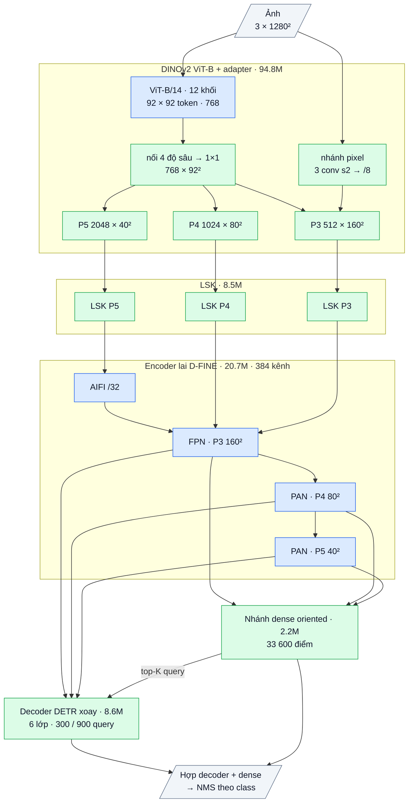

# OpenOBB4-x: DINOv2 + DETR oriented lai dense (bản 4, 2026-10-09)

Dùng: CLI giữ nguyên, chỉ đổi `model=`.

```bash
openobb train data=/content/data.yaml model=openobb4x epochs=100 imgsz=1280
```

- Lần đầu tự tải 2 bộ weights, đều Apache-2.0:
  - DINOv2 ViT-B/14 có registers, khoảng 350 MB;
  - D-FINE-X COCO.
- Không truyền `lr` hoặc `batch`: mặc định lr 1e-4 (ViT × 0.5), batch 8.
- Chỉ có bản x (ưu tiên độ chính xác).

## 1. Bằng chứng dẫn tới v4 (Wall_Color, 250 ảnh)

| Bản | Thiết kế | Kết quả (thước DOTA) | Kết luận |
|---|---|---|---|
| v1 | HGNetv2 COCO + encoder + **decoder DETR** | 0.63 / 0.35 | Tốt nhất của OpenOBB |
| v2 | Dense, train từ đầu | 0.36 / 0.13 (chạm trần) | Không pretrained thì thua; hồi quy segment hỏng |
| v3 | HGNetv2 COCO + encoder + **head dense** | khoảng 0.50 / 0.25 (ep55, đang tăng) | **Cùng feature, decoder DETR > head dense** |
| YOLO11x | CNN dense, pretrained COCO + DOTA | 0.74 / 0.50 (thước Ultralytics) | So không cùng thước. Từ commit `2ba3b81`, OpenOBB in thêm thước Ultralytics |

Rút ra hai điều:
1. Trên data nhỏ, **chất lượng feature pretrained** quyết định nhiều nhất.
2. Decoder DETR (suy luận quan hệ giữa các object) có ích cho class cần ngữ cảnh. Head dense thì cho nhiều mẫu dương và học nhanh. **Hai cái bổ sung cho nhau.**

## 2. Phân tích SOTA và cái v4 lấy về

| Công trình | Bằng chứng | Lấy gì cho v4 |
|---|---|---|
| **RF-DETR** (Roboflow 2025, Apache-2.0) | SOTA khi fine-tune trên RF100-VL (100 dataset nhỏ, miền lạ: tài liệu, y tế, ảnh vệ tinh...). Thắng YOLO11 và D-FINE nhờ backbone **DINOv2 tự giám sát** | Thay HGNetv2 (học có nhãn trên COCO) bằng **DINOv2 ViT-B/14**. Bản vẽ CAD là miền lạ so với COCO |
| **Registers** (Darcet và cộng sự, ICLR 2024) | ViT có token register cho feature dày đặc sạch hơn (bớt điểm nhiễu) | Dùng checkpoint `reg4` |
| **ViTDet** (Li và cộng sự 2022) | ViT thuần + kim tự tháp feature đơn giản vẫn ngang FPN | Adapter: trộn 4 tầng ViT, rồi tạo P3/P4/P5 |
| **ViT-Adapter** (ICLR 2023) | Nhánh conv "spatial prior" bù chi tiết pixel mà patch 14 px làm mờ | Nhánh CNN nhỏ ở stride 8 cộng vào P3, **cho nét mảnh** |
| **Co-DETR** (ICCV 2023), **RT-DETRv3** (2024) | Head dense một-nhiều phụ trên encoder cho DETR thêm giám sát dày đặc: Co-DETR +3.4 ở lịch 12 epoch, RT-DETRv3 +1.6. Ta đã đo trên DOTA (e16): hợp nhất +0.64 | **Nhánh dense = head oriented của v3** (đã chứng minh loss giảm tốt), làm giám sát phụ cho encoder |
| **DDQ** (CVPR 2023) | Query lấy từ ứng viên dense sau NMS (khác nhau) tốt hơn top-K thô | Query decoder lấy từ nhánh dense (`distinct_topk`) |
| **D-FINE** (2024, Apache-2.0) | DETR real-time mạnh, encoder/decoder pretrained COCO | Giữ encoder + decoder OBB của v1 (pretrained COCO) |
| Họ **YOLO** (DFL, TAL, NMS) | Head dense mạnh ở vật nhỏ | Nằm trong nhánh dense (từ v3). Đầu ra = decoder ∪ dense qua NMS |

**Chưa đưa vào (có lý do):**

| Ý tưởng | Lý do chưa dùng |
|---|---|
| Windowed attention (RF-DETR) | Chỉ để tăng tốc; ưu tiên độ chính xác trước |
| DINOv3 | Cần kiểm tra license thương mại |
| Tầng P2 | v1 đo trên CAD: −2.8 |
| Pretrain DOTA | License học thuật |

## 3. Các phần của OpenOBB4-x (134.8M tham số)

Sơ đồ khối và bảng từng lớp: mục 7 (phụ lục, cuối file).

| # | Phần | Làm gì | Tham số | Nguồn code / weights |
|---|---|---|---|---|
| 1 | **ViT-B/14 DINOv2** (12 lớp, 4 register, pos-embed nội suy theo kích thước ảnh) | Feature tổng quát tự giám sát, attention toàn ảnh ngay từ backbone | 86.6M | Code OpenOBB tự viết (`openobb/models/vit.py`); **weights DINOv2 Apache-2.0** |
| 2 | **Adapter** (trộn 4 tầng 3/6/9/12 → P3 deconv, P4, P5) + **nhánh chi tiết CNN stride 8** | Tạo kim tự tháp stride 8/16/32; giữ nét mảnh | 8.2M | OpenOBB (ý tưởng ViTDet, ViT-Adapter) |
| 3 | **LSK** ×3 | Trường nhìn thích nghi (đã đo +1.3 trên CAD) | 8.5M | OpenOBB |
| 4 | **Hybrid encoder** (AIFI + CCFF) | Ngữ cảnh toàn cục + trộn đa tầng | 20.7M | Code D-FINE Apache, **weights COCO** (riêng lớp chiếu đầu vào khởi tạo lại) |
| 5 | **Nhánh dense oriented** (head v3: DFL 2 đầu mút + độ dày, lệch ngang, mục tiêu theo hệ trục dự đoán, TAL đa tầng) | (a) Giám sát một-nhiều cho encoder. (b) Đề xuất query cho decoder. (c) Một nửa đầu ra | 2.2M | OpenOBB |
| 6 | **Decoder OBB D-FINE** (6 lớp, FDR xoay, nhóm query một-nhiều 900, AQD, loss góc) | Tinh chỉnh box và suy luận quan hệ giữa các object | 8.6M | Code D-FINE Apache viết lại cho OBB, **weights COCO** |
| 7 | **Đầu ra** = decoder ∪ nhánh dense qua NMS | Recall của dense + độ chính xác của decoder | 0 | OpenOBB |

## 4. Tận dụng bao nhiêu cái có sẵn

| | v1 | v3 | **v4** |
|---|---|---|---|
| Weights pretrained | COCO (D-FINE) | COCO | **DINOv2 (ViT) + COCO (encoder/decoder)**: 86% tham số khởi đầu từ pretrained |
| Code từ dự án khác (Apache) | khoảng 86% tham số | 83% | **khoảng 22%** (encoder 20.7M + phần decoder) |
| Code OpenOBB tự viết | khoảng 14% | 17% | **khoảng 78%** (ViT + adapter + LSK + nhánh dense + phần OBB của decoder) |
| License | Apache notice | Apache notice | Apache notice. **Thương mại được** |

## 5. Rủi ro và cách đọc log

- **Ba thay đổi cùng lúc:** backbone, nhánh dense phụ, query từ dense. Nếu v4 không vượt v1, chạy thêm `model=openobb4x backbone=hgnet`. Lệnh này giữ phần lai, chỉ trả backbone về HGNetv2, nên tách được tác dụng của DINOv2.
- `eval_val.json` (mục `fusion`) có mAP riêng của decoder, dense và union. Từ đó biết phần nào đóng góp.
- **Nặng hơn:** 134.8M tham số; ViT-B với khoảng 8.5k token ở 1280 px. Train và suy luận đều chậm hơn v1. Cần dòng `Speed` để biết chậm bao nhiêu.
- LR kiểu DETR (1e-4). Giữ mặc định: v1 từng ra NaN ở 1e-3.
- Log console chỉ hiện loss của decoder (giống v1). Loss của nhánh dense (`loss_dense_*`) nằm trong `results.csv`.
- **So với YOLO:** dùng dòng `Ultralytics-style metric` ở cuối run.

## 6. Đã kiểm chứng tới đâu

- CPU, `tests/test_openobb4.py` (81 test toàn repo pass):
  - **checkpoint DINOv2 thật nạp khớp 176/176 tensor** (kiểm bằng ViT-S, cùng định dạng với ViT-B);
  - kích thước ảnh bất kỳ (pad lên bội của 14);
  - train/eval, loss hữu hạn, gradient tới ViT;
  - adapter chạy LR đầy đủ;
  - CLI `model=openobb4x`, nạp `best.pt`;
  - luồng train → val → predict của bản x (2 vòng lặp).
- **Chưa chạy GPU / data thật.**

## 7. Phụ lục: kiến trúc theo lớp (cỡ x)

Kích thước ghi cho ảnh vào 1 × 3 × 1280 × 1280, Wall_Color (7 class). Ký hiệu: `conv k×k sS a→b` = Conv + BN + kích hoạt,
`dw` = depthwise, `/N` = stride N so với ảnh.

### Luồng dữ liệu

Xanh dương: mượn (pretrained, Apache-2.0). Xanh lá: tự viết. Nhánh dense chọn query cho decoder; đầu ra là hợp của decoder và nhánh dense.



### Thân: DINOv2 ViT-B/14 (mượn, Apache-2.0, trọng số DINOv2) + adapter (tự viết), 94.78M

| Khối | Lớp | Ra | Tham số |
|---|---|---|---|
| chuẩn hoá + đệm | trừ trung bình / chia độ lệch ImageNet; đệm lên bội 14 | 3 × 1288² | 0 |
| patch_embed | conv 14×14 s14 3→768 + token lớp + token đăng ký | 92 × 92 token | 0.45M |
| 12 khối ViT | LayerNorm → attention 12 đầu (d 768) → LayerNorm → MLP 768→3072→768; lấy đầu ra khối 3, 6, 9, 12 | 768 × 92² | 85.07M |
| adapter.fuse | nối 4 độ sâu (3072) → conv 1×1 → 768 | 768 × 92² | 2.36M |
| adapter.up | conv chuyển vị 2×2 s2 768→384 + BN + SiLU, nội suy về /8 | 384 × 160² | 1.18M |
| adapter.spm | nhánh chi tiết pixel: conv 3×3 s2 3→64 → s2 64→128 → s2 128→384 | 384 × 160² (/8) | 0.52M |
| adapter.p3 | (up + spm) → conv 3×3 384→512 | **P3** 512 × 160² | 1.77M |
| adapter.p4 | nội suy về /16 → conv 1×1 768→1024 | **P4** 1024 × 80² | 0.79M |
| adapter.p5 | pool trung bình về /32 → conv 1×1 768→2048 | **P5** 2048 × 40² | 1.58M |

### Adapter LSK (tự viết, ý tưởng LSKNet), 8.54M

Trên c3 / c4 / c5, mỗi tầng một khối (c = 512 / 1024 / 2048 kênh; 0.43M / 1.65M / 6.45M):
a = dw 5×5(x); b = dw 7×7 giãn 3(a) (trường nhìn khoảng 23 ô); a, b → conv 1×1 về c/2; cổng = conv 7×7 trên [trung bình, max theo kênh]
của [a, b] → 2 kênh sigmoid; m = conv 1×1 c/2→c (khởi tạo 0) của (a·g₁ + b·g₂); ra **x + x·m**. Khởi tạo = đồng nhất.

### Encoder lai D-FINE (mượn, Apache-2.0, trọng số COCO), 20.70M, 384 kênh

| Khối | Lớp | Ra | Tham số |
|---|---|---|---|
| input_proj | ba conv 1×1 + BN: c3 512→384, c4 1024→384, c5 2048→384 | | 1.38M |
| AIFI | 1 lớp transformer trên 1600 token của /32: attention 8 đầu, FFN 384→2048→384 (GELU), vị trí sin-cos 2-D | 384 × 40² | 2.17M |
| FPN (2 bước) | lateral 1×1 384→384; upsample ×2; nối 768 → RepNCSPELAN4 → 384 | 384 × 80², **P3** 384 × 160² | 8.57M |
| PAN (2 bước) | SCDown [1×1 384→384 → dw 3×3 s2]; nối 768 → RepNCSPELAN4 → 384 | **P4** 384 × 80², **P5** 384 × 40² | 8.58M |

RepNCSPELAN4(768→384): conv 1×1 768→768, tách 2 nửa 384; nửa sau qua [CSP 384→192 (3 khối RepVGG 3×3 ∥ 1×1) → conv 3×3 192] rồi
[CSP 192→192 (3 khối) → conv 3×3 192]; nối 384 + 384 + 192 + 192 → conv 1×1 → 384. Kích hoạt SiLU.

### Nhánh dense oriented (tự viết, head của OpenOBB3), 2.17M

Đọc P3 / P4 / P5 của encoder (384 kênh). Vừa là giám sát một-nhiều phụ cho encoder, vừa chọn top-K đề xuất khác nhau làm query cho decoder.

| Nhánh | Lớp (một tầng) | Ra mỗi điểm | Tham số (3 tầng) |
|---|---|---|---|
| class | dw 3×3 384 → 1×1 384→192 → dw 3×3 192 → 1×1 192→192 → 1×1 →7 (bias tiên nghiệm 0.01) | 7 logit | 0.36M |
| box | conv 3×3 384→128 → conv 3×3 128→128 → 1×1 128→98 (chạy fp32) | 98 kênh | 1.81M |

98 kênh box (một nhóm): góc θ, lệch ngang tâm (× stride), phân phối 32 bin khoảng cách tới đầu sau và 32 bin tới đầu trước dọc trục
(bin = 1 stride), 32 bin độ dày (bin = 1/2 stride). Mỗi tầng một tháp riêng; điểm lưới = tâm ô.

### Decoder DETR xoay (khung D-FINE, phần OBB viết lại), 8.59M

| Khối | Lớp | Ra | Tham số |
|---|---|---|---|
| input_proj | ba conv 1×1 + BN: 384→256 trên P3 / P4 / P5 | 256 kênh | 0.30M |
| chọn query | Linear + LayerNorm trên 33 600 token của encoder → head class + head box → top-K (300 khi train, 900 khi suy luận); vị trí query = MLP 6→512→256 | K × 256 | 0.34M |
| 6 lớp decoder | self-attention giữa query (8 đầu, d 256) → **deformable cross-attention xoay theo góc box** (8 đầu, 3 tầng, 3 / 6 / 3 điểm mỗi tầng) → FFN 256→1024→256 | K × 256 | 6.76M |
| head mỗi lớp | class: Linear 256→7; box: MLP 256→256→256→165 = phân phối 5 × 33 bin (4 cạnh trong khung xoay + góc dư ±π/4), tinh chỉnh dần qua các lớp; LQE (chất lượng định vị từ phân phối) | K × (7 + 165) | 1.20M (6 lớp) |

### Tổng hợp

| Phần | Tham số | Tỉ lệ | Nguồn |
|---|---|---|---|
| ViT-B DINOv2 | 86.58M | 64.2% | mượn (Apache-2.0) |
| Adapter ViT → P3 / P4 / P5 | 8.20M | 6.1% | tự viết |
| LSK | 8.54M | 6.3% | tự viết |
| Encoder lai | 20.70M | 15.4% | mượn (Apache-2.0) |
| Nhánh dense | 2.17M | 1.6% | tự viết |
| Decoder | 8.59M | 6.4% | khung D-FINE, phần OBB viết lại |
| **Tổng** | **134.78M** | | 14.0% tự viết + 6.4% viết lại |

Suy luận: decoder 900 query + 33 600 điểm dense → hợp hai nguồn → NMS theo class khi ghép.
