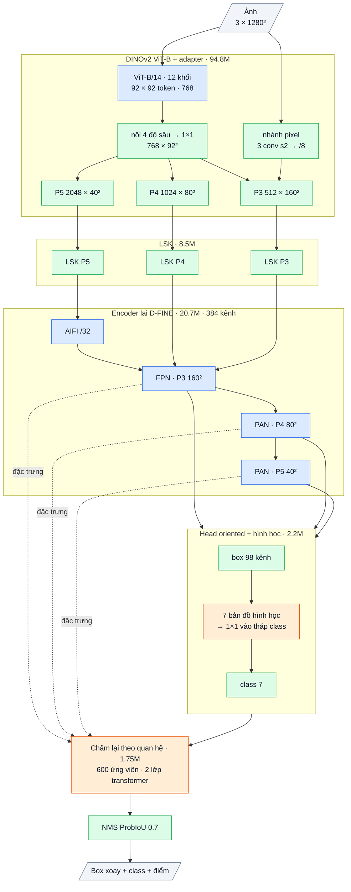

# OpenOBB5-x: dense oriented + DINOv2 + phân loại theo hình học + chấm lại theo quan hệ (bản 5, 2026-10-09)

Dùng: CLI giữ nguyên, chỉ đổi `model=`.

```bash
openobb train data=/content/data.yaml model=openobb5x epochs=100 imgsz=1280
```

- Mặc định: lr 5e-4, phần ViT × 0.2, batch 8.
- Init: DINOv2 ViT-B (Apache) + encoder D-FINE-X COCO. Head và bộ chấm lại khởi tạo mới.
- Tuỳ chọn:

| Tuỳ chọn | Tác dụng |
|---|---|
| `weights=<best.pt của v3>` | Nạp head của v3 (cùng tên tham số). Nên dùng thêm `backbone=hgnet` để nạp cả backbone/encoder v3 |
| `backbone=hgnet` | Bỏ DINOv2, nhanh hơn |
| `geo_cls=False`, `relate=False` | Tắt từng phần mới để đo tác dụng riêng |

## 1. Bằng chứng dẫn tới v5 (Wall_Color, thước YOLO)

| | all | wall_300 | Class hiếm (slide / double / note) | Tốc độ | Bài học |
|---|---|---|---|---|---|
| YOLO26x | 0.746 / 0.499 | 0.824 / 0.441 | .345 / .494 / .764 | – | Mốc |
| v3 (head dense) | 0.712 / 0.467 | **0.599** / 0.256 | **.273 / .589 / .744** | 23 ms | wall_300 chiếm khoảng 95% khoảng cách. Class hiếm tốt |
| v4 (DINOv2 + decoder) | 0.663 / 0.457 | **0.683** / 0.366 | .146 / .471 / .650 | 38 ms | wall_300 tốt hơn v3, độ khít của wall tốt hơn. Class hiếm kém (decoder mỗi object 1 mẫu dương) |

**v5 = đầu ra của v3** (nhiều mẫu dương: tốt cho class hiếm, nhanh) **+ thứ đã giúp v4** (feature DINOv2, ngữ cảnh) **+ 2 phần mới nhắm vào wall_300.**

## 2. Các phần của OpenOBB5-x (127.9M tham số)

Sơ đồ khối và bảng từng lớp: mục 7 (phụ lục, cuối file).

| # | Phần | Làm gì | Tham số | Nguồn |
|---|---|---|---|---|
| 1 | **DINOv2 ViT-B/14** (registers) + adapter (P3/P4/P5, nhánh chi tiết stride 8) | Feature tự giám sát (giống v4) | 86.6 + 8.2M | Code OpenOBB; weights DINOv2 Apache |
| 2 | LSK ×3 | Trường nhìn thích nghi | 8.5M | OpenOBB |
| 3 | Hybrid encoder (AIFI + CCFF) | Ngữ cảnh toàn cục + trộn đa tầng | 20.7M | Code D-FINE Apache, weights COCO |
| 4 | **Head dense oriented của v3** (DFL 2 đầu mút + độ dày, lệch ngang, mục tiêu theo hệ trục dự đoán, TAL đa tầng) | Đầu ra chính; nhiều mẫu dương, tốt cho class hiếm | 2.2M | OpenOBB (v3) |
| 5 | **Phân loại theo hình học (mới)** | Nhánh class nhận 7 số đo mà nhánh box vừa dự đoán ở cùng điểm (đã detach); xem bảng dưới | khoảng 0.01M | OpenOBB |
| 6 | **Chấm lại theo quan hệ (mới)** | 600 ứng viên khác nhau tốt nhất mỗi ảnh "nhìn nhau" qua 2 lớp transformer (d=256) rồi **sửa logit class** (cộng dư, khởi tạo 0); xem ví dụ dưới | 1.75M | OpenOBB (ý tưởng Relation Networks / self-attention của DETR, áp lên ứng viên dense) |
| 7 | Đầu ra = các ứng viên đã chấm lại → Fast-NMS ProbIoU 0.7 | | 0 | OpenOBB |

**Phân loại theo hình học (phần 5).** 7 số đo đưa vào nhánh class:

| Số đo | Ghi chú |
|---|---|
| log độ dày | |
| log chiều dài | |
| sin 2θ, cos 2θ | Góc |
| lệch ngang | |
| độ bất định của độ dày | |
| log stride | Tầng đang xét |

Các số này đi qua conv 1×1 khởi tạo 0, rồi cộng vào nhánh class. wall và wall_300 khác nhau chủ yếu ở độ dày; ở v3, nhánh class không nhìn thấy số đo này.

**Chấm lại theo quan hệ (phần 6).** Mỗi ứng viên mang feature encoder ở vị trí của nó, cộng box và xác suất class. Nhờ "nhìn nhau", model có thể học các quy tắc kiểu:
- "bức tường này dày hơn các bức tường nó giao" → wall_300;
- "cửa này không có cung mở" → slide_door.

Chi phí nhỏ hơn nhiều so với decoder 6 lớp của v4.

**Khởi tạo 0 có tác dụng gì:** lúc bắt đầu, phần 5 và 6 cho ra đúng kết quả của v3 (đã kiểm bằng test). Mô hình chỉ học thêm phần sửa, nên không tệ hơn v3 lúc đầu.

**Loss:** loss của v3 (QFL, 1 − ProbIoU, DFL, lệch ngang, góc) cộng **`loss_rel`**: QFL trên logit đã sửa. Đích là ProbIoU với GT trùng nhiều nhất nếu ≥ 0.5, ngược lại là nền.

## 3. Tận dụng bao nhiêu cái có sẵn

| | v3 | v4 | **v5** |
|---|---|---|---|
| Code tự viết (tỉ lệ tham số) | 17% | khoảng 78% | **khoảng 84%** (ViT + adapter + LSK + head + phần mới) |
| Code D-FINE (Apache) | 83% | khoảng 22% | **khoảng 16%** (encoder) |
| Weights pretrained | COCO | DINOv2 + COCO | **DINOv2 + COCO encoder**; head có thể lấy từ v3 |
| Phần mới | head dị hướng | lai dense + DETR | **phân loại theo hình học, chấm lại theo quan hệ** |
| License | Apache notice | Apache notice | Apache notice. **Thương mại được** |

## 4. Đọc log

```
Epoch  GPU_mem  cls_loss  box_loss  dfl_loss  angle_loss  rel_loss  Instances  Size
```

- `rel_loss` là loss của bộ chấm lại. Phải giảm, nếu không thì phần quan hệ không học được gì.
- **Mới ở mọi run:** cuối run in dòng `Most frequent errors (true -> predicted ...)`, và lưu `confusion_matrix.json`.
  Đọc ra được, ví dụ, `wall_300 -> wall: 37 (26% of wall_300)`, tức wall_300 bị gọi nhầm thành wall. `openobb val` cũng in phần này.

## 5. Rủi ro

- **Nhiều thay đổi cùng lúc:** backbone, phân loại theo hình học, chấm lại theo quan hệ. Để tách tác dụng:
  - `backbone=hgnet` = v3 + 2 phần mới;
  - `relate=False` hoặc `geo_cls=False` để tắt từng phần mới.
- Đầu ra giới hạn ở 600 ứng viên khác nhau mỗi ảnh; tăng bằng `rel_k=`. Data hiện tại trung bình 65 object/ảnh.
- DINOv2 làm chậm hơn v3. Dự kiến giữa v3 (23 ms) và v4 (38 ms); chưa đo.
- LR: v5 là kiểu dense như v3. Mặc định 5e-4; lr 1e-3 từng làm nổ BN ở encoder (F31).

## 6. Đã kiểm chứng tới đâu

- CPU, `tests/test_openobb5.py` (90 test toàn repo pass):
  - **head v5 lúc khởi tạo cho đúng kết quả của head v3** (nạp được checkpoint v3);
  - đích chấm lại;
  - train/eval với HGNet và DINOv2, gradient tới phần mới;
  - chỉ xuất ứng viên đã chấm lại;
  - CLI `model=openobb5x`, nạp `best.pt`;
  - luồng train → val → predict (2 vòng lặp);
  - confusion matrix bắt đúng lỗi "wall_300 → wall".
- **Chưa chạy GPU / data thật.**

## 7. Phụ lục: kiến trúc theo lớp (cỡ x)

Kích thước ghi cho ảnh vào 1 × 3 × 1280 × 1280, Wall_Color (7 class). Ký hiệu: `conv k×k sS a→b` = Conv + BN + kích hoạt,
`dw` = depthwise, `/N` = stride N so với ảnh.

### Luồng dữ liệu

Xanh dương: mượn (pretrained, Apache-2.0). Xanh lá: tự viết. Cam: mới ở v5.



### Thân: DINOv2 ViT-B/14 (mượn, Apache-2.0, trọng số DINOv2) + adapter (tự viết), 94.78M

| Khối | Lớp | Ra | Tham số |
|---|---|---|---|
| chuẩn hoá + đệm | trừ trung bình / chia độ lệch ImageNet; đệm lên bội 14 | 3 × 1288² | 0 |
| patch_embed | conv 14×14 s14 3→768 + token lớp + token đăng ký | 92 × 92 token | 0.45M |
| 12 khối ViT | LayerNorm → attention 12 đầu (d 768) → LayerNorm → MLP 768→3072→768; lấy đầu ra khối 3, 6, 9, 12 | 768 × 92² | 85.07M |
| adapter.fuse | nối 4 độ sâu (3072) → conv 1×1 → 768 | 768 × 92² | 2.36M |
| adapter.up | conv chuyển vị 2×2 s2 768→384 + BN + SiLU, nội suy về /8 | 384 × 160² | 1.18M |
| adapter.spm | nhánh chi tiết pixel: conv 3×3 s2 3→64 → s2 64→128 → s2 128→384 | 384 × 160² (/8) | 0.52M |
| adapter.p3 | (up + spm) → conv 3×3 384→512 | **P3** 512 × 160² | 1.77M |
| adapter.p4 | nội suy về /16 → conv 1×1 768→1024 | **P4** 1024 × 80² | 0.79M |
| adapter.p5 | pool trung bình về /32 → conv 1×1 768→2048 | **P5** 2048 × 40² | 1.58M |

### Adapter LSK (tự viết, ý tưởng LSKNet), 8.54M

Trên c3 / c4 / c5, mỗi tầng một khối (c = 512 / 1024 / 2048 kênh; 0.43M / 1.65M / 6.45M):
a = dw 5×5(x); b = dw 7×7 giãn 3(a) (trường nhìn khoảng 23 ô); a, b → conv 1×1 về c/2; cổng = conv 7×7 trên [trung bình, max theo kênh]
của [a, b] → 2 kênh sigmoid; m = conv 1×1 c/2→c (khởi tạo 0) của (a·g₁ + b·g₂); ra **x + x·m**. Khởi tạo = đồng nhất.

### Encoder lai D-FINE (mượn, Apache-2.0, trọng số COCO), 20.70M, 384 kênh

| Khối | Lớp | Ra | Tham số |
|---|---|---|---|
| input_proj | ba conv 1×1 + BN: c3 512→384, c4 1024→384, c5 2048→384 | | 1.38M |
| AIFI | 1 lớp transformer trên 1600 token của /32: attention 8 đầu, FFN 384→2048→384 (GELU), vị trí sin-cos 2-D | 384 × 40² | 2.17M |
| FPN (2 bước) | lateral 1×1 384→384; upsample ×2; nối 768 → RepNCSPELAN4 → 384 | 384 × 80², **P3** 384 × 160² | 8.57M |
| PAN (2 bước) | SCDown [1×1 384→384 → dw 3×3 s2]; nối 768 → RepNCSPELAN4 → 384 | **P4** 384 × 80², **P5** 384 × 40² | 8.58M |

RepNCSPELAN4(768→384): conv 1×1 768→768, tách 2 nửa 384; nửa sau qua [CSP 384→192 (3 khối RepVGG 3×3 ∥ 1×1) → conv 3×3 192] rồi
[CSP 192→192 (3 khối) → conv 3×3 192]; nối 384 + 384 + 192 + 192 → conv 1×1 → 384. Kích hoạt SiLU.

### Head oriented + phân loại theo hình học (tự viết), 2.17M

| Nhánh | Lớp (một tầng) | Ra mỗi điểm | Tham số (3 tầng) |
|---|---|---|---|
| class | dw 3×3 384 → 1×1 384→192 → [+ 1×1 7→192 của bản đồ hình học, khởi tạo 0] → dw 3×3 192 → 1×1 192→192 → 1×1 →7 (bias tiên nghiệm 0.01) | 7 logit | 0.36M |
| box | conv 3×3 384→128 → conv 3×3 128→128 → 1×1 128→98 (chạy fp32) | 98 kênh | 1.81M |

98 kênh box (một nhóm): góc θ, lệch ngang tâm (× stride), phân phối 32 bin khoảng cách tới đầu sau và 32 bin tới đầu trước dọc trục
(bin = 1 stride), 32 bin độ dày (bin = 1/2 stride). Mỗi tầng một tháp riêng; điểm lưới = tâm ô.

Bản đồ hình học (7 kênh, tính từ box dự đoán, tách gradient): log độ dày, log chiều dài, sin 2θ, cos 2θ, lệch ngang, độ trải của phân phối
độ dày, log₂ stride. Đi qua conv 1×1 7→192 (khởi tạo 0, 0.005M cho 3 tầng) rồi cộng vào tháp class sau hai lớp đầu.

### Chấm lại theo quan hệ (tự viết), 1.75M

| Khối | Lớp | Ra | Tham số |
|---|---|---|---|
| chọn ứng viên | 600 ứng viên tốt nhất, khác nhau (bỏ box trùng khi chọn) trên 33 600 điểm | 600 | 0 |
| feat | Linear 384→256 trên đặc trưng encoder tại điểm của ứng viên | 600 × 256 | 0.10M |
| geo | MLP (tâm, log kích thước, sin / cos 2θ, 7 điểm class) 13→256→256, GELU | 600 × 256 | 0.07M |
| 2 lớp transformer | LayerNorm trước; attention 8 đầu giữa các ứng viên; FFN 256→1024→256 (GELU) | 600 × 256 | 1.58M |
| out | Linear 256→7, khởi tạo 0, cộng vào logit class cũ | 600 × 7 | 0.002M |

### Tổng hợp

| Phần | Tham số | Tỉ lệ | Nguồn |
|---|---|---|---|
| ViT-B DINOv2 | 86.58M | 67.7% | mượn (Apache-2.0) |
| Adapter ViT → P3 / P4 / P5 | 8.20M | 6.4% | tự viết |
| LSK | 8.54M | 6.7% | tự viết |
| Encoder lai | 20.70M | 16.2% | mượn (Apache-2.0) |
| Head + hình học | 2.17M | 1.7% | tự viết |
| Chấm lại theo quan hệ | 1.75M | 1.4% | tự viết |
| **Tổng** | **127.94M** | | 16.1% tự viết |

Suy luận: 33 600 điểm → 600 ứng viên khác nhau được chấm lại → Fast-NMS ProbIoU theo class (0.7) → tối đa 1000 box.
