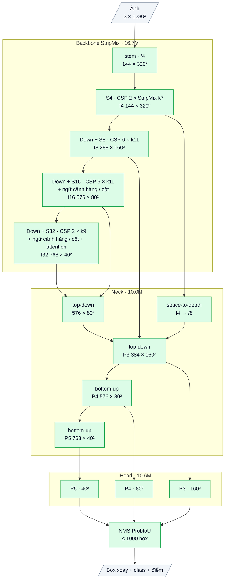

# OpenOBB6: detector OBB tổng quát, thiết kế từ phân tích (2026-10-12)

`model=openobb6n | s | m | l | x`. CLI và API giữ nguyên, chỉ đổi `model=`.

Kiến trúc này **không ghép từ mạng có sẵn**: không có HGNetv2, không có encoder D-FINE, không có weights ImageNet / COCO.
Mọi khối đều được chọn từ phân tích ở [research/ARCH_ANALYSIS.md](../research/ARCH_ANALYSIS.md) (số đo trên v3 đã train,
mã nguồn YOLO26, các kiến trúc detection mạnh khác). Kiến trúc dành cho detection OBB nói chung (DOTA, ảnh tự nhiên, bản vẽ).
Wall_Color chỉ là một bài test.

## 1. Mục tiêu

| | OpenOBB3-x | YOLO26x-obb | **OpenOBB6-x** |
|---|---|---|---|
| Tham số | 64.6M | 57.6M | **37.4M** |
| GFLOPs ở 1280 px (2×MAC) | 909 | 905 | **504** |
| CPU 4 luồng, 1280 px (cùng máy, chỉ để so tương đối) | 10.3 s | 7.9 s | **2.7 s** (đã gộp BN) |
| Phần tính toán chết | khoảng 75 G (F37) | | 0 (mọi khối có tác dụng đo được bằng ablation) |

- Tốc độ GPU thật phải đo trên Colab. Depthwise conv dùng GPU kém hiệu quả hơn conv thường, nên lợi thế trên GPU sẽ nhỏ hơn tỉ lệ FLOPs.
- Độ chính xác chưa có số: cần pretrain + train (mục 5).

## 2. Kiến trúc chi tiết (cỡ x, ảnh 1280)

Sơ đồ khối và bảng từng lớp: mục 7 (phụ lục, cuối file).


| Phần | Làm gì | Nguyên lý / bằng chứng | Ý tưởng từ đâu | Code | Tham số (x) | GFLOPs (x, 1280) |
|---|---|---|---|---|---|---|
| **StripMix** (đơn vị cơ bản) | depthwise 3×3 + depthwise 1×k nối tiếp k×1 (vùng k×k, chi phí 2k) → MLP 1×1 mở rộng 2× → residual, BN cuối khởi tạo 0 | N2, N3: ngữ cảnh rộng sớm, rẻ, mọi hướng; N4: residual bắt đầu bằng 0 | Strip R-CNN (dải nối tiếp), ConvNeXt (inverted bottleneck), RTMDet (depthwise lớn trong CSP) | tự viết | | |
| **CSPStage** | 1×1, chia đôi kênh; một nửa qua n StripMix; nối mọi đầu ra trung gian; 1×1 gộp | Nhiều đường gradient, nửa kênh đi thẳng, rẻ | YOLO C2f / C3k2 (CSP + ELAN), VoVNet (gộp một lần) | tự viết | | |
| **Stem + Down** | Hạ độ phân giải có nhánh max-pool song song conv stride | N5: giữ đỉnh tín hiệu (nét mảnh, vật nhỏ) | HGNetv2 stem, YOLO SPPF (max-pool) | tự viết | | 27 + 15 |
| **Phân bổ độ rộng** | 144 / 288 / 576 / 768 kênh ở stride 4 / 8 / 16 / 32; stage stride-8 và 16 sâu nhất (6 unit) | N1: tính toán ở độ phân giải cao (v3 để 2048 kênh ở 1/32 và phần đó chết) | đo trên v3 + phân bổ của YOLO26 | tự thiết kế | 16.7 (backbone) | 179 (backbone) |
| **AxisContext** | Trung bình theo cả hàng và cả cột → 1×1 → cộng lại (khởi tạo 0) | N2: ngữ cảnh dọc cả ảnh với chi phí gần 0; N4: cộng, không nhân không chặn | Strip Pooling (CVPR 2020), PKINet CAA | tự viết | | 6 |
| **GlobalAttention** (1 lớp, stride 32) | Self-attention trên lưới 40×40, vị trí bằng depthwise 3×3 (mọi cỡ ảnh), layer-scale 0 | Ngữ cảnh toàn ảnh cho vật lớn; khác AIFI của v3: đầu vào khoẻ (BN train được), residual khởi tạo 0 | RT-DETR AIFI, YOLO C2PSA (vị trí bằng depthwise) | tự viết | | 8 |
| **Neck** | Top-down rồi bottom-up P3–P5 bằng CSPStage; **chi tiết stride 4 vào P3 bằng space-to-depth** (không thêm head P2) | N5: vật tí hon cần chi tiết dưới stride 8 mà không trả giá head P2 | PAN-FPN, SPD-Conv | tự viết | 10.0 | 125 |
| **Head hộp** | Bố cục của OpenOBB3: góc, lệch ngang, hai phân phối khoảng cách đầu mút (bin = stride), phân phối độ dày (bin = stride/2) | Đo trên v3: định vị đã tốt (lệch < 1 px khi dịch ảnh) → giữ | DFL (GFL), tự thiết kế dị hướng ở v3 | của OpenOBB (v3) | | |
| **Head class có ngữ cảnh** | 3×3 → StripMix k=11 → 3×3 → 1×1, riêng mỗi tầng | N6: lỗi chính là phân loại vật nhỏ cần hàng xóm; YOLO dành 20% FLOPs cho head | YOLO head nặng + đơn vị StripMix | tự viết | 10.6 (cả head) | 200 (cả head) |
| **Loss / gán nhãn** | TAL xoay, top-k theo độ dài, min_side 8 (vật nhỏ hơn stride được phóng khi chọn ứng viên, kiểu STAL), QFL + ProbIoU + DFL + lệch ngang + góc | N7 | YOLO TAL / STAL, GFL | của OpenOBB (v3) | 0 | 0 |
| **fuse()** | Gộp BN vào conv khi suy luận (`predict`, `OpenOBB(...)` tự gọi) | N9: suy luận nhanh, chỉ còn conv | RepVGG / YOLO fuse | tự viết | | |

Cỡ khác (hệ số rộng × sâu): n 0.25×0.34 (0.9M, 12 G); s 0.5×0.34 (3.3M, 43 G); m 0.75×0.67 (8.3M, 109 G); l 1.0×1.0 (16.4M, 221 G); x 1.5×1.0 (37.4M, 504 G).

## 3. Tỉ lệ tận dụng cái có sẵn

| Loại | Phần | Tỉ lệ |
|---|---|---|
| **Code chép từ nơi khác** | không có | **0%** |
| Code của OpenOBB dùng lại | `decode`, `fast_nms`, loss / gán nhãn của OpenOBB3 (tự viết từ trước) | khoảng 0% tham số (loss không có tham số) |
| **Weights có sẵn trong model** | không có (không ImageNet, không COCO) | **0% tham số** |
| Weights dùng gián tiếp | DINOv2 (Apache-2.0) chỉ làm "thầy" lúc pretrain chưng cất; không nằm trong model | 0% |
| Ý tưởng lấy từ công bố | dải nối tiếp (Strip R-CNN), CSP / ELAN (YOLO, VoVNet), inverted bottleneck (ConvNeXt), max-pool khi hạ độ phân giải (HGNet, YOLO SPPF), strip pooling, space-to-depth (SPD-Conv), STAL / TAL (YOLO) | ý tưởng, tự viết lại |
| **Thiết kế mới của OpenOBB** | Phân bổ tính toán theo số đo (N1); kết hợp StripMix trong CSP; chi tiết stride 4 vào P3 thay head P2; head class có đơn vị ngữ cảnh; head hộp dị hướng; ổn định số học bằng thiết kế (N4); pretrain chưng cất | toàn bộ kiến trúc |

## 4. Pretrain (vì không thừa kế mạng phân loại)

Backbone mới phải học đặc trưng tổng quát trước. Train từ đầu trên data nhỏ thì hỏng (F25), còn train COCO 300 epoch như YOLO thì quá đắt.
Cách dùng: **chưng cất đặc trưng từ DINOv2 trên ảnh chưa gán nhãn**. Ở mỗi vị trí của các tầng stride 8 / 16 / 32, một phép chiếu nhỏ từ
đặc trưng của OpenOBB6 phải cùng hướng với đặc trưng patch của DINOv2 (loss 1 − cosine).

```bash
# 1. pretrain backbone (không cần nhãn; ảnh càng đa dạng càng tổng quát: COCO, DOTA, bản vẽ...)
openobb pretrain model=openobb6x data=/content/coco/train2017,/content/drawings epochs=20 imgsz=640 batch=64
# -> runs/pretrain/train/weights/last.pt   (chỉ chứa backbone)

# 2. train detection (DOTA để có "tiên nghiệm OBB" như YOLO-OBB, hoặc thẳng data của bạn)
openobb train model=openobb6x weights=runs/pretrain/train/weights/last.pt data=/content/data.yaml epochs=150 imgsz=1280
```

- Ước tính chi phí pretrain trên G4: khoảng 300 GFLOPs mỗi ảnh (DINOv2-B ở 448 px + backbone x ở 640 px, xuôi + ngược).
  COCO train2017 (118k ảnh) khoảng 10–15 phút / epoch, 20 epoch khoảng 3–5 giờ, khoảng 30–45 CU.
- Rẻ hơn: `teacher=dinov2_s` hoặc ít ảnh hơn.
- Data NC (DOTA, FloorPlanCAD) chỉ dùng cho nghiên cứu. Bản thương mại pretrain trên ảnh sạch license (COCO ảnh CC-BY, bản vẽ nội bộ).

## 5. Cách đo tác dụng từng mảnh (ablation)

Mỗi mảnh mới tắt được bằng `v6_off=` (danh sách, phân cách bằng dấu phẩy; checkpoint nhớ lựa chọn này):

| `v6_off=` | Tắt gì | Câu hỏi được trả lời |
|---|---|---|
| `strip` | Mọi dải 1×k / k×1 (chỉ còn depthwise 3×3) | Kernel lớn tách được có đáng không? |
| `axis` | AxisContext ở stride 16 / 32 | Ngữ cảnh theo hàng / cột có giúp không? |
| `attn` | Lớp attention ở stride 32 | Attention toàn ảnh có cần không? |
| `spd` | Đường chi tiết stride 4 vào P3 | Vật tí hon có cần chi tiết dưới stride 8 không? |
| `maxpool` | Nhánh max-pool khi hạ độ phân giải | Giữ đỉnh tín hiệu có giúp nét mảnh / vật nhỏ không? |
| `cls_ctx` | Đơn vị ngữ cảnh trong head class | Head class có ngữ cảnh có sửa lỗi phân loại không? |

Quy trình (mỗi thí nghiệm chỉ đổi một yếu tố):
1. Cùng data, cùng epoch, cùng `seed`, cùng lr.
   - Mảnh ở neck / head (`spd`, `cls_ctx`): dùng chung một file pretrain.
   - Mảnh ở backbone (`strip`, `axis`, `attn`, `maxpool`): pretrain riêng biến thể đó (`openobb pretrain ... v6_off=strip`) rồi train từ file đó.
     Có thể dùng `teacher=dinov2_s` và ít epoch hơn cho mọi biến thể để rẻ, miễn là giống nhau giữa các biến thể.
2. Chạy bản đầy đủ **2 lần với 2 seed** để biết mức nhiễu. Chênh lệch nhỏ hơn mức nhiễu thì không kết luận.
3. So mAP50 / mAP50-95 theo class (thước YOLO) và confusion matrix; ghi vào `research/LEDGER.md`.

Ví dụ trên Colab:
```bash
openobb train model=openobb6x weights=<pretrain.pt> data=/content/data.yaml epochs=100 imgsz=1280 seed=0 name=full
openobb train model=openobb6x weights=<pretrain.pt> data=/content/data.yaml epochs=100 imgsz=1280 seed=1 name=full_s1
openobb train model=openobb6x weights=<pretrain.pt> data=/content/data.yaml epochs=100 imgsz=1280 seed=0 v6_off=strip name=no_strip
```

## 6. Rủi ro đã biết

- **Chưa có số độ chính xác.** Mọi lợi thế mới chỉ là FLOPs / tham số / thiết kế. Phải pretrain + train mới biết.
- **Chất lượng pretrain quyết định nhiều.** Nếu chưng cất không đủ, backbone mới có thể thua HGNetv2 (đã train 2 lần trên ImageNet + COCO). Kiểm tra sớm:
  - so OpenOBB6 (pretrain) với OpenOBB6 (không pretrain) trên cùng data;
  - so với OpenOBB3 cùng ngân sách epoch.
- **Head chiếm 40% FLOPs** (YOLO26 là 20%). Nếu ablation `cls_ctx` cho thấy đơn vị ngữ cảnh không giúp, có thể giảm head để nhanh hơn.

## 7. Phụ lục: kiến trúc theo lớp (cỡ x)

Kích thước ghi cho ảnh vào 1 × 3 × 1280 × 1280, Wall_Color (7 class). Ký hiệu: `conv k×k sS a→b` = Conv + BN + SiLU,
`dw` = depthwise, `/N` = stride N so với ảnh. Toàn bộ tự viết; thân được pretrain bằng chưng cất (mục 4).

### Luồng dữ liệu

Xanh lá: tự viết.



### Backbone (tự viết), 16.71M

| Khối | Lớp | Ra | Tham số |
|---|---|---|---|
| stem | conv 3×3 s2 3→72; [conv 3×3 s2 72→144 ∥ max-pool 2]; nối 216 → conv 1×1 → 144 | 144 × 320² (/4) | 0.13M |
| S4 | CSPStage(144, n = 2, k = 7) | **f4** 144 × 320² | 0.11M |
| d8 + S8 | Down 144→288; CSPStage(288, n = 6, k = 11) | **f8** 288 × 160² (/8) | 1.03M |
| d16 + S16 | Down 288→576; CSPStage(576, n = 6, k = 11); AxisContext | **f16** 576 × 80² (/16) | 5.06M |
| d32 + S32 | Down 576→768; CSPStage(768, n = 2, k = 9); AxisContext | 768 × 40² (/32) | 5.65M |
| attn | 1 lớp transformer trên 1600 token: vị trí dw 3×3; LayerNorm → attention 8 đầu; LayerNorm → FFN 768→1536→768 (GELU); hai nhánh dư nhân cổng khởi tạo 0 | **f32** 768 × 40² | 4.74M |

- **StripMix(c, k):** x + MLP(dw 3×3(x) + BN(dw k×1(dw 1×k(x)))); MLP = conv 1×1 c→2c → conv 1×1 2c→c (BN cuối khởi tạo 0).
- **CSPStage(c, n, k):** conv 1×1 → tách hai nửa; nửa sau qua n StripMix nối tiếp; nối 2 nửa + n đầu ra → conv 1×1.
- **Down(a→b):** [max-pool 2 ∥ dw 3×3 s2] nối 2a → conv 1×1 → b (nhánh max-pool giữ nét mảnh).
- **AxisContext(c):** x + conv 1×1 (khởi tạo 0) của SiLU(1×1(trung bình theo hàng) + 1×1(trung bình theo cột)).

### Neck (tự viết), 10.03M

| Khối | Lớp | Ra | Tham số |
|---|---|---|---|
| lat5 | conv 1×1 f32 768→576 | 576 × 40² | 0.44M |
| td4 | nối [f16, upsample lat5] 1152 → CSPStage(n = 2, k = 11) → n4 | 576 × 80² | 2.02M |
| lat4 | conv 1×1 576→384 | 384 × 80² | 0.22M |
| spd | f4 space-to-depth (144 × 320² → 576 × 160²) → conv 1×1 → 192 | 192 × 160² | 0.11M |
| td3 | nối [f8, upsample lat4, spd] 864 → CSPStage(n = 2, k = 11) | **P3** 384 × 160² | 0.94M |
| dn3 + bu4 | Down 384→384; nối n4 → CSPStage(n = 2, k = 11) | **P4** 576 × 80² | 2.21M |
| dn4 + bu5 | Down 576→576; nối f32 → CSPStage(n = 2, k = 9) | **P5** 768 × 40² | 4.09M |

### Head (tự viết), 10.62M

| Nhánh | Lớp (một tầng, c = 384 / 576 / 768) | Ra mỗi điểm | Tham số (3 tầng) |
|---|---|---|---|
| class | conv 3×3 c→256 → StripMix(256, k = 11) → conv 3×3 256→256 → 1×1 →7 (khởi tạo 0, bias tiên nghiệm 0.01) | 7 logit | 6.58M |
| box | conv 3×3 c→192 → conv 3×3 192→192 → 1×1 →98 (khởi tạo 0) | 98 kênh (bố cục v3) | 4.04M |

98 kênh box: góc θ, lệch ngang tâm, 32 bin khoảng cách tới mỗi đầu dọc trục (bin = 1 stride), 32 bin độ dày (bin = 1/2 stride).

### Tổng hợp

| Phần | Tham số | Tỉ lệ | Nguồn |
|---|---|---|---|
| Backbone | 16.71M | 44.7% | tự viết |
| Neck | 10.03M | 26.9% | tự viết |
| Head | 10.62M | 28.4% | tự viết |
| **Tổng** | **37.36M** | | 100% tự viết |

Suy luận: BN gộp vào conv (`fuse()`); 33 600 điểm → Fast-NMS ProbIoU theo class → tối đa 1000 box.
