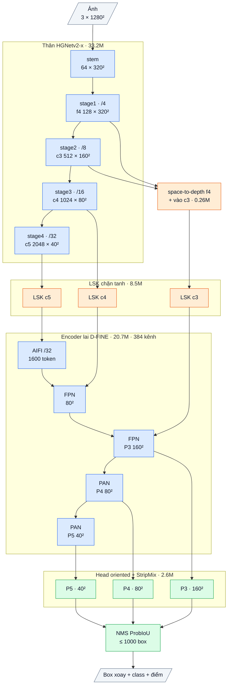

# OpenOBB7: lõi của OpenOBB8 (OpenOBB3 đã sửa các lỗi đo được, 2026-10-12)

**Không có model riêng.** OpenOBB7 là lõi bên trong OpenOBB8. OpenOBB8 = OpenOBB7 + tầng suy luận quan hệ, bắt đầu y hệt
OpenOBB7, nên theo lý thuyết không kém OpenOBB7. Hai bản được gộp thành một (quyết định của user, 10-12): train `model=openobb8x`.
Lập luận đầy đủ cho bản gộp: [OPENOBB8.md](OPENOBB8.md) mục 2. Tài liệu này mô tả chi tiết lõi. Code: `openobb/models/openobb7.py`.

## 1. OpenOBB7 là gì, vì sao

OpenOBB3 mạnh nhờ phần pretrained: backbone HGNetv2-B5 + hybrid encoder của D-FINE, init COCO.
Trên test Wall_Color nó đạt 0.720 / 0.474 (mAP50 / mAP50-95, thước YOLO). Kiến trúc mới train từ đầu (OpenOBB6) chỉ tới khoảng 0.55 / 0.32 (F40).
Vì vậy OpenOBB7 **giữ nguyên lõi pretrained** và chỉ sửa những lỗi đã đo trên checkpoint v3 đã train (F37, [research/ARCH_ANALYSIS.md](../research/ARCH_ANALYSIS.md)):

- **Tầng P5 chết.** Đầu ra stage 4 có độ lớn trung bình 3566 (P3 / P4 chỉ 0.4–0.5). LSK ở P5 khuếch đại lên 1.3·10¹⁰. BN của encoder có running var 3·10²⁶ nên ép nó thành hằng số. Đặt P5 = 0 không đổi detection nào.
  Nguyên nhân: BN đóng băng trong backbone + fine-tune lr 1e-3 + phép nhân không chặn `x + x·m` của LSK.
- **Vật tí hon chỉ được đọc ở stride 8.** Ở 1280 px: junction 9.5 px, wall_300 9.9 × 6 px, tường dày 3.7–5.6 px.
- **Lỗi chính là phân loại vật nhỏ giống nhau.** wall_300 bị nhầm thành junction 32%; 43% wall_300 có top1 − top2 < 0.2.
  75–93% bằng chứng của logit class nằm **ngoài** box của vật (hàng xóm quyết định), mà tháp class của v3 rất nhẹ (5% FLOPs).

Mỗi sửa chữa **bắt đầu bằng phép đồng nhất** và **tắt được** để đo tác dụng.

## 2. Kiến trúc chi tiết (cỡ x, ảnh 1280)

Sơ đồ khối và bảng từng lớp: mục 9 (phụ lục, cuối file).


| Phần | Làm gì | Lỗi nó sửa + bằng chứng | Ý tưởng từ đâu | Code | Tham số (x) | GFLOPs (x, 1280) |
|---|---|---|---|---|---|---|
| Backbone HGNetv2-B5 | Như v3, init COCO | | PP-HGNetV2 / D-FINE | D-FINE (Apache-2.0) | 33.23M | 427 |
| **guard** (chặn độ lớn) | Mỗi ảnh, mỗi đầu ra backbone (f4, f8, f16, f32): nếu RMS ≤ τ = 4 thì giữ nguyên **chính xác**; nếu lớn hơn thì chia cho RMS / τ. Không tham số. Thống kê tính bằng float32 (an toàn với bf16 / fp16) | P5 nổ (3566, có ở cả 3 checkpoint v3). Map khoẻ có RMS 0.7–1.9 (D-FINE-s COCO, đo trên ảnh Wall_Color) nên không bị đụng tới; P5 của v3 đã train có RMS 22136 | Chuẩn hoá theo độ lớn (weight / layer norm), dạng "chỉ cắt khi vượt ngưỡng" như gradient clipping | tự viết | 0 | ~0 (phép từng phần tử) |
| **lsk_bound** (LSK bị chặn) | LSK như v3 nhưng `x + x·tanh(m)` thay vì `x + x·m`. Cùng tên tham số. Hệ số khuếch đại luôn trong (0, 2) | LSK ở P5 khuếch đại map nổ lên 1.3·10¹⁰ | LSKNet (chọn kernel); tanh để chặn | tự viết (v1) + sửa | 8.54M (của LSK, không thêm) | 64 (không thêm) |
| **spd** (chi tiết stride 4 vào P3) | `pixel_unshuffle(f4, 2)` (stride 4 → 8, 4× kênh, không mất điểm ảnh) → 1×1 conv + BN có gamma = 0 → **cộng** vào f8 trước LSK | Vật 4–10 px chỉ được đọc ở stride 8 (86–100% detection ở P3) | SPD-Conv (space-to-depth) | tự viết | 0.26M | 13.4 |
| Hybrid encoder | Như v3, init COCO | | RT-DETR / D-FINE | D-FINE (Apache-2.0) | 20.70M | 371 |
| **cls_ctx** (ngữ cảnh trong head class) | Sau hai lớp đầu của tháp class (dw 3×3, 1×1), thêm một StripMix k = 11: dw 3×3 + dải 1×11 nối tiếp 11×1 → MLP 1×1 (mở rộng 2×) → residual, BN cuối khởi tạo 0. Lưu ở `head.ctx` | 75–93% bằng chứng class nằm ngoài box; wall_300 ↔ junction là lỗi chính; head class của v3 quá nhẹ | Strip R-CNN (dải nối tiếp), ConvNeXt (inverted bottleneck); đơn vị StripMix của OpenOBB6 | tự viết (v6) | 0.47M | 10.3 |
| Head dense oriented | Như v3 | | GFL / DFL, TAL; dị hướng là thiết kế của OpenOBB | tự viết (v3) | 2.17M | 48 |
| **fuse()** | Gộp BN (cả BN thường lẫn BN đóng băng) vào conv trước nó; gộp nhánh 3×3 + 1×1 của VGGBlock thành một conv 3×3 (re-parameterization). `predict` tự gọi | Suy luận nhanh hơn, chỉ còn conv | RepVGG, YOLO fuse | tự viết (dùng `convert_to_deploy` của D-FINE cho VGGBlock) | | 933 → 915 |

Tổng OpenOBB7-x: **65.36M tham số** (v3: 64.64M, +0.73M), **933 GFLOPs** (v3: 909, +2.6%), sau `fuse()` 915 GFLOPs.

## 3. Tỉ lệ tận dụng cái có sẵn (cỡ x, theo tham số)

| Loại | Phần | Tham số | Tỉ lệ |
|---|---|---|---|
| **Code + weights COCO của D-FINE** (Apache-2.0) | Backbone HGNetv2-B5 | 33.23M | 50.8% |
| | Hybrid encoder | 20.70M | 31.7% |
| **Cộng phần pretrained / mượn** | | 53.93M | **82.5%** |
| Code của OpenOBB (init mới, không pretrained) | LSK (bản chặn) | 8.54M | 13.1% |
| | Head dense oriented (v3) | 2.17M | 3.3% |
| | cls_ctx (StripMix) | 0.47M | 0.7% |
| | spd | 0.26M | 0.4% |
| | guard, tanh | 0 | 0% |
| **Cộng phần của OpenOBB** | | 11.43M | **17.5%** |

- Code chép từ nơi khác: chỉ backbone + encoder (D-FINE, Apache-2.0, ghi trong `THIRD_PARTY_NOTICES.md`) và hàm `convert_to_deploy` của VGGBlock.
- Phần mới của v7 so với v3 (guard, LSK chặn, spd, cls_ctx, fuse) đều tự viết.

## 4. Tính chất "bắt đầu bằng phép đồng nhất"

| Sửa chữa | Vì sao bắt đầu bằng đồng nhất |
|---|---|
| guard | Map có RMS ≤ 4 đi qua nguyên vẹn (phép chia cho đúng 1.0) |
| lsk_bound | Conv ra của LSK khởi tạo 0 → tanh(0) = 0, giống hệt LSK cũ |
| spd | BN cuối có gamma = 0 → nhánh cộng thêm đúng bằng 0 |
| cls_ctx | BN cuối của nhánh residual có gamma = 0 → StripMix trả về đúng đầu vào |

Hệ quả (có test, `tests/test_openobb7.py`):
- Init từ D-FINE COCO hoặc từ một OpenOBB3 chưa train → **đầu ra giống hệt OpenOBB3** ở bước 0.
- Tắt cả bốn phần (`v7_off=guard,lsk_bound,spd,cls_ctx`) → **chính là OpenOBB3**: cùng tên và số tham số, cùng đầu ra.
- Từ một **v3 đã train** (`vrdet3x_1.pt`, ảnh Wall_Color, conf 0.25), v7 bật đủ giữ 219 / 224 detection (cùng class, ProbIoU > 0.9); điểm số lệch trung vị 0.004, tối đa 0.02.
  Lệch là do tanh nén biến điệu đã học của LSK (ở P4 tới 36–45%). Chỉ bật guard (tắt `lsk_bound`) thì giữ 223 / 224. Vài epoch đầu sẽ bù lại.

## 5. Đo tác dụng từng mảnh (ablation)

`v7_off=` nhận danh sách phân cách bằng dấu phẩy (hoặc list). Checkpoint nhớ lựa chọn này.

| `v7_off=` | Tắt gì | Câu hỏi được trả lời |
|---|---|---|
| `guard` | Chặn độ lớn đầu ra backbone | P5 có còn nổ không? Chặn nó có làm P5 sống lại và có giúp không? |
| `lsk_bound` | Dùng lại LSK nhân không chặn | tanh có làm mất gì không? |
| `spd` | Đường chi tiết stride 4 vào P3 | Vật tí hon (junction, wall_300) có cần chi tiết dưới stride 8 không? |
| `cls_ctx` | Đơn vị ngữ cảnh trong head class | Ngữ cảnh trong head có giảm nhầm wall_300 ↔ junction không? |
| `guard,lsk_bound,spd,cls_ctx` | Tất cả | Mốc so sánh: chính là OpenOBB3, chạy cùng code |

Quy trình (mỗi lần chỉ đổi một yếu tố):
1. Cùng data, epoch, `seed`, lr, `imgsz`.
2. Chạy bản đầy đủ 2 lần với 2 seed để biết mức nhiễu. Chênh nhỏ hơn mức nhiễu thì không kết luận.
3. So mAP50 / mAP50-95 theo class (thước YOLO) và confusion matrix (đặc biệt wall_300 ↔ junction). Ghi vào `research/LEDGER.md`.

```bash
openobb train model=openobb7x data=/content/data.yaml epochs=100 imgsz=1280 seed=0 name=v7_full
openobb train model=openobb7x data=/content/data.yaml epochs=100 imgsz=1280 seed=0 v7_off=spd name=v7_no_spd
openobb train model=openobb7x data=/content/data.yaml epochs=100 imgsz=1280 seed=0 v7_off=guard,lsk_bound,spd,cls_ctx name=v7_as_v3
```

## 6. Cách train

```bash
# lõi này được train qua OpenOBB8 (xem OPENOBB8.md). Chỉ riêng lõi (không có tầng suy luận quan hệ):
openobb train model=openobb8x v8_off=refine data=/content/data.yaml imgsz=1280

# đi tiếp từ một OpenOBB3 đã train: backbone / LSK / encoder / head nạp theo tên, class ghép theo tên;
# spd và head.ctx giữ init đồng nhất
openobb train model=openobb8x v8_off=refine weights=/content/openobb3x_best.pt data=/content/data.yaml imgsz=1280
```

- Công thức mặc định giống v3: lr 5e-4, backbone ×0.1, LSK, RFS 0.1, `num_top` 1000. Phần mới (spd, head.ctx) học với lr đầy đủ.
- Khi nạp từ v3 đã train, trainer tự reset BN có thống kê nổ (`encoder.input_proj.2.norm`, running var 3·10²⁶) và in cảnh báo. Đúng như mong muốn: P5 được ước lượng lại.
- Python: `OpenOBB7(size, num_classes, img_size, off="spd")`. `model.fuse()` chỉ dùng khi suy luận.

## 7. Chi phí đo được

| | OpenOBB3-x | OpenOBB7-x | OpenOBB7-x sau `fuse()` |
|---|---|---|---|
| Tham số | 64.64M | 65.36M | 64.49M (BN đã gộp) |
| GFLOPs ở 1280 px (2×MAC, `FlopCounterMode`, 7 class) | 909 | 933 | 915 |
| CPU 2 luồng, 1280 px, min của 3 lần | 6.70 s | 6.73 s | 6.30 s |

- CPU máy này nhiễu (máy dùng chung, torch CPU đôi khi crash khi nhiều luồng): chỉ để so tương đối. Tốc độ GPU thật phải đo trên Colab.
- spd: +13.4 GFLOPs (1×1 512 → 512 trên lưới 160×160). cls_ctx: +10.3 GFLOPs. guard và tanh: không đáng kể.

## 8. Rủi ro đã biết

- **Chưa có số độ chính xác.** Phải train và ablation mới biết từng sửa chữa có giúp không.
- **guard chỉ cắt hậu quả, không chặn nguyên nhân.** Trọng số stage 4 vẫn có thể lớn dần (BN đóng băng + lr). Khi bị chặn, gradient bất biến theo độ lớn nên không có vòng nổ, nhưng lr hiệu dụng của stage 4 giảm dần.
  Nên theo dõi RMS của f32 trước guard sau khi train. Nếu P5 vẫn vô dụng thì hướng tiếp theo là P5 mỏng (như N1 trong ARCH_ANALYSIS).
- **Từ v3 đã train, bước 0 không giống hệt v3** (mục 4: 219 / 224 detection). Từ COCO thì giống hệt.
- **spd** cộng vào f8 trước LSK nên LSK P3 thấy thêm chi tiết; nếu chi tiết stride 4 nhiễu (bản vẽ chất lượng thấp), ablation `spd` sẽ cho thấy.
- **cls_ctx** dùng depthwise kernel dải; trên GPU depthwise kém hiệu quả hơn conv thường, nên chi phí thật có thể hơn tỉ lệ 1% FLOPs.
- `fuse()` chỉ cho suy luận; không train tiếp model đã gộp.

## 9. Phụ lục: kiến trúc theo lớp (cỡ x)

Kích thước ghi cho ảnh vào 1 × 3 × 1280 × 1280, Wall_Color (7 class). Ký hiệu: `conv k×k sS a→b` = Conv + BN + kích hoạt,
`dw` = depthwise, `/N` = stride N so với ảnh.

### Luồng dữ liệu

Xanh dương: mượn (pretrained, Apache-2.0). Xanh lá: tự viết. Cam: mới ở v7. Mỗi stage của thân đi qua bộ chặn độ lớn (guard, không tham số).



### Thân: HGNetv2-x (mượn, Apache-2.0, trọng số D-FINE COCO), 33.23M

| Khối | Lớp | Ra | Tham số |
|---|---|---|---|
| stem | conv 3×3 s2 3→32; nhánh [conv 2×2 32→16 → conv 2×2 16→32] ∥ max-pool 2; nối 64 → conv 3×3 s2 64→32 → conv 1×1 32→64 | 64 × 320² (/4) | 0.03M |
| stage1 | 1 khối HG: 6 × conv 3×3 64→64, nối 448 kênh → 1×1 →64 → 1×1 →128 | **f4** 128 × 320² | 0.26M |
| stage2 | dw 3×3 s2; 2 khối HG: 6 × conv 3×3 128, nối → 1×1 → 512 | **c3** 512 × 160² (/8) | 3.03M |
| stage3 | dw 3×3 s2; 5 khối HG nhẹ: 6 × (1×1 → dw 5×5) 256, nối → 1×1 512 → 1×1 1024 | **c4** 1024 × 80² (/16) | 11.93M |
| stage4 | dw 3×3 s2; 2 khối HG nhẹ: 6 × (1×1 → dw 5×5) 512, nối → 1×1 → 2048 | **c5** 2048 × 40² (/32) | 17.99M |

BN của thân bị đóng băng (FrozenBatchNorm), kích hoạt ReLU.

### Chặn độ lớn + chi tiết stride 4 (tự viết), 0.26M

| Khối | Lớp | Ra | Tham số |
|---|---|---|---|
| guard | sau mỗi stage của thân: x · min(1, 4 / rms(x)) theo từng ảnh (tính fp32); đồng nhất khi rms ≤ 4 | như đầu vào | 0 |
| spd | f4 space-to-depth (128 × 320² → 512 × 160²) → conv 1×1 512→512 + BN (gamma khởi tạo 0) → **cộng** vào c3 trước LSK | 512 × 160² | 0.26M |

### Adapter LSK (tự viết, ý tưởng LSKNet), 8.54M

Trên c3 / c4 / c5, mỗi tầng một khối (c = 512 / 1024 / 2048 kênh; 0.43M / 1.65M / 6.45M):
a = dw 5×5(x); b = dw 7×7 giãn 3(a) (trường nhìn khoảng 23 ô); a, b → conv 1×1 về c/2; cổng = conv 7×7 trên [trung bình, max theo kênh]
của [a, b] → 2 kênh sigmoid; m = conv 1×1 c/2→c (khởi tạo 0) của (a·g₁ + b·g₂); ra **x + x·tanh(m)** (hệ số khuếch đại luôn trong (0, 2)). Khởi tạo = đồng nhất.

### Encoder lai D-FINE (mượn, Apache-2.0, trọng số COCO), 20.70M, 384 kênh

| Khối | Lớp | Ra | Tham số |
|---|---|---|---|
| input_proj | ba conv 1×1 + BN: c3 512→384, c4 1024→384, c5 2048→384 | | 1.38M |
| AIFI | 1 lớp transformer trên 1600 token của /32: attention 8 đầu, FFN 384→2048→384 (GELU), vị trí sin-cos 2-D | 384 × 40² | 2.17M |
| FPN (2 bước) | lateral 1×1 384→384; upsample ×2; nối 768 → RepNCSPELAN4 → 384 | 384 × 80², **P3** 384 × 160² | 8.57M |
| PAN (2 bước) | SCDown [1×1 384→384 → dw 3×3 s2]; nối 768 → RepNCSPELAN4 → 384 | **P4** 384 × 80², **P5** 384 × 40² | 8.58M |

RepNCSPELAN4(768→384): conv 1×1 768→768, tách 2 nửa 384; nửa sau qua [CSP 384→192 (3 khối RepVGG 3×3 ∥ 1×1) → conv 3×3 192] rồi
[CSP 192→192 (3 khối) → conv 3×3 192]; nối 384 + 384 + 192 + 192 → conv 1×1 → 384. Kích hoạt SiLU.

### Head oriented có ngữ cảnh (tự viết), 2.63M

| Nhánh | Lớp (một tầng) | Ra mỗi điểm | Tham số (3 tầng) |
|---|---|---|---|
| class | dw 3×3 384 → 1×1 384→192 → **StripMix(192, k = 11)** → dw 3×3 192 → 1×1 192→192 → 1×1 →7 (bias tiên nghiệm 0.01) | 7 logit | 0.82M |
| box | conv 3×3 384→128 → conv 3×3 128→128 → 1×1 128→98 (chạy fp32) | 98 kênh | 1.81M |

98 kênh box (một nhóm): góc θ, lệch ngang tâm (× stride), phân phối 32 bin khoảng cách tới đầu sau và 32 bin tới đầu trước dọc trục
(bin = 1 stride), 32 bin độ dày (bin = 1/2 stride). Mỗi tầng một tháp riêng; điểm lưới = tâm ô.

StripMix(192, k = 11) (0.155M mỗi tầng): x + MLP(dw 3×3(x) + BN(dw 11×1(dw 1×11(x)))), MLP = 1×1 192→384 → 1×1 384→192, BN cuối khởi tạo 0.

### Tổng hợp

| Phần | Tham số | Tỉ lệ | Nguồn |
|---|---|---|---|
| Thân HGNetv2-x | 33.23M | 50.8% | mượn (Apache-2.0) |
| guard + spd | 0.26M | 0.4% | tự viết |
| LSK | 8.54M | 13.1% | tự viết |
| Encoder lai | 20.70M | 31.7% | mượn (Apache-2.0) |
| Head | 2.63M | 4.0% | tự viết |
| **Tổng** | **65.36M** | | 17.5% tự viết |

Suy luận: BN và nhánh RepVGG gộp vào conv (`fuse()`); 33 600 điểm → Fast-NMS ProbIoU theo class → tối đa 1000 box.
