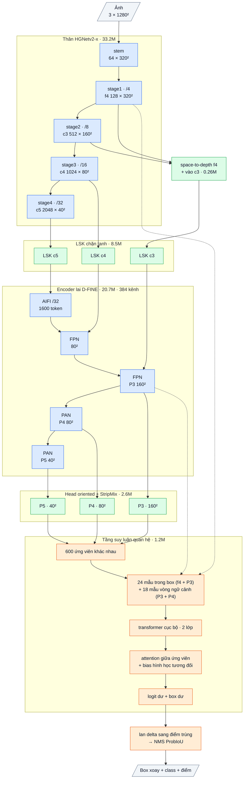

# OpenOBB8: lõi pretrained + tầng suy luận quan hệ theo hướng (2026-10-12)

`model=openobb8s | m | l | x`. CLI và API giữ nguyên, chỉ đổi `model=`. **Đây là bản tốt nhất hiện tại** (gộp v7 + v8).

OpenOBB8 = **lõi OpenOBB7** (HGNetv2 + LSK + encoder lai, khởi tạo COCO, head dense hướng của v3, các sửa lỗi của v7)
+ **bộ tinh chỉnh quan hệ theo hướng** (oriented relational refiner): một tầng suy luận thứ hai do OpenOBB tự thiết kế.
Kiến trúc dành cho OBB nói chung (DOTA, ảnh tự nhiên, bản vẽ). Không có giả định vật thẳng trục.

## 1. Vì sao

- Có tiên nghiệm pretrained thì thắng. OpenOBB3 (COCO) đạt **0.720 / 0.474** (mAP50 / mAP50-95, thước YOLO) trên Wall_Color.
  YOLO26x đạt 0.746 / 0.499. Mạng mới train từ đầu (OpenOBB6) chững ở khoảng **0.55 / 0.32** sau 150 epoch (F40).
  → Phần mới của v8 không thay lõi. Nó đứng trên lõi pretrained và nằm ở tầng thứ hai.
- Tầng thứ hai nhắm đúng hai lỗi đã đo:
  1. **Vật tí hon giống nhau, chỉ hàng xóm mới phân biệt được.**
     - wall_300 (đoạn tường ngắn khoảng 10 × 6 px cạnh khung cửa) bị đoán thành junction 32% (F35, v3) và 49% (F39, v6).
     - Trung vị khoảng cách từ wall_300 tới junction gần nhất là 3.9 px, tới cửa là 16 px.
     - 75–93% bằng chứng của logit class nằm ngoài box (F37).
  2. **Độ khít box của vật mảnh** (khoảng cách mAP50-95): tường dày 4–6 px nhưng được hồi quy từ đặc trưng stride 8 (F32: wall −0.049, note −0.047, junction −0.028).
- Khác với bộ chấm lại quan hệ của OpenOBB5 (không giúp, F35):
  - v5 chỉ đọc đặc trưng tại **một điểm** và dùng vị trí **tuyệt đối**.
  - v8 đọc mỗi ứng viên **trong khung xoay của chính nó**: chi tiết stride 4 ngay hai bên cạnh dài, và một vòng ngữ cảnh cách khoảng một chiều dài box.
  - Các ứng viên nhìn nhau qua **bias attention tính từ hình học tương đối** (box j biểu diễn trong khung của box i).
    "Đoạn tường cạnh cánh cửa" và "khối ở chỗ hai tường giao nhau" là hai **cách sắp xếp** khác nhau, nhận ra được ở mọi góc xoay.
  - v8 sửa cả box, không chỉ điểm class.

## 2. Lập luận: vì sao bản gộp v8 phải tốt hơn v3

Mỗi mảnh dưới đây: bài học đã đo (số F trong sổ cái), cơ chế, vì sao không thể kém v3, điều gì sẽ chứng minh nó sai.

**Tiền đề chung (F40, F25–F27).** Trên data nhỏ, kiến thức pretrain quyết định:
- v3 (COCO): 0.720 / 0.474.
- v6 (train từ đầu): khoảng 0.55 / 0.32.
- v2 (train từ đầu): kẹt ở 0.36 (thước DOTA).

→ v8 **giữ nguyên lõi pretrained của v3**. Mọi mảnh mới **bắt đầu bằng phép đồng nhất** (đầu ra mới = 0, chặn chỉ tác dụng khi
vượt ngưỡng), nên ở bước 0 v8 cho ra y hệt v3 (khi nạp COCO hoặc một v3 chưa train; test `torch.equal`). Gradient descent từ đúng
điểm của v3 chỉ đi tiếp khi loss giảm. Vì vậy v8 có **cận dưới là v3 cùng công thức train**, cộng mức nhiễu giữa các lần train.
Đây là lý do không cần train v7 riêng: v7 là v8 với tầng mới tắt.

| Mảnh | Bài học đã đo | Cơ chế | Kỳ vọng | Điều sẽ chứng minh sai |
|---|---|---|---|---|
| **Chặn độ lớn ở backbone** (lõi) | F37: P5 của backbone có độ lớn 3566, ở cả 3 checkpoint v3. Đặt P5 = 0 không đổi detection nào: khoảng 75 GFLOPs và cả lớp attention toàn ảnh (AIFI) vô dụng | Đồng nhất khi RMS ≤ 4; vượt thì đưa về RMS 4. AIFI và PAN-P5 nhận lại đặc trưng có nghĩa | Lấy lại ngữ cảnh toàn ảnh cho vật lớn (note 200–430 px: v3 0.744 so với YOLO 0.764) | Sau train, đặt P5 = 0 vẫn không đổi detection → P5 vẫn vô dụng |
| **LSK có chặn** `x + x·tanh(m)` (lõi) | F37: LSK nhân không chặn khuếch đại lỗi P5 lên 10¹⁰ | Hệ số khuếch đại ≤ 2, đúng lúc khởi tạo | Hết nguồn nổ; ở P3 / P4 gần như không đổi (thay đổi 12–45% vẫn trong vùng tanh gần tuyến tính) | Nạp từ v3 đã train mà mAP tụt và không hồi lại sau vài epoch |
| **Chi tiết stride 4 vào P3** (lõi) | Data: junction 9.5 px, wall_300 9.9 × 6 px, tường dày 3.7–5.6 px, chỉ đọc ở stride 8. YOLO26 dành 13% FLOPs cho stride 4, v3 chỉ 7% | Space-to-depth không mất điểm ảnh, cộng vào P3 (khởi tạo 0) | Tăng độ khít vật mảnh (mAP50-95 của wall −0.049, junction −0.028 so với YOLO, F32) | mAP50-95 của wall / junction không tăng |
| **Ngữ cảnh trong head class** (lõi) | F37: 75–93% bằng chứng class nằm ngoài box; head class của v3 chỉ 5% FLOPs (YOLO 20%); biên top1 − top2 < 0.2 ở 43% wall_300 | Đơn vị kernel lớn tách được (vùng 11×11 ô) ngay trong tháp class, residual khởi tạo 0 | Bớt nhầm giữa các class nhỏ giống nhau | Ô wall_300 → junction trong confusion matrix không giảm |
| **Tầng suy luận quan hệ** (mới của v8) | F35: v5 chấm lại quan hệ bằng đặc trưng **một điểm** và vị trí **tuyệt đối** không giúp. Data: wall_300 cách junction 3.9 px, cách cửa 16 px; khác nhau ở **cách sắp xếp**, không ở hình dạng | Mỗi ứng viên được đọc trong khung xoay của chính nó (lưới stride 4 ôm hai cạnh dài + vòng ngữ cảnh cách một chiều dài). Các ứng viên nhìn nhau qua bias attention từ **hình học tương đối** (box j trong khung i), bất biến khi xoay ảnh. Sửa cả class lẫn box. Khởi tạo 0 | wall_300 tăng mạnh nhất (v3 0.599, YOLO26x 0.824); mAP50-95 tăng nhờ sửa mép box ở stride 4 | wall_300 không tăng so với lõi, hoặc mAP tổng giảm |

**Giới hạn của lập luận.**
- "Không thể kém v3" chỉ đúng **ở điểm bắt đầu và theo hướng tối ưu**. Train với data nhỏ vẫn có thể overfit vì có thêm tham số (thêm khoảng 1.9M, 3%).
- Cũng chỉ đúng nếu cùng công thức train (lr, epoch, augment).
- Mức tăng cụ thể chưa đo được. Số liệu ở cột "Kỳ vọng" là hướng, không phải lời hứa.

## 3. Kiến trúc chi tiết (cỡ x, ảnh 1280, K = 600)

Sơ đồ khối và bảng từng lớp: mục 9 (phụ lục, cuối file).


| Phần | Làm gì | Lỗi nhắm tới + bằng chứng | Ý tưởng từ đâu | Code | Tham số (x) | GFLOPs (x, 1280) |
|---|---|---|---|---|---|---|
| **Lõi OpenOBB7** | HGNetv2-B5 + LSK có chặn + encoder lai + head dense hướng + các sửa lỗi F37 | Tiên nghiệm pretrained quyết định trên data nhỏ (F40: từ đầu 0.55 so với 0.72) | D-FINE (Apache-2.0), OpenOBB3 / OpenOBB7 | có sẵn (pretrained COCO) + của OpenOBB | 65.36M | 933 |
| **Chọn ứng viên** | K anchor tốt nhất, bỏ trùng (ProbIoU > 0.7) trước khi chọn | Ngân sách K không bị tiêu cho bản trùng của vật lớn; vật nhỏ không bị bỏ đói | DDQ (distinct queries) | của OpenOBB (`distinct_topk`) | 0 | ~0 |
| **Bản rung của box nhãn** (chỉ khi train) | ±15% chiều dài dọc trục, ±½ độ dày ngang, ×[0.8, 1.2] dài, ×e^±0.4 dày, ±0.05 rad; logit nền đọc ở anchor P3 gần nhất | Class hiếm mà head dense bỏ sót (slide_door 0.27, wall_300 R 0.33) vẫn dạy được bộ tinh chỉnh | DN-DETR / DINO (box nhiễu làm query), Cascade R-CNN | tự viết | 0 | 0 |
| **Lưới mẫu bên trong** | 8 × 3 điểm trong khung xoay; hai hàng ngang ngay ngoài hai cạnh dài; đọc f4 (stride 4) + P3 | Độ khít vật mảnh: hai mép của tường 4–6 px đọc ở stride 4 thay vì stride 8 | RoI Align xoay (RoI Transformer, Oriented R-CNN) | tự viết | 98.7k | 2.1 |
| **Vòng ngữ cảnh** | 18 điểm quanh box, cách khoảng một chiều dài (32–192 px); đọc P3 + P4 | 75–93% bằng chứng class nằm ngoài box; bán kính nửa bằng chứng khoảng 40 px (F37) | Context ring / RoI mở rộng (Cascade, PKINet); tự đặt theo số đo F37 | tự viết | 147.8k | 2.1 |
| **Transformer cục bộ** | 2 lớp trên 43 token / ứng viên (token hình học: log L, log T, sin/cos 2θ, xác suất nền) | Gộp các mẫu theo vị trí trong khung xoay | Sparse R-CNN / AdaMixer (đọc mẫu theo query), ViT | PyTorch `TransformerEncoderLayer` (BSD) + tự ghép | 671k (gồm vị trí 37.8k, token 39.6k) | 30.4 |
| **Lớp quan hệ + bias hình học tương đối** | Attention giữa K ứng viên. Bias / head = MLP(7 số của j trong khung i): lệch dọc / ngang trục i (chuẩn hoá theo L_i / T_i, chỉ giữ tới dấu chung), sin / cos 2(θ_j − θ_i), log tỉ lệ dài / dày | Phân biệt theo cách sắp xếp: wall_300 cách junction 3.9 px, cách cửa 16 px; bất biến khi xoay cả ảnh và khi θ → θ + π | Relation Networks (Hu 2018, trọng số hình học giữa object), bias vị trí tương đối (Swin, T5, Graphormer) | tự viết (`F.scaled_dot_product_attention` + mask float) | 297k + 0.5k | 0.65 |
| **Đầu ra dư khởi tạo 0** | logit = logit nền (detach) + delta; box: 2 đầu mút (đơn vị clamp(L/10, 2, 32) px), log độ dày (±1.5), lệch ngang (đơn vị max(T/2, 1) px), góc ±0.2 rad | Lúc đầu v8 = v7; chỉ học phần sửa | Cascade R-CNN (tinh chỉnh hai tầng), ReZero | tự viết | 2.8k | ~0 |
| **Lan delta sang anchor trùng** (suy luận) | Anchor (trong 4000 tốt nhất) trùng một ứng viên với ProbIoU > 0.7 được cộng cùng delta logit của ứng viên đó | Không có bước này, anchor trùng giữ điểm cũ và thắng NMS theo class: stub đổi từ junction sang wall_300 sẽ quay lại thành junction từ anchor bên cạnh | tự thiết kế | tự viết (`apply_refinement`) | 0 | ~0 (4000 × 600 ProbIoU) |
| **Loss** | Ghép ứng viên với box nhãn ProbIoU lớn nhất (≥ 0.5 là dương). QFL với đích = ProbIoU(box đã sửa, nhãn) cho class đúng; box: (1 − ProbIoU) + 0.2 × L1 trong khung ứng viên | Điểm class xếp theo độ khít (mAP50-95 thưởng điều này) | GFL (quality focal), OpenOBB3 `frame_targets` | tự viết (`openobb8_loss.py`) | 0 | 0 |
| **Tổng bộ tinh chỉnh** | | | | | **1.218M** (1.8%) | **35.4** (+3.8%) |

- GFLOPs = 2×MAC, đếm bằng `torch.utils.flop_counter` ở 1280 px, K = 600, 7 class. OpenOBB7-x: 933 G (cùng cách đếm), OpenOBB8-x: khoảng 969 G.
  Transformer cục bộ chiếm 86% FLOPs của bộ tinh chỉnh (25 800 token × 2 lớp).
- Tham số: OpenOBB7-x 65.36M, OpenOBB8-x 66.58M.
- CPU 4 luồng (cùng máy, chỉ để so tương đối, đo nhiễu): bộ tinh chỉnh 0.34–0.48 s; chọn ứng viên 0.01–0.04 s.
  Cả model: 6.49 → 6.89 s và 5.60 → 5.72 s ở hai lần đo (+2–6%). GPU chưa đo.

## 4. Tỉ lệ tận dụng cái có sẵn

| Loại | Phần | Tỉ lệ |
|---|---|---|
| **Weights pretrained trong model** | Backbone HGNetv2-B5 (33.2M) + encoder lai (20.7M), D-FINE COCO, Apache-2.0 | **81% tham số** (cả lõi OpenOBB7 = 98.2% tham số, 96% FLOPs; LSK 8.5M, head 2.6M, spd 0.3M train từ dữ liệu) |
| Code của OpenOBB dùng lại | Lõi OpenOBB7, head + `decode` + `fast_nms` + loss dense của OpenOBB3, `distinct_topk`, `frame_targets`, `probiou` | dùng nguyên |
| Code chép từ nơi khác | không có. Dùng khối chuẩn của PyTorch (BSD): `TransformerEncoderLayer`, `grid_sample`, `scaled_dot_product_attention` | 0% |
| Ý tưởng lấy từ công bố | Relation Networks, bias vị trí tương đối (Swin / T5 / Graphormer), RoI Align xoay (RoI Transformer, Oriented R-CNN), tinh chỉnh hai tầng (Cascade R-CNN), query đọc mẫu (Sparse R-CNN / AdaMixer), box nhiễu khi train (DN-DETR), distinct queries (DDQ), QFL (GFL) | ý tưởng, tự viết lại |
| **Thiết kế mới của OpenOBB** (bộ tinh chỉnh, 1.2M tham số, 3.8% FLOPs, train từ 0) | (1) bias hình học tương đối trong khung xoay, bất biến khi xoay và khi θ → θ + π; (2) lưới mẫu ôm hai cạnh dài ở stride 4 + vòng ngữ cảnh theo chiều dài box; (3) mask attention để bản rung không lộ đáp án (xem mục 8); (4) lan delta sang anchor trùng; (5) đồng nhất lúc khởi tạo | toàn bộ tầng thứ hai |

## 5. Đồng nhất lúc khởi tạo

- Mọi đầu ra mới bắt đầu bằng 0 (`cls_out`, `box_out`, bias cặp `pair_out`). `refine_boxes(b, 0)` trả về đúng `b`; delta = 0 nên lan delta không đổi gì.
- Vì vậy **OpenOBB8 nạp từ OpenOBB7 (hoặc OpenOBB3) cho đầu ra y hệt ở bước 0**: test `test_identity_at_init_equals_openobb7` so `torch.equal`.
- Mọi so sánh v8 với v7 đều bắt đầu từ cùng một điểm. Lần chạy `v8_off=refine` cùng điều kiện là đối chứng sạch.
- Ở bước 0 chỉ `cls_out` / `box_out` có gradient. Các lớp bên trong nhận gradient từ bước thứ hai (test có kiểm tra).
  Loss của bộ tinh chỉnh cũng chảy ngược vào encoder qua các mẫu (đặc trưng không bị detach), nên encoder học thêm ngữ cảnh.

## 6. Đo tác dụng từng mảnh (ablation, tuỳ chọn)

`v8_off=` (danh sách, phân cách bằng dấu phẩy; tên sai báo lỗi). `v7_off=` vẫn tắt được các sửa lỗi của lõi.

| `v8_off=` | Tắt gì | Câu hỏi được trả lời |
|---|---|---|
| `refine` | Toàn bộ bộ tinh chỉnh (= OpenOBB7) | Tầng thứ hai có đáng không? (đối chứng chính) |
| `relate` | Lớp quan hệ (chỉ còn đọc mẫu từng ứng viên) | Nhìn các ứng viên khác có cần không? |
| `geo_bias` | Bias hình học tương đối; thay bằng nhúng vị trí tuyệt đối (tâm, sin/cos 2θ) như v5 | Hình học tương đối có hơn vị trí tuyệt đối không? |
| `ring` | Vòng ngữ cảnh (chỉ còn lưới trong) | Ngữ cảnh cách một chiều dài box có giúp phân loại không? |
| `p2` | Mẫu stride 4 trong lưới trong (chỉ còn P3) | Chi tiết stride 4 có giúp độ khít vật mảnh không? |
| `jitter` | Bản rung của box nhãn khi train | Class hiếm có cần ứng viên "mồi" không? |

- Lan delta sang anchor trùng không có công tắc CLI. Trong Python: `model.spread_iou = None` trước khi suy luận.
- Quy trình như v6: cùng data, epoch, seed, lr; bản đầy đủ chạy 2 seed để biết mức nhiễu; so theo class (thước YOLO) + confusion matrix
  (đặc biệt ô wall_300 → junction); ghi vào `research/LEDGER.md`.

## 7. Train

```bash
# a) từ COCO như v3 (lõi khởi tạo D-FINE COCO, tự tải)
openobb train model=openobb8x data=/content/data.yaml imgsz=1280 epochs=100

# b) đi tiếp từ một OpenOBB3 đã train (lõi nạp đủ, phần mới bắt đầu từ 0)
openobb train model=openobb8x weights=<best.pt của OpenOBB3> data=/content/data.yaml imgsz=1280 epochs=50
```

- Công thức mặc định giống v3 / v7: lr 5e-4, backbone ×0.1, batch 8, `rel_k=600`. Giữ lr ≤ 5e-4 cho encoder pretrained (F31).
- `rel_k=` đổi K (train dùng K/2 ứng viên dense + tối đa K/2 bản rung mỗi ảnh). Ảnh có rất nhiều vật (DOTA: xe dày đặc) có thể cần K lớn hơn.
- **Chi phí dự kiến.**
  - Mỗi bước train: thêm khoảng 4% FLOPs (bộ tinh chỉnh xuôi + ngược với ≤ K ứng viên / ảnh).
  - Bộ nhớ thêm (ước tính, batch 8, 600 ứng viên / ảnh): khoảng 2–4 GB (token cục bộ + ma trận cặp 600 × 600 × 32 fp32).
  - Fine-tune 50 epoch trên Wall_Color tốn gần như một lần fine-tune v3 (thêm khoảng 5–10% thời gian).
- Tiêu chí: hơn v3 (0.720 / 0.474) cùng thước, đặc biệt wall_300 (v3 0.599, YOLO26x 0.824) và mAP50-95 của wall / junction;
  mục tiêu cuối là YOLO26x (0.746 / 0.499).

## 8. Rủi ro đã biết

- **Chưa có số độ chính xác.** Mới có test CPU: đồng nhất lúc khởi tạo, loss hữu hạn, mọi công tắc chạy, bất biến khi xoay.
  Thử overfit một ảnh nhiễu trên CPU: loss class của bộ tinh chỉnh giảm 2.03 → 0.32 trong 60 bước.
- **Lệch train / suy luận.** Train dùng K/2 ứng viên + bản rung; suy luận dùng K ứng viên.
  - Bản rung nằm đúng chỗ có vật thật. Nếu để lớp quan hệ nhìn thấy chúng, model có thể học mẹo "có bản trùng bên cạnh thì là vật thật". Lúc suy luận không có bản trùng (ứng viên đã bỏ trùng ở ProbIoU 0.7).
  - Đã chặn bằng mask: không ứng viên nào nhìn thấy bản rung (trừ chính nó), và bản rung không nhìn thấy ứng viên dense trùng nó quá 0.7.
- **Loss của bộ tinh chỉnh chảy vào encoder.** Có thể làm head dense xấu đi lúc đầu. Nếu thấy mAP tụt ở vài epoch đầu, cân nhắc giảm `w_ref_cls` / `w_ref_box` hoặc detach đặc trưng.
- **Chỉ K ứng viên được sửa.** Vật thứ K+1 trở đi (theo điểm) giữ kết quả của v7.
- **Lan delta là luật cố định** (ProbIoU > 0.7, không phân biệt class). Hai vật khác nhau mà box gần trùng nhau (cửa lồng trong tường) có thể bị sửa theo nhau. Đo bằng `spread_iou = None`.
- **Kích thước ảnh lạ.** Lõi hiện chỉ nhận ảnh có cạnh chia hết cho 32 (và đúng `imgsz` khi suy luận, do encoder). Bộ tinh chỉnh tự nó nhận mọi kích thước (lấy mẫu chuẩn hoá theo kích thước bản đồ đặc trưng thật).
- **Tốc độ GPU chưa đo.** Transformer cục bộ là nhiều phép nhân ma trận nhỏ (25 800 token); trên GPU dự kiến vài ms. Nếu chậm, giảm `d` hoặc số token vòng ngữ cảnh.

## 9. Phụ lục: kiến trúc theo lớp (cỡ x)

Kích thước ghi cho ảnh vào 1 × 3 × 1280 × 1280, Wall_Color (7 class). Ký hiệu: `conv k×k sS a→b` = Conv + BN + kích hoạt,
`dw` = depthwise, `/N` = stride N so với ảnh.

### Luồng dữ liệu

Xanh dương: mượn (pretrained, Apache-2.0). Xanh lá: tự viết. Cam: mới ở v8. Mỗi stage của thân đi qua bộ chặn độ lớn (guard, không tham số).



### Thân: HGNetv2-x (mượn, Apache-2.0, trọng số D-FINE COCO), 33.23M

| Khối | Lớp | Ra | Tham số |
|---|---|---|---|
| stem | conv 3×3 s2 3→32; nhánh [conv 2×2 32→16 → conv 2×2 16→32] ∥ max-pool 2; nối 64 → conv 3×3 s2 64→32 → conv 1×1 32→64 | 64 × 320² (/4) | 0.03M |
| stage1 | 1 khối HG: 6 × conv 3×3 64→64, nối 448 kênh → 1×1 →64 → 1×1 →128 | **f4** 128 × 320² | 0.26M |
| stage2 | dw 3×3 s2; 2 khối HG: 6 × conv 3×3 128, nối → 1×1 → 512 | **c3** 512 × 160² (/8) | 3.03M |
| stage3 | dw 3×3 s2; 5 khối HG nhẹ: 6 × (1×1 → dw 5×5) 256, nối → 1×1 512 → 1×1 1024 | **c4** 1024 × 80² (/16) | 11.93M |
| stage4 | dw 3×3 s2; 2 khối HG nhẹ: 6 × (1×1 → dw 5×5) 512, nối → 1×1 → 2048 | **c5** 2048 × 40² (/32) | 17.99M |

BN của thân bị đóng băng (FrozenBatchNorm), kích hoạt ReLU.

### Chặn độ lớn + chi tiết stride 4 (tự viết), 0.26M

| Khối | Lớp | Ra | Tham số |
|---|---|---|---|
| guard | sau mỗi stage của thân: x · min(1, 4 / rms(x)) theo từng ảnh (tính fp32); đồng nhất khi rms ≤ 4 | như đầu vào | 0 |
| spd | f4 space-to-depth (128 × 320² → 512 × 160²) → conv 1×1 512→512 + BN (gamma khởi tạo 0) → **cộng** vào c3 trước LSK | 512 × 160² | 0.26M |

### Adapter LSK (tự viết, ý tưởng LSKNet), 8.54M

Trên c3 / c4 / c5, mỗi tầng một khối (c = 512 / 1024 / 2048 kênh; 0.43M / 1.65M / 6.45M):
a = dw 5×5(x); b = dw 7×7 giãn 3(a) (trường nhìn khoảng 23 ô); a, b → conv 1×1 về c/2; cổng = conv 7×7 trên [trung bình, max theo kênh]
của [a, b] → 2 kênh sigmoid; m = conv 1×1 c/2→c (khởi tạo 0) của (a·g₁ + b·g₂); ra **x + x·tanh(m)** (hệ số khuếch đại luôn trong (0, 2)). Khởi tạo = đồng nhất.

### Encoder lai D-FINE (mượn, Apache-2.0, trọng số COCO), 20.70M, 384 kênh

| Khối | Lớp | Ra | Tham số |
|---|---|---|---|
| input_proj | ba conv 1×1 + BN: c3 512→384, c4 1024→384, c5 2048→384 | | 1.38M |
| AIFI | 1 lớp transformer trên 1600 token của /32: attention 8 đầu, FFN 384→2048→384 (GELU), vị trí sin-cos 2-D | 384 × 40² | 2.17M |
| FPN (2 bước) | lateral 1×1 384→384; upsample ×2; nối 768 → RepNCSPELAN4 → 384 | 384 × 80², **P3** 384 × 160² | 8.57M |
| PAN (2 bước) | SCDown [1×1 384→384 → dw 3×3 s2]; nối 768 → RepNCSPELAN4 → 384 | **P4** 384 × 80², **P5** 384 × 40² | 8.58M |

RepNCSPELAN4(768→384): conv 1×1 768→768, tách 2 nửa 384; nửa sau qua [CSP 384→192 (3 khối RepVGG 3×3 ∥ 1×1) → conv 3×3 192] rồi
[CSP 192→192 (3 khối) → conv 3×3 192]; nối 384 + 384 + 192 + 192 → conv 1×1 → 384. Kích hoạt SiLU.

### Head oriented có ngữ cảnh (tự viết, của v7), 2.63M

| Nhánh | Lớp (một tầng) | Ra mỗi điểm | Tham số (3 tầng) |
|---|---|---|---|
| class | dw 3×3 384 → 1×1 384→192 → StripMix(192, k = 11) → dw 3×3 192 → 1×1 192→192 → 1×1 →7 (bias tiên nghiệm 0.01) | 7 logit | 0.82M |
| box | conv 3×3 384→128 → conv 3×3 128→128 → 1×1 128→98 (chạy fp32) | 98 kênh | 1.81M |

98 kênh box (một nhóm): góc θ, lệch ngang tâm (× stride), phân phối 32 bin khoảng cách tới đầu sau và 32 bin tới đầu trước dọc trục
(bin = 1 stride), 32 bin độ dày (bin = 1/2 stride). Mỗi tầng một tháp riêng; điểm lưới = tâm ô.

### Tầng suy luận quan hệ (tự viết), 1.22M

K = 600 ứng viên mỗi ảnh, d = 192.

| Khối | Lớp | Ra | Tham số |
|---|---|---|---|
| chọn ứng viên | 600 điểm tốt nhất, bỏ trùng (ProbIoU > 0.7) khi chọn; khi train thêm bản rung của box nhãn | 600 box | 0 |
| mẫu bên trong | lưới 8 dọc × 3 ngang trong khung xoay (hai hàng ngang ngay ngoài hai cạnh dài), đọc song tuyến f4 (128 kênh) và P3 (384) → Linear 128→192 + Linear 384→192 | 600 × 24 × 192 | 0.10M |
| vòng ngữ cảnh | 18 điểm quanh box, cách khoảng một chiều dài (clamp(L, 32, 192) px), đọc P3 + P4 → hai Linear 384→192 | 600 × 18 × 192 | 0.15M |
| vị trí + hình học | MLP vị trí mẫu (2→192→192); token hình học MLP (log L, log T, sin / cos 2θ, xác suất nền → 192 → 192) | | 0.08M |
| transformer cục bộ | 2 lớp, pre-norm, 6 đầu, FFN 192→384→192, trên 43 token mỗi ứng viên → 1 token | 600 × 192 | 0.59M |
| lớp quan hệ | 1 lớp attention giữa 600 ứng viên + bias hình học tương đối mỗi đầu: MLP (7 số của j trong khung i → 32 → 6), fp32 | 600 × 192 | 0.30M |
| đầu ra | LayerNorm → Linear 192→7 (logit dư) và 192→5 (dịch hai đầu, log độ dày, lệch ngang, góc ±0.2 rad), khởi tạo 0 | 600 × (7 + 5) | 0.003M |

Khi suy luận, delta logit của mỗi ứng viên được lan sang các điểm trùng nó (ProbIoU > 0.7) trong 4000 điểm tốt nhất, rồi mới NMS.

### Tổng hợp

| Phần | Tham số | Tỉ lệ | Nguồn |
|---|---|---|---|
| Thân HGNetv2-x | 33.23M | 49.9% | mượn (Apache-2.0) |
| guard + spd | 0.26M | 0.4% | tự viết |
| LSK | 8.54M | 12.8% | tự viết |
| Encoder lai | 20.70M | 31.1% | mượn (Apache-2.0) |
| Head | 2.63M | 4.0% | tự viết |
| Tầng suy luận quan hệ | 1.22M | 1.8% | tự viết |
| **Tổng** | **66.58M** | | 19.0% tự viết |

Suy luận: 33 600 điểm → 600 ứng viên được tinh chỉnh → lan delta → Fast-NMS ProbIoU theo class → tối đa 1000 box.
