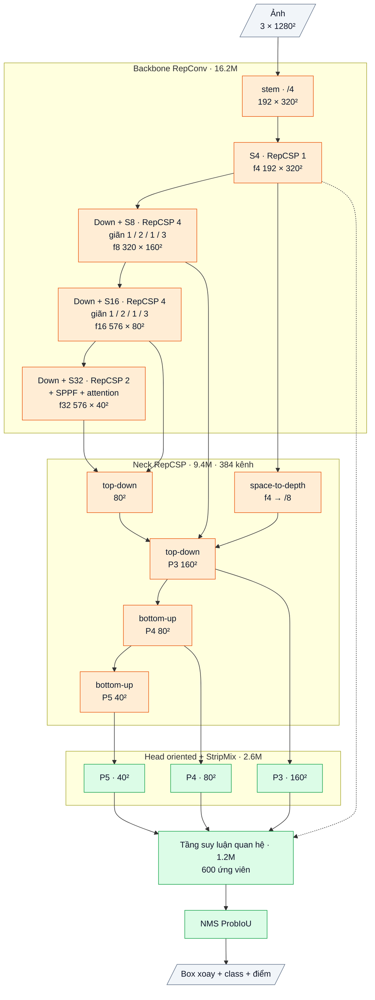

# OpenOBB9: lập luận thiết kế (đã có code, chưa train, 2026-10-12)

`model=openobb9s | m | l | x`. Code: [openobb/models/openobb9.py](../openobb/models/openobb9.py). Kiến trúc đã viết và số đo: mục 9.

Theo luật của user: một version mới phải có lập luận **trước** khi code. Tài liệu này nêu từng lựa chọn thiết kế xuất phát từ bài học nào
(số F trong [research/LEDGER.md](../research/LEDGER.md)), dựa trên lý thuyết nào, kỳ vọng gì, và **phép thử nào bác bỏ được nó**.
Phép thử được xếp sao cho phép rẻ nhất chạy trước. Nếu một phép thử bị bác bỏ thì dừng, không tốn CU cho bước sau.

## 0. Tóm tắt

v9 là một kiến trúc **mới hoàn toàn và thuộc sở hữu của user** (không dùng HGNetv2 / encoder D-FINE trong model). Nó nhắm cùng lúc ba điều:

| Mục tiêu | Cách đạt | Cơ sở |
|---|---|---|
| **A. Chính xác ít nhất bằng v8** | Pretrain bằng **chưng cất từ hai thầy**: lõi D-FINE COCO (chính là lõi của v3 / v8) và DINOv2. Head giữ nguyên của v8 | Mệnh đề 1 (mục 3) + bằng chứng hai thầy bổ sung nhau (F33) |
| **B. Nhanh hơn rõ trên GPU** (nhắm ≤ 0.6× độ trễ của v8 cùng imgsz) | Lõi chỉ gồm **conv 3×3 dày tái tham số hoá** + max-pool; không depthwise, không ViT khi suy luận | Mô hình roofline (mục 4) + bài học v6 (F39) |
| **C. Không lặp lại các lỗi đã đo** | BN được train và gộp khi suy luận; không có cổng nhân không chặn; **mỗi tầng P3–P5 đều có loss chưng cất** nên không tầng nào chết được | F37 (P5 chết ở cả 3 checkpoint v3) |

Khác v6 ở ba chỗ quyết định: (1) có pretrain, và pretrain **truyền đúng biểu diễn của v3** chứ không chỉ học sơ bộ; (2) dùng conv dày, không dùng depthwise; (3) chỉ đổi lõi, giữ head của v8, nên so v9 với v8 là so đúng một yếu tố.

## 1. Bài học đã đo (đầu vào của lập luận)

| # | Bài học | Bằng chứng |
|---|---|---|
| L1 | Data nhỏ (250 ảnh) thì **kiến thức nền quyết định**. Train từ đầu thì chững | v2 kẹt ở 0.36 (thước DOTA; F25–F27); v6 khoảng 0.55 / 0.32 (F40); v3 (COCO) 0.720 / 0.474 (F31) |
| L2 | **FLOPs không phải độ trễ.** Nhiều depthwise thì GPU chậm | v6: 504 GFLOPs nhưng 25.7 ms (chưa gộp BN), v3: 909 GFLOPs, 23.1 ms (F39) |
| L3 | BN đóng băng + lr cao + cổng nhân không chặn → **tầng chết** | P5 của v3 có độ lớn 3566 → 10¹⁰; đặt P5 = 0 không đổi detection (F37) |
| L4 | **Định vị không phải nút thắt; phân loại vật tí hon dựa vào hàng xóm mới là nút thắt** | Dịch ảnh lệch < 1 px; 75–93% bằng chứng class nằm ngoài box; wall_300 → junction 32% (F35, F37) |
| L5 | **Đặc trưng DINOv2 bổ sung cho HGNet** ở đúng chỗ v3 yếu, nhưng ViT chạy khi suy luận thì chậm | v4 (DINOv2): wall_300 .683 so với .599, mAP50-95 của wall .602 so với .575; nhưng 38.1 ms (F33) |
| L6 | Chấm lại quan hệ bằng đặc trưng một điểm + vị trí tuyệt đối thì không giúp | v5 (F35); v8 đã đổi sang khung xoay + hình học tương đối |
| L7 | Head cần đủ nặng; tính toán nên ở độ phân giải cao | YOLO26x: head 20% FLOPs, stride 4 13%; v3: head 5%, 2048 kênh ở 1/32 chết (F37) |
| L8 | Pretrain rẻ phải đo được chất lượng trước khi train detection, và chi phí phải ước tính từ số đo thật | v6 chạy 17 ảnh/s ở 1280 trên G4; ước tính pretrain ban đầu của mình lệch 3–4 lần (F39) |

## 2. Thiết kế đề xuất (cỡ x, sẽ chỉnh độ rộng sau khi đo)

Sơ đồ khối và bảng từng lớp: mục 10 (phụ lục, cuối file).


Pretrain (không cần nhãn), trước khi train detection:
- **Thầy 1:** lõi D-FINE-X COCO (HGNetv2-B5 + encoder lai, Apache-2.0), chạy ở cùng độ phân giải với học trò. Đầu ra P3 / P4 / P5 của thầy làm đích cho P3 / P4 / P5 của neck học trò.
- **Thầy 2:** DINOv2-S hoặc DINOv2-B (Apache-2.0). Đặc trưng patch của thầy làm đích cho P4 / P5 của học trò.
- **Loss:** 1 − cosine theo từng vị trí, qua một phép chiếu 1×1 cho mỗi cặp. Các phép chiếu bị bỏ sau pretrain.
- **Ảnh:** trộn ảnh tổng quát (một phần COCO), ảnh OBB (DOTA), ảnh bản vẽ (kho của user + ảnh train của Wall_Color, không cần nhãn).
  Ảnh cùng miền với ảnh sẽ dùng thật là bắt buộc (xem giả định G2).

## 3. Lập luận A: vì sao độ chính xác không kém v8

**Mệnh đề 1 (thừa kế biểu diễn qua chưng cất).**
- *Ký hiệu:*
  - T(x) là đặc trưng của thầy (lõi v3);
  - S(x) là đặc trưng của học trò, P là phép chiếu đã học;
  - pretrain đạt sai số ‖P(S(x)) − T(x)‖ ≤ ε trên phân phối ảnh D.
- *Khẳng định:* với mọi head h có hằng số Lipschitz L (head dense của v8), head h∘P đặt trên học trò cho đầu ra lệch so với h trên thầy không quá L·ε.
- *Hệ quả:* loss tốt nhất mà học trò + head có thể đạt ≤ loss tốt nhất của thầy + L·ε. Vì khi fine-tune, head được phép học bất kỳ hàm nào, trong đó có h∘P.

Mệnh đề này là bất đẳng thức tam giác; điều đáng giá nằm ở các **giả định**:

| Giả định | Nếu sai thì sao | Kiểm bằng gì |
|---|---|---|
| G1: kiến trúc học trò đủ sức xấp xỉ T (ε nhỏ) | ε lớn, cận vô nghĩa | Đo ε (cosine) trên ảnh giữ lại sau pretrain (phép thử T2) |
| G2: D giống phân phối ảnh khi dùng thật | ε trên ảnh thật lớn hơn ε khi pretrain | Đo cosine **riêng trên ảnh bản vẽ** chưa thấy khi pretrain |
| G3: fine-tune không phá phần đã thừa kế | Mất tiên nghiệm như v6 | Lr thấp cho lõi lúc đầu (như v3: backbone ×0.1); so đường cong với v8 |

**Vì sao có thể hơn v8, không chỉ bằng (lập luận bổ sung, yếu hơn Mệnh đề 1).**
- Hai thầy sai ở chỗ khác nhau (L5): DINOv2 giúp wall_300 và độ khít tường; HGNet / D-FINE giúp class hiếm và cửa (F33).
- Một học trò khớp cả hai (hai phép chiếu từ cùng một S) phải mang thông tin của cả hai. Head v8 khi fine-tune có thể dùng phần thông tin mà riêng v3 không có.
- Kết quả đã biết trong tài liệu chưng cất nhiều thầy là học trò có thể vượt từng thầy riêng lẻ khi các thầy bổ sung nhau. **Không đảm bảo**: đây là kỳ vọng có cơ sở, phép thử T3 quyết định.
- Lợi ích DINOv2 mà v4 phải trả 38 ms mới có, v9 lấy được **mà không chạy ViT khi suy luận**. Đây là điểm đột phá chính của v9: ngữ nghĩa cỡ foundation model ở tốc độ của mạng conv.

## 4. Lập luận B: vì sao nhanh hơn trên GPU

**Mô hình roofline.**
- Thời gian một lớp ≈ max(số phép tính / tốc độ tính, số byte đọc ghi / băng thông bộ nhớ).
- G4: khoảng 195 TFLOPS bf16 (đã đo, COLAB.md). Băng thông bộ nhớ khoảng 1.6–1.8 TB/s (thông số công bố, chưa tự đo).
- Ngưỡng cân bằng khoảng **110 FLOP / byte**. Lớp có cường độ tính (FLOP / byte) thấp hơn ngưỡng thì bị nghẽn bởi bộ nhớ.

| Loại lớp (bf16, 2 byte / phần tử) | FLOP mỗi điểm đầu ra | Byte mỗi điểm (đọc + ghi) | Cường độ | Dùng được bao nhiêu % GPU |
|---|---|---|---|---|
| Depthwise 3×3 | 18 | khoảng 4 | **khoảng 4.5** | ≤ 4% (nghẽn bộ nhớ) |
| Dải depthwise 1×11 | 22 | khoảng 4 | khoảng 5.5 | ≤ 5% |
| BN / activation / cộng riêng lẻ | 1–2 | khoảng 4 | < 1 | gần 0 (thuần chi phí bộ nhớ) |
| Conv 1×1, 256 kênh | 512 | khoảng 4 | khoảng 128 | quanh ngưỡng |
| **Conv 3×3 dày, 256 kênh** | 4608 | khoảng 4 | **khoảng 1150** | nghẽn tính toán, dùng tốt tensor core |

- Điều này giải thích L2: v6 có 504 GFLOPs nhưng phần lớn thời gian nằm ở các lớp depthwise / BN / cộng nghẽn bộ nhớ. Vì vậy nó chậm hơn v3 có 909 GFLOPs.
- **Tái tham số hoá** (RepVGG): tích chập là tuyến tính, nên 3×3 + 1×1 + đồng nhất (mỗi nhánh có BN) gộp được **chính xác** thành một conv 3×3 khi suy luận.
  Lúc train có nhiều nhánh (dễ tối ưu); lúc suy luận chỉ còn một lớp cường độ cao, không còn BN / cộng riêng lẻ.
- **Hệ quả kiểm được ngay:** độ trễ của v9 tỉ lệ gần với FLOPs của nó (cao hơn nhiều so với v6). Với ngân sách khoảng 500–600 GFLOPs (so với khoảng 970 của v8-x), độ trễ kỳ vọng khoảng 0.5–0.6× v8.
- **Phép thử T1 không cần train:** đo độ trễ bản đã gộp trên GPU với weights ngẫu nhiên. Tốn vài phút. Nếu không đạt ≤ 0.6× v8 thì sửa thiết kế trước khi tốn CU cho pretrain.
- **Vùng nhìn đủ rộng mà không cần depthwise:** cần khoảng 40–170 px ngữ cảnh (L4).
  - Các conv giãn (giãn 2, 3) trong RepCSP ở stride 8 và 16, cộng SPPF ở stride 32, cho vùng nhìn lý thuyết > 300 px ở P3. Chi phí như conv 3×3 thường.
  - Thêm một lớp attention nhỏ ở stride 32 (1600 token ở 1280 px), giữ "khoẻ" nhờ loss chưng cất ở P5 (mục 5).

## 5. Lập luận C: vì sao không lặp lại các lỗi đã đo

| Lỗi đã đo | Vì sao không xảy ra ở v9 |
|---|---|
| P5 chết, nổ số (F37) | (1) BN được train, không đóng băng. (2) Không có phép nhân `x·(1+m)` không chặn. (3) **P5 có loss chưng cất riêng** (đích là P5 của thầy). Một tầng chỉ "chết" khi không tín hiệu nào cần nó. Loss chưng cất ở P5 buộc P5 phải mang thông tin của P5 thầy. |
| Cổng LSK không chọn theo nội dung, tốn 60 GFLOPs cho conv 1×1 (F37) | Không dùng cổng chọn kernel. Ngữ cảnh bằng conv giãn + pooling, đều là phép đã biết là hiệu quả |
| Train từ đầu chững ở 0.55 (F40) | Không train từ đầu: pretrain truyền biểu diễn của lõi v3 (Mệnh đề 1) |
| Head nhẹ nên phân loại yếu (F37) | Giữ head của v8: có ngữ cảnh trong tháp class + tầng suy luận quan hệ (đã có lập luận ở OPENOBB8 mục 2) |
| Không tách được kiến trúc và khởi tạo (F40) | v9 chỉ khác v8 ở lõi (+ cách pretrain). Head, loss, công thức train giữ nguyên, nên so v9 với v8 là so đúng một yếu tố |

## 6. Kế hoạch kiểm chứng (dừng ngay khi bị bác bỏ)

| Bước | Phép thử | Đạt nếu | Chi phí ước tính | Nếu không đạt |
|---|---|---|---|---|
| T0 | Test CPU: gộp tái tham số hoá cho ra kết quả y hệt; mọi tầng có gradient; loss hữu hạn | Pass | 0 | Sửa code |
| **T1** | Độ trễ bản đã gộp, G4, 1280 px, batch 1, so với v8-x cùng điều kiện (weights ngẫu nhiên là đủ) | **≤ 0.6× v8** | khoảng 0.2 CU | Chỉnh độ rộng / số khối, đo lại; không pretrain khi chưa đạt |
| T2 | Pretrain 1 epoch để đo tốc độ, rồi pretrain đầy đủ; đo cosine học trò – thầy trên **ảnh bản vẽ giữ lại** | Cosine ≥ 0.8 ở P3 / P4 (ngưỡng đặt trước, chưa có số tham chiếu) | khoảng 15–25 CU (sẽ chốt từ tốc độ đo ở epoch 1) | Pretrain thêm / tăng độ rộng; nếu vẫn thấp thì G1 sai, dừng v9 |
| T3 | Train detection Wall_Color, cùng công thức với v8 | mAP50-95 ≥ v8 − 0.01, và wall_300 không thấp hơn v8 | khoảng 5–10 CU | Mệnh đề 1 không đủ trong thực tế; phân tích theo class trước khi làm gì thêm |
| T4 | Tổng quát: DOTA / FloorPlanCAD so YOLO26x | Ngang hoặc hơn YOLO26x, nhanh hơn | theo dataset | |

Chi phí ước tính dựa trên số đo F39 (17 ảnh/s cho v6-x ở 1280 trên G4) và roofline. Conv dày được kỳ vọng dùng GPU tốt hơn v6, nhưng con số thật chỉ có ở T1 / T2.

## 7. Vì sao không chọn hướng khác

| Hướng | Lý do loại |
|---|---|
| Dùng thẳng DINOv2 khi suy luận (như v4 / v5) | Chậm (38 ms, F33); patch 14 thô cho vật nhỏ |
| Pretrain kiểu YOLO (COCO 300 epoch có nhãn) | Quá đắt với ngân sách Colab (hàng trăm CU) |
| Pretrain tự giám sát thuần (masked image modeling) | Chậm hội tụ hơn chưng cất từ thầy đã mạnh; không truyền được kiến thức detection như thầy D-FINE |
| Giữ HGNetv2 và chỉ đổi phần khác | Đó là v8; không phải kiến trúc mới (user yêu cầu v9 phải mới) |
| Mạng nhiều depthwise / dải dài (như v6) | Nghẽn bộ nhớ trên GPU (mục 4, F39) |

## 8. Giới hạn của lập luận (nói trước)

- Mệnh đề 1 chỉ cho **cận trên của khoảng cách** với thầy, theo ε. Nó không hứa v9 tốt hơn. Phần "có thể hơn" dựa trên việc hai thầy bổ sung nhau (F33), là kỳ vọng chứ không phải chứng minh.
- Hằng số L của head không đo được dễ dàng. Vì vậy cận chỉ có ý nghĩa định tính: ε càng nhỏ thì càng gần thầy. Phép thử T2 đo ε, phép thử T3 đo kết quả cuối.
- Độ trễ kỳ vọng dựa trên roofline với băng thông lấy từ thông số công bố. T1 sẽ đo thật trước khi tốn CU.
- Thầy D-FINE là lõi của v3. Nếu chưng cất quá tốt và DINOv2 không thêm gì, v9 sẽ chỉ là **v8 nhanh hơn**. Đó vẫn là một kết quả có giá trị (sở hữu trọn, nhanh hơn), nhưng không phải đột phá về độ chính xác.

## 9. Kiến trúc đã viết (2026-10-12, chưa train)

Mục 0–8 ở trên là lập luận, giữ nguyên. Mục này ghi những gì đã viết thành code và số đo được (CPU, weights ngẫu nhiên).

Sơ đồ khối và bảng từng lớp: mục 10 (phụ lục, cuối file).


### 9.1 Từng phần (cỡ x, ảnh 1280, 7 class)

GFLOPs = 2×MAC, đếm bằng `torch.utils.flop_counter` (cùng cách đếm với con số 969 của v8-x), trên model chưa gộp.
Bộ đếm trên CPU không thấy phép nhân ma trận bên trong `scaled_dot_product_attention`. Phần này được tính tay và ghi riêng.

| Phần | Làm gì | Bài học / lập luận nó thực hiện | Tham số | GFLOPs |
|---|---|---|---|---|
| Stem | conv 3×3 s2 → [conv 3×3 s2 ‖ max-pool 2] → 1×1, về stride 4 | N5: max-pool giữ đỉnh của nét mảnh. L7 / N1: tính toán ở độ phân giải cao | 0.22M | 47.4 |
| S4 | RepCSP 192 kênh, 1 RepConv | Chi tiết stride 4 cho nét 4–6 px. f4 đi vào P3 (space-to-depth) và vào bộ tinh chỉnh | 0.19M | 37.7 |
| Down + S8 | [conv 3×3 s2 dày ‖ max-pool] → 1×1; RepCSP 320, 4 RepConv giãn 1, 2, 1, 3 | L4: ngữ cảnh 40–170 px phải có ở 1/8. L2: chỉ conv dày, không depthwise. Phần nặng nhất của lõi | 1.83M | 93.3 |
| Down + S16 | như trên, 576 kênh | L4: ngữ cảnh ở 1/16 | 5.84M | 74.6 |
| Down + S32 | RepCSP 576, 2 RepConv | N1: tầng 1/32 mỏng (v3 có 2048 kênh ở đây và tầng đó chết, F37) | 4.65M | 14.9 |
| SPPF | 1×1 xuống 288, max-pool 5 ba lần (vùng 5 / 9 / 13), nối, 1×1 | Vùng nhìn rộng gần như miễn phí; max-pool giữ đỉnh | 0.83M | 2.7 |
| Attention 1/32 | 1 lớp pre-norm, 8 head, 1600 token; vị trí bằng depthwise 3×3 nhỏ; hệ số residual g1 / g2 khởi tạo 0 (khối `GlobalAttention` của v6) | Ngữ cảnh toàn ảnh. L3 / N4: residual bắt đầu bằng 0, không cổng nhân. P5 có loss chưng cất riêng | 2.67M | 8.5 + 5.9 (SDPA) |
| Neck, nhánh xuống | lat5, td4 (1/16), spd + td3 (1/8 → P3) | Chi tiết stride 4 vào P3 không mất mát (junction 9.5 px). P3 nặng nhất (86–100% detection ở P3, F37) | 4.04M | 125.0 |
| Neck, nhánh lên | dn3 + bu4 (P4), dn4 + bu5 (P5) | PAN 2 chiều; mọi đầu ra 384 kênh (head v8 cần độ rộng bằng nhau) | 5.32M | 42.5 |
| Head | ContextOrientedHead của v7 / v8, không đổi | Giữ nguyên để so v9 với v8 là so đúng một yếu tố (mục 5) | 2.63M | 58.7 |
| Bộ tinh chỉnh | OrientedRelationalRefiner của v8, K = 600, không đổi | Như OPENOBB8 mục 2 | 1.23M | 37.8 + 2.0 (SDPA) |
| **Tổng** | | | **29.45M** (sau fuse 28.36M) | **543** (+ 7.9 SDPA ≈ **551**) |

- So với v8-x: **543 so với 969 GFLOPs = 0.56×** (cùng cách đếm). Sau fuse, v9-x còn khoảng 534 G (các nhánh 1×1 đã gộp vào 3×3).
- Phân bổ theo stride (conv, x): stride ≤ 4: 85 G (16%); 1/8: 239 G (44%, gồm head 45 G); 1/16: 143 G (26%); 1/32: 30 G + attention 14 G (8%); bộ tinh chỉnh 40 G (7%).
  So với YOLO26x (13% / 26% / 32% / 10%, head 20%) và v3 (7% ở stride ≤ 4, 1/32 rộng 2048 kênh): v9 dồn tính toán vào stride 4–8, đúng N1.

Các cỡ (độ rộng × độ sâu; kênh làm tròn bội 32, riêng x bội 64):

| Cỡ | Hệ số rộng / sâu | Kênh stride 4 / 8 / 16 / 32 | hid | RepConv mỗi stage; mỗi khối neck | Tham số | GFLOPs (1280) |
|---|---|---|---|---|---|---|
| s | 0.5 / 0.5 | 64 / 128 / 192 / 192 | 128 | 1, 2, 2, 1; 2 | 4.42M | 99 (+4 SDPA) |
| m | 0.75 / 0.75 | 96 / 160 / 288 / 288 | 192 | 1, 3, 3, 2; 2 | 8.11M | 161 (+5) |
| l | 1.0 / 1.0 | 128 / 224 / 384 / 384 | 256 | 1, 4, 4, 2; 3 | 14.38M | 278 (+6) |
| x | 1.5 / 1.0 | 192 / 320 / 576 / 576 | 384 | 1, 4, 4, 2; 3 | 29.45M | 543 (+8) |

- Bộ tinh chỉnh của v8 có độ rộng cố định (d = 192, K = 600). Ở cỡ s nó chiếm khoảng 1/3 FLOPs (34 G trên 99 G).
- hid của x = 384, bằng hidden_dim của thầy D-FINE-X. Phép chiếu chưng cất ở P3–P5 vì vậy là 384 → 384.
- Cách chọn độ rộng cho x: đo vài cấu hình, giữ cấu hình nằm giữa khoảng 500–600 G và dồn tính toán vào stride 4–8.
  Stride 4 rộng 128 thay vì 192 cho 483 G, nhưng chỉ 8% tính toán ở stride ≤ 4 (như v3), trái với N1 / L7.

Công tắc (`v9_off=`, tên sai báo lỗi; `v8_off=` vẫn dùng cho head / bộ tinh chỉnh, ví dụ `v8_off=refine`):

| `v9_off=` | Tắt gì | Câu hỏi được trả lời |
|---|---|---|
| `rep` | Nhánh 1×1 và đồng nhất của RepConv (còn conv 3×3 + BN thường) | Tái tham số hoá có giúp khi train không? (suy luận như nhau) |
| `dilate` | Mọi độ giãn về 1 | Vùng nhìn rộng ở 1/8–1/16 có cần không? (L4) |
| `attn` | Lớp attention ở 1/32 | Ngữ cảnh toàn ảnh có cần không? |
| `spd` | Đường space-to-depth từ f4 vào P3 | Chi tiết stride 4 có giúp vật tí hon / nét mảnh không? |
| `maxpool` | Nhánh max-pool ở stem và mọi Down | Max-pool có giữ được nét mảnh không? (N5) |

### 9.2 Bằng chứng cho lập luận tốc độ (mục 4), đo trên CPU

| Đo (x, 1280, đã fuse) | v9-x | v8-x |
|---|---|---|
| BatchNorm còn lại | 0 | 0 |
| FLOPs trong conv dày (groups = 1, ≥ 64 kênh vào và ra) | 472.9 G = **95.6% của lõi + head** (88.5% cả model; phần còn lại chủ yếu là GEMM của transformer trong bộ tinh chỉnh, cũng là phép dày) | |
| Conv khác (depthwise trong head v8, conv vị trí của attention) | 3.0 G (0.6%) | |
| Số conv trên bản đồ ≥ lưới stride 8 (lõi + head) | 33 | 66 |
| Op không phải conv trên bản đồ ≥ lưới stride 8 | 27 SiLU (ngay sau conv, khi export gộp được vào conv), 6 nối kênh, 2 phép cộng (residual trong StripMix của head v8), 2 max-pool, 1 upsample, 1 pixel_unshuffle | 29 ReLU + 21 SiLU, 8 nối kênh, 8 cộng, 4 chia, 3 nhân, 2 pad, 2 abs, 2 pow, mean, amax, sigmoid, tanh (ScaleGuard, LSK), upsample, pixel_unshuffle (max-pool không đếm) |
| Độ trễ CPU, 2 luồng, lấy min của 3 lần, lõi + head (trước NMS) | **7.36 s** | 13.96 s (v9 = **0.53×**) |
| Độ trễ CPU, cả model gồm bộ tinh chỉnh + NMS | **8.84 s** | 15.58 s (v9 = **0.57×**) |

- Số CPU chỉ để tham khảo. CPU gần như không phân biệt lớp nghẽn bộ nhớ với lớp nghẽn tính toán, nên tỉ lệ ở đây gần bằng tỉ lệ FLOPs (0.56).
  Lợi thế mà lập luận roofline dự đoán (không còn BN / cộng riêng lẻ, không depthwise trong lõi) chỉ lộ ra trên GPU. Đó là việc của T1.
- Head v8 vẫn còn depthwise (tháp class và StripMix: 5 depthwise mỗi tầng, chạy cả ở P3). Chúng chỉ chiếm 0.6% FLOPs nhưng là lớp nghẽn bộ nhớ.
  v9 giữ nguyên head để so đúng một yếu tố. Nếu T1 cho thấy chúng đáng kể thì đó là một thay đổi riêng, đo riêng.

### 9.3 Cách chạy T1 (độ trễ GPU, không cần train)

Cách 1, nhanh nhất (weights ngẫu nhiên, Colab G4, khoảng 0.2 CU). Chạy trong môi trường đã cài `openobb`:

```python
import time, torch
from openobb.models.openobb8 import OpenOBB8
from openobb.models.openobb9 import OpenOBB9
torch.backends.cudnn.benchmark = True
x = torch.rand(1, 3, 1280, 1280, device="cuda").contiguous(memory_format=torch.channels_last)
for name, m in (("v9", OpenOBB9("x", 7, 1280)), ("v8", OpenOBB8("x", 7, 1280))):
    m = m.cuda().eval().fuse().to(memory_format=torch.channels_last)
    for conf in (0.001, 0.5):             # 0.5: weights ngẫu nhiên cho điểm ~0.01, NMS gần như rỗng -> đo riêng mạng
        m.nms_conf = conf
        with torch.no_grad(), torch.autocast("cuda", torch.bfloat16):
            for _ in range(20):
                m(x)
            torch.cuda.synchronize()
            t = time.perf_counter()
            for _ in range(100):
                m(x)
            torch.cuda.synchronize()
        print(name, "nms_conf", conf, f"{(time.perf_counter() - t) * 10:.2f} ms")
```

Cách 2, khi đã có checkpoint của cả hai: chạy `openobb predict` cùng một ảnh, cùng `imgsz=1280`, cho `best.pt` của openobb9x và openobb8x. So dòng `Speed:` trong log.

- **Đạt nếu** độ trễ v9 ≤ 0.6× v8 (mục 6). Không đạt thì chỉnh độ rộng / số khối (hằng số `WIDTHS9`, `HID9`, `DEPTHS9`, `NECK_DEPTH9`, `SCALES9` đầu file) rồi đo lại, chưa pretrain.

### 9.4 Tỉ lệ tận dụng cái có sẵn

| Loại | Phần | Tỉ lệ |
|---|---|---|
| **Weights pretrained trong model** | Không có. Lõi mới khởi tạo ngẫu nhiên, học bằng chưng cất. Hai thầy (D-FINE COCO, DINOv2) chỉ chạy lúc pretrain, không nằm trong model | **0%** |
| Code của OpenOBB dùng lại (import, không chép) | Head `ContextOrientedHead` (v7); bộ tinh chỉnh, `apply_refinement`, `_with_jitter` và đường forward của v8 (gọi thẳng `OpenOBB8.forward` / `OpenOBB7.forward` trên lõi v9); `ConvBN`, `Stem`, `GlobalAttention` (v6); `space_to_depth`, `fold_bn`, `fuse_model` (v7); `decode`, `fast_nms`, `anchors` (v3); loss `OpenOBB8Loss` | head + bộ tinh chỉnh: 3.86M = 13% tham số, 96.5 G = 18% FLOPs. Khối v6 trong lõi (stem, attention): 2.9M |
| Code mới viết cho v9 | `RepConv` (kể cả gộp chính xác khi có giãn), `RepCSP`, `Down` dày, `SPPF`, `Backbone9`, `Neck9`, `OpenOBB9`, `parse_off9` | phần còn lại của lõi (khoảng 22.7M tham số) |
| Ý tưởng lấy từ công bố | RepVGG (tái tham số hoá), CSPNet / ELAN (YOLOv7, C3k2 của YOLO11), SPPF (YOLOv5), SPD-Conv (space-to-depth), PANet (PAN 2 chiều), conv giãn (DeepLab), max-pool song song conv stride (stem HGNet, YOLO), 1 lớp attention ở 1/32 (AIFI của RT-DETR, C2PSA của YOLO) | ý tưởng, tự viết lại |
| Code chép từ nơi khác | Không có. Chỉ dùng khối chuẩn của PyTorch (BSD) | 0% |

### 9.5 Test (CPU, `tests/test_openobb9.py`, 21 test)

- Giao diện: `features` cho stride 4 / 8 / 16 / 32, `c4`, `hid`; khoá state-dict chỉ có `backbone.`, `neck.`, `head.`, `refiner.`; không có depthwise trong lõi (trừ conv vị trí của attention) và neck.
- Train: forward + `OpenOBB8Loss` + backward hữu hạn, cả khi có ảnh không nhãn và cả batch không nhãn. Mọi tham số của lõi có gradient ngay bước đầu (trừ phần bên trong attention, nằm sau g1 / g2 = 0).
- Gộp chính xác: `RepConv` với giãn 1 / 2 / 3, có và không có nhánh đồng nhất. Cả model với thống kê BN khác mặc định: f4, P3–P5, đầu ra thô của head, đầu ra bộ tinh chỉnh khớp trước / sau `fuse()`. Sau `fuse()` không còn BatchNorm.
- Bộ tinh chỉnh lúc khởi tạo là phép đồng nhất: đầu ra bằng đúng (`torch.equal`) bản `v8_off=refine` cùng weights.
- Lưu / nạp state-dict cho ra đúng đầu ra cũ. Mọi công tắc chạy được (train, suy luận, fuse) và tắt đúng phần nó nói. Ảnh kích thước lẻ chạy được.

### 9.6 Rủi ro đã biết

- **Chưa train.** Mọi kỳ vọng về độ chính xác (mục 3) chờ T2 / T3.
- Forward của v9 gọi thẳng forward của v8 (và của v7 khi tắt bộ tinh chỉnh) trên lõi v9. Sửa forward của v8 thì v9 đổi theo (đúng ý: head như nhau).
  Nhưng nếu forward của v8 cần thuộc tính mới thì v9 cũng phải có thuộc tính đó (test của v9 sẽ báo).
- Train tốn bộ nhớ hơn suy luận: RepConv có 3 nhánh và 3 BN. Tốc độ train thật chỉ đo được ở T2 (epoch đầu).
- Bộ đếm FLOPs trên CPU bỏ sót SDPA ở cả v8 lẫn v9 (v9 khoảng 8 G, v8 khoảng 6 G). Tỉ lệ 0.56 gần như không đổi.

## 10. Phụ lục: kiến trúc theo lớp (cỡ x)

Kích thước ghi cho ảnh vào 1 × 3 × 1280 × 1280, Wall_Color (7 class). Ký hiệu: `conv k×k sS a→b` = Conv + BN + SiLU,
`dw` = depthwise, `/N` = stride N so với ảnh. Lõi (backbone + neck) tự viết, pretrain bằng chưng cất; head và tầng quan hệ lấy của v8.

### Luồng dữ liệu

Xanh lá: tự viết (đã có ở bản trước). Cam: mới ở v9.



### Backbone RepConv (tự viết), 16.23M

| Khối | Lớp | Ra | Tham số |
|---|---|---|---|
| stem | conv 3×3 s2 3→96; [conv 3×3 s2 96→192 ∥ max-pool 2]; nối 288 → conv 1×1 → 192 | 192 × 320² (/4) | 0.23M |
| S4 | RepCSP(192, n = 1) | **f4** 192 × 320² | 0.19M |
| d8 + S8 | Down 192→320; RepCSP(320, n = 4, giãn 1 / 2 / 1 / 3) | **f8** 320 × 160² (/8) | 1.83M |
| d16 + S16 | Down 320→576; RepCSP(576, n = 4, giãn 1 / 2 / 1 / 3) | **f16** 576 × 80² (/16) | 5.84M |
| d32 + S32 | Down 576→576; RepCSP(576, n = 2) | 576 × 40² (/32) | 4.65M |
| SPPF | conv 1×1 576→288; ba max-pool 5×5 nối tiếp; nối 1152 → conv 1×1 → 576 | 576 × 40² | 0.83M |
| attn | 1 lớp transformer trên 1600 token: vị trí dw 3×3; attention 8 đầu; FFN 576→1152→576 (GELU); cổng dư khởi tạo 0 | **f32** 576 × 40² | 2.67M |

- **RepConv(c, d):** SiLU(BN(conv 3×3 giãn d) + BN(conv 1×1) + BN(x)); khi suy luận gộp đúng thành một conv 3×3.
- **RepCSP(c, n):** conv 1×1 → tách hai nửa; nửa sau qua n RepConv nối tiếp; nối 2 nửa + n đầu ra → conv 1×1.
- **Down(a→b):** [conv 3×3 s2 a→b/2 ∥ max-pool 2] → conv 1×1 → b.

### Neck RepCSP (tự viết), 9.36M, 384 kênh

| Khối | Lớp | Ra | Tham số |
|---|---|---|---|
| lat5 | conv 1×1 f32 576→384 → t5 | 384 × 40² | 0.22M |
| td4 | nối [f16, upsample t5] 960 → RepCSP(n = 3) → n4 | 384 × 80² | 1.85M |
| spd | f4 space-to-depth (192 × 320² → 768 × 160²) → conv 1×1 → 192 | 192 × 160² | 0.15M |
| td3 | nối [f8, upsample n4, spd] 896 → RepCSP(n = 3) | **P3** 384 × 160² | 1.82M |
| dn3 + bu4 | Down 384→384; nối n4 → RepCSP(n = 3) | **P4** 384 × 80² | 2.66M |
| dn4 + bu5 | Down 384→384; nối t5 → RepCSP(n = 3) | **P5** 384 × 40² | 2.66M |

### Head oriented có ngữ cảnh (tự viết, của v7), 2.63M

| Nhánh | Lớp (một tầng) | Ra mỗi điểm | Tham số (3 tầng) |
|---|---|---|---|
| class | dw 3×3 384 → 1×1 384→192 → StripMix(192, k = 11) → dw 3×3 192 → 1×1 192→192 → 1×1 →7 (bias tiên nghiệm 0.01) | 7 logit | 0.82M |
| box | conv 3×3 384→128 → conv 3×3 128→128 → 1×1 128→98 (chạy fp32) | 98 kênh | 1.81M |

98 kênh box (một nhóm): góc θ, lệch ngang tâm (× stride), phân phối 32 bin khoảng cách tới đầu sau và 32 bin tới đầu trước dọc trục
(bin = 1 stride), 32 bin độ dày (bin = 1/2 stride). Mỗi tầng một tháp riêng; điểm lưới = tâm ô.

### Tầng suy luận quan hệ (tự viết), 1.23M

K = 600 ứng viên mỗi ảnh, d = 192.

| Khối | Lớp | Ra | Tham số |
|---|---|---|---|
| chọn ứng viên | 600 điểm tốt nhất, bỏ trùng (ProbIoU > 0.7) khi chọn; khi train thêm bản rung của box nhãn | 600 box | 0 |
| mẫu bên trong | lưới 8 dọc × 3 ngang trong khung xoay (hai hàng ngang ngay ngoài hai cạnh dài), đọc song tuyến f4 (192 kênh) và P3 (384) → Linear 192→192 + Linear 384→192 | 600 × 24 × 192 | 0.11M |
| vòng ngữ cảnh | 18 điểm quanh box, cách khoảng một chiều dài (clamp(L, 32, 192) px), đọc P3 + P4 → hai Linear 384→192 | 600 × 18 × 192 | 0.15M |
| vị trí + hình học | MLP vị trí mẫu (2→192→192); token hình học MLP (log L, log T, sin / cos 2θ, xác suất nền → 192 → 192) | | 0.08M |
| transformer cục bộ | 2 lớp, pre-norm, 6 đầu, FFN 192→384→192, trên 43 token mỗi ứng viên → 1 token | 600 × 192 | 0.59M |
| lớp quan hệ | 1 lớp attention giữa 600 ứng viên + bias hình học tương đối mỗi đầu: MLP (7 số của j trong khung i → 32 → 6), fp32 | 600 × 192 | 0.30M |
| đầu ra | LayerNorm → Linear 192→7 (logit dư) và 192→5 (dịch hai đầu, log độ dày, lệch ngang, góc ±0.2 rad), khởi tạo 0 | 600 × (7 + 5) | 0.003M |

Khi suy luận, delta logit của mỗi ứng viên được lan sang các điểm trùng nó (ProbIoU > 0.7) trong 4000 điểm tốt nhất, rồi mới NMS.

### Tổng hợp

| Phần | Tham số | Tỉ lệ | Nguồn |
|---|---|---|---|
| Backbone | 16.23M | 55.1% | tự viết |
| Neck | 9.36M | 31.8% | tự viết |
| Head | 2.63M | 8.9% | tự viết |
| Tầng suy luận quan hệ | 1.23M | 4.2% | tự viết |
| **Tổng** | **29.45M** | | 100% tự viết (trọng số lõi từ chưng cất) |

Suy luận: RepConv và BN gộp vào conv (`fuse()`); 33 600 điểm → 600 ứng viên được tinh chỉnh → Fast-NMS ProbIoU → tối đa 1000 box.
